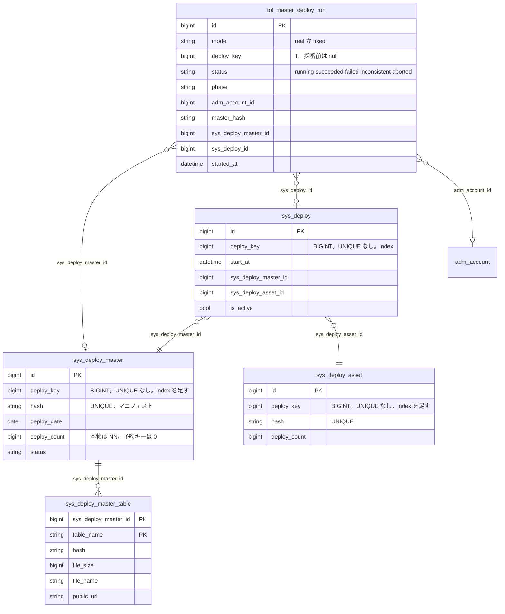
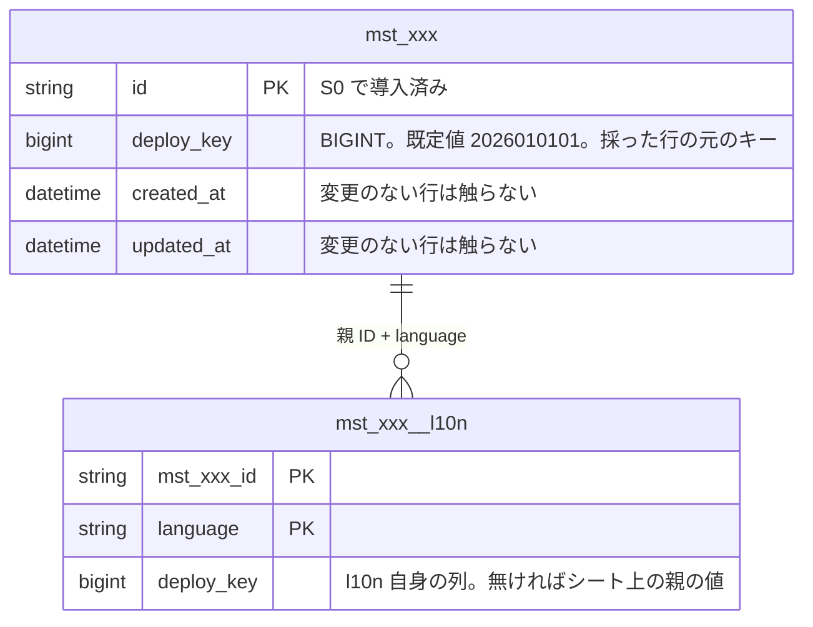

# マスター配信の deploy_key 上乗せ DB 設計（S2 のサーバー設計）

Nexus の全体設計「マスター配信の deploy_key 上乗せ」（決定 D1〜D9）を、サーバー（`tool/`・`api/`・`packages/nexus-version`）の DB・取り込み・配信の設計に落とす。**この文書は設計だけで、実装（マイグレーション・コード・シーダー・テストの変更）はしない。**

- 全体設計（**仕様の正本**。複製しない）: Nexus の `docs/design/master-distribution/overview.md`（決定 D1〜D9、F4・F5・F15、8 節、11.2 節）、`api.md`、`db.md`。確認事項 Q1〜Q14 の回答は Nexus の `docs/progress/master-distribution/progress.md`。判断の記録は Nexus の ADR 0005・0006
- 前提（実装済み）: [mst-id-introduction/db.md](../mst-id-introduction/db.md)（S0。mst の 16 テーブルに string の `id`、255 文字、tool の `ID_RULES`・`validateIds`）
- 規約: `.claude/database.md`（接頭辞・単数形・外部キーなし・コメント必須・ENUM は mst / adm / tol だけ・既存ファイルの書き換え期間）、`.claude/tool.md`
- 他の文書: [api.md](api.md)（運営ツールの入力・出力・エラー、ゲーム API の変更）、[sequence.md](sequence.md)（正常系・異常系・トランザクション境界）
- 凡例: **決定** = 人の決定（Nexus overview の D1〜D9・Q1〜Q14）か既存の規約。**仮置き** = 既定案で書いたもの（人の確認で変わりうる。14 節に一覧）。**未確認** = 確かめていない。**読んだ** = コードを読んだだけで実行していない。サーバーは main `b260dcb9` 時点

## 1. 結論

| 項目 | 内容 |
| --- | --- |
| 流れ | シート（`mst_` 始まりのタブの全行）→ 検証 → `deploy_key ≤ T` の行を鍵ごとに最大の `deploy_key` で畳む → mst（差分だけ反映。1 版）→ mst から配信 SQLite → `sys_deploy*` に登録 → キャッシュ破棄。これを**運営ツールの 1 操作**（`POST /master-import/deploy`。[api.md](api.md)）に束ねる。今の `execute`（シート単位）と `export` は廃止する |
| T（畳みの上限） | リクエストでは渡さず、**環境設定だけ**で決める。設定なし = 本物の次のキー（`YYYYMMDDNN`）、`MASTER_DEPLOY_FIXED_KEY` あり = そのキー（`7777777777`・`8888888888`・`9999999999` のどれか）（7 節） |
| 不正の扱い | 1 行でも不正なら**全体を拒否**し、mst も `sys_*` も変えない（決定 9）。今の行スキップ（`skipped`）はやめる（6.3） |
| mst の置き換え | `TRUNCATE` をやめ、**1 つのトランザクションの中で差分（追加・更新・削除）だけ反映**する。失敗しても元の mst が残る。変更のない行は触らないので `created_at`・`updated_at` が変わらず、**内容が同じなら配信 SQLite の hash も同じになる見込み**（SQLite のバイト列の再現性は S3 のテストで確認する。6.5・6.6） |
| 失敗時の整合 | 排他（MySQL の名前付きロック）→ mst のトランザクションを開いたまま SQLite 書き出し・`sys` 登録 → `sys` コミット → mst コミット。`sys` が先。最後の mst コミットが失敗したときだけ `sys` を元に戻す（補償）。どの失敗も**再実行で直る**。ただし mst コミット後・キャッシュ破棄前の落ち・破棄失敗は差分が 0 件になりキャッシュが残るので、**「最後に phase が commit 以降へ進んだ run」が `cache_invalidated = true` の `succeeded` で終わっていなければ、次の実行は mst の全表と `sys_deploy` のキャッシュを破棄する**（8 節。sequence.md 5.6） |
| sys 3 表 | `deploy_key` を BIGINT にし、UNIQUE を外す（`hash` の UNIQUE は残す）。「最新」は `deploy_key` 降順 → `id` 降順。API は本番で予約帯（`7000000000` 以上）を最新に選ばない（3 節） |
| 新しいテーブル | `tol_master_deploy_run`（デプロイ操作の実行記録。失敗・食い違いの検知用。5 節） |
| 見つけた追加の論点 | ① API の mst は Redis に全件キャッシュされる（`mst:{table}:all`）。運営ツールは `sys_deploy` だけでなく**これも破棄する**（8 節）。② 今の取り込みは `created_at`・`updated_at` を毎回 now にするので、**毎回すべてのテーブルの hash が変わる**。差分反映で解く（6.5）。③ 「最新」を選ぶ場所が API に 2 つある（`SysDeployRepository` と `SysDeploy` モデルの static）（3.3） |
| マイグレーション | 現行規約どおり既存の `create_*_tables.php` を書き換える（10 節）。DB 側の 9 桁の値は作り直しで消え、シーダーを 10 桁にする。シート上の 9 桁は運営が変換する（9 節） |

## 2. 変更の一覧

| # | 対象 | 変更 | 状態 |
| --- | --- | --- | --- |
| C1 | `sys_deploy`・`sys_deploy_master`・`sys_deploy_asset` の `deploy_key` | `integer` → `bigInteger`。UNIQUE を外す（3 節） | **決定**（D7・Q4） |
| C2 | `sys_deploy_master`・`sys_deploy_asset` の `deploy_count` | `unsignedTinyInteger` → `unsignedBigInteger`（3.1） | **決定**（Q13） |
| C3 | mst 全テーブルと `__l10n` の `deploy_key` | `integer` → `bigInteger`。既定値 `202601010` → `2026010101`（4 節） | 型は**決定**（D7）。既定値は**決定**（Q9） |
| C4 | 運営ツールの `tol_master_status`・`tol_asset_status` の `deploy_key` | `integer` → `bigInteger`（4 節） | **決定**（D7） |
| C5 | 新テーブル `tol_master_deploy_run` | 実行記録（5 節） | **仮置き** |
| C6 | シートの読み取りと畳み（6 節） | `deploy_key` 列を必須、`__deleted` 列を足す。mst に列は足さない | **決定**（D8・Q1・Q3・Q14） |
| C7 | mst への反映 | `TRUNCATE` + INSERT → 差分反映（6.5） | **決定**（overview 4.1 の宿題への答え）。方式は**仮置き** |
| C8 | 配信 SQLite の書き出し | 主キー昇順で書く（6.6） | **決定**（overview 7 節）。方式は**仮置き** |
| C9 | 採番 | 最大 + 1、99 超は拒否、予約帯を拒否（3.4） | **決定**（Q9） |
| C10 | 「最新」の選び方・本番ガード（API） | 同点は `id` 降順。本番は予約帯を除く（3.3） | **決定**（Q4・Q7） |
| C11 | Redis キャッシュの破棄 | `sys_deploy` の 3 種に加え、mst の全件キャッシュ（8 節） | `sys` は**決定**。mst は**追加の論点** |
| C12 | シーダー・テスト・録画用デプロイ | 9 桁 → 10 桁、`7777777777` への作り直し（11 節） | **決定**（Q2・Q9） |

## 3. sys（配信管理）

### 3.1 型と列
対象は `packages/nexus-version/database/migrations/sys/2026_01_01_000001_create_version_tables.php`（読んだ）。

| テーブル・列 | 現状 | 変更後 |
| --- | --- | --- |
| `sys_deploy.deploy_key` | `integer`・UNIQUE・index | `bigInteger`・index（UNIQUE を外す。index は残す） |
| `sys_deploy_master.deploy_key` | `integer`・UNIQUE | `bigInteger`・**`index('deploy_key')` を足す**（3.2） |
| `sys_deploy_asset.deploy_key` | `integer`・UNIQUE | `bigInteger`・**`index('deploy_key')` を足す** |
| `sys_deploy_master.deploy_count`・`sys_deploy_asset.deploy_count` | `unsignedTinyInteger` | `unsignedBigInteger`（**決定**。Q13: フラグ以外の整数は BigInt）。意味は「その日の何回目か」= 本物は NN（1〜99）、予約キーは 0 |
| `hash`（master・asset） | `string(64)`・UNIQUE | 変えない（同じ内容を二重に登録しない守りとして残す） |
| `sys_deploy.id`・`sys_deploy_master_id`・`sys_deploy_asset_id` | BIGINT UNSIGNED | 変えない |

コメントは、`deploy_key` を「デプロイキー（YYYYMMDDNN 形式。予約キーは 7 節）」に直す（今は `YYYYMMDDN`）。

### 3.2 UNIQUE と索引（Nexus overview の宿題への答え）
- 3 表の `deploy_key` の UNIQUE を外す（**決定**。Q4）。固定キーは内容が変わるたびに再デプロイするので、同じ `deploy_key` の行が複数できる。version の判定は `sys_deploy.id` の一致だけなので、**新しい行（新しい `id`）にしないとクライアントが更新に気づけない**。
- **UNIQUE を外すと、UNIQUE が兼ねていた索引も消える**。`sys_deploy` は別に `index('deploy_key')` があるので残るだけ。`sys_deploy_master`・`sys_deploy_asset` には **`index('deploy_key')` を明示で足す**（**決定**。S2 の宿題への答え）。理由は、採番が `deploy_key` の範囲検索（3.4）を使い、録画用シーダーも `deploy_key` で引くため。行数は少ない（運営ツールのデプロイ回数だけ）ので、複合索引は足さない。
- `sys_deploy` の「最新」の検索（`is_active`・`start_at` で絞って `deploy_key`・`id` の降順）は、既存の `index(['is_active','start_at'])` で足りる（行数が少ない）。`index(['deploy_key','id'])` は足さない（**仮置き**）。
- 本物のキーが 1 つの内容に固定されることは、DB の UNIQUE ではなく**アプリ（採番と 3.6 の検査）**で守る。
- 同じ `deploy_key` の行が複数あるとき、有効（`is_active = true`）なのは 1 行だけにする（3.6 の登録が、登録のたびに他の行を無効にする）。

### 3.3 「最新」の定義（C10）
「最新」= `is_active = true` かつ `start_at <= 今` の `sys_deploy` を、**`deploy_key` 降順 → `id` 降順**で並べた先頭 1 件。

```sql
-- 本番（APP_ENV=production）は予約帯を除く。他の環境は条件なし
SELECT * FROM sys_deploy
WHERE is_active = 1 AND start_at <= :now
  AND deploy_key < 7000000000        -- 本番のときだけ付ける（決定 Q7）
ORDER BY deploy_key DESC, id DESC
LIMIT 1;
```

直す場所は **2 か所**（Nexus の設計は 1 つだけ書いていた。コードで確かめた）:
1. `api/app/Repositories/Sys/SysDeployRepository.php` の `selectLatestDownloadable()`（Redis キャッシュあり。`VersionService`・`CheckMasterHash` が使う）
2. `api/app/Models/Sys/SysDeploy.php` の static `selectLatestDownloadable()`（キャッシュなし。api のアプリコードに呼び出し元が無いことを確認済み（読んだ。テストでの利用は S3 で再確認）。規約（呼び出し元の無い関数も削除しない）どおり削除せず、並びとガードだけ同じにそろえ、テストで動作を固定する）

あわせて直す（読んだ）:
- `SysDeployRepository::selectByDeployKey()` は `first()` で同点の行がありうる。`orderByDesc('id')` を足して「同じキーの最新の行」にする。
- `SysDeploy` モデルの `$casts` に `'deploy_key' => 'integer'` を足す（BIGINT をドライバが int で返すかに頼らない。Nexus db.md 7 節の「Model に cast が無いテーブル」への対応）。`SysDeploy::parseDeployKey()` の `count` は `substr($key, 8, 1)`（1 桁。旧形式）なので `substr($key, 8, 2)` に直す。api のアプリコードに呼び出し元が無いことは確認済み（削除せず、直してテストで固定する）。
- 予約帯の値 `7000000000` は定数にする（仮称 `Nexus\Version\Constants\DeployKeyConst::RESERVED_FLOOR`。`packages/nexus-version/src/Constants/`）。tool 側にも同じ値の設定（`config/master_deploy.php` の `reserved_floor`）を持つ。tool は packages を使わないので、**2 か所に同じ値を置き、互いのコメントで相互参照する**（`ID_RULES` と `makeId` と同じ扱い。突き合わせるテストは書けない）。

### 3.4 本物の採番（C9）
運営ツールの `MasterDeployService::generateDeployKey()` を次のように置き換える。**排他のロックを取った後**（api.md 11 節）に呼ぶ。

1. 今日の日付 `D = YYYYMMDD`（`config('app.timezone')` = UTC の日付。**決定**ではなく現状の事実。tool の `config/app.php` は `UTC`。運営の業務日付が JST だと日付がずれる点は**未確認**・14 節）。
2. その日の範囲 `D×100+1`〜`D×100+99` にある `sys_deploy_master.deploy_key` の最大値 `M` を取る（`WHERE deploy_key BETWEEN … `。3.2 の索引）。
3. 無ければ `D×100+1`。あれば `M+1`。`M = D×100+99` なら**拒否**（`deploy_key_exhausted`。翌日の範囲に入れない。**決定**。Q9）。
4. 結果が予約帯（`7000000000` 以上）なら拒否（`reserved_key_forbidden`）。日付が 2999 年を超える場合はここで止まる（本物の上限は `2999123199`）。
5. NN は 01 から。**00 は採番されない**（人の回答。今の「件数 + 1」のまま）。

今日の行数で数える今の方式（F5: 予約キーの行で連番が飛ぶ・100 件目が翌日の `00`）は使わない。`deploy_count` は NN（`key % 100`）を入れる。

### 3.5 予約キーの行
- 固定キー（`7777777777`・`8888888888`・`9999999999`）の `sys_deploy_master`・`sys_deploy_asset`: `deploy_date` = 登録日（NOT NULL のため）、`deploy_count` = 0、`deployed_by` = `master_import`（画面・CLI から）。**仮置き**（Nexus の仮置きどおり）。本物の採番は 3.4 のとおり件数を使わないので、これらは採番に影響しない。
- 録画用シーダーの行は `deploy_date` = `1900-01-01`・`deployed_by` = `recording`・`description` が `[REC]` で始まる（11 節。今のまま）。

### 3.6 登録（`register`）の場合分け
入力: T、書き出した SQLite のマニフェスト `hash`、モード（本物 / 固定）。実行は `sys` 接続の 1 トランザクション（sequence.md 6 節）。`sys_deploy_asset` は今までどおりダミーの行（`hash` は master と同じ値）。

| # | 条件 | 動作 | `is_new` |
| --- | --- | --- | --- |
| R1 | **同じ `hash` の `sys_deploy_master` が既にある**（モードによらない） | 新しい行を作らない。その master を指す `sys_deploy` のうち **`id` が最大の行**を有効にし、他のすべての `sys_deploy` を無効にする（**決定**。Q10: 同じ内容の再デプロイは有効に戻す。今の `register()` は戻さず、A → B → A で最新が B のまま残る）。指す `sys_deploy` が 1 つも無ければ、同じ `deploy_key` で新しい `sys_deploy` を作る。`public_url` は今までどおり書き直す | false |
| R2 | `hash` が新しい・本物のモード | 3.4 で採番したキーで master・`sys_deploy_master_table`・asset・`sys_deploy` を入れる。**他のすべての `sys_deploy` を無効**にして新しい行を有効（`start_at` = 今）にする（今のまま） | true |
| R3 | `hash` が新しい・固定のモード | 固定キーで master・asset・`sys_deploy` を**新しい行として**入れる（同じキーの古い行は残る）。他のすべての `sys_deploy` を無効にして新しい行を有効にする | true |
| R4 | 本物のモードで、採番したキーと同じ `deploy_key` の master が**別の `hash` で既にある** | **拒否**（`deploy_key_conflict`。採番が最大 + 1 なので通常は起きない。手で DB を触ったときの守り。**決定**。Q11: 本物のキーは 1 つの内容に固定） | - |

- R1 の「同じ hash が予約キーと本物で重なる」ときは、既存の行（本物のキー）を有効にする（**仮置き**。Nexus の仮置きどおり。内容が同じなら配信は同じ。この場合 `latest_deploy_key` は本物のキーになり、固定指定の環境でも固定キーにならない）。
- 「他のすべてを無効」にするので、固定キーの環境では有効な行は常に 1 つ。本物の環境でも同じ。**複数の有効な行が残るのは、シーダーが入れた行（録画用の追加など）だけ**で、そのときの「最新」が 3.3 の並びで決まる。
- 補償（sequence.md 5.4）のために、登録の中で**無効にした `sys_deploy` の `id` を全部**（直前に有効だった行が複数あってもよい）メモリに持つ。補償はこの集合を有効に戻し、新しい行を無効にする。
- `sys_deploy_master.status`: 登録できたら `completed`（今のまま）。`rolled_back` は**使わない**（**決定**。Nexus overview 9 節の宿題への答え。ロールバックは「戻したい版の `hash` を再登録して有効に戻す」= R1 で表せるので、状態を足さない。列の ENUM の値は残す）。

## 4. mst と tol の deploy_key（C3・C4）
- **mst 全テーブルと `__l10n`**: `$table->bigInteger('deploy_key')->default(2026010101)->comment('デプロイキー')`。`index('deploy_key')` は今のまま。対象は Nexus の調べで 49 列（`packages/*/database/migrations/mst/` と `api/database/migrations/mst/`。**S3 でマイグレーションを grep して数え直す**）。`mst_vip_login_bonus`・`mst_vip_login_bonus_content` には `deploy_key` 列が無い。**列を足さない**（畳みにはシートの列を使い、畳んだ後は捨てる。6.5。**決定**。Nexus db.md 4 節）。
- 既定値 `2026010101` は決定（Q9）。畳んだ行は、採った行の `deploy_key`（元のキー。畳みの上限ではない）をそのまま持つ。
- **運営ツールの `tol_master_status`・`tol_asset_status`**: `bigInteger`（`tool/database/migrations/tol/2026_01_01_000001_create_game_tables.php`）。コードから使っていない（`.claude/tool.md`）が、規約（D7）にそろえる。
- 各 Model の型（`@property int`）・Repository の `int` 引数は 64 ビット PHP で収まるので変更しない。cast が無いモデルは、S3 で「`deploy_key` が int で返る」テストを足す（読んだ。動作は未確認）。

## 5. `tol_master_deploy_run`（運営ツールの実行記録）

### 5.1 目的
排他（MySQL のロック）はプロセスが落ちると自動で外れるので、**途中で止まった・食い違ったかもしれない**ことが残らない。1 回のデプロイ操作ごとに行を 1 つ書き、(1) 失敗・食い違いを次の操作と画面で気づけるようにし、(2) 誰がいつ何を反映したかの記録にする。`tool` 接続（`tol_`）に置く。**仮置き**（人の決定には無い。排他と失敗時の整合の宿題に答えるための追加。`dry_run` は記録しない）。

### 5.2 列
接続は `tool`（`Schema::connection('tool')`。`tool/database/migrations/tol/` の既存ファイルに足す）。

| 列 | 型 | null | 既定・索引 | コメント |
| --- | --- | --- | --- | --- |
| id | `id()` | 不可 | PK | ID |
| mode | enum(`real`,`fixed`) | 不可 | | 本物のキー（real）か固定キー（fixed） |
| deploy_key | bigInteger | 可 | index | T。採番前は null |
| status | enum(`running`,`succeeded`,`failed`,`inconsistent`,`aborted`) | 不可 | index | 実行状態（下） |
| phase | enum(`lock`,`read`,`validate`,`apply`,`export`,`register`,`commit`,`invalidate`,`done`) | 不可 | | 最後に着手した段階。`commit` は `sys` の COMMIT の前に、`invalidate` は `forget` の直前に更新する（8 節） |
| adm_account_id | unsignedBigInteger | 可 | | `adm_account`（`admin` 接続）の ID。CLI 実行は null |
| app_env | string(32) | 不可 | | 実行時の `APP_ENV` |
| master_hash | string(64) | 可 | | 書き出したマニフェストの hash |
| sys_deploy_master_id | unsignedBigInteger | 可 | | 登録（または再利用）した `sys_deploy_master.id` |
| sys_deploy_id | unsignedBigInteger | 可 | | 有効にした `sys_deploy.id` |
| is_new | boolean | 可 | | 新しい版を登録したか（R1 なら false） |
| summary | json | 可 | | 表ごとの件数（`input_rows`・`adopted_rows`・`inserted`・`updated`・`deleted`・`unchanged`）と `cache_invalidated`（破棄に成功したか。8 節） |
| error_code | string(50) | 可 | | api.md 4 節のエラーコード |
| error_message | text | 可 | | 利用者に出したメッセージ |
| started_at | dateTime | 不可 | index | 開始日時（UTC） |
| finished_at | dateTime | 可 | | 終了日時 |
| created_at / updated_at | `dateTime`（規約の書き方） | 不可 | | |

`status` の意味（ENUM は tol なので可）:

| 値 | 意味 | 次の操作で |
| --- | --- | --- |
| running | 実行中（ロックを持っている間） | ロックが取れて `running` が残っていたら、プロセスが落ちた跡として `aborted` に直す |
| succeeded | 全段階が終わった（キャッシュ破棄の失敗は `succeeded` のまま `summary` に記す。api.md 4 節） | - |
| failed | どこかで失敗し、mst も `sys` も元のまま（ロールバック済み） | 何もしない |
| inconsistent | `sys` に登録したのに mst のコミットが失敗した（補償の成否は `error_message`） | 画面に警告を出す。**再実行すれば直る**（再実行は mst の全表と `sys_deploy` のキャッシュを破棄する。sequence.md 5.4） |
| aborted | プロセスが途中で落ちた（`running` のまま残った行を、次の操作が直す） | 画面に警告（「再実行すれば直る。すぐ古いキャッシュを消したいときは clear-cache」）。再実行は全表のキャッシュを破棄する（8 節） |

- 保持は直近の件数に絞らない（行は 1 操作 1 行で少ない）。消す仕組みは作らない（**仮置き**）。
- 書き込みは autocommit（`running` の挿入・段階の更新・終了の更新）。mst・sys のトランザクションの外。

## 6. シートから mst まで

### 6.1 読む範囲（Nexus overview の宿題への答え）
- **スプレッドシート**: `TOL_GOOGLE_SPREADSHEET_DIR` のディレクトリ内の**全部**（`GoogleSpreadsheetService::listSpreadsheets()`。ディレクトリの共有範囲と環境の対応は Nexus overview 8.1）。
- **シート（タブ）**: タイトルが **`mst_` で始まるものだけ**を読む（**仮置き**）。理由は、今の `getSheetData` が A 列の `is_active` を必須にして例外を投げるので、メモ用のタブまで読むと全体が止まるため。読まなかったタブは結果の `ignored_tab_list` に出す。タイトルが `mst_` で始まらないタブに mst テーブルの行が書かれていないかは**未確認**。
- **テーブル**: タブの 1 行目のテーブル名（空は直前を引き継ぐ。今のまま）ごと。`mst_` 始まりで `[a-z0-9_]+`、mst DB に実在すること（V02）。テーブルの決定にタブ名は使わない（今のまま）。
- **同じテーブルが複数のタブ・スプレッドシートに現れる**（確認済み。Nexus F19）: 全部の行を**合わせて**畳む。タブ・スプレッドシートの順序は意味を持たない。
- 空のタブ（2 行未満）は読み飛ばす（`ignored_tab_list`）。
- 1 つのテーブルの行がどこにも 1 行も無い（ヘッダだけ）なら、そのテーブルは**置き換えの対象にしない**（mst の行を残す。今の「データ行がありません」と同じ扱い）。行が 1 行以上あって畳んだ結果が 0 行（全部削除印）なら、そのテーブルを空にする。
- **A 列の `is_active`**: 今のまま、無効な行（`1`・`true`・`TRUE`・`True` 以外）は読む前に落とす。落とした件数は表ごとに `ignored_inactive_rows` で出す。**削除は `is_active` ではなく `__deleted` で表す**。`is_active` を無効にした新しい `deploy_key` の行は削除印にならず、古い行が勝つ（Nexus db.md 3.3 の罠。**仮置き**: 推奨の現状維持。画面の説明文に書く。api.md 7 節）。

### 6.2 行の正規化
読み込み（`GoogleSpreadsheetService::getSheetData` を拡張）の出力を、行ごとに次の形にそろえる。

| 項目 | 内容 |
| --- | --- |
| `sheet` | `{スプレッドシート名}/{タブ名}`（エラーの場所の表示用） |
| `row_no` | タブ上の行番号（1 始まり。ヘッダ 2 行を含む。今の「行 N」は展開後の添字 + 2 でずれうるので、**シート上の行番号**に直す。l10n の展開後の行も元の行番号を持つ。内部キー `_row_no`。`expandL10nRows` の共通列に紛れ込まないよう除外する） |
| `deploy_key` | その行の `deploy_key` 列（6.3 の V03・V04）。**テーブルの列グループにある自分の列**を使う。`__l10n` のグループに `deploy_key` 列が無いときは、**同じシート行の親テーブルの `deploy_key` を使う**（**仮置き**。overview が推奨した「l10n 自身の列」を第一にし、列が無い場合の穴を埋める。親と l10n で別の値を書ける列があるかは**未確認**） |
| `deleted` | 親テーブルの `__deleted` 列の値（V06）。`__deleted` は mst の列ではないので、**mst に入れる列の集合から外す**（今の「テーブルに無いヘッダは無視」で落ちるが、ここで明示的に取り出してから捨てる） |
| `id` | mst の `id`。l10n は `{親テーブル}_id`（今の `_parent_id` 注入で得た親の `id`）と `language` の組 |
| `columns` | 上以外の列（mst の列に存在するものだけ。存在しないヘッダは無視して `ignored_column_list` に出す） |

l10n の `__deleted` は**親の行の列**（言語別の列グループには属さない。Nexus db.md 3.5）。1 行の言語別の列がすべて空の言語は、今までどおり行が作られない（**言語単位の削除印は表せない**。消すなら親ごと消すか、その言語の値を明示する。Nexus の仮置きどおり）。

### 6.3 検証規則
**1 つでも当たったら取り込み全体を拒否する**（`sheet_invalid`。mst も sys も変えない）。当たったものを全部集め、`error_list` に最大 20 件（今の `MAX_REPORTED_ERRORS`）と総件数を返す。`code` は api.md 4 節の `error_list[].code`。

**構造の規則**（**すべての行**に適用。`deploy_key` が T より大きい行も含む）:

| # | 規則 | `code` |
| --- | --- | --- |
| V01 | タブの 2 行目の A 列が `is_active`（今の例外を `sheet_invalid` に統一） | `is_active_column_missing` |
| V02 | テーブル名が `mst_` 始まり・`[a-z0-9_]+`・mst DB に存在 | `unknown_table` |
| V03 | テーブルの列グループに `deploy_key` 列がある（`__l10n` は 6.2 の穴埋めで親の列があれば可） | `deploy_key_column_missing` |
| V04 | `deploy_key` の値: 空でない・数字だけ・10 桁。**本物の形** `YYYYMMDDNN`（年 2026〜2999、月 01〜12、日 01〜31、NN 01〜99。`2026010101`〜`2999123199`）か、**予約キー 3 つのどれか**。それ以外は拒否。9 桁は `deploy_key_legacy_9digits`（変換のしかたを案内。9 節）。旧予約キー `777777777`・`888888888`・`999999999` は `deploy_key_legacy_reserved`（名指し）。NN=00・`7000000000` 以上で予約キー以外・範囲外は `deploy_key_out_of_range` | `deploy_key_empty`・`deploy_key_not_number`・`deploy_key_legacy_9digits`・`deploy_key_legacy_reserved`・`deploy_key_out_of_range` |
| V05 | `id` が空でない・前後に空白がない。l10n は親の `id` と `language` が空でない | `id_empty`・`id_whitespace`・`l10n_parent_empty`・`l10n_language_empty` |
| V06 | `__deleted` の値が、削除（`1`・`true`・`TRUE`・`True`）か、非削除（空・`0`・`false`・`FALSE`・`False`）のどちらか | `deleted_flag_invalid` |
| V07 | 同じ鍵（下の「畳みの鍵」）と同じ `deploy_key` の行が 2 つある（**シート・タブをまたいで判定**。どちらを採るか決められない） | `duplicate_row` |
| V08 | 同じ鍵が、大文字小文字だけ違う `id` の綴りで現れる（例 `UR:1` と `ur:1`。DB の照合順序は大文字小文字を区別しないので、黙って 1 つにまとめると、採った行の綴りだけが残る。**仮置き**） | `id_case_variant` |
| V09 | テーブルに畳みの鍵が無い（`id` 列が無く `__l10n` でもない） | `no_fold_key` |

**内容の規則**（**仮置き**。決定 9 の「不正」の解釈で、人の確認は P4。`deploy_key ≤ T` で畳みに採られた、削除印でない行だけに適用する。負ける古い行と T より大きい行は、mst に入らない・まだ効かないので内容を検査せず、書きかけの未来の行でデプロイが止まらないようにする）:


| # | 規則 | `code` |
| --- | --- | --- |
| V10 | `rarity`・`bonus_rarity` が列の型に入る値（今の `normalizeRarity`。ENUM は定義内、整数列は UR=6…C=1 か 1〜6） | `rarity_invalid` |
| V11 | `id` が 255 文字以内・`ID_RULES` の表は自然キーの列を `:` でつないだ値と一致・3 列以上の規則は最後の列以外に `:` を含まない（今の `validateIds` の中身。**重複の検査は V07・V08 に移る**。畳みの後の重複は起きない） | `id_too_long`・`id_rule_mismatch`・`id_colon` |

**この絞り込みの副作用と対処**（**仮置き**。P4）: (1) 畳みで負ける古い行に V10・V11 の違反があっても、デプロイは止めない（mst に入らないため）。違反は **`dry_run` の `warning_list` にだけ出す**（本番のデプロイでは出さない。検査の費用と、毎回同じ警告が出るのを避けるため）。(2) T より大きい書きかけ行の内容違反は、T に届いたデプロイで初めて落ちる。対処: **`dry_run` が T より大きい行の内容違反（V10・V11）も `warning_list` に出す**（止めない）。運営は T に届く前に気づける。

**畳み結果の規則**（**採った行**に適用）:

| # | 規則 | `code` |
| --- | --- | --- |
| V12 | `UNIQUE_COLUMN_GROUPS`（`mst_vip_login_bonus_content` の `(mst_vip_login_bonus_id, day, sort_desc)`）の重複がない（S0 の決定を維持。過去の行・削除された行は数えない） | `unique_group_duplicate` |

- 列の型に入らない値・NOT NULL の列が空・DB の `uk_*` の衝突は、事前には検査せず、**mst への反映（6.5）で DB が拒否してロールバック**する（`apply_failed`。メッセージに表名と DB の文言）。行番号は出せない。**このため `dry_run` が成功しても `apply_failed` になりうる**（`dry_run` は DB への INSERT を試さない）。照合順序の違い（アクセント違いなど `mb_strtolower` で同じにならない `id`）による主キー衝突も同じ。**仮置き**（今の `import()` は同じ失敗でテーブルを空にしていたので、安全側に変わる）。
- 今の `import()` の行ごとのスキップ（`skipped`）と、`catch` で飛ばす処理は**やめる**（決定 9）。

### 6.4 畳み（D3・D4）
**畳みの鍵**: 通常のテーブルは `id`、`__l10n` は「親の `id` + `language`」。鍵は `mb_strtolower` で正規化して比べる（DB の照合順序に合わせる。V08 で綴りの違いは拒否済み）。

```text
入力: 全タブの検証済みの行（V01〜V09 を通ったもの）、T
出力: テーブルごとの採用行（mst に入れる行）

for 各テーブル:
  候補 = そのテーブルの全行のうち deploy_key <= T
  鍵ごとに、候補の中で deploy_key が最大の行を 1 つ採る        # V07 により同点は無い
  採った行が削除印（deleted = true）なら、その鍵は出さない
for 各 __l10n テーブル（親テーブルが置き換えの対象のとき）:
  親の採用行の id の集合に無い親 ID の行は出さない               # 親が畳みで消えたら l10n も消す
```

- **行単位の置き換え**（D3 は「行を採用する」）。列ごとの上書きはしない。
- **親が置き換えの対象でない**（親テーブルのヘッダだけで行が無い、など）ときは、l10n の親の存在検査をしない。
- 削除印の行は `id`（l10n は親の `id`）と `deploy_key` だけあればよい。他の列は検査しない。削除印より大きい `deploy_key` の通常行があれば復活する。削除印の対象が存在しなくてもエラーにしない（件数だけ `summary` の `deleted` に数えない）。
- 過去の `deploy_key` の行をシートに足しても、**配信済みの版は変わらない**（`hash` が固定）。まだ採番されていない未来のキーの行は、今回の畳みから外れる（意図どおり）。**運営への注意**: 本物のデプロイで T は「次のキー」（3.4）なので、今日の範囲の先のキー（例: 次が `2026112202` のときに書いた `2026112205`）の行は、採番が追いつくまで効かない。すぐ効かせたいなら、次のキー以下の `deploy_key` で書く（api.md 7 節の画面の説明に載せる）。
- 開発（T = `9999999999`）は本物・録画・LD・開発の行をすべて含む（Q5 の帰結。変えない）。
- 畳みはメモリ上で行う（マスターデータは行数が少ない。**仮置き**。大きくなったらテーブル単位の処理に分ける）。

### 6.5 mst への反映（C7。overview 4.1 の宿題への答え）
**今の `import()`**: `SET FOREIGN_KEY_CHECKS=0` → `TRUNCATE`（DDL。トランザクションの外。暗黙コミット）→ 500 行ずつ INSERT。INSERT が失敗すると、そのテーブルが空のまま残る。

**新しい方式**: 1 つのトランザクション（`mst` 接続。**明示の `beginTransaction`**）の中で、置き換えの対象のテーブルすべてについて**差分だけ**反映する。DDL を使わないので暗黙コミットが起きず、**途中で失敗したらロールバックで元に戻る**。FK は張っていない（規約）ので `FOREIGN_KEY_CHECKS` の操作はやめる。

テーブルごとの手順:
1. 今の mst の行を主キー（l10n は `{親}_id` + `language`）で全部読む。
2. 採用行ごとに、同じ主キーの既存行と比べる。比べるのは**シートが持つ列だけ**（`created_at`・`updated_at` は除く）。値は文字列にして比べ、両方が数値の文字列なら数値として比べる（`'1'` と `1`、`'1.50'` と `1.5`）。NULL と空文字は、NULL 可の列では同じとみなす（今の「空文字を NULL に変換」と同じ）。
3. 既存行が無い → INSERT（`created_at`・`updated_at` = 今）。既存行と同じ → **何もしない**。違う → **DELETE して INSERT**（シートに無い列は既定値に戻る。今の `TRUNCATE` + INSERT と同じ結果。`created_at`・`updated_at` = 今）。
4. 採用行に無い既存行 → DELETE。
5. INSERT は 500 行ずつ（今のまま）。

- **変更のない行の `created_at`・`updated_at` を変えない**ことが要点。今は全行が毎回 now になるので、配信 SQLite（全列を書く）の中身が毎回変わり、**どのテーブルも毎回 hash が変わる**（Nexus overview 9 節の「内容が変わったテーブルだけ hash が変わる」・7 節の「同じ畳みなら同じハッシュ」は、この方式でないと成り立たない）。差分反映なら、シートの変更が無い再デプロイは同じ hash になり、3.6 の R1 で既存の版を有効に戻せる。
- 比較が「違う」と誤って判定される列（小数・日時の書式差など）があると、その行は毎回更新され hash が変わる。**安全側**（余計に更新するだけで内容は正しい）。どの列で起きるかは**未確認**。S3 のテストで、実際の列（`decimal` など）を持つ表を同じシートで 2 回反映し、hash が変わらないことを確かめる。
- **置き換えの対象**は、6.1 のとおり「行が 1 行以上ある表」だけ。シートに無い表の mst の行は触らない。ただし**配信（6.6）は mst の全 `mst_%` を書き出す**ので、シートに無い表の中身（シーダーで入った行など）も配信される（今のまま）。
- 反映は mst の接続で、**同じトランザクションを開いたまま** 6.6 の書き出しに進む（書き出しは同じ接続のオブジェクトで読むので、未コミットの内容が見える）。コミットは `sys` の登録が終わった後（sequence.md 2 節）。トランザクションを開いている間、API は mst を一貫読み取り（ロックしない）するので、**コミットまでは古い値を読む**。
- 件数（`inserted`・`updated`・`deleted`・`unchanged`）は表ごとに `summary` に出す。`dry_run` は同じ比較を行い、書かずに件数だけ返す。
- 反映の対象の列: `deploy_key`（元のキー）を含め、mst に存在する列だけ。`__deleted`・`_row_no` は入れない。`deploy_key` 列の無い表（VIP の 2 表）は捨てる（4 節）。

### 6.6 配信 SQLite（C8）
`MasterDataExporter`（`tool/app/Services/MasterDataExporter.php`）の変更:

| 項目 | 現状（読んだ） | 変更後 |
| --- | --- | --- |
| 行の並び | `->get()` のみ（並びは DB 任せ。同じ内容でも並びが変わりうる） | **主キー列（`SHOW COLUMNS` の `Key = PRI`。複合も）を `BINARY` で昇順**に読む。照合順序に依存せず決まる（Nexus overview 7 節の「id 昇順」）。主キーが無い表は無い前提（S0 で 16 表に `id`。`__l10n` は複合） |
| `created_at`・`updated_at` | 全列を書く | 全列を書く（変えない。クライアントの変更を避ける）。6.5 の差分反映で値が安定する |
| bigint | `^(int\|bigint\|…)` → `INTEGER` | 変えない。値は PDO が文字列で束縛するが、**列が `INTEGER` なので SQLite の型アフィニティで整数として保存される**（`9999999999` も。読んだ。**未確認**: 実行。S3 のテストで `typeof(deploy_key) = 'integer'` を確認する。Nexus が S2 に残した「bigint を REAL で書かないか」への答え） |
| `deploy_key` が NULL | mst の列は NOT NULL（既定値あり）なので NULL の行は無い。VIP の 2 表は列が無い | 変更なし |
| 書き出しの読み取り接続 | `DB::connection('mst')`（自動コミットの読み取り） | **6.5 のトランザクションを開いている同じ接続**で読む（未コミットの畳み結果を書き出す） |
| 並び替えの安定性 | - | S3 のテスト: 同じ mst を 2 回書き出して SQLite のバイト列が一致する（Nexus overview 13 節の未確認「同じ内容で常に同じか」への確認） |

公開ディレクトリ（`tool/public/masterdata/{マニフェストハッシュ}/`）の作り方（一時ディレクトリ → ハッシュ確定後に `rename`）は今のまま。**失敗したとき**、公開済みのディレクトリは消さない（内容アドレスなので、同じ内容は再利用できる。孤児は害がない）。孤児の掃除は作らない（**仮置き**）。

## 7. deploy_key の値・環境・本番ガード

### 7.1 予約キーの表（決定。Nexus overview 6 節）
| 用途 | 値 | 登録される環境 |
| --- | --- | --- |
| 本物 | `YYYYMMDDNN`（`2026010101`〜`2999123199`。NN は 01〜99） | 全環境（採番） |
| 録画 | `7777777777` | 録画を撮るローカル（固定指定、または録画用シーダー） |
| レベルデザイン | `8888888888` | LD 環境（固定指定） |
| 開発 | `9999999999` | 開発環境（固定指定） |

予約帯 = `7000000000` 以上（**仮置き**。Nexus の仮置きどおり）。**予約帯の値のうち、上の 3 つ以外は拒否**する（V04。`7777777778` のような誤記を止める）。

### 7.2 環境設定（運営ツール）
新しい設定ファイル `tool/config/master_deploy.php`（**仮置き**。名前は S3 で決めてよい）:

| キー | 環境変数 | 値 | 意味 |
| --- | --- | --- | --- |
| `fixed_key` | `MASTER_DEPLOY_FIXED_KEY` | 未設定（null）か `7777777777`・`8888888888`・`9999999999` | 設定があればそのキーを T にして採番しない。それ以外の値は起動時に拒否（`fixed_key_invalid`） |
| `allowed_fixed_keys` | - | 上の 3 つ | 許可リスト |
| `fixed_key_forbidden_envs` | - | `['production', 'staging']` | この `APP_ENV` で `fixed_key` が設定されていたら、デプロイ操作を拒否（`fixed_key_forbidden`）。画面の対象表示（`GET /master-import/target`）でも警告 |
| `reserved_floor` | - | `7000000000` | 予約帯の下限。採番の結果がこれ以上なら拒否（`reserved_key_forbidden`） |

- **環境ごとの値**（Nexus overview 8.1）: 本番・ステージング・QA は未設定、LD は `8888888888`、開発は `9999999999`、録画（ローカル）は `7777777777`。QA が `fixed_key_forbidden_envs` に入らないのは、QA は固定指定を持たない（未設定）ので問題が起きないため（`APP_ENV` の名前が `qa` かは**未確認**。入れるかは運用で決める）。
- **シートのディレクトリ**: 既存の `TOL_GOOGLE_SPREADSHEET_DIR`（開発は環境別、LD と QA は共通。確認済み）。**本番用のディレクトリがあるか・本番のシートの置き場は未確認**。本番は環境変数に本番のディレクトリ ID を入れればよく、コードの変更は要らない。
- **録画用（`7777777777`）の行の置き場所**: **仮置き**（Nexus の仮置きどおり）。録画を撮る環境のシート（開発の別ディレクトリ）に置き、`MASTER_DEPLOY_FIXED_KEY=7777777777` で畳む（開発・LD の行は T より大きいので外れる）。**確認が要る**（14 節）。
- 固定指定は、**リクエストで渡せない**（画面・API は T を受け取らない）。環境変数を変えて再起動するしかない。誤操作で本番に予約キーを出さないため（**決定**。Nexus Q11: 環境設定を持つ環境の export だけが固定キーを使う）。
- 同じ環境で固定キーを切り替える（開発 `9999999999` → 録画 `7777777777`）と、mst は新しい T で畳み直した版に置き換わる（**仮置き**。Nexus の仮置きどおり。差分反映なので、外れた行は DELETE、戻せば INSERT される）。

### 7.3 本番に混ざらない保証（Nexus overview 8.2 の 4 層のサーバーでの置き場）
| 層 | 内容 | 置き場 |
| --- | --- | --- |
| 1 畳みの上限 | 本物のデプロイの T は採番の結果で、予約帯未満（3.4 の 4）。予約キーの行は T より大きいので畳みに入らない | `MasterDeployService` |
| 2 環境設定 | `fixed_key` があるのに `APP_ENV` が本番・ステージングなら拒否。`fixed_key` が無いのに T が予約帯になる操作も拒否 | `MasterDeployRunner` の最初（排他の前）。`master:deploy` も同じ |
| 3 API の防御 | 本番（`APP_ENV=production`）は予約帯の `sys_deploy` を最新に選ばない | `SysDeployRepository`・`SysDeploy`（3.3） |
| 4 検査 | 採番が予約帯を返さない、固定指定が本番設定で通らない、API が本番で予約帯を選ばない、をテストにする | tool と api の Feature テスト、Architecture テスト（「`deploy_key` は BIGINT」） |

## 8. キャッシュ（C11。Nexus api.md 4 節の宿題への答え）
API は 2 種類のキャッシュを **Redis（`Cache::store('redis')`。キー接頭辞はアプリ名から決まる `{APP_NAME}-cache-`）に 3600 秒**で持つ。運営ツールは、デプロイの**最後**（mst・sys のコミット後）に次のキーを `forget` する。

| 種類 | キー | 破棄する条件 | 出所 |
| --- | --- | --- | --- |
| sys_deploy の最新 | `sys:sys_deploy:latest_downloadable` | 毎回 | `SysDeployRepository` |
| sys_deploy の `deploy_key` | `sys:sys_deploy:deploy_key:{キー}` | 登録した（または有効に戻した）行のキーと、有効・無効が変わった行のキー | 同上。固定キーの再デプロイで古い行が残る問題（録画用シーダーが今手で消している）への対応 |
| sys_deploy の `id` | `sys:sys_deploy:id:{id}` | 登録した行と、有効・無効が変わった行の `id` | 同上 |
| **mst の全件** | `mst:{テーブル名}:all` | **反映（6.5）で `inserted`・`updated`・`deleted` のどれかが 0 でないテーブル**（l10n は `mst_xxx__l10n` のキー）。変更が無いテーブルは破棄しない | `_BaseMstRepository::queryOrMemory()` |

- **mst のキャッシュの破棄が追加の論点**: Nexus の設計は `sys_deploy` の 3 種だけを書いていたが、API の mst は `queryOrMemory()` が表ごとに全件を Redis に 1 時間持つ。破棄しないと、mst を更新しても API は古い値で計算し（スタミナの回復間隔など）、**クライアントに配った版と食い違う**（overview 4.1 が避けたいこと）。
- キー文字列は api のコード（`SysDeployRepository`・`_BaseMstRepository`）が決めている。tool は同じ文字列を持つ（コメントで相互参照。変えるときは両方）。
- **運営ツールが API と同じ Redis・同じ接頭辞を使えるか**（Nexus F13）: tool-php のコンテナには phpredis が入っていて（読んだ）、`tool/config/cache.php` に `redis` ストアがある。両方とも接頭辞は `{APP_NAME}-cache-` が既定で、共有の `.env` を読む。**実環境で同じ Redis・同じ接頭辞かは未確認**。S3 で「tool の `Cache::store('redis')` で `forget` したキーを api が読まなくなる」ことを結合テストで確かめる。
- **破棄に失敗したとき**（Redis に届かない・接頭辞が違う）: デプロイ自体は成功のまま、結果に `cache.invalidated = false` と失敗したキーを返す。最大 3600 秒で自然に直る。手で再実行する口として `POST /master-import/clear-cache`（api.md 5 節）を置く。
- **再実行で確実に破棄する（M1）**: mst の COMMIT 後・破棄前にプロセスが落ちる、または破棄に失敗すると、再実行は差分 0 件になり「変更のあった表」が無いので、上の表の条件では mst のキャッシュが消えない。そこで、**ロック取得後に、「最後に phase が `commit` 以降（`commit`・`invalidate`・`done`）へ進んだ run」を探す**（直近の run ではない。間に `sheet_invalid` などの早期失敗の run が挟まっても見落とさない）。その run が **`succeeded` かつ `summary.cache_invalidated = true` で終わっていれば**通常（変更のあった表だけ破棄）。**それ以外**（`aborted`・`inconsistent`・`failed`、または `succeeded` でも `cache_invalidated = false`）なら、今回は mst の全表（`SHOW TABLES LIKE 'mst_%'`）と `sys_deploy` の 3 種を破棄する。そのような run が 1 件も無ければ通常。Runner は **phase を `commit` に更新するのを `sys` の COMMIT の前**（登録の後）に置く。`sys` の COMMIT 前に落ちると誤検知で全表破棄が走るが、**害は無い**（余計に破棄するだけ）。`phase = invalidate` は `forget` を始める**直前**に更新する。迷うときは常に全表破棄でよい（行数が少なくコストは小さい。**仮置き**）。
- **実行記録を書けないとき**: `sys` の COMMIT の**前**の書き込み（`running` の作成・phase の更新）に失敗したら、中止してロールバックする（`failed`。記録できないデプロイは避ける。**仮置き**）。`sys` の COMMIT の**後**の書き込み（`invalidate`・終了の更新）に失敗しても、**中止も補償もせず**処理を続けてアプリのログに残す。`running`・phase `commit` のまま残った行は、次の実行が `aborted` に直し、上の判定で全表破棄が走る。
- 運営ツールの Laravel 標準のキャッシュ（`database` ストア。排他には使わない）とは別物。

## 9. 9 桁の値の変換（暫定。Nexus overview 6.2・db.md 6.2）

### 9.1 対象と規則
| 場所 | 値 | 直し方 | 担当・時期 |
| --- | --- | --- | --- |
| mst の既定値・`Mst*Seeder` の定数（10 か所超） | `202601010` | `2026010101` | S3（コード） |
| `SysDeploySeeder` | `202601010`・`202602010`・`202602220` | `2026010101`・`2026020101`・`2026022201`（×10 + 1） | S3（コード） |
| テスト（`VersionServiceTest` ほか約 30 ファイル） | `202601010`・`202601020` など | ×10 + 1（`202601020` → `2026010201`） | S3（コード） |
| 録画用 `777777777` | | 変換せず `7777777777`（11 節） | S3（コード） |
| 既存環境の DB（mst・sys の行） | 9 桁が残るかは**未確認** | 10 節（作り直し。作り直さない環境のための SQL も載せる） | S3 |
| **運営のシート上の行** | 9 桁が残っている（確認済み。Nexus F19） | `deploy_key × 10 + 1`。旧予約キーは変換しない | 運営（9.2） |

### 9.2 シートの変換（担当・時期は**仮置き**）
- **担当**: シートの持ち主である運営（シートの編集であって、サーバーの変更ではない）。**担当者・時期は人の回答に無い**（既定案: S3 のリリース直前に運営がディレクトリごとに一括）。
- **順序**: 畳みは `deploy_key` の**数値の大小**で行うので、9 桁と 10 桁が混ざると、日付の新しい 9 桁の行が古い 10 桁の行に負ける（例 `202602220` < `2026010101`）。そのため、**取り込みの変更（S3）を共有環境に出す前に、そのディレクトリの全シートを 10 桁にする**。一部のシートだけ変換した状態でデプロイしない（V04 が 9 桁を拒否するので、混在のままでは取り込みが止まる。安全側）。
- **ディレクトリ単位**: 開発の別ディレクトリは先に単独で行ってよい。**LD・QA の共通ディレクトリは 1 回で両環境ぶん**（片方だけ変換しない）。本番のディレクトリは**有無が未確認**。
- **規則**（Q9）: N = 0 の 9 桁（`YYYYMMDD0`）は `×10 + 1`（N=0 を 01 とみなす）。**N ≠ 0 の 9 桁**（例 `202601021`）があれば規則の前提を外れるので、棚卸しで見つけて人に確認する。**旧予約キー**（`777777777`・`888888888`・`999999999`）は変換せず、取り込みが拒否する（`deploy_key_legacy_reserved`）。扱いを人に確認する（`7777777777`・`8888888888`・`9999999999` に統一済みの意図なら、運営が書き直す）。

### 9.3 棚卸し（Nexus overview の宿題「S2 で棚卸し」への答え）
実シートは設計時に読めない（Google の認証情報が無い）ので、**棚卸しの手段**を設計する。S3 の取り込みの `dry_run`（api.md 4 節）が、**読み取り専用**で次を返す。運営が、ディレクトリごとに（開発者のローカルの tool に `TOL_GOOGLE_SPREADSHEET_DIR` を向けて）実行できる。

| 出力 | 内容 |
| --- | --- |
| 桁数の分布 | 表・タブごとに、`deploy_key` が 9 桁・10 桁（本物の形・予約キー）・その他・空の行数 |
| 9 桁の一覧 | 旧予約キー・N ≠ 0・N = 0 に分けた行数と、行の場所（`sheet`・`row`） |
| 変換した場合の衝突 | N = 0 の 9 桁を `×10 + 1` にしたとき、**同じ `id` に同じ `deploy_key` の行が既にある**（例: `202601010` → `2026010101` が、実在する本物のキーと同じ値）組。変換後に V07（`duplicate_row`）に当たる |
| 同じ `id` の重なり | 変換後に順序が変わる（9 桁と 10 桁にまたがる）鍵の数 |

- `dry_run` は、`deploy_key` の検証で 9 桁を拒否するモードのままでも、**拒否の件数と分布は全部返す**（`error_list` は 20 件で切るが、集計は全件）。
- 変換の実行そのもの（シートの値の書き換え）は、スプレッドシートの数式やスクリプトで運営が行う。サーバーは書き換えない。
- 変換後の最初のデプロイで、**全テーブルの hash が一度変わる**（mst の `deploy_key` の値が変わり、行が「違う」と判定されて更新されるため）。クライアントは全テーブルを 1 回取り直す。変換前の版との `hash` 比較（R1）は成り立たない。

### 9.4 変換後の確認
S3 で、変換済みの開発シートに対して `dry_run` が `sheet_invalid` を返さず、畳みの結果の行数が変換前の旧取り込みの行数と一致する（同じ `id` が重ならない範囲で）ことを確認する。

## 10. マイグレーション方針

### 10.1 既存ファイルを書き換える（**決定**: 現行規約。前提は S0 と同じ）
`.claude/database.md` 3 節「既存ファイルを書き換えてよい期間」のとおり、**今は既存の `create_{機能}_tables.php` を直接書き換えてよい**。S0 で人が「作り直せないサーバー環境（共有の検証環境など）は無い」と明言した（mst-id-introduction/db.md 6.1）のを引き継ぐ。したがって新しいマイグレーションファイルは足さず、次を書き換える。

| ファイル | 変更 |
| --- | --- |
| `packages/nexus-version/database/migrations/sys/2026_01_01_000001_create_version_tables.php` | 3.1・3.2 |
| `packages/*/database/migrations/mst/*`・`api/database/migrations/mst/*`（`deploy_key` を持つファイル。13 ファイル超） | 4 節（`bigInteger`・既定値）。`__l10n` を含む |
| `tool/database/migrations/tol/2026_01_01_000001_create_game_tables.php` | `tol_master_status`・`tol_asset_status` の `deploy_key`、新しい `tol_master_deploy_run`（5 節） |

- 手元・テストでは、書き換えた変更は通常の `make migrate` に反映されない。`make migrate-fresh` → `make seed` で作り直す（tool の `tol` は `make migrate` に含まれないので、`.claude/tool.md` のコマンドで別に流す）。テスト DB は指紋の変化で自動的に作り直される。
- **DB 側の 9 桁の値は、作り直しで消える**。mst はシート（または開発のシーダー）から作り直せる。sys は `SysDeploySeeder`（10 桁にした後）で戻る。**シートの変換（9 節）が先**（先に作り直して 9 桁のシートを取り込むと拒否される）。

### 10.2 作り直せない環境があったときの代替（**仮置き**。前提が崩れたときだけ）
人の明言（作り直せる）が崩れた場合は、**凍結後の規約**に従い、新しいファイルで次を行う（`2026_MM_DD_HHMMSS_*.php`。接続名の書き方は `.claude/database.md` 3 節）。

1. `ALTER TABLE` で `deploy_key` を `BIGINT` に（mst 全表・`__l10n`・`sys_deploy`・`sys_deploy_master`・`sys_deploy_asset`・`tol_*`）。`sys` の UNIQUE を外して `index('deploy_key')` を足す。既定値は `2026010101`。
2. 値の変換（データ）: `UPDATE {表} SET deploy_key = deploy_key * 10 + 1 WHERE deploy_key BETWEEN 100000000 AND 999999999 AND deploy_key NOT IN (777777777, 888888888, 999999999)`。**変換後が既存の `(id, deploy_key)` と衝突しないこと**を、実行前に `SELECT` で確かめる（`sys_deploy` 系は UNIQUE を外してからでないと値が重なりうる）。
3. 順序: 型の変更 → UNIQUE を外す → 値の変換。ロールバックは値を `(deploy_key - 1) / 10` に戻して型を戻す（BIGINT のままでよい。型は戻さない）。

この代替は、設計として残すだけで、実装は前提が崩れてから行う。

### 10.3 安全性
- BIGINT への型変更は、INT の値を含んだまま拡張するだけで値を失わない。UNIQUE を外すのは制約の緩和で、既存の行を壊さない。
- 新しい `tol_master_deploy_run` は新規テーブルで、既存に影響しない。
- 戻し方（書き換え方式）: ファイルを元に戻して `make migrate-fresh`。

## 11. シーダー・録画用デプロイ（C12）

### 11.1 開発用シーダー・テスト
- `SysDeploySeeder`・`Mst*Seeder` の `deploy_key` の定数、テストの 9 桁を、9.1 のとおり 10 桁にする。
- 既定の「基本シード」の `sys_deploy` は本物の形のキー（`2026010101` など）にとどめ、予約キーは使わない。
- **シートを使えない CI・テスト・`make seed` は従来どおり `Mst*Seeder` で mst を作る**（Nexus overview 11.2「S2 で確認」への答え）。畳みを通すのは運営ツールの経路だけ。

### 11.2 録画用デプロイの作り直し（`RecordingDeploySeeder`。S0 PR ③ のつなぎ実装の置き換え）
今の実装（読んだ）と、置き換え後:

| 項目 | 今（つなぎ） | 置き換え後 |
| --- | --- | --- |
| `DEPLOY_KEY` | `777777777`（9 桁） | **`7777777777`**（予約キー。Q2） |
| 登録のしかた | 3 表を `updateOrInsert(['deploy_key' => KEY])`（UNIQUE 前提） | **`hash` で引く**（UNIQUE を外すので `deploy_key` では引かない）。同じ `hash` の master があれば再利用して `sys_deploy` を有効に戻し、無ければ**新しい行**として入れる（新しい `sys_deploy.id`）。同じキーの古い `sys_deploy` は `is_active = false` にする。他のキーの行は触らない（今のまま） |
| 「何もしない」条件 | 配信ファイルを持つ有効なデプロイがある、または `deploy_key > KEY` の有効なデプロイがある | **`deploy_key > 7777777777` の有効なデプロイ（LD・開発の固定キー）がある**ときだけ。本物の 10 桁（`2026…`）は `7777777777` より小さい（F15）ので、**本物があっても録画用が最新になる**（予約キーの狙い。以前の「本物があれば撮れない」を解消）。配信ファイルを持つ有効なデプロイがあっても止めない |
| 本番ガード | なし | `APP_ENV=production` なら何もせず例外（予約帯。3.3 と同じ値を `DeployKeyConst::RESERVED_FLOOR` から読む） |
| 書き出し | `RecordingMasterExporter` が mst の現在の行を書き出す | **同じ方式を残す**（シートを使えない環境のため）。ただし tool の `MasterDataExporter` と**同じ規則**にそろえる: 主キー昇順（6.6）・ファイル名・マニフェスト。同じ mst なら同じ `hash` になるようにする（片方で書いた版をもう片方が R1 で再利用できる）。実 DB をまたぐ比較テストは書けないので、固定の期待値（並び順・列）のテストで揃える |
| シートを使える環境（録画を撮るローカルでシートの認証情報がある） | - | **運営ツールの経路**で行う: `MASTER_DEPLOY_FIXED_KEY=7777777777` を設定して、画面か `php artisan master:deploy`（api.md 8 節）。畳みで開発・LD の行が外れ、本物 + 録画用の行だけの mst になる。この場合 `RecordingDeploySeeder` は流さない（流すと、mst の今の行を `7777777777` として別の `hash` で上書きしうる。README に書く） |
| キャッシュ | `clearApiCaches()` が `sys:sys_deploy:latest_downloadable` と `deploy_key:{KEY}` を `forget` | 同じ。`id:{id}` も足す。mst のキャッシュは、録画用シーダーは mst を変えない（足りないときだけ `MstPlayerLevelSeeder`・`MstConfigSeeder`）ので、その 2 表の `mst:{表}:all` だけ破棄する（既存の `ensureMasterRows` が呼ぶとき） |
| リセット | `RecordingResetSeeder` が `[REC]` の行と SQLite を消す | 同じ。`deploy_key = 7777777777` と `description` が `[REC]` で始まる行を対象にする（旧 `777777777` の行は S3 で `make migrate-fresh` により消える） |
| `deploy_date` | `1900-01-01`（本物の連番を増やさない） | 同じ（採番は件数を使わなくなる（3.4）が、そのまま） |

- 保留中のサーバーの `feature/recording-seeder-player-level`（未 commit の録画用シーダー拡張）の内容は、この表に従って作り直す。このブランチの設計は main の `RecordingDeploySeeder` を元にしている。
- README（`api/database/seeders/Recording/README.md`）・Nexus の `docs/workflow/recording.md` の記述を合わせる（13 節）。

## 12. ER

### 12.1 sys・tol

外部キー制約は張らない（サーバーの規約）。線は参照の向きだけ。`adm_account` は `admin` 接続（別 DB）。

### 12.2 mst（変更の関係する範囲）

シート（スプレッドシート）は DB ではないので図に載せない。シート上の行は `deploy_key` 列（必須）と `__deleted` 列（任意。mst には入らない）を持つ（6.2）。

## 13. 他の md の直し（この PR では直さない。S3 の実装 PR か別 PR）
指示により、この PR では `docs/design/master-distribution/` の 3 点だけを書く。Nexus overview 11.2 が S2 とした次の直しは、**この設計がマージされた後**に行う。

| 場所 | 直し方 |
| --- | --- |
| `.claude/database.md` 5 節 | 整数列の型の一般則（`boolean` 以外は BigInt。ADR 0006）を追記。**一般則の既存列の移行は別作業**（backlog） |
| `.claude/database.md` 7 節 | `deploy_key` を BIGINT・値の形 `YYYYMMDDNN`・既定値 `2026010101`・予約キーの表・畳み・削除印・固定指定・`sys` の UNIQUE なし・最新の並び（3 節・6 節・7 節へのリンク） |
| `.claude/api.md`「バージョンチェック」 | 「最新」の定義（同点は `id` 最大）、`latest_deploy_key` の意味（畳みの上限）、本番の予約帯除外、キャッシュ破棄、`sys_deploy_id` の説明（api.md 10 節） |
| `.claude/tool.md`「マスターデータのインポートとデプロイ」 | 取り込みを 1 操作（`deploy`）に、T は環境設定、`deploy_key` 必須、`__deleted`、差分反映、排他と実行記録、`MasterImportService` のコメントと挙動の不一致（F12）、画面の変更、`master:deploy`（api.md） |
| `docs/design/title-to-home/{api,db}.md`、`docs/design/home-player-info/{db,api,sequence}.md`、`docs/design/free-diamond-item/db.md`、`docs/design/login-bonus-calendar/db.md` | `latest_deploy_key` の型と意味、既定値 `202601010` → `2026010101`、`RecordingDeploySeeder` の記述（11.2） |
| `docs/vip_system_design.md`・`docs/event_platform_design.md` ほか | `deploy_key INT DEFAULT 202601010` の記述 |
| `api/database/seeders/Recording/README.md` | 11.2 |
| Nexus の `docs/workflow/recording.md`、`docs/design/master-distribution/overview.md` | 14 節の「overview との食い違い」を直す（Nexus 側の別 PR） |

## 14. 仮置き・未確認・overview との関係

### 14.1 仮置き（人の確認で変わりうる）
| # | 内容 | 場所 |
| --- | --- | --- |
| P1 | 読むタブは `mst_` で始まるものだけ（メモ用のタブで全体が止まらないように） | 6.1 |
| P2 | `is_active` が無効な行は読む前に落とす（現状維持）。無効にした新しい行は削除印にならない | 6.1 |
| P3 | l10n に自身の `deploy_key` 列が無いときは、同じ行の親の `deploy_key` を使う | 6.2 |
| P4 | 内容の検査は採用行だけ（`deploy_key ≤ T` で畳みに採られた行）。負ける古い行・T より大きい（未来の）行は構造の検査だけで、内容違反は `dry_run` の `warning_list` に出す。決定 9 の「不正」の解釈なので人の確認が要る | 6.3 |
| P5 | `id` の綴りの大文字小文字違い（V08）を拒否する | 6.3 |
| P6 | 型・NOT NULL・`uk_*` の衝突は、反映で DB が拒否してロールバック（行番号なし） | 6.3 |
| P7 | 差分反映（変更のない行は触らない。変えるときは DELETE + INSERT）で、`created_at`・`updated_at` を安定させる | 6.5 |
| P8 | 畳みはメモリ上で行う。孤児の SQLite ディレクトリは掃除しない | 6.4・6.6 |
| P9 | 設定ファイル `config/master_deploy.php`（名前・キー）と許可リスト | 7.2 |
| P10 | 録画用（`7777777777`）の行の置き場所 = 録画を撮る環境のシート（開発の別ディレクトリ）。**未確認の運営の事実** | 7.2 |
| P11 | シート上の 9 桁の変換の担当・時期（S3 のリリース直前、運営がディレクトリごと）。変換の衝突（変換後に既存の 10 桁と重なる）の扱い | 9.2 |
| P12 | `tol_master_deploy_run`（実行記録）を足す | 5 節 |
| P13 | `sys_deploy` の複合索引は足さない | 3.2 |
| P14 | `deploy_date` は UTC の日付 | 3.4 |
| P15 | 作り直せない環境が無いので、既存ファイルを書き換える。代替（新しいファイル）は設計として残すだけ | 10 節 |
| P16 | 予約帯 `7000000000`、固定キーの許可リスト | 7.1・7.2 |
| P17 | 録画用シーダーは mst の現在の行を書き出す方式を残し、シートを使える環境は運営ツールの経路にする | 11.2 |

### 14.2 未確認（確かめていない）
- **本番用のシートのディレクトリがあるか**。
- **録画 `7777777777` の行の置き場所**（P10）。録画を撮るローカルが読むシートが開発の別ディレクトリか。
- **9 桁の変換の担当と時期・衝突**（P11）。実シートの 9 桁・10 桁の分布・N ≠ 0 の値・同じ `id` の衝突は読めていない。9.3 の `dry_run` で棚卸しする。
- **親と l10n の `deploy_key` が別の列にできるか**（P3）。
- タイトルが `mst_` で始まらないタブに mst の行があるか（P1）。
- 運営ツールの業務日付のタイムゾーン（JST か UTC か。今は UTC）。
- 運営ツールと API が同じ Redis・同じ接頭辞か（8 節）。
- **`GET_LOCK` の名前 `nexus_master_deploy:{DB名}` が MySQL の上限 64 文字に収まるか**（`{APP_NAME}-{APP_ENV}-system` の長さ次第。収まらなければ hash で短くする）、**途中の再接続（接続断）でロックが外れること**（外れたら以降の段階の前に検知して中止する）。
- 比較で誤って「変更あり」になる列（6.5）、`MasterDataExporter` の bigint が整数で書かれること（6.6）、tool の `GET_LOCK` が `sys` の接続で期待どおり働くこと、HTTP のタイムアウト（api.md 11 節）。実行して確かめる（S3 のテスト）。
- 本番・共有環境の `sys_deploy`・mst の実データに 9 桁が残るか（10 節。作り直すので影響は小さい）。
- 同梱 `master.db` のテーブル（Nexus の未確認。この設計の範囲外）。
- 開発の環境名と `fixed_key_forbidden_envs`（QA の `APP_ENV` の名前）。

### 14.3 Nexus の overview との食い違い・追加（設計は曲げていない。Nexus 側の直しの候補）
決定 D1〜D9・Q1〜Q14 には反しない。**事実の補足・見つけた前提の誤り**だけ。
1. **mst の Redis キャッシュ**（8 節）。overview 4.1・api.md 4 節は `sys_deploy` の 3 種しか書いていないが、API の mst は `mst:{table}:all` を全件キャッシュしている。運営ツールが破棄しないと、配った版と API の計算が最大 1 時間食い違う。
2. **hash の安定性**（6.5）。overview 7 節・9 節は「id 昇順で書けば同じ畳みなら同じハッシュ」「変わったテーブルだけ hash が変わる」としているが、今の取り込みは `created_at`・`updated_at` を毎回 now にするので、**並びだけでは成り立たない**。差分反映で解く（`TRUNCATE` をやめる点は overview の宿題への答え）。
3. **「最新」を選ぶ場所は 2 か所**（3.3）。overview F7 は `SysDeployRepository` だけ。モデルの static にも同じ選び方がある（api のアプリコードに呼び出し元は無い）。`parseDeployKey()` の `count` も旧形式。
4. **録画用シーダーの「何もしない」条件**（11.2）。`7777777777` は本物の 10 桁より大きいので、本物があっても録画用が最新になる（F15 の意図どおり）。今の条件（本物があれば何もしない）は逆になる。
5. **`rolled_back` は使わない**（3.6）。overview 9 節の宿題への答え（R1 で足りる）。
6. **運営ツールの `now()` は UTC**（3.4）。overview 13 節の未確認の一部が事実として分かった（業務日付が JST かは未確認のまま）。
7. **S0 の db.md の `mst:{table}:all`** は正しい（`_BaseMstRepository` の `cachePrefix = 'mst'`）。確認のみ。
