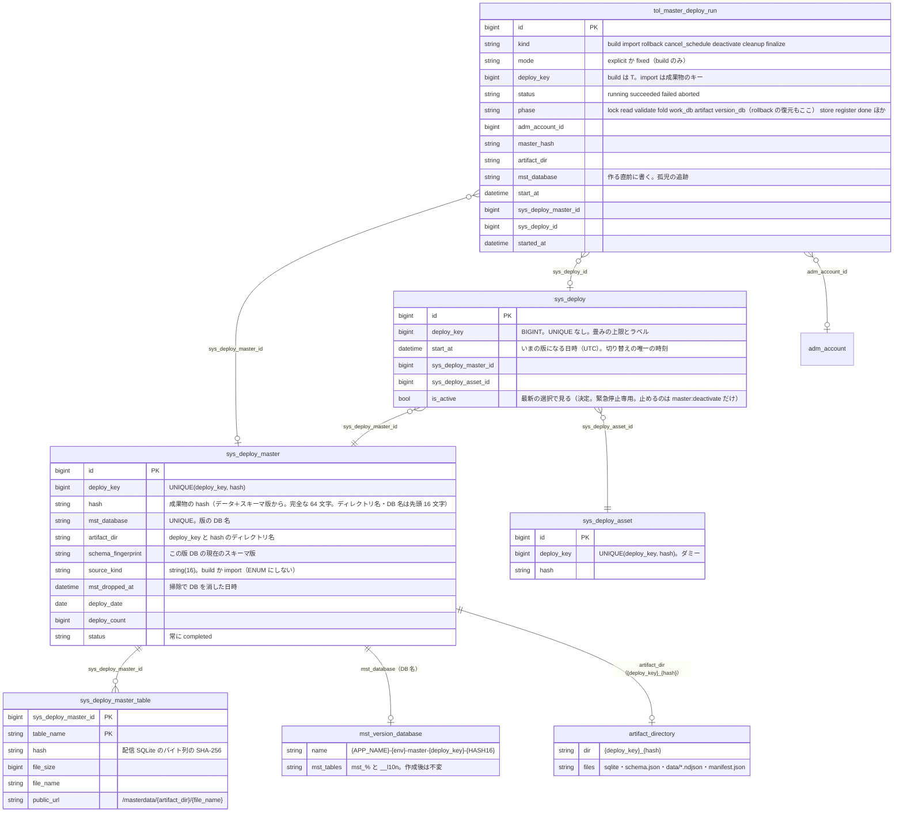
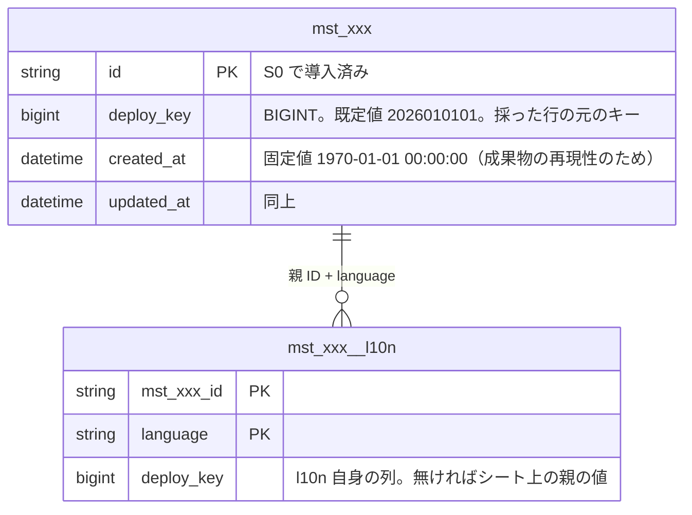

# マスター配信の DB 設計（版ごとの mst DB と start_at の切り替え。S2 のサーバー設計）

Nexus の全体設計「マスター配信」の決定（D1〜D10。Nexus の ADR 0007（`docs/adr/0007-versioned-master-db-timed-switch.md`））を、サーバー（`tool/`・`api/`・`packages/nexus-version`）の DB・成果物・登録・配信の設計に落とす。**ADR 0005 の方式（1 つの mst への差分反映）は ADR 0007 で置き換わったので、この文書はそれに合わせて書き直した。** この文書は設計だけで、実装（マイグレーション・コード・シーダー・テストの変更）はしない。

- 全体設計（**仕様の正本**。複製しない）: Nexus の `docs/design/master-distribution/overview.md`・`api.md`、課題表 `docs/progress/master-distribution/issues.md`（R19〜R32）、進捗台帳 `progress.md`（確認事項 Q1〜Q14。ADR 0007 で覆る Q は台帳の注記のとおり）、ADR 0005・0006・0007
- 前提（実装済み）: [mst-id-introduction/db.md](../mst-id-introduction/db.md)（S0。mst の 16 テーブルに string の `id`、255 文字、`ID_RULES`。変わらない）
- 規約: `.claude/database.md`（接頭辞・単数形・外部キーなし・コメント必須・ENUM は mst / adm / tol だけ・既存ファイルの書き換え期間）、`.claude/tool.md`
- 他の文書: [api.md](api.md)・[sequence.md](sequence.md)は、**この PR で db.md と揃える**（db.md を先に固め、api.md・sequence.md を db.md に合わせて書き直す）。**食い違えば db.md が正本**。両者の「mst への差分反映」「補償」「全破棄」「採番」「`execute`・`export`」の ADR 0005 前提の記述は無効。節番号は、残る内容は旧版と同じ番号にしてある（コードのコメントが `db.md 3.3` などと参照しているため。追従の一覧は 13 節）。**旧版から内容が変わった・置き換わった節**: 3.1（列）・3.2（UNIQUE）・3.3（最新）・3.4（旧「本物の採番」→ キーの検査。採番の廃止）・3.5・3.6（旧 R1〜R4 の登録 → R1〜R3。旧 R4「採番キーと同じ `deploy_key` で別 hash を拒否」は build で外し、import の R3 に移った）・4（旧「mst と tol の deploy_key」→ 版ごとの mst DB。旧 4 は 4.9 に移動）・5（実行記録の列・phase・status）・6.1・6.3・6.4 の一部（「空の表」「`load_failed`」「T より大きい行」）・6.5（旧「mst への反映」＝差分反映 → 成果物）・6.6（旧「配信 SQLite」→ build と import の流れ。SQLite の書き出しは 6.5.1 へ）・6.7（新設）・7（7.2 の設定の追加・7.3）・8（旧 8 節「キャッシュ」＝mst の全件破棄・M1・実行記録の書けないとき → API の「いまの mst」・キャッシュ。M1 は廃止）・9（見出しは旧版のまま、中身は 9.1〜9.4 に変更点を上書き）・10（10.4・10.5 を新設）・11.2（録画）・12（ER）・13・14。**旧版のまま残る節**: 6.2・7.1・11.1
- 凡例: **決定** = 人の決定（Nexus の ADR 0007 の「決めたこと」、overview の D1〜D10、台帳 Q1〜Q14 のうち残るもの、およびこの設計の依頼で追加された人の決定。後者は 2026-11-23 のユーザー確認で、Nexus の ADR・台帳への反映は別 PR＝13 節）か既存の規約。**仮置き** = AI の提案（人の確認で変わりうる。14 節に一覧）。**未確認** = 確かめていない。**未決** = 決まっていない（勝手に決めない）。**読んだ** = コードを読んだだけで実行していない。サーバーは main `bd329a16` 時点

## 1. 結論

| 項目 | 内容 |
| --- | --- |
| 方式 | デプロイのたびに**新しい mst DB を作り**、`sys_deploy.start_at`（UTC）で「いまの mst」を切り替える（**決定**。ADR 0007）。1 つの mst を書き換えない。`TRUNCATE`・差分反映・補償・全破棄の判定・採番は**無くなる** |
| 流れ（build 環境: develop・LD・QA） | シート（`mst_` 始まりのタブの全行）→ 検証 → T（畳みの上限。環境ごとに明示）以下を畳む → 作業用 DB に入れて型を確定 → 成果物（行データ・スキーマ・配信 SQLite・マニフェスト）を作る → 版の DB を作る → ストレージに `{deploy_key}_{hash}` で置く → **sys に 1 トランザクションで登録**（`start_at` つき） |
| 流れ（import 環境: review・production・staging） | 上流の成果物を pull → 検証 → 版の DB を作る → 不変性の検査（production） → 自環境のストレージに置く → sys に登録（`start_at` を指定）。**シートは持たず、畳まない** |
| 版の DB 名 | `{APP_NAME}-{env}-master-{deploy_key}-{HASH}`（**決定**。env は `APP_ENV`。4.2。HASH は固定長の先頭 16 文字。**決定**。人の決定。2026-11-23） |
| 切り替え | API は**リクエストの始め**に `start_at <= 現在` の最新の版を決め、`mst` 接続の database を差し替える（8.1。**仮置き**。R22）。「最新はどれか」は**一覧をキャッシュし、リクエスト時刻で毎回選ぶ**ので、`start_at` をまたいでも古い版は返らない（8.3） |
| キャッシュ | キーに版の DB 名を含める（`mst:{DB名}:{表}:all`）。版の DB は作成後に書き換えないので、**mst のキャッシュの破棄は不要**（8.4） |
| 巻き戻し | 戻したい版を指す**新しい `sys_deploy` 行**を、直前の最新行より後の `start_at`（`max(現在, 直前の最新行の start_at) + 1 秒`）で入れる（3.6。**仮置き**。決定は「`sys_deploy` の切り替え」）。**予約済みの未来の行があるときは拒否**し、先に予約の取り消しを要求する。DB・成果物は作り直さない |
| 失敗時 | 登録は sys の 1 トランザクションだけなので、**2 つの DB にまたがる整合の問題は無い**。途中で失敗しても、版の DB が孤児として残るだけで配信には影響しない（4.7） |
| sys | `sys_deploy_master` に `mst_database`・`artifact_dir`・`schema_fingerprint` などを足し、`hash` の UNIQUE を `(deploy_key, hash)` に直す。「最新」は `start_at` の新しい順（3 節） |
| 実行記録 | `tol_master_deploy_run` に種別（build/import）・版の DB 名などを足し、`inconsistent`・補償・全破棄のための phase を外す（5 節） |
| 成果物 | `{deploy_key}_{hash}/`（ディレクトリ名の hash は完全な hash の**先頭 16 文字**。**決定**。完全な hash は SHA-256 の 64 文字で、`sys_deploy_master.hash`・`manifest.json`・I1 の再計算にそのまま使う。入力は**データ＋スキーマ版**）に行データ（型を保つ NDJSON）・スキーマ・配信 SQLite・マニフェストを置く。保存先は Laravel のファイルシステムの disk で抽象化（6.5） |
| 録画（R19） | キーは `7777777777`（**決定**。Q2）。最新は `start_at` 基準なので、録画用は `start_at = 現在` で登録すれば最新になる。録画用の mst は**録画キー固定の build で作る**（**決定**。人。2026-11-24。11.2） |
| シートに行が無い表 | 版の DB で**空の表**（**決定**。R33。6.1） |

## 2. 変更の一覧

| # | 対象 | 変更 | 状態 |
| --- | --- | --- | --- |
| C1 | `sys_deploy`・`sys_deploy_master`・`sys_deploy_asset` の `deploy_key` | `bigInteger`・UNIQUE 無し（済み。S3-2・S3-3）。`master`・`asset` の UNIQUE は `(deploy_key, hash)` に直す（3.2） | 型は**決定**（D7）。UNIQUE の直しは**仮置き** |
| C2 | `sys_deploy_master` の列追加 | `mst_database`・`artifact_dir`・`schema_fingerprint`・`source_kind`・`mst_dropped_at`（3.1） | **仮置き**（ADR は「DB 名を引く列」が要ると決定。形は仮置き） |
| C3 | 「最新」の選び方 | `start_at` が最も新しい行 → `deploy_key` → `id`（3.3） | **決定**（`is_active` も**見る**。R39 の決定。位置づけは緊急停止専用。3.3・3.6） |
| C4 | 版ごとの mst DB の作成・命名・保持・掃除 | 4 節 | 命名は**決定**（HASH は先頭 16 文字。決定）。他は**仮置き** |
| C5 | ゲーム API の動的な mst 接続・キャッシュキー・JOIN の置き換え | 8 節 | 方式は**仮置き**（R22） |
| C6 | 成果物（artifact）とストレージの抽象化 | 6.5 | `{deploy_key}_{hash}`・抽象化・ローカルの置き場は**決定**。中身・hash は**仮置き** |
| C7 | build と import | 6.6・6.7 | 流れは**決定**（ADR 0007）。細部は**仮置き** |
| C8 | 登録（1 sys トランザクション）・`start_at`・巻き戻し | 3.6 | 巻き戻しの形・`start_at` の規則は**仮置き** |
| C9 | `tol_master_deploy_run` の変更 | 5 節 | **仮置き** |
| C10 | シートの読み取り・検証・畳み | 6.1〜6.4 | **決定**（D3・D8・Q1・Q3・Q14。残る） |
| C11 | 採番・補償・全破棄・差分反映・`TRUNCATE` | **廃止** | **決定**（ADR 0007） |
| C12 | シーダー・録画用デプロイ | 11 節 | キーと作り方は**決定**（Q2・R19。人。2026-11-24。11.2） |
| C13 | S3 実装済み部品の扱い・移行の段取り・旧経路の削除 | 10.4〜10.5 | **仮置き**（R29） |

## 3. sys（配信管理）

### 3.1 型と列
対象は `packages/nexus-version/database/migrations/sys/2026_01_01_000001_create_version_tables.php`（読んだ。`deploy_key` の BIGINT 化・UNIQUE 外しは S3-2・S3-3 で済み）。

**版の DB 名を引く列は `sys_deploy_master` に置く**（**仮置き**）。理由: DB と成果物は「マスターの内容」に属し、巻き戻し・再スケジュールでは**同じ内容を指す `sys_deploy` 行が複数**できる。`start_at`・`is_active`（切り替えの情報）は `sys_deploy` に残す。API は `sys_deploy` を引くときに `deployMaster` を同時に読む（今のまま）ので、追加の問い合わせは増えない。

| テーブル・列 | 現状 | 変更後 |
| --- | --- | --- |
| `sys_deploy.deploy_key` | `bigInteger`・index | 変えない。意味は「畳みの上限（T）とラベル」。最新の選択には使わない |
| `sys_deploy.start_at` | `dateTime`・index。コメント「DL可能となる日時」 | 型は変えない。コメントを「いまの版になる日時（UTC）」に。**切り替えの唯一の時刻**（決定） |
| `sys_deploy.is_active` | `boolean` 既定 true | 残す。**最新の選択で見る**（決定。R39。位置づけは緊急停止専用。3.3・3.6）。デプロイ・巻き戻し・予約の取り消しは自動では変えない。運営が明示的に止める操作（`master:deactivate`。仮置き）だけが落とす |
| `sys_deploy.sys_deploy_master_id` / `sys_deploy_asset_id` | `unsignedBigInteger`・index | 変えない |
| `sys_deploy_master.deploy_key` | `bigInteger`・index | 変えない（UNIQUE は 3.2） |
| `sys_deploy_master.hash` | `string(64)`・UNIQUE | 長さは変えない（**完全な SHA-256 の 64 文字をそのまま保存**する。DB 名・ディレクトリ名に使うのは先頭 16 文字だけ。決定）。UNIQUE を `(deploy_key, hash)` に（3.2）。意味は「成果物の hash（6.5.2。データ＋スキーマ版から作る）」 |
| `sys_deploy_master.deploy_date` / `deploy_count` | 登録日 / その日の何回目 | 変えない。`deploy_count` は本物のキーは `deploy_key % 100`（NN）、予約キーは 0（**仮置き**。採番を廃止したので件数は数えない） |
| `sys_deploy_master.status` | ENUM `scheduled`・`in_progress`・`completed`・`failed`・`rolled_back` | 登録できたものだけが行になるので**常に `completed`**。他の値は使わない（ENUM の値は残す。`rolled_back` は巻き戻しが新しい `sys_deploy` 行で表せるので使わない。**決定**: 旧 3.6 の判断を維持） |
| **`sys_deploy_master.mst_database`**（新） | - | `string(64)`・NOT NULL・UNIQUE。この版の mst DB 名（4.2）。**API が接続先を決める唯一の根拠** |
| **`sys_deploy_master.artifact_dir`**（新） | - | `string(128)`・NOT NULL。成果物のディレクトリ名 `{deploy_key}_{hash}`。hash の長さを後から変えても URL を組み直さずに済むよう、導出せず**保存する**（**仮置き**） |
| **`sys_deploy_master.schema_fingerprint`**（新） | - | `string(64)`・NOT NULL。この版 DB の**現在の**スキーマ版（4.4）。DB にマイグレーションを流したら更新する（4.8） |
| **`sys_deploy_master.source_kind`**（新） | - | `string(16)`・NOT NULL。値は `build`（自環境で build）か `import`（上流から import）。**ENUM にしない**（`.claude/database.md` の規約: sys は string にして値を列コメントに書く）。列コメントに「`build` = 自環境で build、`import` = 上流から取り込み」と書く。監査用 |
| **`sys_deploy_master.mst_dropped_at`**（新） | - | `dateTime`・NULL 可。掃除で DB を消した日時（4.6）。NULL でなければ、その版へは切り替えられない（成果物から復元するまで） |
| `sys_deploy_master_table` | 主キー `(sys_deploy_master_id, table_name)`、`file_name`・`public_url` | 変えない。`public_url` は `/masterdata/{artifact_dir}/{file_name}`（相対パス。クライアントの変更は無い） |
| `sys_deploy_asset` | master と同じ型で `hash` UNIQUE | 実体の無いダミーのまま（アセットの設計は別の機能。R23）。UNIQUE だけ master と同じ `(deploy_key, hash)` に直す |
| `sys_deploy.id`・`sys_deploy_master_id`・`sys_deploy_asset_id` | BIGINT UNSIGNED | 変えない |

シーダー（`SysDeploySeeder`）が入れる行は、開発の**基底 DB**（4.1）を 1 つの版として登録する（`mst_database` = 基底 DB 名、`artifact_dir` = `{deploy_key}_{hash}` の名前だけ。実体のディレクトリは無い。`source_kind` = `build`）。

### 3.2 UNIQUE と索引（Q4 の見直しへの答え）
- **`deploy_key` の UNIQUE は復活させない**（**決定**。Q4 のとおり外す）。固定キー（develop・LD）の再 build、QA の再 build で、同じ `deploy_key` の行が複数できる。version の判定は `sys_deploy.id` の一致だけなので、**デプロイのたびに新しい行（新しい `id`）にする**ことが、クライアントが更新に気づける条件（R2）。
- **`sys_deploy_master`・`sys_deploy_asset` の UNIQUE は `hash` 単独から `(deploy_key, hash)` に直す**（**仮置き**）。ADR 0007 は成果物を「deploy_key と hash で一意」とする。hash は**データとスキーマ版だけ**から作る（6.5.2。`deploy_key` を含めない）ので、LD（T = `8888888888`）と QA（T = `2026120101`）が**同じ内容**になりうる（LD 用の行が無いとき）。`hash` 単独の UNIQUE だとそれが衝突する。`(deploy_key, hash)` の UNIQUE が、`deploy_key` の前方一致の検索も兼ねるので、別の `index('deploy_key')` は要らない（外してよい。**仮置き**）。`index('hash')` は残す（`CheckMasterHash` ほかの検索）。
- `sys_deploy_master.mst_database` の UNIQUE（`uk_deploy_master_mst_database`）は、同じ DB を 2 つの版が指さないための守り。
- `sys_deploy` の索引は、既存の `index(['is_active','start_at'])`・`index('start_at')` で足りる（行数は少ない）。`index(['start_at','deploy_key','id'])` は足さない（**仮置き**）。
- 同じ内容の再 import（同じ `(deploy_key, hash)`）は `sys_deploy_master` を**再利用**して `sys_deploy` の行だけ足す（3.6 の R1）。

### 3.3 「最新」の定義（C3）
**決定**（人。2026-11-23）: 「最新」= `start_at <= 現在` の `sys_deploy` のうち、**`start_at` が最も新しい行**。同じ `start_at` なら **`deploy_key` が大きい方**、それも同じなら **`id` が大きい方**。各サーバーが独立に決める。`deploy_key` の大小は最新の選択に使わない。

```sql
-- 定義（実際は 8.3 のとおり、キャッシュした一覧に対して PHP で同じ並びを適用する）
SELECT d.*, m.*
FROM sys_deploy d JOIN sys_deploy_master m ON m.id = d.sys_deploy_master_id
WHERE d.start_at <= :now                 -- :now はリクエスト時刻（ApiSession::getNow()。UTC）
  AND d.is_active = 1                   -- 見る（決定。R39。緊急停止専用。3.6）
  AND d.deploy_key < 7000000000          -- 本番（APP_ENV=production）のときだけ付ける（決定。Q7）
ORDER BY d.start_at DESC, d.deploy_key DESC, d.id DESC
LIMIT 1;
```

- **`is_active` は最新の選択で見る**（**決定**。人の決定。2026-11-23。R39 は A）。**位置づけは「緊急停止専用」**（以下は決定を具体化した**仮置き**。決定は「見る」まで）: デプロイ（build・import の登録）・巻き戻し・予約の取り消しは、**`is_active` を自動では変えない**（登録した行は有効、取り消しは行の削除、巻き戻しは新しい行の追加）。**運営が明示的に「この行を止める」操作（`master:deactivate`。3.6）をしたときだけ**落とす。目的は、予約の `start_at` の直前（現在 + 2 × `schedule_ttl` ＝ 120 秒以内）の「取り消しも巻き戻しもできない窓」（3.6。P47）で、悪い版が配信される直前に止められる**唯一の手段**にすること。**巻き戻しや予約の取り消しの運用は `is_active` に依存しない形のまま**（3.6。予約済みの未来の行があるときの巻き戻しは拒否する）。実装は条件を 1 か所にまとめる（既存の方針）。止めたあと、切り替え予定のキャッシュ（`schedule` キー。TTL 60 秒。8.3）に最大 60 秒古い判断が残るので、**止める操作は同時に `forget` する**（失敗は警告 `schedule_cache_not_invalidated` と同じ扱い。3.6）。
- **選んだ版の DB が掃除済み（`mst_dropped_at` が NULL でない）のとき**は、古い版に黙って落とさず**エラー**（299 / `SystemDataException::deploy()`。ログに残す）。掃除の規則（4.6）が、いまの版・未来の版を消さないので、通常は起きない。
- **`start_at` が現在より後の版しか無いとき**は「いまの版が無い」として 299（**仮置き**。Nexus api.md 5 節）。
- **本番の予約帯の除外**（決定。Q7）は変えない: 本番（`APP_ENV=production`）は `deploy_key >= 7000000000`（予約帯）の行を最新に選ばない。予約帯の値は定数 `Nexus\Version\Constants\DeployKeyConst::RESERVED_FLOOR`（`packages/nexus-version`）。tool 側にも同じ値（`config/master_deploy.php` の `reserved_floor`）を持ち、相互にコメントで参照する（今のまま）。

直す場所は**2 か所**（旧設計のとおり。読んだ）:
1. `api/app/Repositories/Sys/SysDeployRepository.php` の `selectLatestDownloadable()`・`buildLatestDownloadableQuery()`（`SysDeploy::latestOrder()` スコープを `start_at` 降順 → `deploy_key` 降順 → `id` 降順に）。キャッシュの持ち方も変わる（8.3）
2. `api/app/Models/Sys/SysDeploy.php` の static `selectLatestDownloadable()`（キャッシュ無し。api のアプリコードに呼び出し元は無い。削除せず、並びとガードだけそろえてテストで固定する。規約）

**済み（S3-1, #31。読んだ）。テストで固定する**: `selectByDeployKey()` の `orderByDesc('id')`（`SysDeployRepository.php:70`）、`SysDeploy::parseDeployKey()` の `count` の 2 桁（`SysDeploy.php:161`）。

### 3.4 deploy_key の検査（採番は廃止。C11）
**日付による採番は行わない**（**決定**。ADR 0007・R32）。`MasterDeployService::allocateRealKey()`・`generateDeployKey()` は使わない。キーは次のように決まる。

| 環境 | キー（T または成果物の deploy_key） | 検査 |
| --- | --- | --- |
| develop・LD（仮） | 固定キー（`9999999999`・`8888888888`）。環境設定 `fixed_key`（7.2） | 許可リストの値だけ。本番・ステージングでは拒否 |
| LD（確定後）・QA | 本物の形 `YYYYMMDDNN`（LD で確定した V。QA は環境ごとの明示）。環境設定 `explicit_key`（7.2。**仮置き**） | V04 の形（年 2026〜2999、月・日、NN 01〜99）・予約帯未満（`MasterDeployKeyPolicy::assertRealKey`） |
| review・production・staging | 成果物の `deploy_key`（import。畳まない） | 成果物のマニフェストとディレクトリ名の一致、予約帯の拒否（6.7） |

- NN の付け方（同じ日の再リリース）は**未決**（R32。既定案: LD で人が付ける）。サーバーは NN を採番せず、与えられたキーの形だけを検査する。
- 旧設計の `deploy_key_exhausted`（99 超）・UTC 日付の採番は不要になる。

### 3.5 予約キーの行
- 固定キー（`7777777777`・`8888888888`・`9999999999`）の `sys_deploy_master`・`sys_deploy_asset`: `deploy_date` = 登録日（NOT NULL のため）、`deploy_count` = 0、`deployed_by` = `master_build`（画面・CLI の build）か `master_import`。**仮置き**。
- 録画用の行（`deploy_key` = `7777777777`）は、**build で作られる**ので他の固定キーの行と同じ形（`deployed_by` = `master_build`。`description` に `[REC]` は付かない）。旧設計のシーダーの行（`deployed_by` = `recording`・`[REC]` で始まる）は廃止。リセットの引き方は 11.2（**仮置き（AI）。人の確認待ち**）。

### 3.6 登録（C8）
**登録は `sys` 接続の 1 トランザクション**（`DB::connection('sys')->transaction`）。中身は、`sys_deploy_master`（再利用でなければ）・`sys_deploy_master_table`・`sys_deploy_asset`（ダミー）・`sys_deploy` の INSERT（と、復元のときの `sys_deploy_master` の更新）だけ。**例外**（**仮置き**）: import の I5 が参照版 A の DB を復元するときの、A の `sys_deploy_master` の `mst_database`・`mst_dropped_at` の更新は、**登録より前に、登録とは別のトランザクション**で行う（A は登録済みの版で、新しい登録とは独立。6.6 の手順 4・6.7 の I5）。**mst の DB への書き込みは登録の前に済んでいる**（版の DB は完成・検証済みで、以後書き換えない）。登録が失敗しても DB は孤児として残るだけで、配信には影響しない。したがって、旧設計の「mst のトランザクションを開いたまま sys に登録 → 補償」は**不要**になる（C11）。**登録の前に、「版の DB が存在し、スキーマ版・往復検査が合う」ことを必ず確かめる**（6.6。成果物のディレクトリが有るかではなく、DB の状態で決める）。デプロイ操作は `MasterDeployLock` の中で行うので、登録の前提（予約済みの行の有無など）は登録までの間に変わらない。

入力: 成果物の `deploy_key`・`hash`・`artifact_dir`・`mst_database`・`schema_fingerprint`・SQLite のマニフェスト、`source_kind`、`start_at`。

| # | 条件 | 動作 |
| --- | --- | --- |
| R1 | **同じ `(deploy_key, hash)` の `sys_deploy_master` が既にある** | master は作らず**再利用**し、`sys_deploy` の行だけ足す（新しい `id`）。ただし、**その master の版の DB が使えない**（`mst_dropped_at` が NULL でない、または DB が存在しない、またはスキーマ版・往復検査が合わない）ときは、**成果物から版の DB を復元**（6.6 の `version_db`。名前は 4.2 の規則で付け直す。**復元の前に、戻し先の成果物の `schema_fingerprint` が自環境の基底 DB のスキーマ版と一致するかで判定する（I3 と同じ）。一致すれば復元、一致しなければ `schema_mismatch` で拒否**。復元できる成果物が無いときは `rollback_target_unavailable`）し、同じトランザクションで `mst_database` を更新して `mst_dropped_at` を NULL にする。**巻き戻しもこの経路**（下） |
| R2 | 新しい `(deploy_key, hash)` | master・`sys_deploy_master_table`・asset（ダミー）・`sys_deploy` を足す |
| R3 | import 環境（review・production・staging **すべて**）で、同じ `deploy_key` の master が**別の `hash` で既にある** | **拒否**（`confirmed_key_modified`。**仮置き**: 確定済みキーの行の変更は新しいキーで入れる規則。**環境設定（`enforce_confirmed_rows`）に依らず、import 全体で効く**。人の確認が要る＝R36。6.7 の I4）。build 環境は拒否しない（確定前の再 build。下）。**前進（`deploy_key_regression`）と行の不変性（I5）だけが production に限られる**（6.7） |

- **他の `sys_deploy` を無効にしない**（旧設計の「登録のたびに他を無効にする」は廃止）。どれが最新かは `start_at` だけで決まる（3.3）。
- **`sys_deploy.sys_deploy_asset_id` の決め方**（R1 の再利用でも必要）: ダミーの `sys_deploy_asset` は `(deploy_key, hash)` が UNIQUE（3.2）。**同じ `(deploy_key, hash)` の asset 行があればその `id` を使い、無ければ作る**（R2 は master と同時に asset も作るので、R1 では通常は既にある。asset の設計は別の機能。R23）。
- **二重登録の防止**（**仮置き**）: 同じ `sys_deploy_master`・同じ `start_at` の `sys_deploy` が既にあれば、**新しい行は作らず、既存の行を返す**（`is_new = false`。警告 `already_registered`）。同じ操作の再実行（sys の COMMIT の成否が不明だったときなど）で行が増えないようにする。`start_at` を省略（「すぐ」）した登録は毎回違う時刻になるので対象外。
- **同じ `deploy_key` の別 hash（Q11 の「本物のキーは 1 つの内容に固定」）**: Nexus overview 9 節は「この範囲で外すかは未決（仮置き）」としている。**仮置き**: build 環境（develop・LD・QA）は**外す**（確定前なので再 build で別の hash の成果物ができる。`{deploy_key}_{hash}` なので衝突せず、`sys_deploy` には新しい行を入れる）。import 環境（review・production・staging）は**環境設定に依らず拒否**（R3）。
- **`start_at` の指定（誰がいつ決めるか）**:
  - **build 環境**（develop・LD・QA）: 既定は**現在**（すぐ有効）。操作で未来を指定してもよい。
  - **import 環境**: **必須の入力**（運営担当が import の操作で指定する。ADR 0007: 「取り込む成果物と `start_at` を指定」）。review はストア申請の都合で即時でもよく、production は例えば 0 時（UTC）を指定する。staging は production と同じ `start_at` を指定する（時間差の取り込みで、取り込み時点で既に過ぎていてもよい）。
  - 画面・CLI は UTC で受け取り、**JST を併記して表示**する（表示だけ。保存は UTC。**仮置き**）。
  - **「即時」の指定**（**仮置き**）: `start_at` を**省略する（`null`・画面の「すぐ」）**と、サーバーが登録の直前の現在時刻を入れる。入力してから登録まで数秒かかっても過去にならない。
  - **検査**（**仮置き**）: 設定 `reject_past_start_at`（7.2。production だけ true）が true のとき、**明示された**過去の `start_at` は、許容幅 `start_at_past_grace`（既定 60 秒。7.2）を超えて過去なら拒否（`start_at_past`）。許容幅以内の過去は現在に丸めて通す（操作者が入力してから登録まで数十秒かかっても通る）。現在 + `2 × schedule_ttl`（8.3。既定 120 秒）より近いときは、他のサーバーへの反映が遅れうるので**警告**（`start_at_too_soon`。止めない）。登録済みで、新しい版より後の `start_at` の行がすでにあるときも警告（`start_at_shadowed`。その版は選ばれない）。
- **巻き戻し**（決定は「`sys_deploy` の切り替え」。形は**仮置き**）: 戻したい版（`sys_deploy_master`）を選び、**それを指す新しい `sys_deploy` 行を、`start_at = max(現在, 直前の最新行の `start_at`) + 1 秒` で入れる**（R1 と同じ経路。**直前の最新行 = 巻き戻しの時点でいまの版（3.3）**。**同じ秒だと同点の規則（`deploy_key` が大きい方）で戻し先が負けて、黙って無効になりうる**ため、必ず直前の最新行より後の `start_at` にする。R43。専用の操作 `master:rollback` / 画面の「この版に戻す」）。理由: ① 最新が `start_at` だけで決まるので、**予約済みの行が無ければ**、直前の最新行より後の `start_at` の行を足せば確実に最新になる ② 履歴が残る ③ クライアントは `sys_deploy.id` が変わるので更新に気づく。検査: 戻し先の DB が使える（上の R1。使えないなら成果物から復元してよい。復元できなければ `rollback_target_unavailable`）・`schema_fingerprint` が現行と一致（4.8）・予約帯でない（本番）。
  - **予約済みの未来の行があるとき（M5。`start_at` が現在より後の `sys_deploy` 行が 1 つでもあるとき）は、巻き戻しを拒否する**（`rollback_blocked_by_scheduled`。戻し先の行は直前の最新行より後の `start_at` を持つが、**未来の行の `start_at` に到達すると、その行が最新になって巻き戻しが黙って無効になる**ため。**`is_active` を見るかの決定には依存しない**: 見る・見ないどちらでも、未来の行は到達すれば最新の候補になる）。拒否のメッセージは、予約の一覧と、次の「予約の取り消し」を案内する。
    - **「予約済み」の判定から除く行**（**仮置き**）: `start_at <= 現在 + start_at_past_grace`（60 秒）**かつ戻し先と同じ `sys_deploy_master` を指す行**は、「予約済み」に数えない。理由: 巻き戻しの `start_at` は `max(現在, 直前の最新行の start_at) + 1 秒` で、現在より約 1 秒先になりうる。その行が約 1 秒間「予約済み」に見えて、**直後の巻き戻し（やり直し）が `rollback_blocked_by_scheduled` になる**のを避ける。**戻し先と別の版を指す、近い（60 秒以内）予約の行は除かない**（除くと、その行が到達して巻き戻しが黙って無効になる。M5 の問題が戻る）。
    - **巻き戻しの二重登録**（**仮置き。許容**）: 巻き戻しを 2 回続けると、2 回目の `start_at` は「直前の最新行（1 回目の行を含みうる）+ 1 秒」になり、**同じ master・同じ `start_at` ではない**ので `already_registered`（二重登録の防止）に当たらず、**行が 1 つ増えるだけ**で害は無い（どちらも同じ版を指す。最新は後の行）。防止の対象にしない。
  - **予約の取り消し**（**仮置き**。操作 `master:cancel-schedule {sys_deploy.id}` / 画面）: `start_at` が**まだ到達していない** `sys_deploy` 行を**削除する**。`DELETE ... WHERE id = :id AND start_at > :now` の影響行数が 0 なら `schedule_already_started`（取り消しの直前に到達した。この場合は巻き戻しの操作からやり直す）。`sys_deploy_master`・版の DB・成果物は残す（別の予約や巻き戻しの対象になりうる）。**取り消しは `is_active` を変えない**（行を削除する。止めるだけの緊急停止は別の操作＝次の項）。取り消しの後に、巻き戻しを行う。取り消した予約を残したいときは、巻き戻しの後に同じ版を改めて予約する（R1）。**ロック・登録と同じ排他の中**で行う。
    - **直前の取り消しを拒否する**（**仮置き**。`start_at_too_soon` と同じ型の保護）: **`start_at` が「現在 + 2 × `schedule_ttl`（既定 120 秒）」以内の行は、取り消しを拒否する**（`schedule_cancel_too_soon`）。理由: API は切り替え予定の一覧を TTL（60 秒）でキャッシュし、取り消し後の `forget` は失敗しうる（tool と api が同じ Redis かは未確認。8.3）。直前に取り消すと、API のキャッシュに取り消した行が残ったまま `start_at` に到達し、**取り消した版が最大 TTL の間配信される**。また、tool と api の時計のずれで、「到達していない」という判定自体も崩れる。保護の範囲外（`start_at` が十分先）の取り消しなら、TTL が経てば、キャッシュに取り消した行が残っていても `start_at` より前に切れる。
    - **取り消し後の `forget` の失敗は成功扱いにしない**（**仮置き**）: **run は `succeeded`** のまま、`summary.cache_invalidated = false` と警告（`schedule_cache_not_invalidated`）を実行記録と結果に残し、**呼び出し側（画面・CLI）に「再試行する、または `clear-cache` を実行する」案内を出す**。実行記録（`kind = cancel_schedule`）の `summary` にも残す。登録・巻き戻しの `forget` の失敗も、同じ警告を返す（登録自体は成功のまま）。
    - 「まだ一度も配信されていないので履歴の欠落は無い」という理由づけは、時計のずれで崩れうるので、**保護の範囲（上）の内側では使わない**。
    - **取り消しも巻き戻しもできない窓**（**仮置き。許容**）: 予約の `start_at` が**現在 + 2 × `schedule_ttl`（120 秒）以内**になると、取り消しは拒否され（上）、巻き戻しは予約済みの行で拒否される（上）ので、**最大 120 秒、どちらもできない**。**緊急の手段は `is_active` を落とす操作（決定した R39。次の「緊急停止」）**。運用: ① 予約が**現在 + 2 × `schedule_ttl` より先**なら取り消せる（早めに判断する）② 窓の中に入ったら、**悪い版が配信される前に止めたいときは緊急停止**（`master:deactivate`。窓の中でもできる。止めた行は最新の選択から外れ、前の行が最新のまま）③ 緊急でなければ、**到達して配信が始まるのを待ってから巻き戻す**（`start_at` 到達の後は予約済みでなくなるので巻き戻せる）。R41 の注記。
  - **緊急停止**（R39 の決定 A に基づく。**操作の名前・形は仮置き**: `master:deactivate {sys_deploy.id}` / 画面の「この行を止める」。再び有効にする `master:activate {sys_deploy.id}` / 画面の「再開」も**仮置き**）: 運営が**明示的に操作したときだけ** `sys_deploy.is_active` を 0 にする（activate は 1 に戻す）。**デプロイ・巻き戻し・予約の取り消しは `is_active` を自動では変えない**（3.3）。**排他のロックの中**で行う。
    - **対象**: `start_at` が未到達でも到達済み（いまの版）でもよい。**窓の中（現在 + 2 × `schedule_ttl` 以内）の予約の行**を止められるのが目的（取り消しも巻き戻しもできない間の唯一の手段）。止めた行は行として残る（履歴・`sys_deploy_master`・版の DB・成果物も残る）。**同じ状態への操作は、更新はせず成功**（冪等。`already_in_state`。**ただし `forget` は行う**＝下）。行が無ければ `deploy_not_found`（仮称）。
    - **検査**（**仮置き**）: **止めた後に、最新の選択（3.3）が空になる、または掃除済み（`mst_dropped_at` が NULL でない）の版に落ちるときは拒否**する（`deactivate_no_fallback`。仮称。配信が 299 になる止め方を防ぐ）。**止める行が最新でも予約でもない行**（選択に影響しない）は検査なしで通す。
    - **再開（`master:activate`）の検査**（**仮置き**）: **再開で最新の選択（3.3）になる行の master が掃除済み**（`mst_dropped_at` が NULL でない、または DB が無い・不一致）のときは、**成果物から復元（6.6 の `version_db`）してから** `is_active = 1` にする（復元の規則・`schema_fingerprint` の一致は rollback の復元と同じ。4.8）。**復元できなければ拒否**（`activate_target_dropped`。仮称。更新しない）。理由（再現）: 悪い版 X を止める → X の `start_at` が過ぎる → 掃除（4.6）で X の DB が `DROP`（下の 4.6 は止めた行の master を保持対象にするので通常は起きないが、手動の `DROP` や N の変更などで起きうる）→ 検査なしで再開すると X が最新の選択になり、選んだ版の DB が掃除済みで 299 になる。再開しても最新の選択にならない行（より新しい有効な行がある・未来の行）は、検査なしで通す（未来の行は、到達するまで掃除されない。4.6 ②）。
    - **実行記録**（**仮置き**）: `kind = deactivate`（**既存の kind 一覧への追加は `deactivate` の 1 つ**。`master:activate` も同じ kind で、`summary.is_active` に新しい値を残す）。phase は `lock`・`check`・`version_db`（**activate が復元するときだけ**。上）・`register`・`done`（deactivate は DB を作らない）。
    - **`forget`**（上の取り消しと同じ扱い）: 更新の**後**に、`schedule` キー（8.3）を破棄する。止めたあとも、キャッシュには最大 `schedule_ttl`（60 秒）古い判断（止める前の一覧）が残るため。**`already_in_state`（すでにその状態）のときも `forget` を行う**（更新は無いが、前回 `forget` に失敗した後の**冪等な再試行で `forget` が効く**ようにするため）。**失敗は成功扱いにしない**: run は `succeeded` のまま、`summary.cache_invalidated = false` と警告（`schedule_cache_not_invalidated`）を残し、**「再試行する（同じ操作をもう一度実行すると `forget` だけ行われる）、または `clear-cache` を実行する」案内を出す**。`start_at` 直前の緊急停止で `forget` に失敗したときは、**最大 60 秒、止めた版が配信されうる**ことを案内に含める。
    - **取り消し・巻き戻しとの関係**: 止めた行は、巻き戻しの「予約済み」の判定（`start_at` が現在より後の行）に**数えるまま**（行が残るため。巻き戻しは拒否される。先に取り消す、または `master:activate` で戻す）。取り消しは `is_active` に関わらず削除できる（窓の外）。**窓の中（現在 + 2 × `schedule_ttl` 以内）の未来の行を止めた場合は、取り消しもできず、巻き戻しも `rollback_blocked_by_scheduled` になる**ので、**窓の中は `start_at` の到達を待つ**（到達後は「予約済み」から外れ、巻き戻せる）。
- 登録の**後**、API の「切り替え予定の一覧」のキャッシュを破棄する（`forget`。失敗しても登録は成功のまま。結果に `cache_invalidated = false` を返す。8.3）。mst のキャッシュは破棄しない。
- **巻き戻しで戻し先の DB を復元する段階**（**仮置き**）: **`version_db` は rollback・build・import が共有する段階**（6.6）。rollback では、戻し先の版の DB が使えない（`mst_dropped_at` が NULL でない・DB が無い・不一致。R1）ときだけ、実行記録の phase を **`version_db`** にして成果物から復元する（6.6 の共通の手順。`lock` → `check` → `version_db` → `register` → `done`）。復元が無ければ `version_db` を通らない。
- 登録で使う新しいエラーコード（仮称。`error_code` の最終形は db.md が正本。api.md はこの PR で db.md に揃える）: `deploy_locked`・`sheet_invalid`・`artifact_invalid`・`schema_mismatch`・`confirmed_key_modified`・`deploy_key_regression`・`reserved_key_forbidden`・`start_at_past`・`mst_database_name_too_long`・`mst_database_collision`・`artifact_dir_collision`（**仮称**。6.5.2）・`base_database_mismatch`・`load_failed`・`rollback_target_unavailable`・`rollback_blocked_by_scheduled`・`schedule_already_started`・`schedule_cancel_too_soon`・`register_confirmed_after_error`（警告。4.7）・`register_unknown`（4.7）・`already_finalized`（成功。6.5.1）・`finalize_conflict`・`sheet_changed_since_build`・`follow_check_unavailable`（6.5.1）・`reference_unavailable`・`drop_forbidden`・`not_finalized`（final.json が無い。6.5.1）、および段階ごとの失敗の語（**仮称**。`register_failed`＝sys の登録の失敗、`store_failed`＝成果物の配置の失敗、`pull_failed`＝上流からの取得の失敗、`export_failed`＝成果物（NDJSON・SQLite）の書き出しの失敗。実行記録の `error_code` に入る。api.md の書き直しで確定）。

## 4. 版ごとの mst DB（C4。R21・R22・R26）

### 4.1 構成（基底 DB と版の DB）
**DB の命名の一般則**（**決定**。人の決定。2026-11-23 のユーザー確認。Nexus の ADR・台帳への反映は別 PR＝13 節）: **すべての DB の名前を `{APP_NAME}-{env}-{役割}` の形に揃える**（`env` は `APP_ENV`）。役割は `master`・`system`・`transaction` など（例: `{APP_NAME}-{env}-master`・`{APP_NAME}-{env}-system`・`{APP_NAME}-{env}-transaction`）。版ごとの mst DB は、基底 DB `{APP_NAME}-{env}-master` に `-{deploy_key}-{HASH}` を足した `{APP_NAME}-{env}-master-{deploy_key}-{HASH}`（4.2）。
- **この PR の範囲**: この規則は**設計の方針**として決める。**master 以外の DB（sys = `system`、trx = `transaction`、tool・admin など）の現行の名前を変える作業は、別の実装・運用の作業で、この PR の範囲外**。現行の名前の置き場は、`docker-compose.yml` の `db-master` ほかの `DB_NAMES`、api の `config/database.php`、tool の `config/database.php`（`mst` 接続の既定が固定値 `nexus-local-master`）、`.env.example`、`api/phpunit.xml`（`nexus-testing-*`）。現行の名前と実装での追従の一覧は 13 節。
- **帰結**（**仮置き**）: ① 4.6 の `DROP` の保護の接頭辞 `{APP_NAME}-{env}-master-` は、この規則（`{APP_NAME}-{env}-{役割}` の役割 `master` に `-` を付けたもの）から導かれる ② 同じ MySQL サーバーに複数の環境が同居しても、`env` が名前に入るので衝突しない ③ tool の `mst` 接続の既定（固定の `nexus-local-master`）を `{APP_NAME}-{APP_ENV}-master` に揃えれば、`base_database_mismatch` は**「api と tool の設定（`APP_NAME`・`APP_ENV`・`DB_MASTER_DATABASE`）が同じであること」の検査**に単純化できる（下）。
| DB | 名前 | 中身・用途 |
| --- | --- | --- |
| **基底 DB** | `{APP_NAME}-{APP_ENV}-master`（api の `mst` 接続の既定名。`.env.example` の `DB_MASTER_DATABASE=${APP_NAME}-${APP_ENV}-master`。`make migrate` の対象） | ① **スキーマの雛形**（版の DB は、ここの `mst_%` の表定義を複製して作る。4.3）② 開発のシーダー（`Mst*Seeder`）の行き先 ③ テストの mst（`{APP_NAME}-testing-master`）。**本番・ステージングでは行を持たない**（スキーマだけ） |
| **版の DB** | `{APP_NAME}-{env}-master-{deploy_key}-{HASH}`（4.2） | ある成果物の内容。**作成後に書き換えない**。`sys_deploy_master.mst_database` が指す |

- **tool の `mst` 接続との関係（読んだ）**: tool の `config/database.php` の `mst` 接続の既定 database は固定値 `nexus-local-master`（`DB_MASTER_DATABASE` が未設定のとき）。api は `{APP_NAME}-{APP_ENV}-master` を既定にする。docker では共有の `.env`（`DB_MASTER_DATABASE=${APP_NAME}-${APP_ENV}-master`）を両方が読むので揃うが、**tool は版の DB 名を `config('app.name')`・`config('app.env')` から組み、基底 DB 名は接続の設定をそのまま使う**ので、2 つが食い違うと、雛形（基底）の環境と版の DB の環境が別になる。**仮置き**: build・import の最初（排他の前）に「`mst` 接続の database == `{APP_NAME}-{APP_ENV}-master`」を検査し、違えば `base_database_mismatch` で拒否する。tool の既定値を固定の `nexus-local-master` から `{APP_NAME}-{APP_ENV}-master` に直すのは実装 PR（13 節）。**`base_database_mismatch` の前提**（**仮置き**。tool の既定を一般則に揃えた後は、この検査は「設定が同じであること」の確認に単純化できる）: **`.env` の `APP_NAME`・`APP_ENV` が api と tool で同じ**であること。`config/app.php` の `APP_NAME` の既定は Laravel の既定値で、`.env.example` と docker の既定が `nexus`。api の `mst` 接続の既定は `env('APP_NAME', 'laravel')`、tool は `config('app.name')` から組むので、`.env` で値を揃えないと、2 つのアプリで版の DB 名の接頭辞が食い違う。
- API は本番で基底 DB を直接読まない（版が無ければ 299。8.1）。開発は `SysDeploySeeder` が基底 DB を 1 つの版として登録するので、`make seed` だけで動く（3.1）。
- tool の build は基底 DB の行を使わない（シートだけが元）。**シートに行が無い表は、版の DB でも空の表になる**（**決定**。2026-11-23 のユーザー確認。R33。旧設計の「行の無い表は触らない（mst の行を残す）」はやめる。版ごとに新しい DB を作るので、mst に残っていた行（シーダーで入った行など）は引き継がない。**運営シートが `mst_` の全表を持つかは問わない**）。

### 4.2 命名（**決定**）
**`{APP_NAME}-{env}-master-{deploy_key}-{HASH}`**（人の決定。2026-11-23 のユーザー確認。Nexus の ADR・台帳への反映は別 PR＝13 節。例 `nexus-local-master-2026120101-<HASH>`、`nexus-qa-master-2026120101-<HASH>`）。現行のデータベース名（`nexus-local-master`・`nexus-testing-master`・`nexus-local-tool` など）もハイフン入りなので記法は既存と整合する。SQL ではバッククォートで囲む（Laravel のクエリビルダ・`getDatabaseName()` は囲んでくれる。生の SQL・`GRANT`・`SHOW` では自分で囲む。例は 4.3 のコードブロック）。

- **`{APP_NAME}`**: アプリ名の設定値（`config('app.name')`。**決定**）。既定は `nexus`。
- **`{env}`**: `APP_ENV`（`config('app.env')`。**決定**）。docker-compose の `db-master` には `${APP_NAME}-${APP_ENV}-master`・`${APP_NAME}-testing-master`・`${APP_NAME}-testing-tool-master` が同居している（`docker-compose.yml` の `DB_NAMES`。確認済み）。環境名が入るので、**local と testing が同じ MySQL に同居しても名前は衝突しない**。
- **`{deploy_key}`**: 10 桁の `sys_deploy_master.deploy_key`。
- **`{HASH}`**: 成果物の完全な `hash`（6.5.2。SHA-256 の 16 進 64 文字）の**先頭 16 文字**（固定長。**決定**。人の決定。2026-11-23「hash の長さは 16」。成果物のディレクトリ名の hash も同じ 16 文字＝下の「成果物のディレクトリ名との関係」）。
- **接頭辞** `{APP_NAME}-{env}-master-`（末尾のハイフンを含む）は、基底 DB `{APP_NAME}-{env}-master`・他の環境の DB・`{APP_NAME}-testing-tool-master` と区別できる。**この接頭辞が付いた名前だけを、tool が `DROP` の対象にする**（4.6）。
- **前提: 版の DB の名前は 1 つの sys に対して一意**（**仮置き**）。**同じ MySQL サーバー・同じ `APP_NAME`・同じ `APP_ENV`・同じ T・同じ hash で複数の環境（別の sys）が build すると、版の DB 名が同じになる**。後の環境は先の環境の DB を「孤児（sys に行が無い DB）」として中身の一致で**採用**でき、先の環境の `cleanup` が消すと後の環境の DB も消える。**同じ MySQL サーバーに同居する環境は、`{env}` または `APP_NAME` で名前を分ける運用**にする（環境名が違えば名前は衝突しない。同じ名前を共有する構成は取らない）。

**長さの制約**: MySQL のデータベース名は 64 文字まで。`HASH` に使える最大長は
`64 - (len(APP_NAME) + 1 + len(env) + len("-master-") + 10 + 1)` = `64 - (len(APP_NAME) + len(env) + 20)` = **`44 - len(APP_NAME) - len(env)`**。
- 例: `nexus`（5）＋ `local`（5）なら **34**、`nexus` ＋ `qa`（2）なら **37**、`nexus` ＋ `production`（10）なら 29。**APP_NAME や env が長いほど短くなる**。
- 完全な SHA-256（64 文字）はどの組み合わせでも入らない。
- そこで、**APP_NAME と env の長さに依らず収まる固定長**として `HASH` = 先頭 **16 文字**にする（**決定**）。**確定した制約**: `44 - len(APP_NAME) - len(env) ≥ 16`、すなわち **`len(APP_NAME) + len(env)` が 28 文字以内**。**28 文字を超える設定は、tool が build・import の最初（排他の前）に `mst_database_name_too_long` で拒否**する（設定の誤りとして早く落とす）。
- 衝突: 16 文字 = 64 ビット。同じ `deploy_key` の版が互いに衝突する確率は、n 個で約 n²/2⁶⁵（n = 1000 でも 10⁻¹³ 程度）で、実用上は起きない。**起きたとき（同じ名前の DB が既にある）**は次のとおり（**仮置き**。**DB 名は 16 文字固定の決定を超えない**ので、**HASH を伸ばして別名にはしない**。「32 文字に伸ばす」案は撤回した）: sys の `sys_deploy_master.mst_database` でその名前の行を引き、**完全な hash（64 文字）を比べる**（先頭 16 文字だけの比較にしない）。同じ → 同じ成果物なので再利用（R1。DB が使える状態かは 6.6 で確かめる）。**同じ名前の DB が実在し、往復検査・スキーマ版だけが合わない（使えない）→ その DB は触らず（この run が作った名前でないので `DROP` しない。4.7）、`mst_database_collision` で止める**（使えない旧 DB は手動で確認する）。違う（先頭 16 文字が同じで完全な hash が別）→ 衝突。**`mst_database_collision` で止める**（別名にしない）。sys に行が無い DB（孤児）→ 中身（スキーマ版・行の往復。6.6）が成果物と一致すれば**採用**、一致しなければ拒否。**採用した DB は、この run が作ったものではないので、以後の失敗・掃除で `DROP` しない**（4.7 の規則）。**以後 DB 名は `sys_deploy_master.mst_database` を正とし、hash から導出し直さない**（HASH の長さを後から変えても壊れない）。
- **成果物のディレクトリ名との関係**（**決定**。人の決定。2026-11-23）: ディレクトリ名 `{deploy_key}_{hash}` の hash も、完全な hash の**先頭 16 文字**（DB 名の HASH と同じ）。**完全な hash（64 文字）は `sys_deploy_master.hash`・`manifest.json`・I1 の再計算・`(deploy_key, hash)` の UNIQUE でそのまま使う**（先頭 16 文字だけの比較にしない）。**同じ `deploy_key` で先頭 16 文字が同じ、完全な hash が別**のとき（ディレクトリ名の衝突）は、別名にせず**止める**（`artifact_dir_collision`。**コード名・HTTP・終了コードは仮置き**。6.5.2）。DB 名の衝突は `mst_database_collision`。
- 作業用の DB（6.6。hash が確定する前の中間。import の dry run の一時 DB も同じ）は `{APP_NAME}-{env}-master-work-{UTC の YYYYMMDDHHMMSS}-{ランダム 4 文字}`（**仮置き**。`len(APP_NAME) + len(env)` が 28 文字以内なら 64 文字以内）。完成したら版の DB に複製して作業用は捨てる。接頭辞は版の DB と同じなので、`DROP` の保護の対象に含まれる。**名前に作成時刻が入る**ので、異常終了で残った作業用 DB を、実行記録が無くても（dry run は記録しない）時刻で見つけられる（4.7）。

### 4.3 作り方（R26 の「作り方」。**仮置き**）
**基底 DB の表定義を複製して新しい DB を作る**（マイグレーションを流して作らない）。

1. 版の DB を作る。文字コードは `docker/mysql/init/create-databases.sh` と同じ。
2. 基底 DB の `SHOW TABLES LIKE 'mst\_%'` の表ごとに、表定義を複製する（索引・既定値・コメントを複製する）。
3. 成果物の行データを入れる（6.6）。

```sql
CREATE DATABASE `nexus-local-master-2026120101-0f3c1a2b3c4d5e6f`
  CHARACTER SET utf8mb4 COLLATE utf8mb4_unicode_ci;
CREATE TABLE `nexus-local-master-2026120101-0f3c1a2b3c4d5e6f`.`mst_item`
  LIKE `nexus-local-master`.`mst_item`;
```

理由: ① **tool は `packages/` を持たず**（tool と api は別の Laravel アプリ）、mst のマイグレーションファイルを持たないので、tool がマイグレーションを流せない ② 基底 DB は `make migrate`（リリース手順）で常に現行スキーマになっているので、新しい版は現行コードのスキーマで作られる ③ 複製は同じ MySQL サーバー内で速い。条件: **基底 DB と版の DB が同じ MySQL サーバーにある**（今は `db-master` 1 台。**別サーバーに分けるなら再設計**）。TiDB で `CREATE TABLE LIKE` が同じ結果になるかは**未確認**（`nexus-tidb` の変換マイグレーションの影響）。

### 4.4 スキーマ版（R26。**仮置き**）
- **スキーマ版（`schema_fingerprint`）= mst の `mst_%` の全表の列・索引の構造の SHA-256**。`information_schema.COLUMNS`（表名・列順・列名・型（表示幅を除く）・NULL 可・既定値・キー）と `STATISTICS`（索引名・一意か・列順・列）を、表名・列順で並べて正規化した文字列から作る。コメント・AUTO_INCREMENT の現在値は含めない。
- マイグレーションファイルの名前の一覧ではなく**実際の構造**にするのは、現行規約が既存ファイルの書き換えを許す（凍結前）ので、ファイル名が同じまま構造が変わりうるため。
- 使う場所: ① build が成果物のマニフェストに記録 ② import が「成果物のスキーマ版 == 自環境の基底 DB のスキーマ版」を**検査して、違えば拒否**（`schema_mismatch`）③ 巻き戻し・復元の前に「その版の DB のスキーマ版 == 現行」を検査（4.8）。
- 現行コードが期待するスキーマ版は、**基底 DB から計算する**（リリース手順で `make migrate` が基底を更新する）。`information_schema` を全表分読むので、**画面の対象表示（`GET /master-import/target`）が毎回計算しないよう、短い TTL（60 秒。**仮置き**）でキャッシュする**（tool の既定のキャッシュ。キー `tool:master:schema_fingerprint:{基底 DB 名}`）。build・import の検査（I3 ほか）は**キャッシュを使わず、その場で計算する**（リリース直後の食い違いを見逃さないため）。
- **スキーマ版は成果物の `hash` の入力に含まれる**（6.5.2）。したがって、同じデータでも**スキーマが変わると hash が変わる**（帰結は 4.8 の R34）。
- **未確認**: MySQL のバージョンや TiDB の違いで、同じスキーマなのに `information_schema` の表記が違って指紋が食い違わないか。build（QA）と import（本番）で DB の種類・版が違う場合に問題になる。正規化（型の表示幅を落とす・既定値を文字列にそろえる）で吸収する方針だが、実機で確かめる（S3）。**食い違った場合の影響範囲**（**仮置き**）: ① import の I3 が `schema_mismatch` で拒否する（成果物は取り込めないが、環境の DB は壊れない）② 成果物の `hash` は `manifest.json` の内容から**再計算できる**ので（I1）、QA で作った hash が壊れるわけではない。ただし **hash の入力に指紋が入っている**ため、指紋の計算が環境で違うと、同じ成果物の hash を環境ごとに再計算した値が合わなくなりうる。そこで **I1 の hash の再計算は、マニフェストに記録された `schema_fingerprint` の値を入力にして行う**（自環境で計算し直さない）。自環境の指紋と比べるのは I3 だけ。

### 4.5 必要な権限（**決定**: 付ける側と付けない側。人。2026-11-24。R38。細部は**仮置き**）
**決定（人。2026-11-24）**: tool の DB ユーザーには `CREATE DATABASE`（と、自分が作った版の `DROP`）の権限を付ける。**api の DB ユーザーには付けない**（読み取り専用）。

| 利用者 | 対象 | 権限 |
| --- | --- | --- |
| tool（build・import・掃除） | 接頭辞 `{APP_NAME}-{env}-master-` の DB すべて（版の DB と作業用 DB）、基底 DB | **決定**: `CREATE`（`CREATE DATABASE`）と `DROP`（自分が作った版・作業用 DB）（決定は人の意図。実際の GRANT は接頭辞パターン全体の `DROP` になる。下の注記）。**仮置き**: 加えて `ALTER`・`INDEX`・`INSERT`・`SELECT`・`DELETE`・`UPDATE`（表の作成・投入・往復検査に要る）。基底 DB は `SELECT` だけでよい（雛形を読むだけ） |
| api（ゲーム API） | 接頭辞 `{APP_NAME}-{env}-master-` の DB すべて、基底 DB（開発） | **決定**: **`SELECT` だけ**（今も mst は読み取り専用。規約）。`CREATE DATABASE`・`DROP` は持たない |

- 「自分が作った版の `DROP`」は、MySQL の権限では**作成者で絞れない**（`GRANT` は DB 名のパターンの単位）。したがって権限は接頭辞のパターンに付け、**「この run が作った DB だけを `DROP` する」「登録済みの版は掃除の規則（4.6）でしか消さない」はアプリ側の規則で守る**（**仮置き**。4.7 と 4.1 の `DROP` の保護）。
- `GRANT` のパターンは `` `{APP_NAME}-{env}-master-%`.* `` の形（`%` が末尾）で書く。パターンの `_` は 1 文字ワイルドカードなので、`APP_NAME` や env に `_` を含むときは `\_` で書く。
- 接続は既存の `mst` 接続（tool の `config/database.php`）を DDL 可能なユーザーで使い、api は読み取り専用のユーザーを使う（接続の設定だけで分ける）。
- **未確認**（インフラ）: 本番で実際にこの権限を付けられるか、プロキシ型の接続プールがあるか（14.2）。ローカルは root なので問題無い。

### 4.6 残す期間と掃除（R21。**仮置き**）
- **消さない**: ① **いまの版（3.3 の最新の選択。`is_active` を見る）と、その直前に最新だった有効な版（フォールバック先。3.3 の並びで最新の選択の次に来る有効な行の master）**② `start_at` が現在より後の版（予約済み）③ 直近 **N 版**（巻き戻し先。**N = 3 を初期値**とする。N は運用で決める＝**未決**のまま）④ 基底 DB ⑤ **止めた行（`is_active = false` の `sys_deploy` 行）を指す版**（**仮置き**。R39 の緊急停止。再開・巻き戻し先になるため `DROP` しない）。**N の数え方**: `sys_deploy` の行数ではなく、**`sys_deploy_master` を重複排除した版の数**で数える。1 つの master を指す `sys_deploy` 行は巻き戻し・再予約で複数になりうるので、各 master について「**`is_active = true` で** `start_at <= 現在` の `sys_deploy` 行の最大の `start_at`」を取り、その新しい順に N 個。**止めた行は N の枠に数えない**（⑤ で別に保持する）。再現（これを防ぐ）: B が有効な最新で、B より新しい X1・X2・X3 が到達済みで全て停止中のとき、止めた行を枠に数えると B が N = 3 の枠の外になり、掃除で B の DB が `DROP` され、最新の選択（B）が掃除済みで 299 になる。**止めた行が未来から過去に変わったとき**（予約の行を止めたまま `start_at` が過ぎた）の扱い（再開の運用）: ② は `start_at > 現在` だけを見るが、⑤ が止めた行の版を保持するので、**到達後も先に消えない**。再開（3.6 の `master:activate`）は、その版の DB が残っていればそのまま、掃除済みなら成果物から復元して通す。
- **消す**: 上の外にある版の DB。**DB だけ消し、`sys_deploy_master` の行と成果物は残す**（`mst_dropped_at` に日時を入れる）。**順序**（**仮置き**）: **`DROP DATABASE IF EXISTS` を先、`mst_dropped_at` の更新を後**にする。途中で止まっても（DROP の後・更新の前）、**再実行で冪等に完了する**（`IF EXISTS` なので 2 回目の DROP は何もせず、更新が済む）。逆の順（更新を先）にすると、止まったときに DB が残ったまま「消した」ことになり、掃除の対象から漏れる。消した版へ戻すときは、**成果物から DB を復元**する（3.6 の R1。DB 名は新しく付け直してよく、`mst_database` を更新する）。成果物の掃除は別の方針（成果物はバケットで保管し、当面消さない。**未決**）。
- 掃除は**手動の操作**（`master:cleanup`。既定は `--dry-run`）で、定期実行は作らない（**仮置き**）。保持数と猶予は設定（`keep_version_count` = 3、`orphan_grace_hours` = 24。7.2）。
- **`DROP DATABASE` の保護**（**仮置き**。この規則は 4.7 の失敗時の `DROP` にも掛かる）: 次を**すべて**満たす名前だけを `DROP` する。① **自環境の接頭辞 `{APP_NAME}-{env}-master-` が付いている**（基底 DB・他の環境・`{APP_NAME}-testing-tool-master` などを誤って消さない）② 基底 DB の名前と一致しない ③ 掃除（`master:cleanup`）の対象は、`mst_database` が**自環境の `sys_deploy_master` に存在する**もの、または 4.7 の孤児の条件に当たるもの。接頭辞が付いていない名前は、実行記録に書かれていても `DROP` しない（`drop_forbidden`）。

### 4.7 孤児の DB（build・import の途中で失敗して残る）
- 版の DB は**登録の前**に作るので、途中の失敗で、`sys_deploy_master` に行が無い DB が残りうる（作業用 DB も同じ）。**配信には影響しない**（API は `sys_deploy_master.mst_database` が指す DB しか読まない）。
- **失敗したときの `DROP` は、「この run が新規に作った名前だけ」に限る**（**仮置き**）。run は作った名前を実行記録（`summary.created_database_list`）に残し、失敗時はそのリストにある名前だけを、4.6 の保護の規則（接頭辞・基底 DB でない）を通して `DROP` を試みる（ベストエフォート）。**4.2 で「sys に行が無い DB を、中身が一致すれば採用」した既存の DB、および R1 で再利用した既存の版の DB は、この run が作ったものではないので `DROP` しない**。落とせなかった（プロセスの異常終了を含む）ものは、**実行記録（`tol_master_deploy_run.mst_database`。作成の直前に書く）に名前が残る**。
- **sys の COMMIT の成否が不明のとき**（登録のトランザクションの **COMMIT 処理中**にエラーや接続断が起き、登録されたか分からない。COMMIT より前のエラーは「失敗が確定」なので、この規則の対象外で、その場で `DROP` してよい）: **`DROP` の前に、sys に同じ `mst_database` の行が無いことを確かめる**。**行がある（登録は済んでいた）なら `DROP` しない**。**行が無くても、接続断の直後は COMMIT の処理中の可能性やレプリカ遅延がありうる**ので、**その場では `DROP` せず**、run を `failed`（`error_code = register_failed`）で閉じて、**DB は孤児掃除（`orphan_grace_hours` = 24 時間経過後。sys を再確認してから `DROP`。4.7）に回す**（**既定**。**仮置き**）。代替案: 数秒待って読み直しを再試行し、それでも行が無いときだけ `DROP` する。この場合、**run は `succeeded` で終え、応答は成功に警告 `register_confirmed_after_error` を付ける**（登録は済んでいるので schedule キーの `forget` も行う。**仮置き**）。**sys を読めない**なら、**`DROP` せず**、名前を実行記録（`status = failed`・`error_code = register_unknown`）に残して、掃除の対象外にする（人が確認する。**仮置き**）。登録済みの版の DB を消すと、`start_at` で `Unknown database` になるため。
- **`register_unknown` の DB の人手での片付け**（**仮置き**。操作 `master:resolve-unknown {run_id}`。ロックの中で行う）: **人が sys を確認して、次のどちらかにする**。**放置すると、`register_unknown` の run は掃除（`master:cleanup`）の対象外のまま、DB が残り続ける**（画面の `target` の警告に出し続ける）。操作は sys を読めるときだけ動く（読めなければ `register_unknown` のまま拒否）。
  - **(a) 登録済み**（sys に同じ `mst_database` の行がある）: run を **`succeeded` に直す**（`error_code` は消さず、`summary.resolved = registered`・`resolved_at`・`resolved_by`（`adm_account_id`）を残す）。DB は消さない。schedule キーを `forget` する。
  - **(b) 未登録**（sys に行が無い）: **人の誤判断で登録済みの DB を `DROP` しないよう、ツールが sys を再確認し**、**「sys に同じ `mst_database` の行が無い」かつ「その run の `created_database_list` にある名前」に限って** `DROP DATABASE IF EXISTS`（4.6 の保護の規則つき）する。どちらかを満たさなければ拒否（`drop_forbidden`）。run は **`failed` のまま閉じる**（`summary.resolved = dropped`・`resolved_at`・`resolved_by` を残す。`error_code = register_unknown` は残す）。**再現（これを避ける）**: run1 が `register_unknown` で終わる → 再実行の run2 が同名の DB を**採用して登録**する → 人が run1 を「未登録」と判断して DROP すると、登録済みの DB が消える。ツールの再確認（sys に行がある）と、`created_database_list`（採用した DB は入らない。4.2）の条件が防ぐ。
  - 掃除の除外の条件は「`error_code = register_unknown` かつ `summary.resolved` が無い run」。解決した run は除外から外れる。
  - **実行記録の扱い**（**仮置き**）: `master:resolve-unknown` は**新しい run を作らず、対象の既存の run を更新するだけ**で、**`kind` は足さない**（R42 の「監査記録は kind で持つ」は、新しい操作の run に対する規則で、この操作は既存の run への解決の記録）。`resolved`・`resolved_by`・`resolved_at` を `summary` に残す（5.2）。
- 孤児の掃除（`master:cleanup`）は、実行記録で `status` が `failed`・`aborted` の run の `mst_database`（と作業用 DB の名前）のうち、`sys_deploy_master` に無く、かつ**その run が新規に作ったもの**を、**一定時間（既定 24 時間）経過後**に `DROP` する（4.6 の保護の規則つき）。**サーバーを `SHOW DATABASES` で走査して消すことはしない**（他の環境・他の run が採用しうる DB を消さないため）。
- **一時の場所の掃除**（j。**仮置き**）: pull・成果物の作成の一時の場所は、`master_artifact` の disk の `.tmp/{UTC の YYYYMMDDHHMMSS}-{run の id}/` に作る（`manifest.json` を含むディレクトリではないので、配信にも成果物の一覧にも出ない）。**run の終わり（成功・失敗とも。`finally`）に削除する**。異常終了で残ったものは、`master:cleanup` が **`orphan_grace_hours`（既定 24 時間）を過ぎたもの**を削除する（名前の時刻で判定）。作業用 DB（名前に時刻が入る。4.2）も、実行記録が無いもの（dry run の異常終了）は、**接頭辞 `{APP_NAME}-{env}-master-work-` の DB に限って**名前の時刻で判定して掃除してよい（env を含む接頭辞なので他の環境の DB は対象にならない。サーバー全体の走査はしない）。
- 孤児の成果物（ディレクトリはあるが `sys_deploy_master` が無い）も無害。完成の印は `manifest.json`（6.5.3）で、無いディレクトリは未完成として無視する。**ただし「成果物が有る」ことは「版の DB が有る」ことを意味しない**ので、build・import は成果物の有無ではなく DB の状態で登録の可否を決める（6.6）。

### 4.8 古い DB のスキーマ変更（R26 の残り。**仮置き**）
**問題**: 残してある古い版の DB は古いスキーマのまま。新しいコード（新しいスキーマ）で巻き戻すと壊れうる。`.claude/database.md` 3 節は、共有の検証環境を作る**まで**は既存ファイルの書き換えを許す。

- **凍結前（今）**: 書き換えでスキーマを変えたら、**版の DB は作り直す**（作り直せない環境は無いという S0 での人の明言を引き継ぐ。10.1）。このとき古い版の DB は「現行のスキーマ版と違う」状態になり、**tool の巻き戻し・復元は `schema_mismatch` で拒否**する（API は指紋を見ない。性能のため。検査はリリース手順と巻き戻しの操作が担う）。
- **凍結後**: mst のスキーマ変更は新しいマイグレーションファイル（追加）で行う。**保持している全版の DB にも同じマイグレーションを流す**（リリース手順の一部。コマンド `mst:migrate-versions`（仮称）は api 側で、`sys_deploy_master` の `mst_dropped_at IS NULL` の全 DB へ、`mst` 接続の database を差し替えて同じマイグレーションを流し、`schema_fingerprint` を更新する。**`sys_deploy_master` の更新は api の書き込み規約に従う**（`SysDeployMasterRepository` の `setModel()` を `executeWithTransaction()` の中で。Model の `save()`・`update()` は使わない）。**デプロイ操作と同時に動かない**ように、api 側にも**排他の部品**を持ち（tool の `MasterDeployLock` と**同じ名前**のロック `nexus_master_deploy:{sys の DB 名}` を `sys` 接続の `GET_LOCK` で取る。api と tool は別のアプリなので、ロック名の組み立てを**2 か所に置き、互いのコメントで参照する**。`ID_RULES` と同じ扱い）、取れなければ待たずに失敗する。）変更は**追加を基本**とする（列の追加は NULL 可または既定値つき。削除・改名・型の縮小は、全版への適用が済んでからの別の変更にする）。追加のみ + 全版に適用、の両方を採る（ADR 0007 の未決の 2 案の併用。**仮置き**）。
- **未決**（R34）: スキーマ変更**後**に、古い成果物（古いスキーマ版）を復元・import できるか（成果物のスキーマを移行する仕組み。いまは `schema_mismatch` で拒否）。新しい未決として台帳に足す（14.4）。
  - **hash の入力にスキーマ版を含めている帰結**（6.5.2）: スキーマ更新だけで、**同じデータでも hash が変わる**。次の詰まりが起きうる（レビューの再現）: ① review が `(K, h1)` を取り込み済み ② 本番がスキーマ更新（リリース）③ production で `(K, h1)` を import しようとすると I3 が `schema_mismatch` で拒否 ④ QA で**同じ `K` を再 build**すると、スキーマが新しいので hash は `h2` ⑤ review に `(K, h2)` を import しようとすると、review は `(K, h1)` を持つので **R3（同じ `deploy_key` で別 hash。import 全体＝review にも効く。3.6）で拒否**され、詰まる。回避の運用: スキーマ更新を伴うリリースは、**未配信の版が review・production の手前に溜まっていない**ときに行う、または QA で新しいキーの版を作り直す。恒久策（成果物のスキーマ移行、R3 の例外）は**未決**（R34）。

### 4.9 mst と tol の deploy_key の型（旧 4 節。変更なし）
- mst 全テーブルと `__l10n`: `bigInteger('deploy_key')->default(2026010101)`・`index('deploy_key')`（**決定**。D7・Q9。済み）。`mst_vip_login_bonus`・`mst_vip_login_bonus_content` に `deploy_key` 列は無い（列を足さない。畳みにはシートの列を使い、畳んだ後は捨てる。**決定**）。畳んだ行は採った行の元の `deploy_key` を持つ（T ではない）。
- `tol_master_status`・`tol_asset_status` の `deploy_key` は `bigInteger`（済み）。

## 5. `tol_master_deploy_run`（運営ツールの実行記録。C9）

### 5.1 目的
1 回のデプロイ操作（build・import・巻き戻し・予約の取り消し・緊急停止・掃除・QA 完了）ごとに行を 1 つ書き、(1) 失敗・途中で止まったことを次の操作と画面で気づけるようにし、(2) 誰がいつ何をしたかの記録にし、(3) **孤児の DB を見つける**（4.7）。`tool` 接続（`tol_`）に置く。**仮置き**。旧設計の「sys と mst の食い違い（`inconsistent`）の検知」「キャッシュの全破棄の判定（M1）」の役目は無くなった（食い違いが起きない。mst のキャッシュは破棄しない）。`dry_run` は記録しない（import の dry run は一時 DB を作るが、実行記録は作らず、`created_database_list` は**メモリだけ**に持って `finally` で `DROP` する。異常終了で残った一時 DB は名前の時刻で掃除する。4.7）。

**巻き戻し・予約の取り消し・緊急停止・掃除・QA 完了も、実行記録の `kind` で残す**（**仮置き**。R42「監査記録を実行記録の kind で持つ」）。誰がいつ何をしたかを 1 つの表で追えるようにし、掃除が作った・消した DB の名前も `summary` に残す。

### 5.2 列
接続は `tool`（`tool/database/migrations/tol/2026_01_01_000001_create_game_tables.php` の既存定義を書き換える。10.1）。★は旧設計からの変更。

| 列 | 型 | null | 既定・索引 | コメント |
| --- | --- | --- | --- | --- |
| id | `id()` | 不可 | PK | ID |
| ★kind | enum(`build`,`import`,`rollback`,`cancel_schedule`,`deactivate`,`cleanup`,`finalize`) | 不可 | index | 操作の種類。build（シートから畳んで成果物を作る）・import（上流の成果物を取り込む）・rollback（巻き戻し。3.6）・cancel_schedule（予約の取り消し。3.6）・deactivate（緊急停止・再開。`is_active` の更新。3.6。**仮置き**）・cleanup（掃除。4.6・4.7）・finalize（QA 完了の印を付ける。6.5.1）。**仮置き**（R42） |
| ★mode | enum(`explicit`,`fixed`) | 可 | | build のみ（他の kind は null）。T を環境の明示キーで決めた（explicit）か固定キー（fixed）か。import は null（旧 `real`/`fixed` を置き換え） |
| deploy_key | bigInteger | 不可→可 | index | build は T、import・rollback・finalize は対象の成果物・版の deploy_key、cancel_schedule は取り消した行の deploy_key、**deactivate・activate は対象の行（止める・再開する `sys_deploy` 行）の deploy_key**、cleanup は null。開始前に失敗したときは null |
| status | enum(`running`,`succeeded`,`failed`,`aborted`) | 不可 | index | ★`inconsistent` を外した（食い違いが無い） |
| phase | enum | 不可 | | ★最後に着手した段階。build: `lock`・`read`・`validate`・`fold`・`work_db`・`artifact`・`version_db`・`store`・`register`・`done`。import: `lock`・`pull`・`verify`・`check`（DB を要しない検査）・`version_db`・`check_rows`（I5）・`store`・`register`・`done`。**rollback: `lock`・`check`・`version_db`（戻し先の DB を復元するときだけ。3.6 の R1）・`register`・`done`**。cancel_schedule: `lock`・`check`・`register`・`done`。deactivate: `lock`・`check`・`version_db`（**activate が復元するときだけ**。3.6）・`register`（`is_active` の更新と `forget`）・`done`。finalize: `lock`・`check`（追従検出。6.5.1）・`register`（`final.json` の書き込み）・`done`。cleanup: `lock`・`check`・`drop`・`done`。enum の値は `version_db` を共有する。**版の DB を作る・復元する段階（`version_db`）は rollback・build・import が共有する**（build・import も R1 で既存 master の DB を復元し、import の I5 も A の DB を復元する。6.6・6.7）。**cancel_schedule・deactivate・finalize・cleanup は DB を作らない**（**仮置き**）（`commit`・`invalidate` は外した） |
| adm_account_id | unsignedBigInteger | 可 | | 実行した管理者。CLI は null |
| app_env | string(32) | 不可 | | 実行時の `APP_ENV` |
| master_hash | string(64) | 可 | | 成果物の hash（完全な 64 文字。ディレクトリ名・DB 名は先頭 16 文字） |
| ★artifact_dir | string(128) | 可 | | 成果物のディレクトリ名 `{deploy_key}_{hash}` |
| ★mst_database | string(64) | 可 | index | 作った版の DB 名。**DB を作る直前に書く**（孤児の追跡。4.7）。作業用 DB の名前は `summary.work_database` |
| ★schema_fingerprint | string(64) | 可 | | 作った DB のスキーマ版 |
| ★start_at | dateTime | 可 | | 登録した `sys_deploy.start_at`（UTC） |
| sys_deploy_master_id | unsignedBigInteger | 可 | | 登録（または再利用）した master |
| sys_deploy_id | unsignedBigInteger | 可 | | 足した `sys_deploy` |
| is_new | boolean | 可 | | 新しい `(deploy_key, hash)` を登録したか（R1 なら false） |
| summary | json | 可 | | 表ごとの件数（`input_rows`・`adopted_rows`・`loaded`）、★`row_digest`（畳み後の行ダイジェスト。`deploy_key` ごと。R28）、`work_database`、★`created_database_list`（この run が**新規に作った** DB 名。失敗時の `DROP` の対象は、この一覧にある名前だけ。4.7）、`warning_list`、`cache_invalidated`（schedule キーの破棄に成功したか）、★`follow_check`（finalize の追従検出の結果。`status`（`match`・`changed`・`unverified`）・`checked_at`・`artifact_dir`・`changed_deploy_key_list`・`reason`。画面の `target` の `follow_check` の出どころ。6.7）、`allow_unverified`、`resolved`・`resolved_at`・`resolved_by`（`register_unknown` を人が解決したとき。4.7） |
| error_code / error_message | string(50) / text | 可 | | 3.6 のエラーコード一覧（api.md は db.md に揃える） / 利用者に出したメッセージ |
| started_at / finished_at | dateTime | 不可 / 可 | index | 開始・終了日時（UTC） |
| created_at / updated_at | `dateTime`（規約） | 不可 | | |

`status`: `running`（ロックを持っている間。ロックが取れて `running` が残っていたら、落ちた跡として `aborted` に直す）・`succeeded`・`failed`（失敗。sys は元のまま）・`aborted`（プロセスが落ちた）。`failed`・`aborted` で `mst_database` があるものは、孤児の候補（4.7）。

- 保持は絞らず、消す仕組みは作らない（**仮置き**）。書き込みは autocommit（トランザクションの外）。
- 実行記録を書けないとき: 登録（sys の COMMIT）の**前**の書き込みに失敗したら中止する（`failed`）。登録の**後**の書き込みに失敗しても、中止せずログに残す（旧設計と同じ。**仮置き**）。

## 6. シートから成果物・版の DB まで

### 6.1 読む範囲（残る。**決定**または旧設計の仮置きのまま）
- **スプレッドシート**: `TOL_GOOGLE_SPREADSHEET_DIR` のディレクトリ内の**全部**（`GoogleSpreadsheetService::listSpreadsheets()`。ディレクトリの共有範囲は Nexus overview 8.1。**LD と QA は共通、開発は環境別**）。**build 環境だけ**が読む（import 環境は読まない）。
- **シート（タブ）**: タイトルが **`mst_` で始まるものだけ**を読む（**仮置き**。メモ用のタブで `is_active` 列の検査が止まるのを避ける）。読まなかったタブは `ignored_tab_list`。`mst_` で始まらないタブに mst の行が無いかは**未確認**。
- **テーブル**: タブの 1 行目のテーブル名（空は直前を引き継ぐ）ごと。`mst_` 始まりで `[a-z0-9_]+`、基底 DB に実在すること（V02）。
- **同じテーブルが複数のタブ・スプレッドシートに現れる**（確認済み。F19）: 全部の行を**合わせて**畳む。順序は意味を持たない。
- 空のタブ（2 行未満）は読み飛ばす。**シートに行が無い表・ヘッダだけで行が無いテーブルは、版の DB で空の表になる**（**決定**。2026-11-23 のユーザー確認。R33。旧設計の「置き換えの対象にしない」はやめた。4.1）。畳んだ結果が 0 行（全部削除印）も空の表。運営シートが `mst_` の全表を持つかは問わない。
- **A 列の `is_active`**: 今のまま、無効な行（`1`・`true`・`TRUE`・`True` 以外）は読む前に落とす（`ignored_inactive_rows`）。**削除は `__deleted` で表す**。`is_active` を無効にした新しい `deploy_key` の行は削除印にならず、古い行が勝つ（**仮置き**。画面の説明に書く）。

### 6.2 行の正規化（残る）
読み込み（`GoogleSpreadsheetService::getSheetData` の拡張）の出力を、行ごとに次の形にそろえる。

| 項目 | 内容 |
| --- | --- |
| `sheet` | `{スプレッドシート名}/{タブ名}`（エラーの場所の表示用） |
| `row_no` | タブ上の行番号（1 始まり。ヘッダ 2 行を含む。l10n の展開後の行も元の行番号） |
| `deploy_key` | その行の `deploy_key` 列（V03・V04）。`__l10n` の列グループに `deploy_key` が無いときは、同じシート行の親テーブルの値（**仮置き**。親と l10n で別の値を書ける列があるかは**未確認**） |
| `deleted` | 親テーブルの `__deleted` 列（V06）。mst の列ではないので、入れる列の集合から外す |
| `id` | mst の `id`。l10n は `{親テーブル}_id` と `language` の組 |
| `columns` | 上以外の列（mst の列に存在するものだけ。存在しないヘッダは `ignored_column_list`） |

l10n の `__deleted` は**親の行の列**。言語別の列がすべて空の言語は行が作られない（言語単位の削除印は表せない）。

### 6.3 検証規則（残る）
**1 つでも当たったら build 全体を拒否**（`sheet_invalid`。版の DB も成果物も sys も作らない）。当たったものを全部集め、`error_list` に最大 20 件と総件数を返す。

**構造の規則**（**すべての行**に適用。`deploy_key` が T より大きい行も含む）:

| # | 規則 | `code` |
| --- | --- | --- |
| V01 | タブの 2 行目の A 列が `is_active` | `is_active_column_missing` |
| V02 | テーブル名が `mst_` 始まり・`[a-z0-9_]+`・基底 DB に存在 | `unknown_table` |
| V03 | テーブルの列グループに `deploy_key` 列がある（`__l10n` は 6.2 の穴埋めで可） | `deploy_key_column_missing` |
| V04 | `deploy_key` の値: 空でない・数字だけ・10 桁。**本物の形** `YYYYMMDDNN`（`2026010101`〜`2999123199`）か、**予約キー 3 つのどれか**。9 桁は `deploy_key_legacy_9digits`。旧予約キー `777777777`・`888888888`・`999999999` は `deploy_key_legacy_reserved`。NN=00・予約帯で予約キー以外・範囲外は `deploy_key_out_of_range` | `deploy_key_empty`・`deploy_key_not_number`・`deploy_key_legacy_9digits`・`deploy_key_legacy_reserved`・`deploy_key_out_of_range` |
| V05 | `id` が空でない・前後に空白がない。l10n は親の `id` と `language` が空でない | `id_empty`・`id_whitespace`・`l10n_parent_empty`・`l10n_language_empty` |
| V06 | `__deleted` の値が削除（`1`・`true`・`TRUE`・`True`）か非削除（空・`0`・`false`・`FALSE`・`False`） | `deleted_flag_invalid` |
| V07 | 同じ鍵と同じ `deploy_key` の行が 2 つある（シート・タブをまたいで判定） | `duplicate_row` |
| V08 | 同じ鍵が、大文字小文字だけ違う `id` の綴りで現れる（DB の照合順序は大文字小文字を区別しないため。**仮置き**） | `id_case_variant` |
| V09 | テーブルに畳みの鍵が無い（`id` 列が無く `__l10n` でもない） | `no_fold_key` |

**内容の規則**（**仮置き**。`deploy_key ≤ T` で畳みに採られた、削除印でない行だけに適用する。負ける古い行と T より大きい行は版の DB に入らないので、内容を検査せず、書きかけの未来の行で build が止まらないようにする）:

| # | 規則 | `code` |
| --- | --- | --- |
| V10 | `rarity`・`bonus_rarity` が列の型に入る値（今の `normalizeRarity`） | `rarity_invalid` |
| V11 | `id` が 255 文字以内・`ID_RULES` の表は自然キーの列を `:` でつないだ値と一致・3 列以上の規則は最後の列以外に `:` を含まない（今の `validateIds`。重複は V07・V08） | `id_too_long`・`id_rule_mismatch`・`id_colon` |

採られなかった行の V10・V11 の違反と、T より大きい行の違反は、**`dry_run` の `warning_list` にだけ出す**（止めない）。

**畳み結果の規則**（**採った行**に適用）:

| # | 規則 | `code` |
| --- | --- | --- |
| V12 | `UNIQUE_COLUMN_GROUPS`（`mst_vip_login_bonus_content` の `(mst_vip_login_bonus_id, day, sort_desc)`）の重複がない | `unique_group_duplicate` |

- 列の型に入らない値・NOT NULL の列が空・DB の `uk_*` の衝突は、事前には検査せず、**作業用 DB への投入（6.6）で DB が拒否**したら、作業用 DB を捨てて build 全体を失敗にする（`load_failed`。メッセージに表名と DB の文言。行番号は出せない）。`dry_run` は DB に投入しないので、**`dry_run` が成功しても `load_failed` になりうる**。旧設計のような「テーブルが空のまま残る」ことは、新しい DB を作るので起きない。
- 旧設計の行ごとのスキップ（`skipped`）はやめる（決定 9。残る）。

### 6.4 畳み（D3・D4。残る）
**畳みの鍵**: 通常のテーブルは `id`、`__l10n` は「親の `id` + `language`」。鍵は `mb_strtolower` で正規化して比べる。

```text
入力: 全タブの検証済みの行（V01〜V09 を通ったもの）、T
出力: テーブルごとの採用行（版の DB に入れる行）

for 各テーブル:
  候補 = そのテーブルの全行のうち deploy_key <= T
  鍵ごとに、候補の中で deploy_key が最大の行を 1 つ採る        # V07 により同点は無い
  採った行が削除印（deleted = true）なら、その鍵は出さない
for 各 __l10n テーブル:
  親の採用行の id の集合に無い親 ID の行は出さない               # 親が畳みで消えたら l10n も消す
```

- **行単位の置き換え**（D3）。列ごとの上書きはしない。削除印の行は `id`（l10n は親の `id`）と `deploy_key` だけあればよい。削除印より大きい `deploy_key` の通常行があれば復活する。
- **T より大きい `deploy_key` の行は畳みに入らない**（T は環境ごとに明示。決定）。「次のキー以下で書く」運用の注意は不要になった（採番が無い）。効かせたいなら、T を上げて build する。
- 開発（T = `9999999999`）は本物・録画・LD・開発の行をすべて含む（Q5。残る）。畳みはメモリ上（**仮置き**）。
- 畳みは **build だけ**で行う。import は畳まない（決定）。

### 6.5 成果物（artifact。C6）

#### 6.5.1 構成（**仮置き**）
`{deploy_key}_{hash}/` ディレクトリ（`{deploy_key}` は 10 桁、`{hash}` は完全な hash の先頭 16 文字（決定）。**決定**はこの名前の規則と、成果物がマスター DB の中身・配信 SQLite・マニフェスト・hash を含むこと。ファイルの形は仮置き）:

```text
{deploy_key}_{hash}/
  {グループ}_{sqliteのhash}.sqlite   # 配信 SQLite（クライアントが取る。テーブルグループごと。今の形）
  schema.json                         # mst の表定義（表・列・MySQL の型・NULL 可・既定値・キー・索引）と schema_fingerprint
  data/{表}.ndjson                    # 畳み後の行（型を保つ。下）
  manifest.json                       # 最後に書く。完成の印
  final.json                          # QA 完了の印（任意。hash に含めない。QA の `master:finalize` が書く。提案。R28）
```

- **行データ（`data/{表}.ndjson`）**: 1 行 1 行、主キー昇順（`BINARY`）、列は `schema.json` の列順。**値はすべて JSON の文字列か null**（数値型にしない）。decimal・64 ビット整数・日時を JSON の数値や SQLite の型に変換すると型・桁が落ちるので、**文字列で持ち、型は `schema.json` が決める**。投入時は PDO が文字列を束縛し、MySQL が列の型に変換する。
  - **書き出しの正規化**（**仮置き**。往復検査と hash の再現のため、バイト列を固定する）: ① 書き出しに使う接続は **`PDO::ATTR_STRINGIFY_FETCHES = true`**（mysqlnd は既定で整数・浮動小数を PHP の int・float で返すので、そのままだと表記が PHP の変換に依存する。MySQL が返す文字列表記をそのまま使う。小数 `decimal` は元から文字列）。`float`・`double` 列も MySQL の表記のまま ② 各行は **JSON のオブジェクト 1 つ**。キーは列順 ③ `json_encode` のフラグは `JSON_UNESCAPED_UNICODE | JSON_UNESCAPED_SLASHES | JSON_THROW_ON_ERROR`（整形しない。`JSON_PRESERVE_ZERO_FRACTION` は不要。値が文字列だけなので）。不正な UTF-8 は例外にして `load_failed` ④ 行の区切りは **LF（`\n`）で、最後の行の後にも LF を付ける**（空の表は 0 バイトのファイル）。CRLF・BOM は付けない ⑤ JSON 型の列は、MySQL が返す文字列（MySQL が正規化した表記）をそのまま 1 つの文字列として持つ（JSON として再パースしない）⑥ 並びは主キー（複合は構成列の順）を `BINARY` で昇順。`created_at`・`updated_at` は**行データに含めない**（投入時は固定値 `1970-01-01 00:00:00` を入れる。**仮置き**。build のたびに時刻が変わって hash が変わるのを避けるため。配信 SQLite にも同じ固定値が入る。クライアントが両列を読むかは**未確認**）。圧縮はしない（gzip は時刻がヘッダに入りバイトが再現しない。行数は少ない）。
- **配信 SQLite**: 今の `MasterDataExporter` の形（テーブルグループごと、`mst_xxx` と `mst_xxx__l10n` を同じファイル。主キー昇順）。**作業用 DB（または版の DB）から読んで書く**ので、API が読む版の DB と配信 SQLite は同じ内容になる（Q6 の一致）。
- **SQLite は mst の再現には使えない**: SQLite の型アフィニティで `decimal` は REAL になり、桁・型が落ちる（日時は TEXT、ENUM も TEXT）。`CREATE TABLE`・型・索引の情報も元に戻せない。**配信専用**。mst の再現（import での版の DB の作成）は、行データ（NDJSON）とスキーマ（`schema.json`）で行う。
- **`final.json`**（**提案**。R28。QA 完了時の成果物が最終版という決定を、成果物の側で表す）: `{deploy_key, hash, finalized_at (UTC), finalized_by_env}`。**`hash` に含めない**（付けても hash は変わらない）。**QA の `master:finalize` は、完成済みの成果物に `manifest.json` の後で別に書く**（完成の印は `manifest.json` のまま。import の `store` は逆に `final.json` を先にコピーする。6.6）。QA の `master:finalize {deploy_key}_{hash}`（実行記録 `kind = finalize`）だけが書き、**書いた後は上書きしない**。
  - **`final.json` が既にあるとき**（**仮置き**）: 中身の `deploy_key`・`hash` が今回の成果物と**一致する**なら、**何もせず `already_finalized`（成功・冪等）**。一致しない（別の成果物の印がある、または壊れている）なら **`finalize_conflict` で拒否**（**上書きしない**）。
  - **`master:finalize` は追従検出の一致を前提にする**（**仮置き**。api.md は「前提にする」、sequence.md は「前提にしない」と書いて食い違っていたので、db.md で前提にすると決める）: 書く前に追従検出（下の 6.7 の R28）を行い、**build 時の `row_digest`（マニフェスト）と現在のシートの `row_digest` が違えば拒否**する（`sheet_changed_since_build`。**`--allow-unverified` では通せない**。`changed_deploy_key_list` を返す）。
  - **シートを読めない・認証情報が無い**場合は、既定では拒否（`follow_check_unavailable`）。**`--allow-unverified`**（**仮置き**）を付けると、**拒否ではなく警告で通す**。通したことは**実行記録に残す**（`summary.follow_check = {status: unverified, reason}`・`summary.allow_unverified = true`・`adm_account_id`。監査のため）。`--allow-unverified` が使えるのは「読めない」場合だけ（「読めて違う」は通せない）。`final.json` の中身は変えない（`unverified` の印は成果物に付けない。実行記録だけに残る）。`require_finalized`（7.2）が true の import 環境（review・production・staging の既定。**仮置き**）は、**`final.json` が無い成果物、または `final.json` の `deploy_key`・`hash` がマニフェストと違う成果物の import を拒否する**（`not_finalized`。6.7 の I1）。最終 hash の確定の仕組み・ゲートの置き場は**未決**（R28）で、`final.json` はその提案の 1 つ。
- **`manifest.json`**: `format_version`・`deploy_key`・`hash`・`schema_fingerprint`・表ごとの `{name, row_count, data_sha256}`・グループごとの `{group, file_name, sqlite_sha256, file_size}`。出所（hash に含めない）: `built_env`・`built_at`（UTC）・`source_kind`・T・**`row_digest`**（畳み後の行ダイジェスト。R28 提案。`deploy_key` ごとに、その `deploy_key` で採った行の NDJSON を表・主キーの順に連結して SHA-256 を取る）。

#### 6.5.2 hash（長さ・作り方。**仮置き**。ディレクトリ名・DB 名に使う長さは先頭 16 文字で**決定**。R24 の本番のストレージは「S3 のようなオブジェクトストレージに CDN」想定で**決定**。サービス名・細部は未決）
- **`hash` = SHA-256（16 進 64 文字。完全な hash）**。ディレクトリ名・DB 名には**先頭 16 文字**を使う（決定）。入力は**データ＋スキーマ版**: `format_version`・`schema_fingerprint`・表ごとの `(name, row_count, data_sha256)` を、表名の順に並べた正規化 JSON。**`deploy_key`・時刻・配信 SQLite のバイト列を含めない**。理由: ① 同じ畳みなら同じ hash になる（R8）。SQLite のバイト列が毎回同じかに頼らずに済む ② `{deploy_key}_{hash}` の `deploy_key` と重複させない。
- **帰結（スキーマ版が入力に入っている）**: スキーマ更新だけで、**同じデータでも hash が変わる**。review・production への受け渡しの詰まり（4.8 の R34）と、指紋の計算が環境で食い違ったときの影響（4.4）を参照。**検証（I1）の hash の再計算は、マニフェストに記録された `schema_fingerprint` を入力にして行う**（自環境で計算し直さない）。
- 同じ `{deploy_key}_{hash}` のディレクトリが**既にある**ときは、build は成果物のファイルを**作り直さず既存を使う**（同じデータなので。配信 SQLite のバイトが違う場合でも既存が正）。**ただし、これは成果物のファイルの話だけで、版の DB が有ることは意味しない**。登録の前に、版の DB が使える状態かを必ず確かめる（6.6 の `version_db`）。
- **完全な hash（64 文字）は `sys_deploy_master.hash`・`manifest.json`・I1 の再計算・UNIQUE でそのまま使う**（短縮しない。決定）。**ディレクトリ名の衝突**: 同じ `{deploy_key}_{hash16}` のディレクトリが既にあるとき、`manifest.json` の完全な hash を比べる。**同じ → 既存を使う**（上）。**違う（先頭 16 文字が同じで完全な hash が別）→ 別名にせず `artifact_dir_collision` で止める**（**コード名・HTTP 500・終了コードは仮置き**。run は `failed`。build は phase `store`、import は phase `store`。既存のディレクトリは触らない）。確率は DB 名と同じ（約 n²/2⁶⁵）で実用上は起きない。
- `sys_deploy_master_table.hash`・クライアントが比べる表ごとの hash は、**配信 SQLite のバイト列の SHA-256**（今のまま。クライアントの変更なし）。

#### 6.5.3 ストレージの抽象化（**決定**: 抽象化・ローカルの置き場・git に入れない。実装は**仮置き**）
- **Laravel のファイルシステムの disk** で扱う。`tool/config/filesystems.php` に次を置く（**仮置き**）:

| disk（仮称） | ローカル | 本番側 | 用途 |
| --- | --- | --- | --- |
| `master_artifact` | `local`、root = `tool/public/masterdata`（**決定**。tool-web の `/masterdata` で配る） | **S3 のようなオブジェクトストレージのバケット**（**決定**: 人。2026-11-24。R24。`s3` の disk を想定。具体的なサービス名・設定の細部は**未決**）。review・production・staging は**専用バケット**、develop・LD・QA は共通ストレージ（この分け方は**仮置き**） | 自環境の成果物の置き場（書き込み可） |
| `master_artifact_upstream` | 上流の置き場のディレクトリ（環境変数で指定） | 上流のバケット（**読み取りだけ**の資格情報） | import の pull 元（import 環境だけ） |
| `asset_artifact` | `local`、root = `tool/public/asset`（**決定**） | バケット | アセット。**設計は別の機能**（R23）。disk の名前だけ予約する |

- **完成の印は `manifest.json`**: S3 などのバケットにはディレクトリの原子的な rename が無いので、**全ファイルを書いてから最後に `manifest.json` を書く**。`manifest.json` が無いディレクトリは未完成として無視する（ローカルも同じ規則。実装は一時ディレクトリに書いて `rename` してよい）。書き込みは `MasterArtifactStore`（仮称）が包む。
- **pull（下流が上流を読み取りだけで引く。R27 の提案）**: 上流の disk から `{deploy_key}_{hash}/` を一時の場所に写し、6.7 の検証を通ったものだけを自環境の disk に置く。**ローカルでも同じ操作**（上流 = 別のディレクトリ。ディレクトリのコピーで再現する。細部の運用は R27 の確認待ち）。
- **URL**: `sys_deploy_master_table.public_url` は `/masterdata/{artifact_dir}/{file_name}`（相対パス。**決定**: ディレクトリ名が `{deploy_key}_{hash}` になり、パスがその分変わる。クライアントは `url` をそのまま使うので変更なしの見込み）。配信ホストは ADR 0001 のまま（ローカルは `localhost:8091`）。**本番は、オブジェクトストレージの前に CDN を立てて配る想定**（**決定**: 人。2026-11-24。R24）。CDN のサービス名・`/masterdata/` の下への割り当て・キャッシュの設定（成果物は `{deploy_key}_{hash}` で不変なので長いキャッシュにしやすい）は**未決・未確認**（インフラ）。
- **配信に要るのは SQLite だけ**だが、`schema.json`・`data/`・`manifest.json`・`final.json` も同じディレクトリに置くので URL から見える。中身は SQLite と同じマスターデータで秘匿情報は無い（**仮置き**）。本番のバケットは公開範囲を SQLite に限ってよい（インフラ。**未確認**）。

#### 6.5.4 ローカルの置き場と `.gitignore`（**決定**: 成果物は git に入れない。細部は**仮置き**）
- `tool/.gitignore` を、今の `/public/masterdata/*.sqlite`・`/public/masterdata/**/*.sqlite` から、**成果物全体の除外**に直す:
  ```
  /public/masterdata/*
  !/public/masterdata/.gitkeep
  /public/asset/*
  !/public/asset/.gitkeep
  ```
  `.gitkeep` は**置く**（現行の `tool/public/masterdata/.gitkeep` を残し、`tool/public/asset/.gitkeep` を足す）。理由: `docker-compose.yml` が `./tool/public/masterdata` を api-php にマウントしている（録画用シーダーが書く）ので、ディレクトリが無いと Docker が root 所有で作ってしまう。
- **現行 `tool/public/masterdata/{hash}/` からの移行**: **作り直しで足りる**（旧ディレクトリは消し、sys も `make migrate-fresh` で作り直す。共有環境が無いという人の明言の範囲。10.5）。

### 6.6 build と import の流れ（C7）
**排他**: デプロイ操作（build・import・巻き戻し・予約の取り消し・掃除・QA 完了（finalize）・`master:resolve-unknown`、および api 側の `mst:migrate-versions`。4.8）の二重実行は禁止する。既存の `MasterDeployLock`（MySQL の `GET_LOCK`。sys 接続。待たない）を使う（残る）。

#### 版の DB を確定する（`version_db`。build の 6・import の 5 で共通。M3）
「登録してよい版の DB がある」状態にするための共通の手順。**成果物のディレクトリが有るかではなく、DB の状態で決める**（成果物が残っていて DB が無い、という状態で登録しないため）。

1. sys で `(deploy_key, hash)` の `sys_deploy_master`（**既存の master**）を引く。
2. **既存の master があり、その版の DB が「使える」** → **新しい DB は作らず、その DB を使う**（R1）。「使える」= ① `mst_dropped_at` が NULL ② `mst_database` の DB が実在する（`information_schema.SCHEMATA`）③ その DB のスキーマ版（4.4）が自環境の基底 DB のスキーマ版と一致する ④ **往復検査**が合う（その DB から行データを 6.5.1 の正規化で書き出した SHA-256 が、成果物の `data_sha256` と表ごとに一致。比べる列は**成果物の `schema.json` にある列だけ**で、マイグレーションで足した列は見ない）。
3. 上以外（既存の master が無い、`mst_dropped_at` が NULL でない、DB が無い、スキーマ版・往復検査が合わない）→ **版の DB を新しく作る**（4.2 の命名・4.3 の複製。作る直前に実行記録の `mst_database` に名前を書き、`summary.created_database_list` に追加する）。build は作業用 DB から行を写し（`INSERT ... SELECT`）、import は `data/*.ndjson` を投入する。**投入のトランザクション**（h。**仮置き**）: `CREATE DATABASE`・`CREATE TABLE ... LIKE` は DDL（暗黙コミット）なので、**すべての DDL を終えた後に、その DB 全体の投入を 1 つのトランザクション**（`BEGIN` → 表ごとに 500 行ずつ `INSERT` → `COMMIT`）にする。途中で失敗したら `ROLLBACK` して、この run が作った DB を `DROP` する（4.7）。作った DB に**往復検査**をかける。合わなければ `load_failed`。同じ名前の DB が既にある場合は 4.2 のとおり（sys の行が有れば完全な hash を比べる。無ければ中身が一致するものだけ採用し、採用した DB は `created_database_list` に**入れない**）。
4. **既存の master があって復元する（3 のうち `mst_dropped_at` が NULL でない・DB が無い・不一致）とき**: 作った DB の名前で、登録（3.6）の同じトランザクションの中で `mst_database` を更新し、`mst_dropped_at` を NULL にする。**登録が失敗したら、この run が作った DB だけを `DROP`**（4.7）。元の `mst_database` が指していた古い DB は、この run が作ったものでないので触らない（残る）。
   - **A の復元（import の I5。6.7）は別の扱い**（M3）: 「DB を作る → 往復検査 → sys の A の `mst_database` を更新し `mst_dropped_at` を NULL にする」を済ませた**時点で、その DB を `created_database_list` から外す**。以後は「この run が作った DB」ではなく **sys が指す A の DB** として扱い、**後続の失敗（`store_failed`・`register_failed` など）でも `DROP` しない**（`DROP` すると sys が指す DB が消え、`mst_dropped_at` が NULL のまま `Unknown database` になる）。**A の更新自体が失敗したら、作った DB を `DROP` して I5 を `reference_unavailable` で拒否する**。

#### build（develop・LD・QA）
1. **環境設定の検査**（ロックの前）: role が build・T（`fixed_key` か `explicit_key`）・本番ガード・`mst_database_name_too_long`（4.2）・`base_database_mismatch`（4.1）。
2. ロック → 実行記録を `running` で作る（`lock`）。
3. **`start_at` の検査（I6。3.6）**を、DB を作る前に行う。続けて、読む（`read`）→ 検証（`validate`。6.3）→ 畳み（`fold`。6.4）。`dry_run` はここまで（棚卸し・警告も返す。副作用なし）。
4. **作業用 DB** を作る（`work_db`）: 4.3 のとおり基底 DB の表定義を複製し、採用行を投入する（DDL の後に 1 トランザクション・500 行ずつ。上の `version_db` の「投入のトランザクション」と同じ。DB が拒否したら `load_failed`）。シートに行が無い表は空の表。投入時の `created_at`・`updated_at` は固定値（6.5.1）。
5. **成果物を作る**（`artifact`）: 作業用 DB から行データ（NDJSON）を主キー昇順で書き出し、配信 SQLite を書き出し、`schema.json`・`schema_fingerprint`・`hash`（6.5.2）・マニフェストを**一時の場所**に作る（まだストレージに置かない）。
6. **版の DB を確定する**（`version_db`。上の共通の手順）。作業用 DB を捨てる（この run が作ったので `DROP` してよい）。
7. **成果物をストレージに置く**（`manifest.json` を最後に。同じ `{deploy_key}_{hash}` に `manifest.json` が既にあれば、**ファイルは作り直さず既存を使う**。6.5.2）。
8. **sys に 1 トランザクションで登録**（`register`。3.6）→ schedule のキャッシュを破棄 → `succeeded`（`done`）。ロックを必ず解放する。
- **失敗したとき**: この run が**新規に作った** DB（作業用 DB・版の DB）だけを `DROP` する（4.7。ベストエフォート）。**既存の版の DB（2 で使うと決めたもの）・採用した DB は `DROP` しない**。置いてしまった成果物のディレクトリは害が無く、そのままにする（同じデータなら次の build で再利用される。ただし次の build も 6 で DB の状態を確かめるので、**DB が無いまま登録されることは無い**）。

#### import（review・production・staging）
1. 環境設定の検査（role が import・`start_at`・`mst_database_name_too_long`・`base_database_mismatch`）。
2. ロック → 実行記録。
3. **pull**（`pull`）: 上流の `{deploy_key}_{hash}/` を一時の場所（4.7 の `.tmp/`）に写す。
4. **検証**（`verify`。6.7 の I1〜I3）。
5. **DB を要しない登録前の検査**（`check`。6.7 の I4・I6）。**既存の master を再利用する（R1）ときは、I4 の「前進」を省略する**（古い版へ戻すなら巻き戻しの操作を使う）。同じ `deploy_key` の別 hash の拒否（R3）は常に行う。
6. **版の DB を確定する**（`version_db`。上の共通の手順。**新しく作るときは `data/*.ndjson` を投入**する。シートも畳みも使わない）。
7. **行の不変性の検査**（`check_rows`。6.7 の I5。production。R1 の再利用では省略。その版は過去の登録で検査済み）。
8. 成果物を自環境のストレージに置く（`store`。**`final.json` があれば `manifest.json` より前にコピーする**。`manifest.json` を最後に書く。完成の印は `manifest.json` のまま。`manifest.json` の後に `final.json` をコピーして途中で落ちると、完成した成果物に `final.json` が無く、`require_finalized` で `not_finalized` になって詰まるため。**仮置き**）。
9. sys に登録（`register`。`start_at` を指定）→ キャッシュ破棄 → `succeeded`。
- 失敗時は build と同じ（この run が新規に作った DB だけを `DROP`。sys の COMMIT の成否が不明なときの扱いは 4.7）。
- **`dry_run`**（f。**仮置き**）: ① **ロックは取る**（二重実行と競合しないため。`GET_LOCK`）② **実行記録は作らない**（4.7・5.1）③ 3〜5 を行い、**一時の DB**（作業用と同じ命名。4.2）を作って 6〜7 を行う。**この run が作った一時の DB（`created_database_list`。メモリだけに持つ）と一時の場所を、`finally` で必ず片付ける**。異常終了で残った一時 DB は名前の時刻で掃除する（4.7）④ **I5 で A の DB が使えない（掃除済み）とき、sys は更新しない**: A の成果物から**一時の DB に復元**して比べ、終わったら一時の DB を捨てる（本番の import では A の `mst_database`・`mst_dropped_at` を更新して復元するが、dry run は更新しない。6.7）⑤ 登録・成果物の配置はしない。

### 6.7 登録前の検査（import。R25・R28。**仮置き**）
| # | 検査 | 失敗 |
| --- | --- | --- |
| I1 | `manifest.json` があり、`hash` が再計算した値と一致し（入力はマニフェストに記録された `schema_fingerprint`。6.5.2）、ディレクトリ名 `{deploy_key}_{hash}`（hash は完全な hash の先頭 16 文字）と一致する（`hash` の比較は完全な 64 文字。ディレクトリ名は先頭 16 文字との一致）。各ファイルの SHA-256 がマニフェストと一致する（改ざん・転送の欠損の検出）。`require_finalized` が true なら `final.json` がありマニフェストと一致する（`not_finalized`） | `artifact_invalid`・`not_finalized` |
| I2 | **予約帯の成果物は import しない**（`deploy_key >= 7000000000`。環境が production・staging のとき。overview 8.2 の 2。**仮置き**） | `reserved_key_forbidden` |
| I3 | **スキーマ版**: 成果物の `schema_fingerprint` == 自環境の基底 DB のスキーマ版（R26。**提案**） | `schema_mismatch` |
| I4 | **参照版 A と `deploy_key` の前進**（**DB を要しない検査なので、`version_db` の前に行う**。**同じ `deploy_key` の別 hash の拒否は全 import 環境**、**前進の検査（`deploy_key_regression`）は production（`enforce_confirmed_rows`）だけ**）: **参照版 A = 登録済みの `sys_deploy_master` のうち `deploy_key` が最大のもの**（同じ `deploy_key` が複数なら `id` が最大。**`start_at` が最新の版ではない**。理由: ① 未来の予約の版を除外する意味が無い（確定済みの最大キーを守りたい）② **巻き戻しは `sys_deploy` の行を足すだけで master を増減しないので、巻き戻しで取り消した版も A に残る**＝取り消した版も確定済みとして扱う。**仮置き**）。K = A の `deploy_key`。成果物の `deploy_key` が K より**小さい**（かつ新しい master）なら拒否（`deploy_key_regression`。古い版へ戻すのは巻き戻し（3.6）で行う）。**同じ `deploy_key` の master が別の hash で既にある**なら、A に限らず拒否（`confirmed_key_modified`。3.6 の R3。**全 import 環境**。人の確認が要る＝R36）。同じ `(deploy_key, hash)` は R1 | 左記 |
| I5 | **確定済みキーの行の不変性**（R25。**提案**。production。**DB を要するので `version_db` の後**）: 新しい版の DB B の行のうち **`deploy_key <= K`** のものは、A の DB に**同じ `id`・同じ内容**で存在しなければならない（`created_at`・`updated_at` は除く）。**A の DB が使えない**（`mst_dropped_at` が NULL でない・DB が無い・スキーマ版が合わない）ときは、**A の成果物から DB を復元して比べる**（6.6 の `version_db`。**import では**、復元した DB を A の版の DB として残し、A の `mst_database`・`mst_dropped_at` を更新する（**更新が済んだ時点で `created_database_list` から外す。更新が失敗したら作った DB を `DROP` して `reference_unavailable`**。6.6 の手順 4）。**dry run では sys を更新せず、一時の DB に復元して比べ、捨てる**。6.6）。**A の成果物も無い、または復元できない**ときは、**検査を拒否**する（`reference_unavailable`。検査をしないまま通さない）。SQL は同じサーバーの 2 つの DB を比べる 1 本（表ごと）: `SELECT cols FROM B.表 WHERE deploy_key <= :K EXCEPT SELECT cols FROM A.表`。**`EXCEPT` は MySQL 8.0.31 以降の要件**（14.0。使えない環境では逆結合に切り替える）。逆結合は `B LEFT JOIN A ON` 主キーと全列を **`<=>`（NULL 安全の比較）**で結び、`A` 側が NULL の行を拾う（`=` で結ぶと NULL の列がある行を取り違える）。1 行でも出たら拒否（`confirmed_key_modified`。表と `id` を返す）。確定済みキーの行の変更は**新しいキーの行として入れる**規則の強制 | `confirmed_key_modified`・`reference_unavailable` |
| I6 | `start_at` の検査（3.6。**DB を要しないので `version_db` の前**。build の登録でも、DB を作る前に行う） | `start_at_past`（警告は `start_at_too_soon`・`start_at_shadowed`） |

- **I5 の限界**（**仮置き**。台帳の R25 に注記する候補）: B の行が A と同じか否かの**一方向**だけを見る。**確定済みの行がシートから黙って消えた**場合（新しい削除印でなく、行ごと削除）は、B から行が無くなるだけで、DB の比較では**削除印による正当な削除と区別できない**ので検出できない。これは build 側の**行ダイジェスト**（`row_digest`。R28）で補う案がある（元のシートの行の `deploy_key` ごとのダイジェストを前の版と比べる）が、決まっていない（**未決**。R37）。
- **R28（QA の追従検出）**: build は `row_digest` を実行記録とマニフェストに残す（決定に近い提案）。QA の環境で**現在のシートを同じ T で畳み直し、`row_digest` を成果物のものと比べて、シートが QA 後に変わっていないか検出する**コマンド（`master:verify-sheet`。仮称。読み取り専用）を置く。**「QA 完了」の操作で最終 hash を確定する・古い build の review への受け渡しを拒否するゲートの置き場は未決**（R28。QA 側に置く案が提案）。
  - **`master:verify-sheet` と `master:finalize --dry-run` は同じ追従検出の処理**（シートを読み、同じ T で畳み、`deploy_key` ごとの `row_digest` を成果物のものと比べる）で、**どちらも `dry_run`**なので**実行記録は作らない**（5.1 の「dry_run は記録しない」規則と整合）。結果（`match`・`changed`・`unverified`、`changed_deploy_key_list`）は呼び出し側に返すだけ。
  - **追従検出の結果の出どころ**（**仮置き**）: 画面の `target` に出す `follow_check` は、**直近の `kind = finalize` の実行記録の `summary.follow_check`**（`dry_run` でない `master:finalize` が書く）から出す。**`dry_run`（`verify-sheet`・`finalize --dry-run`）の結果は画面の `target` には出ない**（記録が無いため。呼び出した人の画面・CLI にだけ返る）。
- **検査の順序**（i）: I1〜I3（`verify`）→ I4・I6（`check`。DB を要しない）→ `version_db` → I5（`check_rows`）→ 配置 → 登録。失敗のたびに DB を作って捨てることを避ける。**登録（sys の 1 トランザクション）の前に全部終える**。

## 7. deploy_key の値・環境・本番ガード

### 7.1 予約キーの表（決定。Nexus overview 6 節。残る）
| 用途 | 値 | 使う環境 |
| --- | --- | --- |
| 本物 | `YYYYMMDDNN`（`2026010101`〜`2999123199`。NN は 01〜99） | LD で確定した V・QA の明示キー。review 以降は成果物のまま |
| 録画 | `7777777777`（**決定**。Q2。録画用の mst は録画キー固定の build で作る＝**決定**。人。2026-11-24。R19。11.2） | 録画を撮るローカル |
| レベルデザイン（仮） | `8888888888` | LD（確定後は V に書き換え） |
| 開発 | `9999999999` | develop |

予約帯 = `7000000000` 以上（**仮置き**）。予約帯の値のうち上の 3 つ以外は拒否（V04）。

### 7.2 環境設定（運営ツール）
`tool/config/master_deploy.php`（S3-9 で実装済み。★は追加・変更）:

| キー | 環境変数 | 値 | 意味 |
| --- | --- | --- | --- |
| `fixed_key` | `MASTER_DEPLOY_FIXED_KEY` | 未設定か `7777777777`・`8888888888`・`9999999999` | 設定があればその予約キーを T にして build する。それ以外の値は `fixed_key_invalid` |
| ★`explicit_key` | `MASTER_DEPLOY_KEY`（**仮置き**） | 未設定か本物の形 `YYYYMMDDNN`（予約帯未満） | QA の T の明示、LD の確定後の V。**build 環境では `fixed_key` か `explicit_key` のどちらか 1 つが必須**（両方・どちらも無し = `deploy_key_not_configured`）。リクエストでは渡せない（誤操作で予約キー・別の T を出さないため。**決定**: Q11 の考え方を維持）。T は**環境ごとに明示**する（決定。D10） |
| ★`role` | `MASTER_DEPLOY_ROLE`（**仮置き**） | `build`（develop・LD・QA）か `import`（review・production・staging） | import の環境では、シートの読み取りと build を拒否する。build の環境では import を拒否する（誤操作の防止） |
| `allowed_fixed_keys` | - | 上の 3 つ | 許可リスト |
| `fixed_key_forbidden_envs` | - | `['production', 'staging']` | この `APP_ENV` で `fixed_key` が設定されていたら拒否（`fixed_key_forbidden`） |
| `reserved_floor` | - | `7000000000` | 予約帯の下限 |
| ★`reject_past_start_at` | - | production だけ true | 3.6 |
| ★`start_at_past_grace` | - | 60（秒。**仮置き**） | 明示された過去の `start_at` の許容幅。これ以内は現在に丸めて通す（3.6） |
| ★`enforce_confirmed_rows` | - | production だけ true | 6.7 の I4 の**前進の検査**と I5。**同じ `deploy_key` の別 hash の拒否（R3）はこの設定に依らず全 import 環境で効く**（3.6） |
| ★`require_finalized` | - | import の環境（review・production・staging）で true（**仮置き**） | final.json が無い成果物の import を拒否する（6.5.1。提案。R28） |
| ★`keep_version_count` | - | 3（**仮置き**） | 掃除で消さない直近の版の数 N（4.6。R40） |
| ★`orphan_grace_hours` | - | 24（**仮置き**） | 孤児の DB・一時の場所を掃除するまでの猶予（4.7） |
| ★`schedule_ttl` | - | 60（秒） | API の切り替え予定の一覧の TTL（8.3）。tool は `start_at_too_soon`・`schedule_cancel_too_soon` の判定（現在 + 2 × TTL）に使う |
| ★上流の disk | `MASTER_ARTIFACT_UPSTREAM_*`（**仮置き**） | import の環境だけ | 6.5.3 |

- シートのディレクトリ: 既存の `TOL_GOOGLE_SPREADSHEET_DIR`（開発は環境別、LD と QA は共通）。**本番用のディレクトリがあるか**は未確認（import 環境はシートを読まないので、本番に要らなくなった）。
- 同じ環境で T を切り替えても（develop `9999999999` → 録画 `7777777777`）、**mst は置き換わらない**。build のたびに新しい DB ができ、`start_at` で切り替わる（旧 8.1 の R14 は消える）。
- 録画用（`7777777777`）のキーは決定（Q2）。録画用の mst は、シートを使える環境で `MASTER_DEPLOY_FIXED_KEY=7777777777` の build により作る（**決定**。人。2026-11-24。R19。11.2）。

### 7.3 本番に混ざらない保証（Nexus overview 8.2 のサーバーでの置き場）
| 層 | 内容 | 置き場 |
| --- | --- | --- |
| 1 畳みの上限 | build の T は環境設定で明示。QA の T は予約帯未満（`assertRealKey`）。予約キーの行は T より大きいので畳みに入らない。review 以降は QA の成果物をそのまま取り込む | tool の build |
| 2 環境設定 | `fixed_key` があるのに `APP_ENV` が本番・ステージングなら拒否。import が予約帯の成果物を取り込むのを拒否（I2。**仮置き**） | `MasterDeployRunner` の最初（排他の前）。運営ツールの CLI（`master:*`）も同じ |
| 3 API の防御 | 本番は予約帯の `sys_deploy` を最新に選ばない（3.3） | `SysDeployRepository`・`SysDeploy` |
| 4 検査 | 採用するキーが予約帯でない、固定指定が本番設定で通らない、API が本番で予約帯を選ばない、import が予約帯を拒否する、をテストにする | tool と api の Feature テスト |
| 5 確定済みの行の不変性 | 6.7 の I5（**提案**。R25） | tool の import（production） |

## 8. ゲーム API の「いまの mst」とキャッシュ（C5。R22。旧 8 節を置き換え）

### 8.1 接続の動的切り替え（**仮置き**。R22）
現行は mst の接続名が `mst` で固定、`database` は設定の静的な値（読んだ。`api/config/database.php`）。モデル（`_BaseMst` の `$connection = 'mst'`）・Repository（`_BaseMstRepository` の `$connection`）・生の `DB::connection('mst')`（`RewardTrackMasterRepositoryAdapter`・`MigrateItemsCommand`・シーダーなど）が接続名で書かれている。

**方式: 接続名は `mst` のまま、`database` だけを差し替える。**
1. **リクエストの始め**（ミドルウェア `ResolveMasterVersion`（仮称）。`ResolvePlatform` などと同じ api のグループ）で、`CurrentMasterVersion`（リクエスト単位のサービス。`scoped` 束縛）が、`ApiSession::getNow()`（リクエスト時刻）で「いまの版」を決める（3.3・8.3）。
2. 決めた版の `sys_deploy_master.mst_database` を `config(['database.connections.mst.database' => $name])` に設定し、**`DB::purge('mst')`**（まだ接続していなければ何もしない）。以降の `DB::connection('mst')`・Eloquent の `$connection = 'mst'`・Repository は**そのままの記述**で、その版の DB に繋がる。**モデル・Repository の `$connection` は書き換えない**。
3. リクエストの途中で `start_at` を過ぎても、**そのリクエストは同じ版を使い続ける**（`CurrentMasterVersion` が固定。`CheckMasterHash` もこの版の hash と比べる。応答と比較対象がずれない）。
4. いまの版が無い（`start_at` が未来のものしか無い・本番で予約帯しか無い・掃除済み）→ 299 / `SystemDataException::deploy()`。基底 DB に**フォールバックしない**（本番で空の基底 DB を読まないため）。
- 検討した他の案: ① 版ごとに接続名を作る（`mst_{id}` など）→ 全モデル・Repository の接続名を動的にする改修が大きい（不採用）② クエリで `{DB名}.表` と連結する → trx からの JOIN と同じ問題（不採用）③ 最初に mst に触れたときに解決する（`DatabaseManager` を拡張）→ mst を読まないルートで 299 にならない利点はあるが、全 DB 利用に影響する。**ミドルウェアのほうが明示的で影響が小さい**ので既定案。mst を読まないルート（メンテ・管理 API など）のためにミドルウェアを外すかは S3 で確かめる（**未確認**）。

### 8.2 FPM・常駐プロセス・CLI・接続のプール
- **PHP-FPM**（今の api。nginx + php-fpm。Octane・Swoole などは無い。読んだ）: 1 リクエスト 1 プロセスの状態なので、上の方式（設定を書き換え → 最初の接続）で足りる。接続は版の DB に直接張られる（`USE` の切り替え不要）。PDO の永続接続は使っていない（`database.php` に `PDO::ATTR_PERSISTENT` が無い。読んだ。Redis の永続は別）。
- **常駐プロセス**（今は無い。キューワーカーのコンテナも無い。将来 Octane やワーカーを入れる場合）: `config` の書き換えがプロセスに残るので、**リクエスト・ジョブの単位で「解決 → purge → 終了時に戻す」**（`scoped` 束縛がリセットされる単位に合わせる）。**入れるときに再設計する**（今は不要）。**`_BaseMstRepository` のインスタンス内のメモリ（`$this->models`）も、版が切り替わったら捨てる**（今の FPM ではリクエストごとに Repository が作り直されるので問題にならないが、常駐ではリクエスト・ジョブの境界で空にしないと、前の版の行を返す）。
- **CLI（シーダー・artisan・テスト）**: ミドルウェアを通らないので**基底 DB のまま**（シーダーは基底 DB に入れる）。「いまの版」を使いたいコマンド（`MigrateItemsCommand` が `mst_item` を読む）は、明示的に `CurrentMasterVersion` を解決して使う（**仮置き**。実装時に確認）。
- **接続のプール**: アプリ側のプールは無い。**プロキシ型のプール**（ProxySQL・RDS Proxy など）を本番で使う場合、接続時の database 指定は問題無いが、**接続ごとの `USE` を前提にしない**（この方式は `USE` に頼らない）。プールの有無は**未確認**（インフラ）。

### 8.3 切り替え予定の一覧のキャッシュと TTL が `start_at` をまたぐ問題（**仮置き**）
**問題**: 「最新」の結果を TTL（今は 3600 秒）でキャッシュすると、`start_at` を過ぎても古い版が最大 TTL の間返る（Nexus api.md 4 節の**未決**）。

**解き方（案）: 「最新の 1 件」ではなく「切り替え予定の一覧」をキャッシュし、リクエスト時刻で毎回選ぶ。**
- キー `sys:sys_deploy:schedule`（1 つ）。値は、その時点の時刻 t0 に対して **「`start_at > t0` のすべての行」と「`start_at <= t0` のうち 3.3 の並びで先頭の 1 行」** の配列（`is_active`・本番の予約帯の除外は一覧を作るときに適用する。環境ごとに固定の条件）。各行は `id`・`deploy_key`・`start_at`・`sys_deploy_master_id`・master の `hash`・`mst_database`・`artifact_dir`・`schema_fingerprint`・`mst_dropped_at`。行数は少ない（いまの版 + 予約済みだけ）。
- リクエストでは、**一覧から `start_at <= 今回のリクエスト時刻` の行を絞り、3.3 の並びで先頭を選ぶ**（PHP の比較）。**`start_at` をまたいでも、リクエスト時刻で選ぶので遅れない**（TTL に依存しない）。
- **TTL を短くする**（`schedule_ttl` = 60 秒。**仮置き**）: 一覧にまだ載っていない**新しく登録された版**が見えるまでの上限。登録のたびに `forget` もする（ベストエフォート。tool と api が同じ Redis・同じ接頭辞かは**未確認**。overview F13）ので、通常は即時、届かなくても最大 60 秒。巻き戻し（直前の最新行より後の `start_at`）も同じ。
- **旧キーの廃止**（**仮置き**）: 現行のキャッシュキー **`sys:sys_deploy:latest_downloadable`**（`SysDeployRepository.php:44`。tool の `MasterCacheInvalidator::SYS_DEPLOY_LATEST_KEY`）は、新キー `sys:sys_deploy:schedule` に置き換えるので**廃止**し、tool の定数も消す。旧キーは Redis に**最大 3600 秒残る**ので、**切り替えの初回に `clear-cache` か `forget` で旧キーを消す**（手順に入れる。残っていても新コードは読まないので害は無いが、メモリを占める）。
- 3.6 の `start_at_too_soon`（現在 + 2 × TTL より近い `start_at` を警告）は、この TTL の帰結。0 時の切り替えは数時間前に登録する運用で、TTL の影響を受けない。
- サーバー間の時計のずれ（NTP）で、`start_at` の瞬間に版が数秒ずれる可能性は残る（**未確認**。クライアントの扱いは R20）。
- 表の一覧（`master.tables`）は選んだ版の `sys_deploy_master_table` を `sys:sys_deploy_master:{id}:tables` で別にキャッシュする（**登録後は変わらない**ので TTL は長くてよい）。`sys:sys_deploy:id:{id}`（`deploy_version` の突き合わせ）・`sys:sys_deploy:deploy_key:{key}`（録画シーダーが使う）は今のまま。

### 8.4 キャッシュキーに版を含める（**決定**: キーに版を含める。形は**仮置き**）
- **`mst:{DB名}:{表}:all`**（`{DB名}` = その版の `mst_database`。例 `mst:nexus-local-master-2026120101-0f3c…:mst_item:all`）。`_BaseMstRepository::queryOrMemory()` が、**`DB::connection($this->connection)->getDatabaseName()`** から組む（解決の仕組みに依存せず、実際に繋がっている DB を使う）。
- **キーの契約テストが落ちる**（実装 PR で直す）: `api/tests/Feature/Repositories/MasterCacheKeyContractTest.php` が `mst:{表}:all` を固定している。`_BaseMstRepository.php:28` のコメントも tool の `MasterCacheInvalidator` と同じ文字列と書く。キーを `mst:{DB名}:{表}:all` に変えるので、**契約テストを新しい形に直し**、**`clearCache()`（`_BaseMstRepository` 内でキーを組み直す）も追従**させる。tool の `MasterCacheInvalidator` の mst 側は不要になる（下）。
- **版の DB は作成後に書き換えない**ので、このキーのデータは**永久に正しい**。したがって **mst のキャッシュの破棄は不要**（版が変われば別のキーを引く）。旧設計の「mst の全件キャッシュの破棄・M1（全破棄の判定）」・運営ツールの `MasterCacheInvalidator` の mst 側は**不要**になる（R7・R18 は、残る破棄 = schedule キーだけに縮む）。TTL は 3600 秒のまま（メモリの解放のため）。
- **例外: 基底 DB**（開発のシーダーが書き換える）。基底 DB を指す版のキーは、従来どおりシーダーが破棄するか TTL で切れるのを待つ（開発だけの問題。今のまま）。

### 8.5 trx から mst への JOIN と生の `DB::connection('mst')`
- **`RewardTrackMilestoneRepositoryAdapter::findByPlayerAndTrack`**: 今は `DB::connection('mst')->getDatabaseName().'.mst_reward_track_milestone'` を JOIN に連結している（読んだ）。**版ごとの DB では DB 名が毎回違うので、この連結はやめる**。同じファイルの `findReceivedKeySet` が既に「mst と trx は別の DB サーバーに載っているため、跨いだ JOIN はできない」として、**mst で対象の `id` を引いてから trx を `whereIn` で絞る**形を取っている。**`findByPlayerAndTrack` も同じ形（`findReceivedKeySet` と同形）に統一する**（**決定**。マイルストーンはトラックごとに少数）。**決定**（2026-11-23 のユーザー確認）: trx から mst への JOIN はやめ、二段引きにする。**確認済み**: ローカルの docker では `db-master` と `db-shard*` が別コンテナ（別の MySQL サーバー）なので、今の JOIN は成立しない（`RewardTrackMilestoneRepositoryAdapter.php` の 27 行目の JOIN と、74〜75 行目の `findReceivedKeySet` のコメント「別の DB サーバーに載っているため、跨いだ JOIN はできない（'Unknown database' で落ちる）」）。
- **生の `DB::connection('mst')`**（`RewardTrackMasterRepositoryAdapter` の 6 か所。`MigrateItemsCommand`。シーダー）: 接続名のままなので、8.1 の方式では**変更不要**（HTTP のリクエストでは版の DB に、CLI・シーダーでは基底 DB に繋がる）。DB 名の連結・`getDatabaseName()` の使用は 1 か所だけ（上）。S3 で `grep` して他に無いことを確かめる（**仮置き**）。
- **モデルの `$connection`**: `_BaseMst`・`MstVipLoginBonus`・`MstVipLoginBonusContent` の `$connection = 'mst'` は変えない。`_BaseMstRepository::$connection` も同じ。

### 8.6 テスト基盤（`api/tests/RefreshMultipleDatabases.php`）への影響（**仮置き**）
- 既存のテストは、`connectionsToMigrate()` の `mst`（テスト用の基底 DB）に流し、**そのまま基底 DB を読む**。`ResolveMasterVersion` は、テストで `sys_deploy` に**基底 DB を指す版**を 1 つ入れる（`SysDeploySeeder`・テスト用ヘルパー）か、テスト用の固定の `CurrentMasterVersion` に差し替える。既存の Feature テストは影響を受けない形にする（ヘルパーを `TestCase` の基本に入れる）。
- **版の切り替えを試すテスト**は、2 つ目の mst DB が要る。テストの DB サーバーで `CREATE DATABASE` に頼らず、**`docker-compose.yml` の `DB_NAMES`（`docker/mysql/init/create-databases.sh` が作る一覧）にテスト用の 2 つ目の mst DB（固定の名前。版の DB の命名規則に合わせた例 `${APP_NAME}-testing-master-2026010101-0000000000000000`）を足し**、`connectionsToMigrate()` に接続（例 `mst_alt`。同じ `mst` の設定の database 違い）を足して同じマイグレーションを流す。マイグレーションの指紋（今は migration ファイルの変化で作り直す）はそのまま使える。
- **既存の開発者環境には作られない**（R-e）: `create-databases.sh` は MySQL のデータディレクトリが空のとき（**ボリュームの初回作成時だけ**）に実行される。`DB_NAMES` に足しても、**既にボリュームがある環境には 2 つ目の DB は作られない**。対処: 開発者に `docker compose down -v`（DB のボリュームを消して作り直す。開発データは `make migrate-fresh`・`make seed` で戻る）を案内するか、手で `CREATE DATABASE` する。**10.1 と `.claude/development.md`（13 節）に書く**。
- **別接続 `mst_alt` だけのテストは、8.1 の実経路を通らない**: `mst_alt` は別の接続名なので、「`mst` 接続の database を差し替えて `purge` する」経路・ミドルウェア・`CurrentMasterVersion` の実装を検査しない。**実経路を通すテスト**（**仮置き**）: ① `sys_deploy_master` に 2 つの版（基底 DB と 2 つ目の DB の名前）を入れ、`start_at` を過去と未来に置く ② 2 つ目の DB にだけある行（`mst_config` の値など）を入れる ③ **HTTP のリクエストを送って（ミドルウェアを通して）**、版の切り替えの前後で、API の応答がそれぞれの DB の値になることを確かめる（時刻は `ClockUtility` で動かす）。接続名の差し替えだけを見る単体のテストは、実経路のテストの補助にとどめる。
- `CurrentMasterVersion` の単体テスト（`start_at` の境界・同点の並び・予約帯・掃除済み・版なしの 299）と、キャッシュ一覧の TTL をまたぐ挙動（時刻を `ClockUtility` で動かす）を足す。

## 9. 9 桁の値の変換（残る。担当・時期は**仮置き**。Nexus overview 6.2）
旧設計の 9.1〜9.4 の見出しを残し、ADR 0007 で変わる点を上書きした。

### 9.1 対象と規則
| 場所 | 値 | 直し方 | 担当・時期 |
| --- | --- | --- | --- |
| mst の既定値・`Mst*Seeder` の定数（10 か所超） | `202601010` | `2026010101` | S3（コード） |
| `SysDeploySeeder` | `202601010`・`202602010`・`202602220` | `2026010101`・`2026020101`・`2026022201`（×10 + 1）。基底 DB を指す版として登録（3.1） | S3（コード） |
| テスト（`VersionServiceTest` ほか約 30 ファイル） | `202601010`・`202601020` など | ×10 + 1（`202601020` → `2026010201`） | S3（コード） |
| 録画用 `777777777` | | 変換せず `7777777777`（11.2） | S3（コード） |
| 既存環境の DB（mst・sys の行） | 9 桁が残るかは**未確認** | 10 節（作り直し）。版の DB は新しく作るので 9 桁は持ち込まれない | S3 |
| **運営のシート上の行** | 9 桁が残っている（確認済み。Nexus F19） | `deploy_key × 10 + 1`。旧予約キーは変換しない | 運営（9.2） |

### 9.2 シートの変換（担当・時期は**仮置き**）
- **担当**: シートの持ち主である運営（シートの編集であって、サーバーの変更ではない）。**担当者・時期は人の回答に無い**（既定案: S3 のリリース直前に運営がディレクトリごとに一括）。
- **順序**: 畳みは `deploy_key` の**数値の大小**で行うので、9 桁と 10 桁が混ざると、日付の新しい 9 桁の行が古い 10 桁の行に負ける（例 `202602220` < `2026010101`）。そのため、**build（S3）を共有環境に出す前に、そのディレクトリの全シートを 10 桁にする**。一部のシートだけ変換した状態で build しない（V04 が 9 桁を拒否するので、混在のままでは build が止まる。安全側）。
- **ディレクトリ単位**: 開発の別ディレクトリは先に単独で行ってよい。**LD・QA の共通ディレクトリは 1 回で両環境ぶん**（片方だけ変換しない）。**本番のディレクトリは、import 環境がシートを読まないので不要になった**（旧設計の「有無が未確認」は解消）。
- **規則**（Q9。残る）: N = 0 の 9 桁（`YYYYMMDD0`）は `×10 + 1`（N=0 を 01 とみなす）。**N ≠ 0 の 9 桁**（例 `202601021`）があれば規則の前提を外れるので、棚卸しで見つけて人に確認する。**旧予約キー**（`777777777`・`888888888`・`999999999`）は変換せず、build が拒否する（`deploy_key_legacy_reserved`）。扱いを人に確認する（`7777777777`・`8888888888`・`9999999999` に統一済みの意図なら、運営が書き直す）。**NN の 99 超の拒否・日付の採番は無い**（採番廃止。3.4）。

### 9.3 棚卸し（Nexus overview の宿題「S2 で棚卸し」への答え）
実シートは設計時に読めない（Google の認証情報が無い）ので、**棚卸しの手段**を設計する。build の `dry_run`（`MasterDeployInventory`。S3-13 で実装済み）が、**読み取り専用**で次を返す。運営が、ディレクトリごとに（開発者のローカルの tool に `TOL_GOOGLE_SPREADSHEET_DIR` を向けて）実行できる。

| 出力 | 内容 |
| --- | --- |
| 桁数の分布 | 表・タブごとに、`deploy_key` が 9 桁・10 桁（本物の形・予約キー）・その他・空の行数 |
| 9 桁の一覧 | 旧予約キー・N ≠ 0・N = 0 に分けた行数と、行の場所（`sheet`・`row`） |
| 変換した場合の衝突 | N = 0 の 9 桁を `×10 + 1` にしたとき、**同じ `id` に同じ `deploy_key` の行が既にある**（例: `202601010` → `2026010101` が、実在する本物のキーと同じ値）組。変換後に V07（`duplicate_row`）に当たる |
| 同じ `id` の重なり | 変換後に順序が変わる（9 桁と 10 桁にまたがる）鍵の数 |

- `dry_run` は、`deploy_key` の検証で 9 桁を拒否するモードのままでも、**拒否の件数と分布は全部返す**（`error_list` は 20 件で切るが、集計は全件）。
- 変換の実行そのもの（シートの値の書き換え）は、スプレッドシートの数式やスクリプトで運営が行う。サーバーは書き換えない。
- 変換後の最初の build で、**全テーブルの hash が一度変わる**（行の `deploy_key` の値が変わるため。新しい版として登録されるので、クライアントは全テーブルを 1 回取り直す）。旧設計の「差分反映で『違う』と判定されて更新されるため」「変換前の版との `hash` 比較（R1）は成り立たない」は、版ごとの DB では、**変換前後の成果物は別の `(deploy_key, hash)` になる**（R1 の再利用にならない）に読み替える。

### 9.4 変換後の確認
S3 で、変換済みの開発シートに対して `dry_run` が `sheet_invalid` を返さず、畳みの結果の行数が変換前の旧取り込みの行数と一致する（同じ `id` が重ならない範囲で）ことを確認する。

## 10. マイグレーション方針・実装済み部品・移行の段取り

### 10.1 既存ファイルを書き換える（**決定**: 現行規約。前提は S0 と同じ）
`.claude/database.md` 3 節のとおり、**今は既存の `create_{機能}_tables.php` を直接書き換えてよい**。S0 で人が「作り直せないサーバー環境（共有の検証環境など）は無い」と明言した（mst-id-introduction/db.md 6.1）のを引き継ぐ。新しいマイグレーションファイルは足さず、次を書き換える。

| ファイル | 変更 |
| --- | --- |
| `packages/nexus-version/database/migrations/sys/2026_01_01_000001_create_version_tables.php` | 3.1・3.2（`sys_deploy_master` の列追加、`(deploy_key, hash)` の UNIQUE、`sys_deploy_asset` の UNIQUE） |
| `tool/database/migrations/tol/2026_01_01_000001_create_game_tables.php` | `tol_master_deploy_run`（5 節） |
| `tool/.gitignore`・`tool/public/asset/.gitkeep` | 6.5.4 |
| `.env.example`・`docker/mysql/init`・`docker-compose.yml` | 新しい環境変数（`MASTER_DEPLOY_KEY`・`MASTER_DEPLOY_ROLE` など）、テスト用 2 つ目の mst DB（8.6）、`GRANT`（本番は別途。4.5） |

- 手元・テストでは `make migrate-fresh` → `make seed` で作り直す（tool の `tol` は `.claude/tool.md` のコマンドで別に流す）。**版の DB は `make migrate-fresh` の対象外**なので、**旧い版の DB を手で消す**（開発の掃除。`master:cleanup`）。
- **テスト用の 2 つ目の mst DB（8.6）を `DB_NAMES` に足しても、既存の開発者環境には作られない**（`create-databases.sh` はボリュームの初回作成時だけ動く）。開発者は `docker compose down -v` で DB のボリュームを作り直す（その後 `make migrate-fresh`・`make seed`）か、手で `CREATE DATABASE` する。**この手順は `.claude/development.md` に書く**（13 節）。
- **凍結したら**（共有の検証環境を作る時点）: 新しいマイグレーションファイル（追加）で変更し、4.8 の `mst:migrate-versions` を使う。この文書の 10.2 の代替はそのとき見直す。

### 10.2 作り直せない環境があったときの代替（**仮置き**。前提が崩れたときだけ）
sys の変更は新しいファイルで `ALTER TABLE`（列の追加は NULL 可で足し、既存の行は基底 DB を指す版として `mst_database` を埋める。UNIQUE の付け替えは `(deploy_key, hash)` を足してから `hash` 単独を外す）。実装は前提が崩れてから行う。

### 10.3 安全性
- 列の追加は既存の行を壊さない。UNIQUE を `(deploy_key, hash)` に緩めるのは、既存の行が `hash` 単独で一意なので必ず通る。
- 版の DB の作成・削除は新しい名前だけを触り、基底 DB・他の版を触らない（`DROP` は名前の検査つき。4.6）。
- 戻し方: ファイルを元に戻して `make migrate-fresh`。

### 10.4 S3 で実装済みの部品の扱い（台帳の区分と一致させる。R29）
台帳（Nexus の `progress.md` の「版ごとの DB への変更」）の区分。クラスは `tool/app/Services/`（読んだ）。

| 部品（S3） | 区分 | 扱い |
| --- | --- | --- |
| `MasterSheetValidator`（V01〜V12。S3-8） | **再利用** | 検証規則は変わらない。V10・V11・V12 の「採った行」の定義は同じ |
| `MasterOverlayFolder`（畳み。S3-8） | **再利用** | 変更なし（6.4） |
| `GoogleSpreadsheetService`（S3-7） | **再利用** | build だけが使う |
| `MasterDeployLock`（S3-12a） | **再利用** | build・import・巻き戻し・掃除で使う。ロック名は sys の DB 名から作る（今のまま） |
| `MasterImportService`（S3-6 まで） | **再利用（一部）** | 行の変換（`normalizeRarity`・空文字の NULL 化など）と ID の検査（`ID_RULES`・`validateIds`）は残す。`import()`（TRUNCATE + INSERT）と `reflect()`（差分反映。S3-6, #40）は**不要**。投入は新しいローダー（4.3・6.6）に置き換える |
| `MasterDataExporter`（S3-5） | **再利用（変更あり）** | SQLite の書き出し（主キー昇順・型の対応）は残す。読み取り元を作業用 DB・版の DB にし、出力を `master_artifact` の disk 経由に、ディレクトリ名を `{deploy_key}_{hash}` に変える。行データ（NDJSON）の書き出しを足す |
| `MasterDeployKeyPolicy`（S3-9。台帳は未定） | **再利用（一部）** | **使う**: `resolveFixedKey`・`isReservedBand`・`isRejectedReservedKey`・`assertNotRejectedReservedKey`（V04・本番ガード・I2）、`assertRealKey`（`explicit_key` と成果物の `deploy_key` の予約帯の検査）。**使わない**: 採番の結果の検査としての役割（採番が無い）。`explicit_key`・`role` の検査を足す |
| `MasterDeployInventory`（9 桁の棚卸し。台帳に記載なし） | **再利用** | 変更なし（9 節） |
| `MasterDeployRunner`（S3-12a, #44） | **作り直し**（build/import の分割は**仮置き**） | 名前は仮称で、**build と import の Runner を分けるか 1 つにするかは実装 PR で決める**（台帳は新名を決めていない。api.md は `MasterBuildRunner`・`MasterImportRunner` と書くが、db.md の中では **`MasterDeployRunner` を作り直し**で統一する）。6.6 の 2 つの流れを持ち、順序・排他・実行記録の骨は流用する |
| 補償（`MasterDeployRunner::handleCommitFailure`・`MasterDeployService::compensate`。S3-12b, #45） | **不要** | 食い違いが起きない（3.6） |
| `MasterDeployService::allocateRealKey`（採番。S3-10） | **不要** | 採番は廃止（3.4） |
| `MasterDeployService::registerDeploy`（登録。S3-10） | **作り直し** | 3.6 の R1〜R3（1 つの sys トランザクション。他を無効にしない） |
| `MasterDeployService::register`（旧経路の登録） | **不要（削除）** | S3-16 |
| `MasterCacheInvalidator`（S3-11, #38・#43） | **不要（大半）** | mst の破棄・M1（全破棄の判定）・`findLastCommitReachedRun`・`needsFullInvalidation` は不要。残すのは schedule キーの `forget` だけ（小さく作り直す）。`SYS_DEPLOY_LATEST_KEY`（旧キー）の定数は消す |
| `MasterDeployTargetService`（S3-13, #46。台帳に記載なし） | **作り直し** | 版の一覧（`start_at`・いまの版・予約済み）・環境の role・ストレージ・孤児の警告を返す |
| `MasterImportController`（`target`・`deploy`・`clear-cache`。#46） | **作り直し（一部）** | `deploy` を build に、`import`・`rollback`・版の一覧を足す。`clear-cache` は schedule キーだけに縮める。`execute`・`export` は削除 |
| `SysDeployRepository`・`SysDeploy`（S3-1, #31） | **作り直し** | 3.3・8.3。旧キー `sys:sys_deploy:latest_downloadable`（`SysDeployRepository.php:44`）を廃止し、新キー `sys:sys_deploy:schedule` に（切り替えの初回に旧キーを消す） |
| `DeployRepositoryAdapter`（`api/app/Repositories/Sys/`）と `VersionService`（`packages/nexus-version`。台帳に記載なし） | **作り直し（小）** | `/auth/version` は `VersionService` が `DeployRepositoryInterface::selectLatestDownloadable()` で引き、実装が `DeployRepositoryAdapter`（`CheckMasterHash` とは**別の呼び出し元**）。`packages/` は `App\` を参照できない規約なので、**`CurrentMasterVersion`（App 側）を `DeployRepositoryAdapter` が仲介する**設計にする（`VersionService`・インターフェースは変えない）。`start_at` 基準の最新・schedule キャッシュ（3.3・8.3）をここで使う |
| `CheckMasterHash`（api のミドルウェア。台帳に記載なし） | **作り直し（小）** | 今は `$next` の**後**に `selectLatestDownloadable()` を呼んで最新の hash と比べる（読んだ）。8.1 の **`CurrentMasterVersion`（リクエスト冒頭で固定した版）を使う**ように直す。呼び直すと、リクエストの途中で `start_at` を過ぎたときに、応答の版と比較対象の版がずれる |
| `_BaseMstRepository`（キャッシュキー） | **作り直し** | 8.4。`mst:{DB名}:{表}:all` に変える。`MasterCacheKeyContractTest` と `clearCache()`（キーを組み直す）も追従 |
| `RecordingDeploySeeder`（S3-4, #33） | **作り直し**（実装は別 PR） | 作り方は決定（R19。人。2026-11-24）: 録画用の版は build で作り、シーダーは「版の DB が実在しなければ中止」を正式な挙動にする（11.2） |
| `tol_master_deploy_run`（S3-3, #32） | **変更** | 5 節 |

### 10.5 現行実装（#44〜#46）からの移行の段取り（**仮置き**。台帳の S3-14〜S3-17 の保留を解く順序）
api 側は、**基底 DB を 1 つの版として登録すれば今まで通りに動く**ので、tool の作り直しより先に出せる。

| 順 | 内容 | 備考 |
| --- | --- | --- |
| 0 | **この PR で db.md・api.md・sequence.md を揃えてマージ**（食い違えば db.md が正本） | 食い違う部分の下流は、マージまで止める |
| 1 | sys・tol のマイグレーション（3・5 節）、`SysDeploySeeder`（基底 DB を指す版）、`SysDeployRepository`・`SysDeploy` の並び（3.3） | ここまでは tool 無しで検証できる |
| 2 | api: `CurrentMasterVersion`・ミドルウェア・schedule のキャッシュ・キャッシュキー・JOIN の置き換え・テスト基盤（8 節） | 本番の動きは変わらない（版は基底 DB 1 つ） |
| 3 | tool: 成果物・ストレージ（6.5）、版の DB の作成とローダー、build（6.6）、`MasterDeployRunner`・`MasterDeployService` の作り直し | S3-12a・S3-13 の置き換え |
| 4 | tool: import・登録前の検査（6.6・6.7）、巻き戻し・掃除（3.6・4.6・4.7） | |
| 5 | CLI（S3-14）・画面（S3-15） | build・import・巻き戻し・版の一覧 |
| 6 | 旧経路の削除（S3-16）・docs（S3-17。R16 の設計 md 対応を含む。13 節） | docs（S3-17）は**済み**（サーバーの `.claude/` ほか）。旧経路の削除は台帳のとおり |

- **現行のデータ**: 開発の DB は `make migrate-fresh` で作り直し、旧い `tool/public/masterdata/{hash}/` は消す（6.5.4）。
- **旧経路の削除（S3-16）**: `POST /master-import/execute`・`POST /master-import/export`・`MasterDeployService::register`・`MasterImportService::import`（TRUNCATE）・`reflect`・補償・採番・M1。画面の「インポート」「エクスポート」のボタンも build に統合する。

## 11. シーダー・録画用デプロイ（C12）

### 11.1 開発用シーダー・テスト
- `SysDeploySeeder`・`Mst*Seeder` の `deploy_key` の定数、テストの 9 桁を、9 節のとおり 10 桁にする。
- 既定の「基本シード」の `sys_deploy` は本物の形のキー（`2026010101` など）で、**基底 DB を指す版**として登録する（3.1）。予約キーは使わない。
- **シートを使えない CI・テスト・`make seed` は従来どおり `Mst*Seeder` で基底 DB を作る**。畳みを通すのは運営ツールの build だけ。

### 11.2 録画用デプロイ（`RecordingDeploySeeder`。R19 は**決定**。人。2026-11-24）
**キーは `7777777777`**（**決定**。Q2 は変わらない）。**変わるのはキーの値ではなく、「最新」が `start_at` 基準になること**（**決定**。ADR 0007）。旧設計の「予約キーが大きいので本物があっても録画用が最新になる」（F15 の意図）は、`deploy_key` の大小では実現されなくなり、次のように置き換わる。

**録画用の mst の作り方（決定。人。2026-11-24。R19）**: **(a) 録画キー固定の build**。シートを使える環境で `MASTER_DEPLOY_FIXED_KEY=7777777777` の build を行い、録画用の版を作る。
- 版の DB の名前は他の版と同じ `{APP_NAME}-{env}-master-7777777777-{HASH16}`（人が過去に決めた統一規則。4.2）。成果物のディレクトリは `7777777777_{hash16}`（6.5）。特別な命名・特別な置き場所は無い。
- T が `7777777777` なので、**開発・LD の行は畳みに入らず、本物の行 + 録画用の行だけの版**になる（6.4。sequence.md 7 節）。
- **(b)（シーダーが基底 DB の現在の行から版の DB を作る方式）は採らない**（**決定**）。旧 `RecordingMasterExporter` の「基底 DB から書き出して版を作る」方式は引き継がない。成果物と hash の規則を build と二重に持たないため。

**`RecordingDeploySeeder` の挙動（作り直しの前提。実装は別 PR）**:
- 版の DB の作成も成果物の作成も**しない**。**build で作られた録画用の版の DB が実在することを前提に、`sys` の行（`sys_deploy_master`・`sys_deploy`）を登録する**だけ（**仮置き**: build も `start_at` 省略で sys に登録するので、シーダーの出番は、`make migrate-fresh` などで sys だけが消えて版の DB（と成果物）が残ったときの登録のやり直し。`make seed-recording` の入口は残す）。
- **録画用の版の DB が実在しなければ、何もせず中止して理由を表示する**（「今の挙動」を**正式な挙動**にする。決定）。メッセージには「シートを使える環境で `MASTER_DEPLOY_FIXED_KEY=7777777777` の build を行う」ことを示す。
- **シートが無い環境（CI・`make seed`）では録画用の版は作らない**（決定）。このとき録画用のシードは中止になるだけで、CI・`make seed` は失敗にしない。基底 DB は従来どおり `Mst*Seeder` で作る（11.1）。
- **録画用は `start_at = 現在` で登録すれば最新になる**（`deploy_key` の大小は効かない。3.3）。
- **「何もしない」条件**（**仮置き**）: 旧: 「`deploy_key > 7777777777` の有効なデプロイがある」は廃止。新: **「`start_at` が未来の行（予約済み）がある」とき、何もしない（または警告して中止する）**。理由: 予約済みの版が `start_at` に到達すると最新が入れ替わり、録画用が黙って無効になる（3.6 の巻き戻しと同じ型の問題）。既定は**何もせず理由を表示する**。
- 本番ガード（`APP_ENV=production` なら何もせず例外）は残す（予約帯。3.3）。
- **元に戻す `RecordingResetSeeder`**（**仮置き（AI）。人の確認待ち**）: build で作った行には `[REC]` が付かないので、**`deploy_key = 7777777777` の行**（`sys_deploy`・`sys_deploy_master` と、対応する成果物 `7777777777_*`）で引いて消す。版の DB は消さず、4.6 の掃除に任せる。**`sys_deploy` の行を消すと前の版が最新に戻る**。
- **録画用が黙って無効になる穴**（**仮置き（AI）。人の確認待ち**）: 録画用の版は build の時点で最新になるが、**その後に本物の build（`start_at` = 現在）が走るとそちらが最新になり、録画用は黙って無効になる**。build 側には「未来の予約を見て録画用を足さない」保護が無く、**シーダー側の保護（上の「何もしない」条件）だけでは build は素通りする**。運用は「**本物の版の登録の後に、録画用を build する**」とする。
- **シーダーが複数の成果物から選ぶ規則**は sequence.md 7 節（仮置き）。
- 関連: `start_at` を省略したときに現在で登録する規則は 3.6 と 6.6 の build の 8、同じ `(deploy_key, hash)` の版の DB を再利用する規則は 6.6 の `version_db` の 2。

**未決・仮置きのまま**: 録画用の版の DB の保持（4.6 の N の枠に数えるか。既定案: 数える）。保留中のブランチ `feature/recording-seeder-player-level`（未 commit の録画用シーダー拡張）は、この方式への作り直しの後に再開する。

## 12. ER

### 12.1 sys・tol・版の DB

外部キー制約は張らない（サーバーの規約）。線は参照の向きだけ。`mst_version_database`・`artifact_directory` は DB の表ではなく、名前で引く外部の実体（概念図）。`adm_account` は `admin` 接続（別 DB）。

### 12.2 mst（版の DB の中身。変更の関係する範囲）

どの版の DB も同じ表定義（基底 DB の複製）で、1 つの DB に 1 つの版だけが入る（主キーは `id` 単独のまま。畳みは build だけ）。シート（スプレッドシート）は DB ではないので図に載せない。

## 13. 他の md の直し
この PR で直すのは `docs/design/master-distribution/` の db.md・api.md・sequence.md の 3 点（**食い違えば db.md が正本**）。それ以外の古い記述は、**この PR がマージされた後**に別の PR で直す。

| 場所 | 直し方 |
| --- | --- |
| `docs/design/master-distribution/api.md`・`sequence.md`（**この PR で db.md に揃える**） | 運営ツールの入力・出力・エラーを build・import・巻き戻し・掃除・版の一覧に書き直す。ゲーム API の変更（動的な mst・schedule キャッシュ）。排他・補償・全破棄の記述を外す。冒頭に「ADR 0007 で置き換え」の 1 行（Nexus overview 10.0 の 2） |
| `.claude/database.md` 7 節 | `deploy_key` を BIGINT・値の形 `YYYYMMDDNN`・既定値 `2026010101`・予約キーの表・畳み・削除印・`sys` の UNIQUE なし・**最新は `start_at` 基準**・**版ごとの mst DB と基底 DB・命名**。1 節（DB 構成）に版の DB を追記。3 節（書き換え期間）に、版の DB は `make migrate-fresh` の対象外であることと、凍結後は `mst:migrate-versions` を流すこと（**`mst:migrate-versions` は未実装**。`.claude/database.md` には「未実装」と書いてある） |
| `.claude/database.md` 5 節 | 整数列の型の一般則（`boolean` 以外は BigInt。ADR 0006）を追記（既存列の移行は別作業） |
| `.claude/api.md`「バージョンチェック」 | 「最新」の定義（`start_at` 基準）、`latest_deploy_key` の意味（畳みの上限）、本番の予約帯除外、版の DB・schedule キャッシュ、`url` が `/masterdata/{deploy_key}_{hash}/...`、`sys_deploy_id` の説明 |
| `.claude/tool.md`「マスターデータのインポートとデプロイ」 | build と import、T は環境設定、`role`、成果物とストレージ、版の DB、`start_at`、巻き戻し・掃除、実行記録、`MasterImportService` のコメントと挙動の不一致（F12）、CLI（`master:*`。**`tool/app/Console/Commands` に `master:*` の 10 本が実装済み**（build・import・finalize・verify-sheet・rollback・cancel-schedule・cleanup・deactivate・activate・resolve-unknown）。S3-14 は済み）ほか。**「廃止」は HTTP の `POST /master-import/deploy` ルートに限る**（build・import に分ける）。`execute`・`export` の記述の削除 |
| `CLAUDE.md`「DB構成」 | `mst` の説明に、基底 DB と版の DB（動的に切り替え）を追記 |
| `.claude/development.md` | 版の DB の掃除・`mst:migrate-versions`（未実装）・テストの 2 つ目の mst DB |
| `.env.example`・`docker-compose.yml`・`docker/mysql/init/` | 環境変数（`MASTER_DEPLOY_KEY`・`MASTER_DEPLOY_ROLE`・上流 disk）、テスト用 mst DB、`.gitignore`（6.5.4） |
| `docs/design/title-to-home/{api,db}.md`、`docs/design/home-player-info/{db,api,sequence}.md`、`docs/design/free-diamond-item/db.md`、`docs/design/login-bonus-calendar/db.md` | `latest_deploy_key` の型と意味、既定値 `202601010` → `2026010101`、`RecordingDeploySeeder` の記述（11.2） |
| `docs/vip_system_design.md`・`docs/event_platform_design.md` ほか | `deploy_key INT DEFAULT 202601010` の記述 |
| `api/database/seeders/Recording/README.md` | 11.2（暫定） |
| `.claude/development.md` | 上の行に加え、**テスト用の 2 つ目の mst DB は、ボリュームの初回作成時だけ作られる**ので、既存の開発者環境は `docker compose down -v` で作り直す（8.6・10.1） |
| **DB の命名の一般則（`{APP_NAME}-{env}-{役割}`。4.1）に伴う名前の変更**（別の実装・運用の作業。この PR の範囲外。**master 以外**） | 現行の名前（読んだ）: `docker-compose.yml` の `DB_NAMES` は `${APP_NAME}-${APP_ENV}-master`・`${APP_NAME}-testing-master`・`${APP_NAME}-testing-tool-master`（`db-master`）、`-system`・`-testing-system`・`-testing-tool-system`（`db-system`）、`-shard`・`-testing-shard`・`-testing-tool-shard`（シャード）、`-admin`・`-testing-admin`、`-tool`。api の `config/database.php` は `-master`・`-shard`・`-system`・**`-adm`**（admin の既定。`.env.example` は `-admin`）。tool の `config/database.php` は固定値の既定（`nexus-local-admin`・`nexus-local-tool`・`nexus-local-shard`・**`nexus-local-master`**・`nexus-local-system`）。`api/phpunit.xml` は `nexus-testing-*`。**変えるときの影響**: ① 各アプリの接続設定と `.env.example`（既定値を `{APP_NAME}-{APP_ENV}-{役割}` に）② `docker/mysql/init/create-databases.sh` と `DB_NAMES`（新しい名前の DB が作られる） ③ テスト用 DB 名（`phpunit.xml`・`{APP_NAME}-testing-…`）④ **既存の開発者環境の volume**（`create-databases.sh` は volume の初回作成時だけ動くので、名前を変えると `docker compose down -v` での作り直しか、手で `CREATE DATABASE` が要る。8.6・10.1 と同じ事情）⑤ 既存のデータ（名前を変えると別の DB になる）。**実装 PR で変えるのは master のうち tool の `mst` 接続の既定値（固定の `nexus-local-master` → `{APP_NAME}-{APP_ENV}-master`）だけ**（この設計の PR はドキュメントのみ） |
| **コードのコメントの `db.md` 参照の追従**（実装 PR で直す。節番号は旧版と同じ番号を保ったが、**内容が変わった・消えた節への参照**は直す） | tool: `MasterDeployInventory`（8・14 行目。9.3）・`MasterSheetValidator`（29 行目。6.3）・`MasterDeployKeyPolicy`（10 行目。3.4 の 4 → 3.4）・`config/master_deploy.php`（11 行目。3.4 の 4 → 3.4、7.2 の設定の追加）・`MasterImportService`（277 行目）・`MasterDeployService`（14・58 行目。3.4・3.6 の R1〜R4 → R1〜R3、旧 8 節 M1）・`MasterCacheInvalidator`（27・111 行目。旧 8 節の M1・全破棄 → 8.4。クラスの大半が不要。10.4）・`MasterDeployRunner`（17 行目＝sequence.md 2〜6 節・api.md 4・11・12 節、176・209 行目＝sequence.md 2 節の手順 20、246・729 行目。旧 8 節・5.6・補償）・`MasterDeployTargetService`（14 行目。旧 8 節 M1）。api: `api/tests/Feature/Recording/RecordingDeployRegistrationTest.php`（14 行目。11.2）・`api/tests/Feature/Repositories/MasterCacheKeyContractTest.php`（`mst:{表}:all` を固定。8.4）・`_BaseMstRepository.php`（28 行目のコメント。8.4）。**行番号は 2026-11-23 時点（レビューの列挙）で、実装 PR の着手時に `grep "db.md"` で数え直す** |
| **Nexus 側に決定・更新として残す**（次の Nexus の PR で直す一覧。M2） | ① **ADR 0007 の未決「版の DB 名の付け方と掃除」**: 命名 `{APP_NAME}-{env}-master-{deploy_key}-{HASH}` を決定として追記（HASH は先頭 16 文字で決定。最大長は `44 - len(APP_NAME) - len(env)` ≥ 16 → `len(APP_NAME) + len(env)` ≤ 28）。掃除は仮置きのまま ② **台帳**: R21（命名は決定。保持数 N・掃除は未決）・**R33 を決定済みに**（シートに行が無い表は空の表）・R19（**決定**: 録画キー固定の build。人。2026-11-24。残る仮置きは「何もしない」条件が `start_at` の予約の有無に変わること）・R24（本番のストレージは S3 のようなオブジェクトストレージ＋CDN の想定で決定。細部は未決）・R38（**決定**: tool に `CREATE DATABASE`、api は読み取り専用。環境の同居は解消。本番の付与の確認だけが残る）・R25（I5 の限界の注記。14.4 の R37）の更新 ③ **overview**: 14.3 の 1（`hash` の UNIQUE は `(deploy_key, hash)`）・3（DB 名を引く列は `sys_deploy_master`。overview 4 節・ADR の「`sys_deploy` に DB 名を引く列が無い」の言い方）・4（trx と mst の JOIN は docker で成立しない＝確認済み）・5（hash が決まる前に DB 名が要る循環＝作業用 DB）の反映 ④ **glossary**: 「版ごとの DB」の命名 ⑤ 台帳の「版ごとの DB への変更」の区分に `MasterDeployInventory`・`MasterDeployTargetService`・`CheckMasterHash` を足す（10.4）⑥ `docs/workflow/recording.md`（録画の手順。11.2）⑦ **台帳の R34〜R45**（14.4。R33 は決定への格上げ）と **overview 14.3 の 8・9**（巻き戻しと予約の関係、hash にスキーマ版を含める帰結）⑧ **DB の命名の一般則**（`{APP_NAME}-{env}-{役割}`。4.1。ADR 0007 の命名の記述と glossary）。Nexus 側の別 PR |

## 14. 仮置き・未確認・未決・overview との関係

### 14.0 この設計の前提
- **MySQL 8.0.31 以降**（I5 の `EXCEPT`。6.7）。実環境（QA・本番）の MySQL・TiDB がこの版以上かは**未確認**（14.2）。使えない環境では、逆結合（`<=>`）に切り替える。
- 基底 DB と版の DB が**同じ MySQL サーバー**にある（4.3 の複製・6.7 の DB 間の比較）。
- 運営ツールは `config('app.name')`・`config('app.env')` から版の DB 名を組み、api と同じ `.env` を読む（4.1）。
- 運営ツールは版の DB を作る権限を持つ（4.5）。

### 14.1 仮置き（AI の提案。人の確認で変わりうる）
| # | 内容 | 場所 | R |
| --- | --- | --- | --- |
| P1 | （P1 は、版の DB 名の HASH とディレクトリ名の hash の長さが **決定（先頭 16 文字。2026-11-23）** になったので仮置きから外した。残る仮置き: `len(APP_NAME) + len(env)` が 28 文字を超えたら拒否（決定した 16 文字から導く）。衝突時（完全な hash が別）は別名にせず止める＝DB 名は `mst_database_collision`、ディレクトリ名は `artifact_dir_collision`（仮称）） | 4.2・6.5.2 | R24 |
| P2 | **版の DB 名は `sys_deploy_master.mst_database` を正**とし、導出し直さない。`DROP` は自環境の接頭辞 `{APP_NAME}-{env}-master-` が付いた名前だけ。失敗時の `DROP` は「この run が新規に作った名前」だけ（採用した既存 DB・R1 で再利用した DB は消さない） | 3.1・4.2・4.6・4.7 | |
| P3 | DB 名を引く列は `sys_deploy` でなく `sys_deploy_master` に置く。`artifact_dir`・`schema_fingerprint`・`source_kind`（`string(16)`。ENUM にしない）・`mst_dropped_at` を足す | 3.1 | |
| P4 | `sys_deploy_master`・`sys_deploy_asset` の UNIQUE を `hash` 単独から `(deploy_key, hash)` に | 3.2 | Q4 |
| P5 | （決定になったので仮置きから外した。`is_active` は最新の選択で**見る**。R39 の決定 A。3.3。緊急停止専用の運用・`master:deactivate` は P57） | 3.3・3.6 | R39 |
| P6 | 登録は sys の 1 トランザクション。他の `sys_deploy` を無効にしない。登録の前に「版の DB が存在し、スキーマ版・往復検査が合う」ことを確かめる（成果物の有無ではなく DB の状態） | 3.6・6.6 | |
| P7 | 巻き戻しは**新しい `sys_deploy` 行を `start_at = max(現在, 直前の最新行の start_at) + 1 秒` で入れる**（同秒で戻し先が負けるのを避ける。R43）。**予約済みの未来の行があれば拒否**し、予約の取り消し（未到達の `sys_deploy` 行の削除。`master:cancel-schedule`）を先に要求する。**取り消しは `start_at` が現在 + 2×`schedule_ttl` 以内なら拒否**し、`forget` の失敗は警告として返す（R41） | 3.6 | R41・R43 |
| P8 | `start_at`: build は既定が現在、import は必須。省略（「すぐ」）はサーバーが現在を入れる。production は明示の過去を拒否（許容幅 60 秒は現在に丸める）。近すぎる・後続の予約があれば警告。JST 併記は表示だけ | 3.6・7.2 | R35 |
| P9 | 同じ `deploy_key` の別 hash は build で許可、**import は全環境（review・production・staging）で拒否**（`confirmed_key_modified`）。前進（`deploy_key_regression`）と I5 の不変性だけが production | 3.6・6.7 | R36 |
| P10 | 基底 DB を雛形に `CREATE TABLE LIKE` で版の DB を作る（マイグレーションを流さない） | 4.3 | R26 |
| P11 | スキーマ版は列・索引の構造の SHA-256（`schema_fingerprint`）。**hash の入力に含める**。import で一致を検査。I1 の再計算はマニフェストの値を入力にする | 4.4・6.5.2 | R26 |
| P12 | 権限: **決定**（人。2026-11-24）: tool に `CREATE DATABASE` と自分が作った版の `DROP`、api は `SELECT` だけ（付けない）。仮置きは、tool のその他の表の権限（`ALTER`・`INDEX`・`INSERT` など）と、「自分が作った」をアプリ側の規則で守ること（MySQL は作成者で絞れない） | 4.5 | R38 |
| P13 | 保持: いまの版 + 予約済み + 直近 N=3 版（`sys_deploy_master` の重複排除後で数える）。DB だけ消して成果物は残す。復元は成果物から。掃除は手動 | 4.6 | R21・R40 |
| P14 | 孤児は実行記録（`created_database_list`）で追う。サーバーを走査して消さない。24 時間経過後に掃除 | 4.7 | |
| P15 | 古い DB のスキーマ: 凍結前は作り直し、凍結後は追加のみ + 全保持版にマイグレーション（`mst:migrate-versions`）。スキーマ更新で hash が変わる帰結（review の詰まり）は未決 | 4.8 | R26・R34 |
| P16 | tool の基底 DB 名が `{APP_NAME}-{APP_ENV}-master` と一致しなければ `base_database_mismatch` で拒否。tool の既定値（固定の `nexus-local-master`）は実装 PR で直す | 4.1 | |
| P17 | `tol_master_deploy_run` の変更（kind・mode・mst_database・created_database_list ほか。`inconsistent`・M1 を外す） | 5 | |
| P18 | 成果物の構成（NDJSON・`schema.json`・SQLite・`manifest.json`）。値は文字列・`created_at`/`updated_at` は固定値 `1970-01-01 00:00:00`・圧縮なし。NDJSON の正規化（`ATTR_STRINGIFY_FETCHES`・`json_encode` のフラグ・LF・JSON 型は文字列のまま） | 6.5.1 | |
| P19 | hash は**データ＋スキーマ版**から（`deploy_key`・SQLite のバイト列を含めない）。完全な 64 文字（ディレクトリ名・DB 名は先頭 16 文字。決定。本番のストレージは S3 のようなオブジェクトストレージ＋CDN の想定で決定。サービス名・設定は未決） | 6.5.2・6.5.3 | R24 |
| P20 | disk の名前（`master_artifact`・`master_artifact_upstream`・`asset_artifact`）、`manifest.json` を最後に書く完成の印、pull の形 | 6.5.3 | R27 |
| P21 | `.gitkeep` を置く（`masterdata`・`asset`）。現行 `{hash}/` は作り直しで足りる | 6.5.4 | R31 |
| P22 | build は作業用 DB → 成果物（一時）→ 版の DB の確定 → 成果物の配置 → 登録の順。往復検査 | 6.6 | |
| P23 | import の検査 I1〜I6。参照版 A は「登録済みの最大 `deploy_key` の master」（巻き戻しで取り消した版も含む）。A の DB が使えなければ成果物から復元、成果物も無ければ拒否（`reference_unavailable`）。逆結合は `<=>` | 6.7 | R25・R26 |
| P24 | `row_digest` と `master:verify-sheet`（シートの追従検出）。ゲートの置き場は未決 | 6.7 | R28 |
| P25 | 環境設定 `explicit_key`（`MASTER_DEPLOY_KEY`）・`role`・`reject_past_start_at`・`start_at_past_grace`・`enforce_confirmed_rows`・`schedule_ttl` | 7.2 | |
| P26 | 接続は `mst` のまま database を差し替える。**リクエストの始め**（ミドルウェア）で版を決めてリクエスト中は固定。版なしは 299（基底 DB にフォールバックしない）。常駐では `$this->models` も捨てる | 8.1・8.2 | R22 |
| P27 | 切り替え予定の**一覧**をキャッシュし、リクエスト時刻で選ぶ。TTL 60 秒 + 登録時の `forget` | 8.3 | |
| P28 | キャッシュキー `mst:{DB名}:{表}:all`。mst の破棄は不要（基底 DB を除く） | 8.4 | |
| P29 | テスト基盤: 基底 DB を指す版を入れる。2 つ目のテスト用 mst DB を `DB_NAMES` に足す（既存環境は `down -v` が要る）。実経路（ミドルウェア）を通すテストを別に置く | 8.6 | |
| P30 | S3 部品の扱い表（10.4）と移行の段取り（10.5）。台帳に無い `MasterDeployInventory`（再利用）・`MasterDeployTargetService`（作り直し）・`CheckMasterHash`（作り直し・小）の区分 | 10.4・10.5 | R29 |
| P31 | 録画: キー（Q2）と作り方（**決定**。人。2026-11-24。録画キー固定の build。シーダーが基底 DB から作る方式は採らない。シートの無い環境では録画用の版を作らず中止）。仮置きは、「何もしない」条件（`start_at` が未来の行があれば何もしない）と録画用の版の保持 | 11.2 | R19 |
| P32 | 旧設計から残る仮置き: 読むタブは `mst_` 始まり、`is_active` の扱い、l10n の `deploy_key` の穴埋め、内容検査は採用行だけ、`id` の大文字小文字違いの拒否、予約帯 `7000000000`、9 桁の変換の担当・時期 | 6・7・9 | |
| P33 | `sys_deploy_asset_id` は同じ `(deploy_key, hash)` の asset 行を使い、無ければ作る。同じ master・同じ `start_at` の二重登録は既存の行を返す（`already_registered`） | 3.6 | |
| P34 | 同名の DB が実在し使えないとき、または完全な hash が別のときは、触らず `mst_database_collision` で止める。ディレクトリ名の衝突は `artifact_dir_collision`（仮称）で止める（HASH を 32 文字に伸ばす案は撤回。決定の 16 文字を超えるため） | 4.2・6.5.2 | |
| P35 | 作業用 DB の名前に作成時刻を入れ、dry run・異常終了の残りを名前の時刻で掃除する。一時の場所は `.tmp/` に作り、run の終わりと掃除で消す。sys の COMMIT の成否が不明なときは、sys に行が無いことを確かめるまで `DROP` しない | 4.2・4.7 | |
| P36 | 実行記録の `kind` を build・import・rollback・cancel_schedule・deactivate・cleanup・finalize に広げ、監査記録を 1 つの表で持つ | 5 | R42 |
| P37 | `final.json`（QA 完了の印。hash に含めない）と `require_finalized`。cleanup の設定（`keep_version_count`・`orphan_grace_hours`） | 6.5.1・7.2 | R28 |
| P38 | 版の DB への投入は、DDL の後に 1 つのトランザクション（500 行ずつ）。I4・I6 は `version_db` の前、I5 は後 | 6.6・6.7 | |
| P39 | `mst:migrate-versions` は api の書き込み規約（Repository・`executeWithTransaction()`）で `schema_fingerprint` を更新し、api 側にも同名のロックを持つ。基底 DB の指紋は画面の対象表示では 60 秒キャッシュし、build・import ではその場で計算する | 4.4・4.8 | R26 |
| P40 | rollback の phase に `version_db`（戻し先の DB を復元するときだけ）。**`version_db` は rollback・build・import が共有**する（build・import も R1 で既存 master の DB を復元し、import の I5 も A の DB を復元する）。cancel_schedule・finalize・cleanup は DB を作らない | 3.6・5.2・6.6 | |
| P41 | sys の COMMIT の成否が不明で、読み直したら登録済み: run は `succeeded`、応答は成功に警告 `register_confirmed_after_error`。読めなければ `register_unknown`。人手の片付けは `master:resolve-unknown {run_id}`（登録済みなら run を `succeeded` に、未登録なら DB を `DROP` して `failed` のまま閉じる。放置すると掃除の対象外のまま残る） | 4.7 | R44 |
| P42 | 予約の取り消しで `forget` に失敗: run は `succeeded`、`summary.cache_invalidated = false` と警告 `schedule_cache_not_invalidated` | 3.6 | R41 |
| P43 | `final.json` が既にある: 一致なら `already_finalized`（成功・冪等）、不一致なら `finalize_conflict`（上書きしない） | 6.5.1 | R28 |
| P44 | `finalize` は追従検出の一致を前提にする（違えば `sheet_changed_since_build`）。シートを読めないときは拒否が既定で、`--allow-unverified`（警告で通し、実行記録に残す）の有無を置く。`verify-sheet` と `finalize --dry-run` は同じ処理で、実行記録は作らない。画面の `follow_check` は直近の finalize の run の `summary.follow_check` から出す（dry run の結果は出ない） | 6.5.1・6.7・5.2 | R28・R45 |
| P45 | 掃除は `DROP DATABASE IF EXISTS` を先、`mst_dropped_at` の更新を後（再実行で冪等） | 4.6 | |
| P46 | 巻き戻しの連続実行は行が増えるだけで許容（`already_registered` に当たらない）。「予約済み」の判定から「`start_at <= 現在 + 60 秒` かつ戻し先と同じ master」の行を除く | 3.6 | R43 |
| P47 | 近い予約（120 秒以内）は取り消しも巻き戻しもできない窓が最大 120 秒ある。緊急の手段は `is_active` を落とす操作（決定した R39。`master:deactivate`）。運用: 緊急停止、または待つ、または予約が現在 + 2×TTL より先なら取り消す | 3.6 | R41・R39 |
| P48 | A の復元（I5）は、作った DB の更新が済んだ時点で `created_database_list` から外し、後続の失敗でも `DROP` しない。更新が失敗したら DROP して `reference_unavailable`。A の更新は登録の 1 トランザクションの例外 | 3.6・6.6・6.7 | |
| P49 | `resolve-unknown` (b) はツールが sys を再確認し、「sys に行が無い」かつ「その run の `created_database_list` にある名前」に限る。新しい run・`kind` は足さず既存の run を更新する | 4.7 | R44 |
| P50 | import の `store` は `final.json` を `manifest.json` より前にコピーする | 6.6 | R28 |
| P51 | sys の COMMIT 不明で行が無いときは、その場で DROP せず孤児掃除（24 時間後・sys 再確認）に回す（既定。代替は数秒待って再試行） | 4.7 | |
| P52 | 版の DB 名は 1 つの sys に対して一意が前提。同居する環境は `{env}` か `APP_NAME` で分ける。`.env` の `APP_NAME`・`APP_ENV` が api と tool で同じことが `base_database_mismatch` の前提 | 4.1・4.2 | R38 |
| P53 | 巻き戻しの復元は、戻し先の成果物の `schema_fingerprint` が基底 DB と一致すれば復元、不一致は `schema_mismatch`（I3 と同じ） | 3.6 | R34 |
| P54 | 旧キー `sys:sys_deploy:latest_downloadable` を廃止し、新キー `sys:sys_deploy:schedule` に（初回に旧キーを消す）。`MasterCacheKeyContractTest`・`clearCache()` の追従。`DeployRepositoryAdapter` が `CurrentMasterVersion` を仲介 | 8.3・8.4・10.4 | R22 |
| P55 | Runner の名前は仮称（`MasterDeployRunner` を作り直し。build/import の分割は仮置き）。CLI は実装済み（`tool/app/Console/Commands` に `master:*` が 10 本。`mst:migrate-versions` は未実装）。「廃止」は HTTP の `POST /master-import/deploy` に限る | 10.4・13 | R29 |
| P56 | DB の命名の一般則 `{APP_NAME}-{env}-{役割}` は**決定**（方針）。master 以外の名前の変更は別作業（範囲外）。`DROP` の保護の接頭辞・環境の同居の衝突回避・`base_database_mismatch` の単純化は、この規則から導く（仮置き） | 4.1・13 | R47 |
| P57 | **緊急停止**（R39 の決定を具体化した仮置き。再開は掃除済みなら復元してから通し、復元できなければ `activate_target_dropped`（仮称）。`already_in_state` でも `forget` を行う。掃除は止めた行の版を保持し、N の枠に数えない＝4.6）: 操作 `master:deactivate {sys_deploy.id}`・`master:activate {sys_deploy.id}`（名前・形は仮置き）。`is_active` を自動では変えない。排他のロックの中。止めた後に最新が空・掃除済みになるときは拒否（`deactivate_no_fallback`）。実行記録 `kind = deactivate`（phase: lock・check・register・done）。止めたあと `schedule` キーを `forget`（失敗は警告 `schedule_cache_not_invalidated`） | 3.3・3.6・5 | R39 |

（**決定になって仮置きから外したもの**: 「シートに行が無い表は空の表」（R33）・版の DB の命名・版の DB 名の HASH と成果物のディレクトリ名の hash は先頭 16 文字（P1 の一部・P19 の長さ。2026-11-23）・`is_active` を最新の選択で見る（P5。R39）・trx から mst への JOIN をやめて二段引きにする（8.5）。）

### 14.2 未確認（確かめていない）
- **MySQL・TiDB の版**: `EXCEPT`（8.0.31 以降。14.0）が使えるか。`schema_fingerprint` が MySQL の版・TiDB の違いで食い違わないか（4.4）。TiDB で `CREATE TABLE LIKE` が同じ結果になるか（4.3）。
- **往復検査（6.6）が、`float`・`double` 列や JSON 型の列の表記で、MySQL の版をまたいで食い違わないか**。build（QA）の版で書き出した行データを、別の版の MySQL（本番）に投入して書き出し直すと、表記が変わる可能性がある（`ATTR_STRINGIFY_FETCHES` は MySQL が返す表記をそのまま使うので、サーバーの版に依存する）。食い違えば `load_failed` になる。実機で確かめる（S3）。mst に `float`・`double`・JSON 型の列があるかも S3 で数える。
- **クライアント・API が `created_at`・`updated_at` を読むか**（固定値にしてよいか。6.5.1）。モデルに `@property` はあるが、使う箇所は確かめていない。
- **本番の `CREATE DATABASE` 権限と、api の読み取り専用ユーザーの分離**、プロキシ型の接続プールの有無（4.5・8.2）。インフラの確認。（権限の付け方そのものは R38 で**決定**。人。2026-11-24。本番での実際の付与の確認だけが残る）
- **本番のバケットを `/masterdata/` で配る仕組み**、公開範囲を SQLite に限れるか（6.5.3）。
- **tool と api が同じ Redis・同じ接頭辞か**（schedule キーの破棄が効くか。8.3。F13。R18 の再確認）。
- **サーバー間の時計のずれ**（8.3）。
- **mst を読まないルートでミドルウェアが 299 にしてよいか**（8.1）。
- **`GET_LOCK` の名前が 64 文字に収まるか**（`MasterDeployLock` は超えたらハッシュで縮める実装。確認は S3）、接続断でロックが外れること。
- **system・transaction の具体的な名前**（R47）: 一般則の役割名 `system`・`transaction` は例。**現行の trx（シャード）は `-shard`**（`.env.example`・docker）で、`transaction` とは違う。**シャードの番号の付け方**（`{APP_NAME}-{env}-transaction-{N}` など。現行は全シャードが同じ `-shard` の DB 名を別サーバーで使う）、**testing 環境での名前**（現行は `nexus-testing-*`・`nexus-testing-tool-*` の 2 系統）、admin の `-adm`（api の既定）と `-admin`（`.env.example`）の食い違いは**未確認・未決**。
- **`require_finalized` の既定**（論点。R46）: R28（最終 hash の確定・ゲートの置き場）が未決の間は **false を既定**にし、運用開始時（QA 完了の運用が始まるとき）に true にする案もある。**仮置きは true のまま**（7.2）。true だと、`master:finalize` の運用が無い間は import が全部 `not_finalized` で拒否される。
- 親と l10n の `deploy_key` が別の列にできるか。録画 `7777777777` の行は、build が通常どおり `sys_deploy_master` 等に置く（R19 の決定により、別の置き場所は要らない）。同梱 `master.db` のテーブル（Nexus の未確認。この設計の範囲外）。開発の環境名と `fixed_key_forbidden_envs`（QA の `APP_ENV` の名前）。
- **確認済みに変わったもの**: 同じ MySQL サーバーに複数の環境の DB が同居するか → **確認済み**（`db-master` に `${APP_NAME}-${APP_ENV}-master`・`${APP_NAME}-testing-master`・`${APP_NAME}-testing-tool-master` が同居。`docker-compose.yml`）。命名に env を入れたので衝突しない（4.2）。trx と mst の JOIN が docker で成立しないこと（8.5）。運営シートが `mst_` の全表を持つか → **問わない**（R33 決定）。

### 14.3 Nexus の overview との食い違い・追加（設計は曲げていない。Nexus 側の直しの候補。13 節の「Nexus 側に決定・更新として残す」）
決定 D1〜D10・ADR 0007 の決定には反しない。**事実の補足・見つけた前提のずれ**だけ。
1. **`hash` の UNIQUE は `(deploy_key, hash)` にする必要がある**（3.2）。ADR は「deploy_key と hash で一意」だが、現行は `hash` 単独。hash をデータ＋スキーマ版から作ると、LD と QA で同じ内容・別の `deploy_key` が衝突する。
2. **F15（録画用が本物より大きいキーなので最新になる）の前提が崩れる**（11.2）。最新は `start_at` 基準で、予約キーの大小は効かない。録画用は `start_at = 現在` で登録すれば最新になる。録画シーダーの「何もしない」条件は、予約済みの未来の行の有無に変わる。
3. **DB 名を引く列は `sys_deploy_master` に置く**（3.1）。ADR・overview 4 節は「`sys_deploy` に DB 名を引く列が無い」と書く。内容に属する列なので master に置き、`sys_deploy` は `deployMaster` 経由で引く。台帳の言い方を直す候補。
4. **docker では trx と mst が別の MySQL サーバー**（別コンテナ）で、`RewardTrackMilestoneRepositoryAdapter::findByPlayerAndTrack` の JOIN はそもそも成立しない（**確認済み**。8.5。ADR 0007 は「JOIN が DB 名連結」を引き受けることに挙げている）。
5. **作業用 DB が要る**（6.6）。DB 名に hash が入る（決定）が、hash は行を入れて型を確定した後に決まる（decimal などの表記を DB が正規化するため）。DB は名前を変えられないので、**作業用 DB で hash を決めてから版の DB に複製**する。
6. **mst のキャッシュ破棄・M1・補償・`inconsistent` が不要になる**（5・6.6・8.4）。R7・R18 は schedule キーの破棄だけに縮む。
7. **S0 の `mst:{table}:all`**（旧設計で確認済み）は、`mst:{DB名}:{表}:all` に変わる（8.4）。
8. **巻き戻しと予約の関係**（3.6）。ADR 0007 の「巻き戻しは `sys_deploy` の切り替え」は、予約済みの未来の行があると、その `start_at` への到達で黙って無効になる。予約の取り消しを先に要求する形にした（`is_active` の決定に依存しない）。
9. **hash の入力にスキーマ版を含める帰結**（4.8）。スキーマ更新で hash が変わるので、review・production への受け渡しが詰まりうる（R34）。

### 14.4 新しい未決・確認待ち（台帳に足す R 番号の候補）
| 候補 | 内容 | 既定案（仮置き） |
| --- | --- | --- |
| R33 | **決定済み**（人。2026-11-23）: シートに行が無い `mst_` 表は、版の DB で空にしてよい。運営シートの全表の有無は問わない。台帳を決定に直す | 4.1・6.1 のとおり |
| R34 | スキーマ変更**後**に、古い成果物（古いスキーマ版）を復元・import できるか（成果物のスキーマ移行）。**hash の入力にスキーマ版を含める帰結**: スキーマ更新だけで同じデータでも hash が変わり、review が取り込み済みの `(K, h1)` に対し、再 build の `(K, h2)` が R3 で拒否されて詰まる（4.8） | `schema_mismatch` で拒否。運用: 未配信の版が review・production の手前に溜まっていないときにスキーマ更新を伴うリリースを行う |
| R35 | `start_at` の規則（import は必須・省略は「すぐ」・production は明示の過去を拒否し許容幅 60 秒・近すぎる警告・JST 併記）の確認 | 3.6 のとおり |
| R36 | 同じ `deploy_key` で別 hash の扱い（build は許可・**import は全環境で拒否**。前進と I5 だけ production）。overview 9 節の未決（Q11 の範囲）を閉じる。**環境設定に依らず import 全体で拒否することの人の確認が要る** | 3.6・6.7 のとおり |
| R37 | R25 の限界: 確定済みの行がシートから黙って消えるのは DB の比較で検出できない。`row_digest` で補うか | 検出しない。`row_digest` は R28 で |
| R38 | **決定済み**（人。2026-11-24）: tool の DB ユーザーに `CREATE DATABASE`（と自分が作った版の `DROP`）を付け、api のユーザーには付けない（読み取り専用）。環境の同居は解消（命名に env を入れた。確認済み）。残るのは本番で実際に付けられるかのインフラの確認だけ。台帳を決定に直す | 4.5 のとおり |
| R39 | **決定済み**（人。2026-11-23。A）: `is_active` を最新の選択で**見る**。位置づけは緊急停止専用（具体化は仮置き: 自動では変えない・`master:deactivate`／`activate`・止めたあと `forget`。P57）。台帳を決定に直す | 3.3・3.6 のとおり |
| R40 | 版の DB の保持数 N（R21 の続き）と、成果物（バケット）の保管・掃除の方針 | N = 3（`sys_deploy_master` の重複排除後で数える）。成果物は消さない |
| R41 | **予約の取り消し**（`master:cancel-schedule`。未到達の `sys_deploy` 行の削除）と、巻き戻しが予約済みの未来の行で拒否される規則の確認（3.6）。`is_active`（R39）に依存しない形。**直前（現在 + 2×`schedule_ttl` 以内）の取り消しは拒否**し、`forget` の失敗は警告で返す | 3.6 のとおり |
| R42 | **監査記録を実行記録の `kind` で持つ**（rollback・cancel_schedule・deactivate・cleanup・finalize を `tol_master_deploy_run` に残す。作った・消した DB の名前も） | 5 のとおり（仮置き） |
| R43 | **巻き戻しの `start_at` が直前の最新行と同じ秒だと、同点の規則で戻し先が負けて黙って無効になる**。`start_at = max(現在, 直前の最新行の start_at) + 1 秒` にする | 3.6 のとおり（仮置き） |
| R44 | **`register_unknown` の人手の片付け**（`master:resolve-unknown {run_id}`）の操作と、放置したときの DB の残り方（4.7） | 4.7 のとおり（仮置き） |
| R45 | **`master:finalize` は追従検出の一致を前提にするか**（db.md は前提にすると決めた。api.md・sequence.md の食い違いを揃える）と、シートを読めないときの `--allow-unverified` の有無 | 前提にする・`--allow-unverified` あり（読めない場合だけ）・実行記録に残す（6.5.1） |
| R41 の注記 | 近い予約（現在 + 2×`schedule_ttl` 以内）は取り消しも巻き戻しもできない窓が最大 120 秒。**緊急の手段は `is_active` を落とす操作（決定した R39。`master:deactivate`）** | 3.6 のとおり（緊急停止、または運用で待つ） |
| R21 の注記 | 版の DB 名の HASH は先頭 **16 文字で決定**（2026-11-23。ディレクトリ名の hash も同じ 16 文字で決定。R24 の注記）。最大長の式 `44 - len(APP_NAME) - len(env) ≥ 16`（`len(APP_NAME) + len(env)` ≤ 28）は確定した制約。衝突時は別名にせず止める（仮置き） | 4.2 のとおり |
| R24 の注記 | **決定**（人。2026-11-23）: 成果物のディレクトリ名の hash も、DB 名の HASH と同じく完全な hash の先頭 16 文字。完全な hash（64 文字）は `sys_deploy_master.hash`・`manifest.json`・I1・UNIQUE でそのまま使う。先頭 16 文字の衝突は別名にせず止める（`mst_database_collision`・`artifact_dir_collision`＝仮称）。R24 の本番のストレージは「S3 のようなオブジェクトストレージに CDN を立てる想定」（**決定**。人。2026-11-24）。サービス名・設定の細部は未決 | 4.2・6.5.2 のとおり |
| R46 | **`require_finalized` の既定**。R28 が未決の間は false、運用開始時に true にする案（仮置きは true のまま） | 7.2（true）。論点として 14.2 |
| R47 | **master 以外の DB の名前**（`{APP_NAME}-{env}-system`・`{APP_NAME}-{env}-transaction` などの具体名、シャードの番号の付け方、testing 環境の名前、admin の `-adm`/`-admin` の食い違い）。一般則は決定、名前の変更は別の実装・運用の作業（範囲外。13 節） | 一般則のみ決定。具体名は未決（14.2） |
| R28 の細部 | `final.json`（QA 完了の印。成果物のディレクトリ。hash に含めない）・`require_finalized`・`master:finalize`・`master:verify-sheet` を提案として足した。ゲートの置き場・最終 hash の確定方法は未決のまま | 6.5.1・6.7 のとおり（提案） |
| R19 の更新 | **決定済み**（人。2026-11-24）: 録画用の mst は **(a) 録画キー固定の build**（`MASTER_DEPLOY_FIXED_KEY=7777777777`。命名は `{APP_NAME}-{env}-master-7777777777-{HASH16}`）で作る。(b)（シーダーが基底 DB から作る）は採らない。`RecordingDeploySeeder` は版の DB が実在しなければ中止（正式な挙動）。シートの無い環境（CI・`make seed`）では録画用の版を作らない。キー `7777777777` は Q2 のまま。残る仮置きは「何もしない」条件（`start_at` が未来の行）と録画用の版の保持。台帳を決定に直す | 11.2 のとおり。シーダーの作り直しは別 PR |
| R24 の更新 | **決定済み（方針）**（人。2026-11-24）: 本番のストレージは「S3 のようなオブジェクトストレージに CDN を立てる想定」。**具体的なサービス名・disk の設定の細部・CDN の割り当てとキャッシュは未決**（仮置きと区別）。アセット（`asset_artifact`）の配信は別の機能（R23。変更なし） | 6.5.3 のとおり |
