# マスター配信の シーケンス設計（版ごとの mst DB と start_at の切り替え。S2 のサーバー設計）

運営ツールの build・import・巻き戻し・予約の取り消し・QA 完了・掃除の正常系と主要な異常系、トランザクション境界、ゲーム API の version 判定、録画用デプロイ、9 桁変換の手順。

**ADR 0007（Nexus の `docs/adr/0007-versioned-master-db-timed-switch.md`）で、ADR 0005 前提の旧版（1 つの mst への差分反映・補償・`inconsistent`・全表破棄・採番）を置き換えた。** 旧版の図と手順は無効。

- DB・規則: [db.md](db.md)（**この文書の土台で、正本**。節番号は db.md を指す）、入力・出力・エラーコード: [api.md](api.md)（db.md・api.md・sequence.md はこの PR で揃う。失敗コード名は **api.md 13.1 で確定済みで、db.md が正本**）
- 全体の流れの概要（**正本**）は Nexus の `docs/design/master-distribution/overview.md` 5 節（5.1 build・5.2 import・5.3 start_at での切り替え）。ここはその**サーバー内部の詳細**で、写さない
- 凡例: **決定**（人）・**仮置き**（AI の提案。一覧は db.md 14.1。この文書で新しく置いたものは 9 節）・**未確認**・**未決** は db.md と同じ。「読んだ」= コードを読んだだけ。図の `;` `#` は使えないので読点で区切り、`<=` は文字で書く

## 1. 登場者

| 名前 | 実体 |
| --- | --- |
| OP | 運営担当（画面）または CLI |
| R | `MasterDeployRunner`（tool。build・import の順序・排他・実行記録。**名前は仮称**で、build と import を分けるか 1 つにするかは実装 PR で決める。db.md 10.4。巻き戻し・取り消し・QA 完了・掃除・`resolve-unknown` は同じロックの中で動く別の操作） |
| G | Google スプレッドシート（build 環境だけが読む） |
| TOL | tool DB（`tool` 接続。`tol_master_deploy_run`） |
| SYS | sys DB（`sys` 接続。`sys_deploy*`。**ロックもここ**） |
| WK | 作業用 DB（`{APP_NAME}-{env}-master-work-{UTC の YYYYMMDDHHMMSS}-{ランダム 4 文字}`。build の間だけ。時刻が入るので、実行記録の無い dry run の異常終了でも時刻で掃除できる。db.md 4.2） |
| MST | 版の mst DB（`{APP_NAME}-{env}-master-{deploy_key}-{HASH}`。作成後は書き換えない）。基底 DB（雛形）は `BASE` と書く |
| ST | ストレージ（成果物。disk `master_artifact`。ローカルは `tool/public/masterdata/`。db.md 6.5.3）。上流の読み取り専用の置き場は `UP`（import だけ） |
| RD | Redis（API と共有。キーは schedule・版つきの mst。db.md 8.3・8.4） |
| API | ゲーム API（各サーバーが独立に判断する） |
| C | クライアント |

## 2. 正常系

### 2.1 build（develop・LD・QA）
**本物の形のキー**（LD 確定後・QA。環境設定 `explicit_key`）でも、**固定キー**（develop `9999999999`・LD 仮 `8888888888`。`fixed_key`）でも、流れは同じ。違いは T とキーの検査だけ（下表）。環境ごとに T を明示する（**決定**。ADR 0007）。

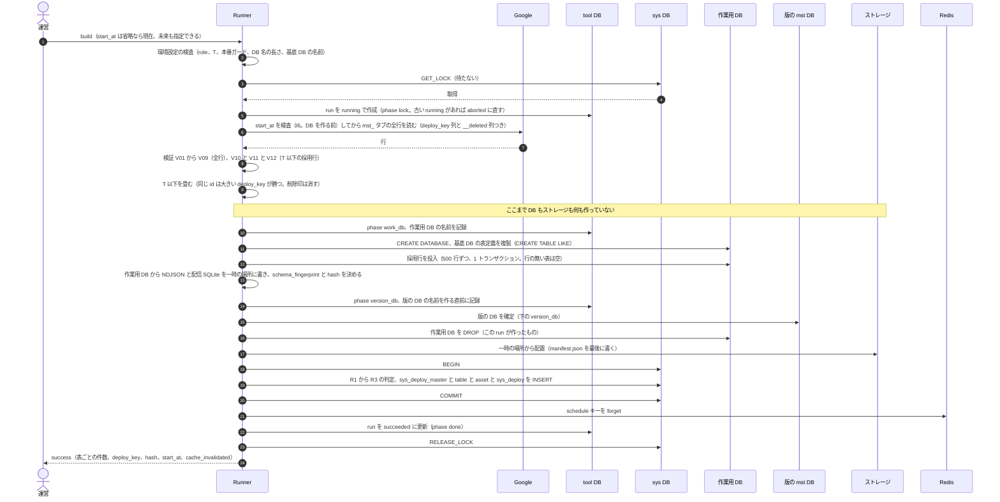

| 項目 | 本物の形のキー（LD 確定後・QA） | 固定キー（develop・LD 仮） |
| --- | --- | --- |
| T | `explicit_key`（`YYYYMMDDNN`。リクエストでは渡せない） | `fixed_key`（`9999999999`・`8888888888`。本番・ステージングでは拒否） |
| 検査 | V04 の形・予約帯未満（`MasterDeployKeyPolicy::assertRealKey`） | 許可リストの値だけ |
| 採番 | **しない**（採番は廃止。db.md 3.4） | しない |
| 同じ内容の再 build | 同じ `(deploy_key, hash)` → master を再利用（R1）し、`sys_deploy` の行だけ足す（新しい `id`） | 同じ |
| 内容が変わった再 build | **別の hash** の新しい成果物・版の DB。`sys_deploy` に新しい行（build は同じ `deploy_key` の別 hash を許す。db.md 3.6） | 同じ。新しい `sys_deploy.id` になるのでクライアントは `needs_update` に気づく（R2） |

- 手順 9 までは**外部の読み取りと計算だけ**で、DB もストレージも何も作らない（失敗してもそのまま終われる）。手順 11 から DB を、手順 17 からストレージを作るが、`sys` に行が無い間は**配信に影響しない**（API は `sys_deploy_master.mst_database` が指す DB しか読まない）。
- **`sys` への登録（手順 18〜20）が唯一の公開操作**で、1 トランザクション。版の DB・成果物は、登録の前に完成・検証済み（**mst の DB と sys の 2 つにまたがる整合の問題は無い**。4.6）。
- **版の DB の確定（`version_db`。db.md 6.6）**: 成果物の有無ではなく**DB の状態**で決める。

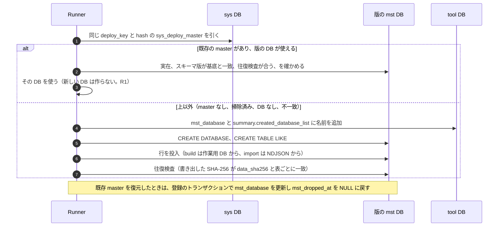

### 2.2 import（review・production・staging）
review は QA の成果物を、production は review から、staging は production の成果物を時間差で同じ `start_at` で取り込む（Nexus overview 5.2・8）。**シートは読まず、畳まない。**

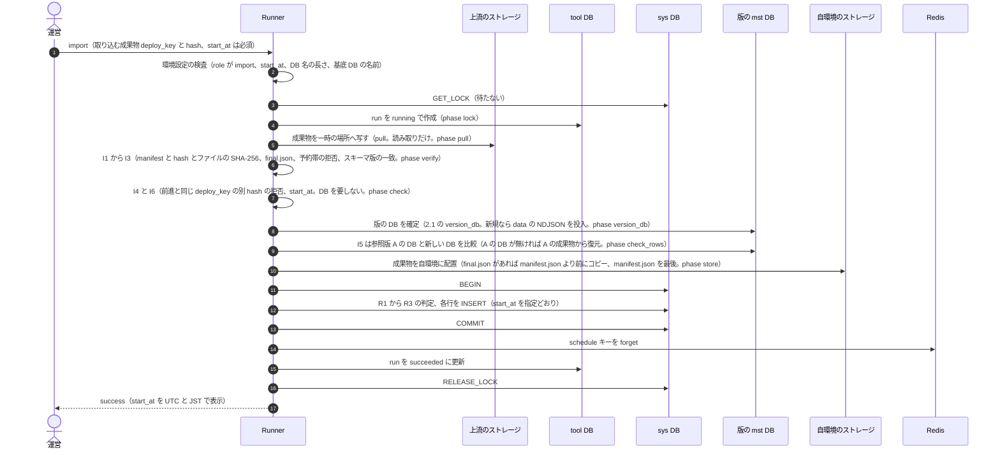

- **I4 の「同じ `deploy_key` の別 hash の拒否」（R3）は全 import 環境**で行う。**I4 の前進（`deploy_key_regression`）と I5 は production だけ**（`enforce_confirmed_rows`）。I6 の過去の拒否は `reject_past_start_at`（production）で、警告は全環境。I2 は production・staging、`not_finalized` は `require_finalized` が true の環境（既定は import の全環境。**仮置き**）。db.md 6.7・7.2 のとおり。
- **検査の順序**（db.md 6.6・6.7）: I1〜I3（`verify`）→ **I4・I6（`check`。DB を要しない）**→ 版の DB の確定（`version_db`）→ **I5（`check_rows`）**→ 配置 → 登録。DB を要しない検査の失敗では**DB を作っていない**。I5 の失敗は、この run が作った DB を `DROP` する（4.8）。
- **既存の master を再利用する（R1）とき**は、I4 の「前進」と I5 を省く（過去の登録で検査済みで、`start_at` を足すだけ。R3 は常に行う。古い版へ戻すなら 2.4 の巻き戻しを使う）。
- staging は production と同じ `start_at` を指定する。取り込み時点で既に過ぎていてもよい（staging は `reject_past_start_at` が false）。
- **`store` の順序**（db.md 6.6）: **`final.json` があれば `manifest.json` より前にコピーする**。完成の印は `manifest.json` のまま。`manifest.json` の後に `final.json` をコピーして途中で落ちると、完成した成果物に `final.json` が無く、`require_finalized` で `not_finalized` になって詰まるため。
- **I5 で参照版 A の DB を復元するとき**（db.md 6.6 の手順 4・6.7。M3）: 「DB を作る → 往復検査 → `sys` の A の `mst_database` を更新し `mst_dropped_at` を NULL に」を済ませた**時点で、その DB を `created_database_list` から外す**。以後は sys が指す A の DB なので、**後続の失敗（`store_failed`・`register_failed` など）でも `DROP` しない**（消すと、sys が指す DB が無くなり `Unknown database` になる）。**A の更新自体が失敗したら、作った DB を `DROP` して I5 を `reference_unavailable` で拒否する**。この A の更新は、登録とは別のトランザクションで、登録より前に行う（db.md 3.6）。
- `start_at` の既定・警告（`start_at_too_soon`・`start_at_shadowed`）・即時の指定は db.md 3.6。画面・CLI は UTC で受け、JST を併記して表示する（**仮置き**）。

### 2.3 start_at での切り替え（各サーバーが独立に決める）
運営は 0 時に操作しない。`start_at` を過ぎたかどうかは、**各 API サーバーがリクエスト時刻で独立に**決める（ADR 0007 の決定。db.md 3.3・8.3）。

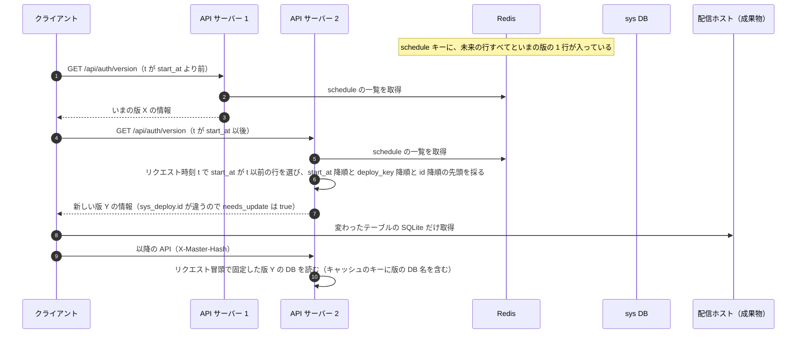

- **一覧をキャッシュして、リクエスト時刻で毎回選ぶ**ので、`start_at` をまたいでも古い版が TTL の間返ることは無い（db.md 8.3）。登録のたびに schedule キーを `forget` し、届かなくても最大 `schedule_ttl`（60 秒）で新しい登録が見える。
- 切り替え後は mst のキャッシュの破棄が**要らない**（版が変われば別のキー `mst:{DB名}:{表}:all` を引く。db.md 8.4）。
- クライアントは `sys_deploy.id` の厳密一致で更新を判断し、`deploy_key` は読まない（Nexus の契約。変えない。6 節）。**切り替えの瞬間のクライアントの扱い（メンテナンスで吸収するか、事前ダウンロードか）は未決**（R20。既定はメンテナンスで吸収。クライアントの変更なし）。サーバー間の時計のずれで、`start_at` の瞬間に数秒ずれる可能性は残る（**未確認**。db.md 8.3）。
- **アセット**は同じ規則（`{deploy_key}_{hash}`）だが、設計は別の機能（R23）。この文書では扱わない。

### 2.4 巻き戻しと予約の取り消し
巻き戻しは**新しい `sys_deploy` 行を `start_at = max(現在, 直前の最新行の start_at) + 1 秒` で入れる**（決定は「`sys_deploy` の切り替え」。形は**仮置き**。db.md 3.6・R43）。**直前の最新行**は、巻き戻しの時点でいまの版（db.md 3.3）。**同じ秒だと同点の規則（`deploy_key` が大きい方）で戻し先が負けて黙って無効になりうる**ので、必ず直前の最新行より後にする。DB・成果物は作り直さない（使えないときだけ成果物から復元）。実行記録は `kind = rollback`（phase は `lock`・`check`・`version_db`（戻し先の DB を復元するときだけ）・`register`・`done`。db.md 5.2）。

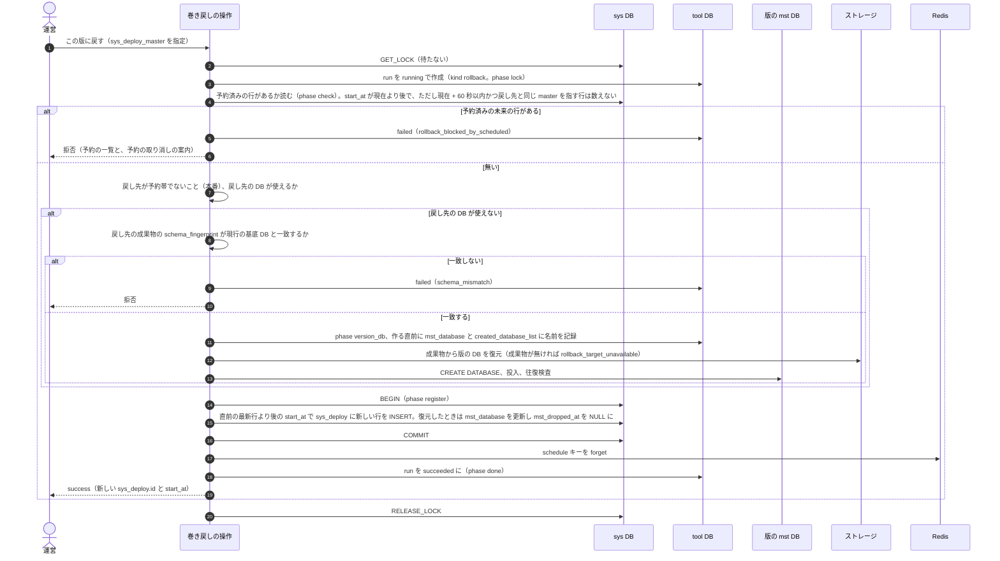

- **予約済みの未来の行があるときは拒否**する理由: 未来の行の `start_at` に到達すると、その行が最新になって**巻き戻しが黙って無効になる**ため。`is_active` を見るかの決定（未決。R39）には依存しない（db.md 3.6）。
- **「予約済み」から除く行**（db.md 3.6。**仮置き**）: `start_at <= 現在 + 60 秒` **かつ戻し先と同じ master を指す行**は数えない。巻き戻しの `start_at` は現在より約 1 秒先になりうるので、直後のやり直しが `rollback_blocked_by_scheduled` にならないため。**戻し先と別の版を指す近い予約は除かない**（除くと、その行が到達して巻き戻しが黙って無効になる）。
- **巻き戻しの二重登録は防がれない**（db.md 3.6。**許容**）: 巻き戻しを 2 回続けると、2 回目の `start_at` は「直前の最新行（1 回目の行を含みうる）+ 1 秒」になり、同じ master・同じ `start_at` ではないので `already_registered`（二重登録の防止）に当たらず、**行が 1 つ増えるだけ**で害は無い（どちらも同じ版を指す。最新は後の行）。`already_registered` が効くのは、`start_at` を明示した build・import の再実行など、同じ `start_at` になる場合（4.4）。
- **戻し先の DB が使えない**ときの判定は、**戻し先の成果物の `schema_fingerprint` が自環境の基底 DB のスキーマ版と一致するか**（I3 と同じ。db.md 3.6 の R1）。一致すれば復元、一致しなければ `schema_mismatch` で拒否。復元の失敗・登録の失敗では、この run が作った DB だけを `DROP` する（4.4）。
- クライアントは `sys_deploy.id` が変わるので更新に気づく。同じ内容の版でも、表ごとの hash が同じなら取り直すテーブルは無い。

**予約の取り消し**（`master:cancel-schedule {sys_deploy.id}`。**仮置き**。R41。実行記録は `kind = cancel_schedule`。phase は `lock`・`check`・`register`・`done`）:

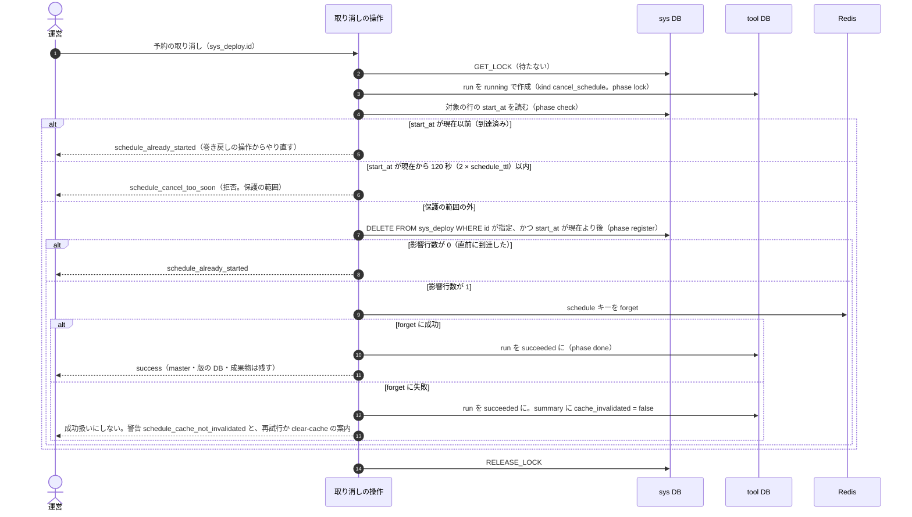

- **直前の取り消しを拒否する**（`schedule_cancel_too_soon`。db.md 3.6）: API は切り替え予定の一覧を TTL（60 秒）でキャッシュし、取り消し後の `forget` は失敗しうる（tool と api が同じ Redis かは**未確認**）。**防がれる再現シナリオ**: 登録済みの未来の行を `start_at` の 10 秒前に取り消す → API のキャッシュに取り消した行が残る（`forget` の失敗、または届かない）→ `start_at` に到達して、**取り消した版が最大 60 秒配信される**。保護の範囲（`start_at` が現在 + 120 秒以内）の取り消しは拒否されるので、このシナリオは起きない。保護の範囲の外（十分先）の取り消しなら、キャッシュに取り消した行が残っても、TTL が `start_at` より前に切れる。tool と api の時計のずれで「到達していない」という判定自体が崩れうる点も、保護の範囲が吸収する。
- **取り消し後の `forget` の失敗は成功扱いにしない**（db.md 3.6）: run は `succeeded` のまま、`summary.cache_invalidated = false` と警告 `schedule_cache_not_invalidated` を実行記録と結果に残し、呼び出し側（画面・CLI）に「再試行する、または `clear-cache` を実行する」案内を出す。登録・巻き戻しの `forget` の失敗も同じ警告を返す（登録自体は成功のまま）。
- 「まだ一度も配信されていないので履歴の欠落は無い」という理由づけは、時計のずれで崩れうるので、**保護の範囲の内側では使わない**（db.md 3.6）。範囲の外では、取り消した行は配信されていない（`start_at` が十分先）。
- **取り消しも巻き戻しもできない窓**（db.md 3.6。**許容**）: 予約の `start_at` が現在 + 120 秒以内になると、取り消しは拒否され、巻き戻しも予約済みの行で拒否されるので、最大 120 秒どちらもできない（緊急の手段は `is_active`（R39）の決定待ち）。運用: 予約が現在 + 120 秒より先なら取り消せる（早めに判断する）。窓に入ったら、到達して配信が始まるのを待ってから巻き戻す。
- `sys_deploy_master`・版の DB・成果物は残す（別の予約や巻き戻しの対象になりうる）。`is_active` を 0 にする方式は採らない（db.md 3.6）。取り消しの後に巻き戻しを行う。取り消した予約を残したいときは、巻き戻しの後に同じ版を改めて予約する（R1）。

### 2.5 QA 完了（提案 R28）と追従検出（提案）
**提案**（人の確認待ち。決定は「QA 完了時の成果物が最終版」「LD の承認は hash と結びつけない」まで。以下は db.md 6.5.1・6.7・7.2 の提案をそのまま書く）。QA の操作は 2 つ（**同じ追従検出の処理**を使う）。
- **追従検出**（`master:verify-sheet` と `master:finalize --dry-run`。**同じ処理**）: シートを読み、同じ T で畳み、`deploy_key` ごとの `row_digest` を成果物のものと比べる。**どちらも `dry_run`** なので**実行記録は作らない**（db.md 6.7・5.1）。結果（`match`・`changed`・`unverified`、`changed_deploy_key_list`）は呼び出し側に返すだけ。
- **QA 完了**（`master:finalize {deploy_key}_{hash}`。実行記録 `kind = finalize`）: **書く前に追従検出を行い**（**前提にする**）、通れば成果物に `final.json` を書く。

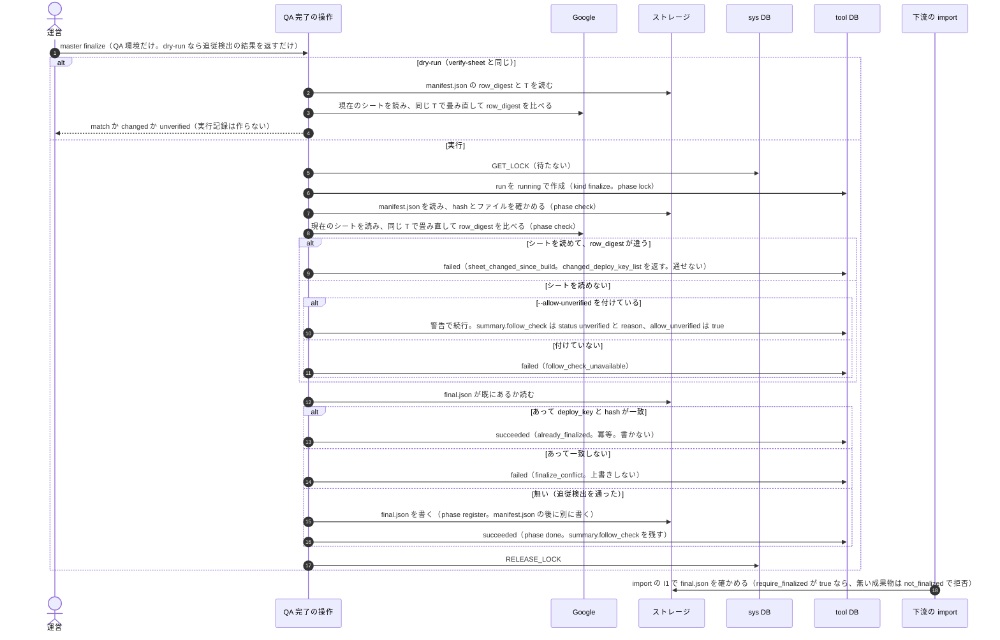

- **`final.json`**: `{deploy_key, hash, finalized_at (UTC), finalized_by_env}`。**`hash` に含めない**（付けても hash は変わらない）。QA の `master:finalize` が、完成済みの成果物に `manifest.json` の後で別に書く。**書いた後は上書きしない**。`sys`・版の DB・キャッシュは変えない（ロックは、同じ成果物への同時の書き込みを避けるために取る）。
- **追従検出の結果の分岐**（db.md 6.5.1）: 読めて**違う** → `sheet_changed_since_build`（**`--allow-unverified` では通せない**）。**読めない・認証情報が無い** → 既定では `follow_check_unavailable` で拒否。**`--allow-unverified`**（読めない場合だけ使える）を付けると警告で通し、`summary.follow_check = {status: unverified, reason}`・`summary.allow_unverified = true`・`adm_account_id` を実行記録に残す（監査）。`final.json` の中身は変えない（`unverified` の印は成果物に付けず、実行記録だけに残る）。
- **`final.json` が既にあるとき**: `deploy_key`・`hash` が今回の成果物と**一致**なら何もせず `already_finalized`（成功・冪等）、**一致しない**（別の成果物の印、または壊れている）なら `finalize_conflict` で拒否（上書きしない）。
- **`summary.follow_check`**（db.md 5.2）: `status`（`match`・`changed`・`unverified`）・`checked_at`・`artifact_dir`・`changed_deploy_key_list`・`reason`。**画面の `target` の `follow_check` は、直近の `kind = finalize` の実行記録の `summary.follow_check` から出す**（dry run の結果は記録が無いので画面には出ない。呼び出した人の画面・CLI にだけ返る）。
- 下流の import は、`require_finalized`（review・production・staging の既定で true。**仮置き**）のとき、`final.json` が無い、またはマニフェストと違う成果物を `not_finalized` で拒否する（4.8）。import の `store` は、`final.json` があれば `manifest.json` より前にコピーする（2.2）。
- `row_digest` は build が実行記録（`summary.row_digest`）とマニフェストに残す（db.md 6.5.1・6.7）。シートを読めるのは build 環境だけ（QA）。**最終 hash の確定の仕組みと、古い build を review へ渡させないゲートの置き場は未決**（R28）で、`final.json` はその提案の 1 つ。
- 限界: 確定済みの行がシートから黙って消えたことは import の I5 では検出できない（db.md 6.7。R37）。

### 2.6 掃除（`master:cleanup`。既定は `--dry-run`。手動）
実行記録は `kind = cleanup`（phase は `lock`・`check`・`drop`・`done`。db.md 5.2）。
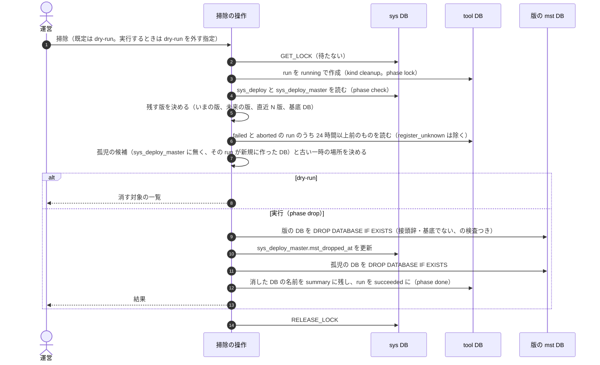

- **残すもの**（db.md 4.6）: いまの版（`start_at` が現在以前の最新）・`start_at` が未来の版（予約済み）・直近 N 版（N = 3 を初期値。**未決**。`sys_deploy_master` を重複排除して数える）・基底 DB。
- **DB だけ消し、`sys_deploy_master` の行と成果物は残す**。消した版へ戻すときは成果物から復元する（2.4）。
- **`DROP` の保護**（db.md 4.6）: 自環境の接頭辞 `{APP_NAME}-{env}-master-` が付き、基底 DB の名前でない名前だけ。そうでなければ `drop_forbidden`。**サーバーを `SHOW DATABASES` で走査して消さない**（db.md 4.7）。例外として、接頭辞 `{APP_NAME}-{env}-master-work-` の作業用 DB で、実行記録が無いもの（dry run の異常終了）は、名前の時刻で判定して掃除してよい。
- **掃除の対象外の run**: **`error_code = register_unknown` かつ `summary.resolved` が無い run** の DB（登録済みの可能性があるため。解決は 2.7）。解決した run は対象外から外れる。
- 異常終了で残った一時の場所（`.tmp/`）は、名前の時刻が `orphan_grace_hours`（24 時間）を過ぎたものを削除する（db.md 4.7）。
- **順序は db.md 4.6 のとおり**: `DROP DATABASE IF EXISTS` が先、`mst_dropped_at` の更新が後。DROP の後・更新の前に止まっても、再実行が冪等に完了する（`IF EXISTS` なので 2 回目の DROP は何もせず、更新が済む）。逆順（更新が先）だと、止まったときに DB が残ったまま「消した」ことになり、掃除の対象から漏れる。DB が実在しないことは、巻き戻しの `version_db` が `information_schema.SCHEMATA` で検出して復元する（2.1）。

### 2.7 `register_unknown` の片付け（`master:resolve-unknown {run_id}`。db.md 4.7）
`sys` の COMMIT の成否が不明で `sys` も読めなかった run（4.4）の DB は、掃除の対象外のまま残る。人が `sys` を確認して片付ける。**ロックの中**で行い、**新しい run は作らず、対象の既存の run を更新するだけ**（`kind` は足さない。**仮置き**。db.md 4.7）。**放置すると DB が残り続ける**（画面の `target` に警告を出し続ける）。

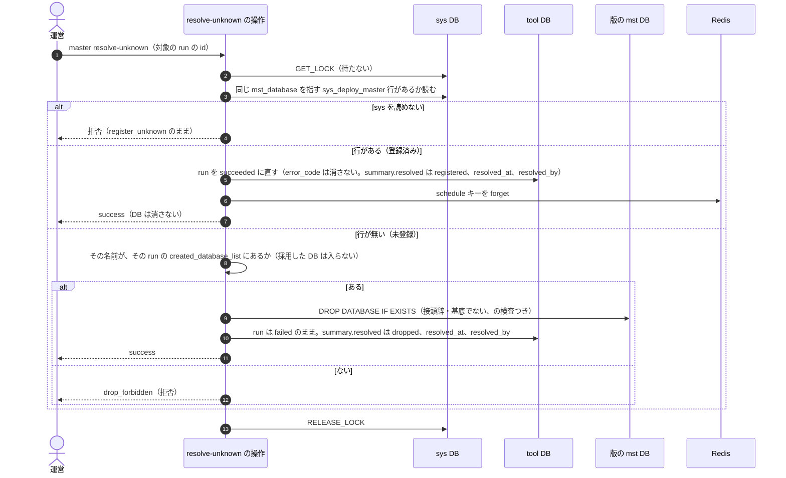
- **ツールが `sys` を再確認する**のは、人の誤判断で登録済みの DB を `DROP` しないため。**再現（これを避ける）**: run1 が `register_unknown` で終わる → 再実行の run2 が同名の DB を**採用して登録**する → 人が run1 を「未登録」と判断して DROP すると、登録済みの DB が消える。`sys` の再確認（行がある）と、`created_database_list`（採用した DB は入らない。db.md 4.2）の条件が防ぐ。
- 解決した run は、掃除の対象外の条件（`summary.resolved` が無い）から外れる。

## 3. dry run

### 3.1 build の dry run
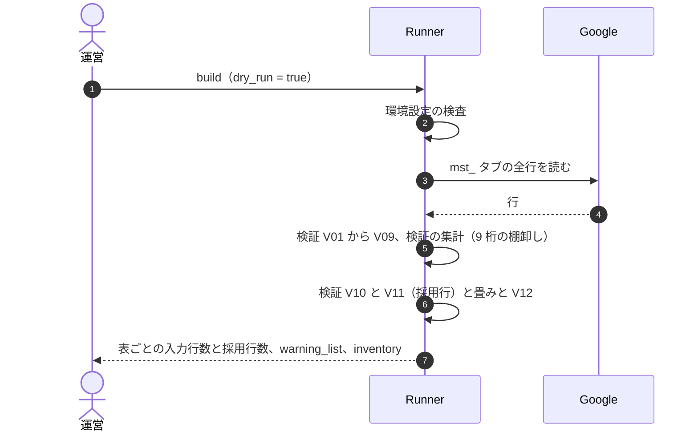
**ロック・実行記録・DB・成果物・キャッシュは一切使わない**（副作用なし。db.md 6.6）。検証でエラーがあっても**全件を集計して**返す（`error_list` は 20 件で切るが `error_total` と `error_count_by_code` は全件。db.md 9.3）。**DB に投入しないので、`dry_run` が成功しても `load_failed` になりうる**（db.md 6.3）。旧版の「次のキーの予告」「mst との差分の件数」は無い（採番・差分反映が無い）。

### 3.2 import の dry run（db.md 6.6）
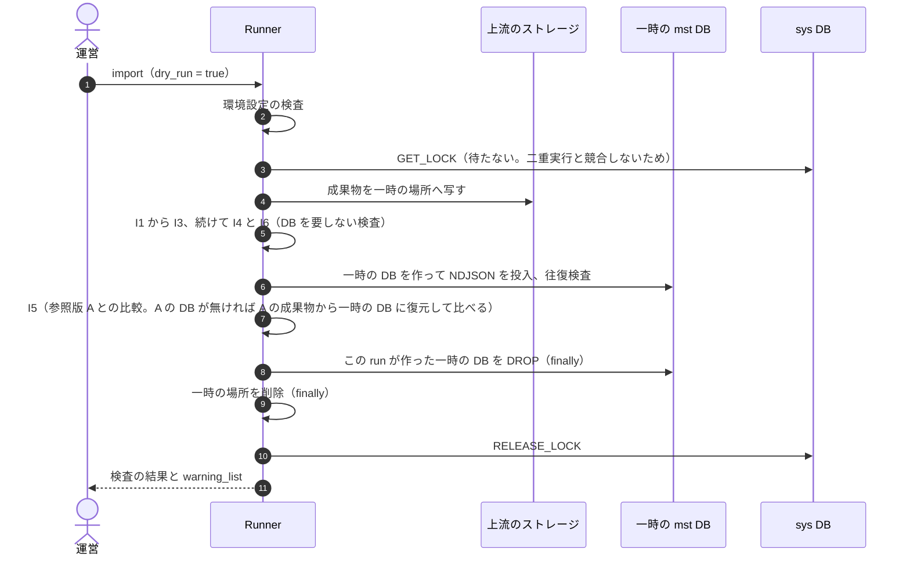
**登録・成果物の配置・キャッシュの破棄はしない**。ロックは取るが、**実行記録は作らない**（db.md 5.1）。作った一時の DB は `created_database_list` を**メモリだけ**に持って `finally` で `DROP` し、一時の場所も必ず片付ける。**I5 で A の DB が使えないときも `sys` は更新しない**（本番の import は A の `mst_database`・`mst_dropped_at` を更新して復元するが、dry run は一時の DB に復元して比べ、捨てる）。異常終了で残った一時の DB は、名前の時刻で掃除する（db.md 4.7）。

## 4. 異常系
**どの異常系でも、`sys` は登録の前なら元のまま**で、配信は変わらない（登録は `sys` の 1 トランザクションだけ。5 節）。DB の `DROP` は、**この run が新規に作った名前だけ**（db.md 4.7）。

### 4.1 検証の失敗（`sheet_invalid`）
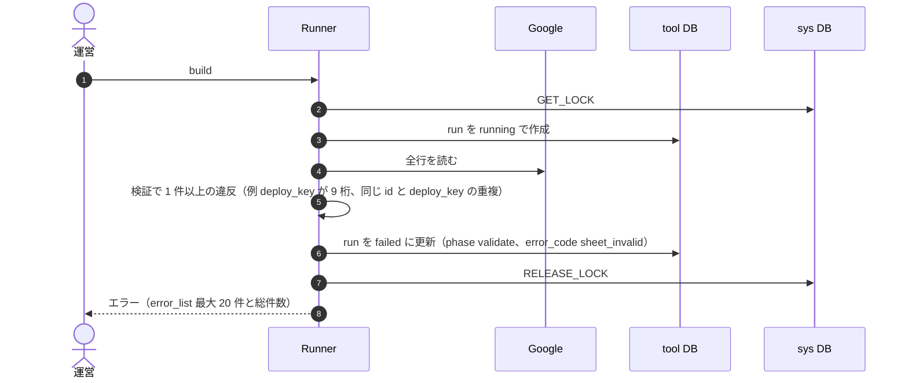
作業用 DB・版の DB・成果物・`sys` は**何も作らない**。一部の行だけが入ることは無い（決定 9）。DB への投入で DB が型・NOT NULL・`uk_*` を拒否したときは `load_failed`（4.3）。

### 4.2 排他（`deploy_locked`）
他のデプロイ操作（build・import・巻き戻し・予約の取り消し・掃除・QA 完了）がロックを持つ間に来た要求は、`GET_LOCK` が 0 を返して**待たずに**拒否（`deploy_locked`）。`tol_master_deploy_run` は作らない（実行中の行を `aborted` に直さないため。ロックを取れていないので古い `running` を判断できない）。画面は `target` の `running` を見せ、しばらくして押し直してもらう（api.md）。

### 4.3 build の途中失敗（版の DB と孤児）
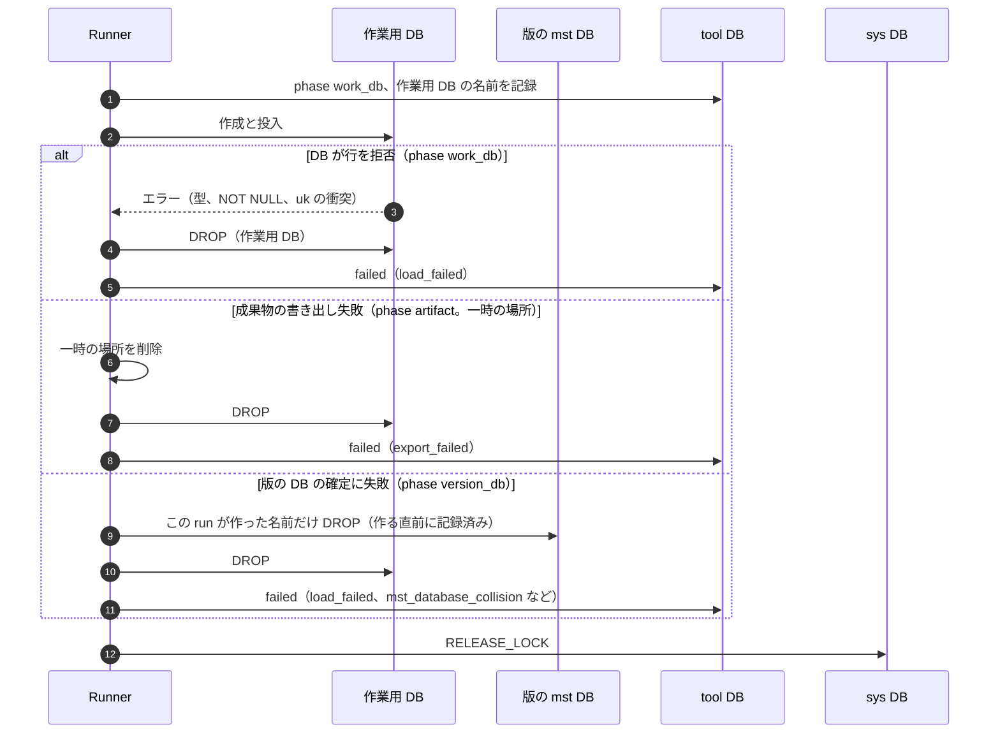
- 段階の名前（phase）は db.md 5.2 のとおり（build: `lock`・`read`・`validate`・`fold`・`work_db`・`artifact`・`version_db`・`store`・`register`・`done`）。コード名の `export_failed` などは db.md 3.6 が正本（api.md 13.1 で確定済み）。
- **`DROP` は「この run が新規に作った名前」だけ**（`summary.created_database_list`。接頭辞・基底 DB でない、の検査つき。db.md 4.6・4.7）。**採用した既存の DB**（`sys` に行が無いが中身が成果物と一致したもの）と、**R1 で再利用した既存の版の DB は、この run が作ったものでないので `DROP` しない**。
- **孤児の DB の扱い**: `DROP` に失敗した、またはプロセスが止まった（4.7）DB は、**実行記録に名前が残る**（`mst_database`・`summary.work_database`・`summary.created_database_list`。作る直前に書く）。配信には影響しない。`master:cleanup` が、`failed`・`aborted` の run のうち 24 時間経過後に、`sys_deploy_master` に無く、かつその run が新規に作った DB を `DROP` する（2.6。`sys` を再確認してから）。**`error_code = register_unknown` かつ `summary.resolved` が無い run の DB は対象外**（登録済みの可能性があるため。`master:resolve-unknown` で片付ける。2.7）。
- 一時の場所のファイル（`master_artifact` の disk の `.tmp/`）は、run の終わりに（成功・失敗とも）削除する。異常終了で残ったものは `master:cleanup` が 24 時間後に削除する（db.md 4.7）。置いてしまった成果物のディレクトリは害が無く、そのままにする（同じ内容なら次の build が再利用する。ただし**次の build も `version_db` で DB の状態を確かめる**ので、DB が無いまま登録されることは無い。4.6）。
- 失敗の次の操作は、そのまま再実行してよい。

### 4.4 `sys` 登録の失敗（`register_failed`・`register_unknown`）
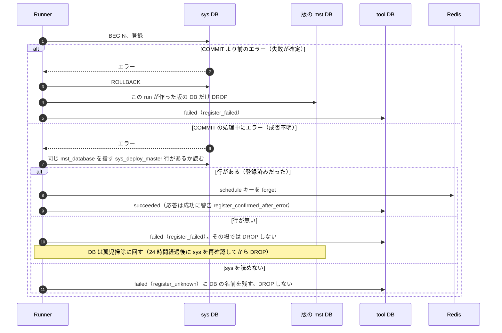
- 登録が `sys` 1 つだけなので、**ロールバックすれば元のまま**（旧版のように mst 側を戻す・補償する必要は無い。4.6）。
- **COMMIT の処理中のエラーは成否不明**（サーバー側で確定済みの可能性がある）。COMMIT より前のエラーは失敗が確定なので、その場で DROP してよい。成否不明のときに版の DB を `DROP` してしまうと、**登録済みの版の DB を壊す**（`start_at` で `Unknown database` になる）。db.md 4.7 の最終形は次のとおり（**既定**。**仮置き**）:
  - **行がある**（登録は済んでいた）: `DROP` しない。**run は `succeeded`、応答は成功に警告 `register_confirmed_after_error`**。登録済みなので schedule キーの `forget` も行う。
  - **行が無い**: 接続断の直後は COMMIT の処理中の可能性やレプリカ遅延がありうるので、**その場では `DROP` せず**、run を `failed`（`register_failed`）で閉じ、**DB は孤児掃除（24 時間経過後。`sys` を再確認してから `DROP`。4.7）に回す**。**代替案**: 数秒待って読み直しを再試行し、それでも行が無いときだけ `DROP` する。
  - **`sys` を読めない**: **`DROP` せず**、名前を実行記録（`status = failed`・`error_code = register_unknown`）に残し、**掃除の対象外**にする。人が `master:resolve-unknown` で片付ける（2.7）。
- **復元（R1 で `mst_dropped_at` が NULL でない・DB が無い版を作り直した）の登録が失敗**したときも、この run が作った新しい DB だけを `DROP` し、**元の `mst_database` が指していた古い DB は触らない**（db.md 6.6）。
- **二重登録の防止**（db.md 3.6）: 同じ操作をそのまま再実行しても、**同じ `sys_deploy_master`・同じ `start_at` の `sys_deploy` が既にあれば、新しい行は作らず既存の行を返す**（`is_new = false`。警告 `already_registered`）。COMMIT の成否不明のあとの再実行で、`start_at` を明示した登録の行が増えない。`start_at` を省略した登録や、巻き戻しの連続（2.4）は対象外で、行が 1 つ増えるだけ（同じ版を指し、害は無い）。

### 4.5 成果物の配置・取得の失敗（`store_failed`・`pull_failed`）
コード名は db.md 3.6 の段階ごとの失敗の語（db.md が正本。api.md 13.1 で確定済み。`store_failed`＝成果物の配置、`pull_failed`＝上流からの取得、`export_failed`＝成果物の書き出し、`register_failed`＝`sys` の登録）。
- **build / import の配置（`store`）**: `manifest.json` を書く前に失敗したら、そのディレクトリは**未完成**（`manifest.json` が無い）として無視され、害は無い。この run が作った版の DB は `DROP` する（4.3 と同じ。**配置は `version_db` の後**なので、DB は既にできている）。`sys` は元のまま。再実行は、ファイルを書き直す（`manifest.json` が無い場合は既存を使わない）。
- **import の pull（`pull`）の失敗**（上流に読めない・欠損）: 一時の場所を削除して終わる。**DB も `sys` も作っていない**。
- import の `store` は **`final.json` を `manifest.json` より前にコピーする**（2.2）。途中で落ちて `final.json` だけが残っても、`manifest.json` が無いので未完成として無視される。逆の順だと、完成した成果物に `final.json` が無く、下流が `not_finalized` で詰まる。
- 配置の後に `sys` の登録が失敗した場合は、成果物のディレクトリが残るが、**`sys_deploy_master` が無いので配信されない**（4.4）。

### 4.6 旧設計との対比: 「補償」と `inconsistent` は不要になった
**旧設計（ADR 0005）**は、1 つの mst を書き換えるので、mst と sys の**2 つの DB にまたがる整合**を守る必要があった。

| 旧設計 | 版ごとの DB（ADR 0007） |
| --- | --- |
| mst のトランザクションを開いたまま `sys` に登録し、`sys` を先にコミット、mst を最後にコミット | mst への書き込み（版の DB の作成・投入）は**登録の前に済み**、**未登録の DB だけが相手**。登録は `sys` の 1 トランザクション |
| `sys` のコミット後に mst の COMMIT が失敗する窓があり、クライアントには新しい版を案内するのに API の mst は古い状態になりえた（5.4） | その窓が**無い**。登録が成功すれば版の DB は完成・検証済み。失敗すれば版の DB は孤児になるだけ |
| 補償（`sys_deploy` の無効・有効を戻す）、`inconsistent`（補償済み・補償できず）、再実行で収束させる前提 | **不要**。`inconsistent` の status・補償・`compensated` は無い（db.md 5.2。status は `running`・`succeeded`・`failed`・`aborted`） |
| phase `commit`・`invalidate` と「最後に commit 以降へ進んだ run」の探索で、再実行が mst の全表・`sys_deploy` のキャッシュを破棄（M1） | **不要**。mst のキャッシュのキーに版の DB 名を含め、版の DB は書き換えないので、破棄が要らない（db.md 8.4）。残る破棄は schedule キーだけ（4.10） |
| `TRUNCATE`・差分反映の途中失敗で mst が空・中途半端 | 1 つの mst を書き換えないので起きない |

- **残る注意**は 4 つだけ: ① 孤児の版の DB・作業用 DB（4.3。配信に影響せず、実行記録で追って掃除する）② schedule キーの `forget` の失敗（4.10。最大 `schedule_ttl` で直る。予約の取り消しだけは警告と案内を返す）③ `sys` の COMMIT の成否不明のとき、行が無くてもその場では DROP しない（4.4）④ **`register_unknown`（手動確認が要る状態）**: COMMIT の成否が不明で `sys` も読めないときは、DB を `DROP` せず、`failed`・`register_unknown` で名前を実行記録に残し、**`summary.resolved` が付くまで掃除の対象外**にする。人が `master:resolve-unknown` で片付ける（2.7。登録済みなら run を `succeeded` に、未登録なら DB を `DROP`）。旧設計の `inconsistent` と違い、**配信の食い違いではなく、孤児か登録済みかが分からないだけ**で、配信は壊れない。
- **M3 の再現シナリオ「DB 無しの版が登録される」は塞がっている**: 旧設計の骨格で、build が成果物（ディレクトリ）を置いた後に失敗し、次の build が「成果物がある」ことを理由に DB の作成を飛ばして登録すると、版の DB が無い `sys_deploy_master` ができる。新しい設計は、**成果物の有無ではなく DB の状態で登録の可否を決める**（`version_db`。db.md 6.6）。

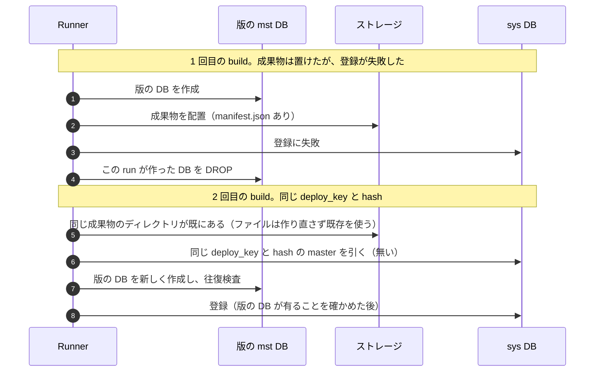
DROP に失敗して DB が残った場合は、2 回目の `version_db` が同じ名前の DB を見つけ、`sys` に行が無いので**中身（スキーマ版・往復検査）が成果物と一致すれば採用**、一致しなければ拒否する（`mst_database_collision` か `load_failed`。db.md 4.2）。**採用した DB は `created_database_list` に入れず、以後の失敗・掃除でも `DROP` しない**。

### 4.7 プロセスが途中で止まる（タイムアウト・強制終了。`running` → `aborted`）
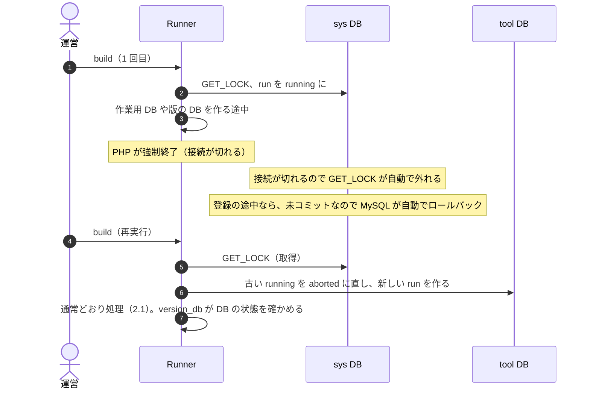

| 止まった位置 | 残るもの | 次回 |
| --- | --- | --- |
| 検証・畳み（import は `verify`・`check`）まで | 何も無い（一時の場所のファイルが残りうる。4.3） | そのまま再実行 |
| `work_db` | 作業用 DB（`summary.work_database`） | 再実行は新しい名前（時刻とランダム）。残りは 24 時間後に掃除 |
| `artifact` | 作業用 DB、一時の場所のファイル | 同上。一時の場所は未完成として無視 |
| `version_db`・`check_rows` | 作業用 DB、途中の版の DB（`mst_database`・`created_database_list`） | 再実行の `version_db` が同じ名前を見つけ、`sys` に行が無いので中身が一致すれば採用、違えば拒否。24 時間後に掃除 |
| `store` | 版の DB、途中の成果物（`manifest.json` が無い） | 再実行は未完成として書き直す。DB は上と同じ |
| `register`（COMMIT の前） | 版の DB（`sys` は MySQL が自動でロールバック） | 再実行が再利用か採用。配信は変わらない |
| `register`（COMMIT の後・run の更新の前） | **登録は完了**。run が `running` のまま | 次の操作が `aborted` に直す。`sys_deploy_master` に行があるので、掃除は DB を消さない。schedule キーの `forget` が済んでいなければ最大 60 秒で自然に直る |

`register_unknown`（4.4）は、プロセスが止まったのでなく、COMMIT の成否が不明で `sys` も読めなかったときに、**止まらずに** `failed` で終えた状態。`aborted` とは別で、`summary.resolved` が付くまで掃除の対象外（`master:resolve-unknown` で片付ける。2.7）。

- **M3 は塞がっている**: どの位置で止まっても、次の build・import は**DB の状態で登録の可否を決める**ので、**DB の無い版が登録されることは無い**（4.6。db.md 6.6）。
- **旧設計の「`sys` のコミット後・mst のコミット前に落ちる」「mst の COMMIT 後・キャッシュ破棄前に落ちる」という状態は無い**。再実行時の全表破棄の判定（M1）も不要。
- `aborted` の行は、次の操作が見つけて直す。画面の警告は孤児の DB の有無などを出す（api.md）。

### 4.8 import の検査の失敗
エラーコードは db.md 3.6・6.7 と同じ。**検査の順序は db.md 6.6・6.7 のとおり**: I1〜I3（`verify`）→ **I4・I6（`check`。DB を要しない）→ `version_db` → I5（`check_rows`）** → 配置 → 登録。**DB を作る前の検査（I1〜I4・I6）の失敗では DB を作っていない**ので、`DROP` するものは無い。**I5 以降の失敗だけ**、この run が作った DB を `DROP` する。

| 検査・規則 | `error_code` | 段階（phase） | 失敗時に残るもの |
| --- | --- | --- | --- |
| I1 manifest・hash・ディレクトリ名・各ファイルの SHA-256（改ざん・欠損） | `artifact_invalid` | `verify` | 一時の場所だけ（削除する） |
| I1 `require_finalized` なのに `final.json` が無い、またはマニフェストと違う | `not_finalized` | `verify` | 同上 |
| I2 予約帯の成果物（production・staging） | `reserved_key_forbidden` | `verify` | 同上 |
| I3 スキーマ版が自環境の基底 DB と違う | `schema_mismatch` | `verify` | 同上 |
| I4 `deploy_key` が参照版 A のキー K より小さい（新しい master。production） | `deploy_key_regression` | `check` | 何も作っていない |
| I4 同じ `deploy_key` の master が別の hash で既にある（R3。**全 import 環境**） | `confirmed_key_modified` | `check`（登録の `register` でも再判定） | 何も作っていない |
| I6 `start_at` が許容幅を超えて過去（production） | `start_at_past` | `check` | 何も作っていない。警告 `start_at_too_soon`・`start_at_shadowed` は止めない |
| 往復検査が合わない・投入が拒否される | `load_failed` | `version_db` | この run が作った DB を `DROP` |
| 名前が既にあり完全な hash が別（衝突）で、伸ばしても入らない | `mst_database_collision` | `version_db` | 同上 |
| I5 確定済みキー以下の行が A と違う（表と `id` を返す。production） | `confirmed_key_modified` | `check_rows` | この run が作った DB を `DROP` |
| I5 で A の DB が使えず、A の成果物も無い・復元できない。または A の復元後の `sys` の更新が失敗した | `reference_unavailable` | `check_rows` | 同上（A の更新の失敗では、復元で作った DB を `DROP`） |

- **確定済みキーの行の変更は、新しいキーの行として入れる**規則の強制が I5（production だけ。**提案**。R25）。**A = 登録済みの `sys_deploy_master` のうち `deploy_key` が最大のもの**で、`start_at` が最新の版ではない（db.md 6.7）。
- **I5 の限界**: 行ごと黙って消えたことは検出できない（R37。`row_digest` の案は 2.5）。
- **A の復元の扱い**（db.md 6.6 の手順 4）: A の DB を復元し、往復検査を通して `sys` の A の `mst_database` を更新した時点で、`created_database_list` から外す。以後の失敗では `DROP` しない（2.2）。A の更新自体が失敗したら `DROP` して `reference_unavailable`。
- 同じ `(deploy_key, hash)` は R1（再利用）で、I4 の前進と I5 を省く（R3 は常に行う）。**古い版へ戻すのは import でなく巻き戻し**（2.4）。

### 4.9 スキーマ更新と hash（R34 の帰結）
**hash の入力にスキーマ版（`schema_fingerprint`）を含める**（**仮置き**。db.md 6.5.2）ので、**スキーマ更新だけで、同じデータでも hash が変わる**。review が取り込み済みの `(K, h1)` に対し、QA で同じ `K` を再 build した `(K, h2)` が、review の R3 で拒否されて詰まる。

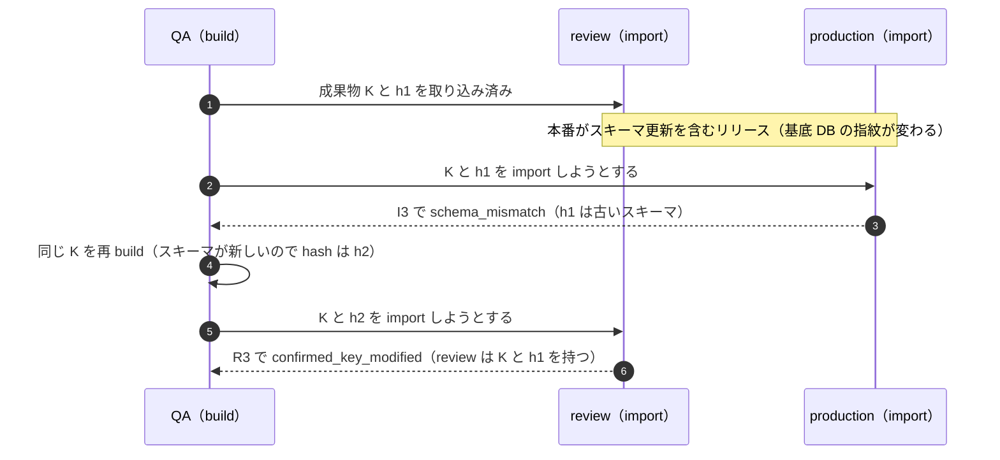
- **回避の運用**（**仮置き**）: スキーマ更新を伴うリリースは、**未配信の版が review・production の手前に溜まっていない**ときに行う。または、QA で**新しいキーの版を作り直す**（NN の付け方は R32）。
- **古い版の DB**: スキーマ更新後、その版の巻き戻し・復元は **`schema_mismatch` で拒否**（API は指紋を見ない。検査は操作側。db.md 4.8）。凍結前は版の DB を作り直す。凍結後は `mst:migrate-versions`（仮称）で全保持版にマイグレーションを流し、`schema_fingerprint` を更新する。
- **未決**（R34）: スキーマ変更後に、古い成果物を復元・import できるか（成果物のスキーマ移行）と、R3 の例外。ここでは決めない。

### 4.10 schedule キーの破棄の失敗
登録・巻き戻しの後の `forget` が失敗しても、操作は**成功のまま**。結果の `cache_invalidated = false` と警告 `schedule_cache_not_invalidated`、run の `summary.cache_invalidated` に記す。**最大 `schedule_ttl`（60 秒）で自然に直る**（db.md 8.3）。旧設計と違い、**次の操作が全表を破棄する仕組みは無い**（要らない）。すぐ直したいときは `POST /master-import/clear-cache`（schedule キーだけに縮む。api.md）。`tol_master_deploy_run` は `succeeded`。

**予約の取り消しだけは、失敗を成功扱いにしない**（db.md 3.6）。取り消した行が API のキャッシュに残ると、取り消した版が配信されうるため、結果に `cache_invalidated = false` と警告 `schedule_cache_not_invalidated` を返し、呼び出し側（画面・CLI）に「再試行する、または `clear-cache` を実行する」案内を出す（2.4）。保護の範囲外の取り消しなら、キャッシュに残っても TTL が `start_at` より前に切れる。

## 5. トランザクション境界

| 段階 | 接続・対象 | 範囲 | 失敗したとき |
| --- | --- | --- | --- |
| ロック | `sys`（`GET_LOCK`） | 取得から `RELEASE_LOCK`（またはプロセス終了）まで。トランザクションではない | 取れなければ `deploy_locked`。プロセスが落ちれば自動で外れる |
| 実行記録（全 kind） | `tool` | 各更新が autocommit（トランザクションの外） | `sys` の COMMIT の**前**の書き込み失敗は中止（`failed`）。**COMMIT の後**の書き込み失敗は中止せずログに残す（残った `running` は次の実行が `aborted` に直す。**仮置き**。db.md 5.2） |
| **実行記録の書き込み（`register_unknown`）** | `tool` | `sys` の COMMIT の成否不明のあと、`sys` を読めずに `failed`・`register_unknown` と版の DB の名前を書く。**これは COMMIT の成否が分からない状態での書き込みで、書けなければ名前が失われる**ので、書き込みの失敗はログと標準エラーにも名前を出す | DROP しない。`summary.resolved` が付くまで掃除の対象外（4.4） |
| シート読み込み・検証・畳み・pull・I1〜I4・I6 | なし（メモリ・一時の場所。I4 は `sys` の読み取り） | - | 何も変わらない（DB を作る前） |
| **DDL**（`CREATE DATABASE`・`CREATE TABLE LIKE`・`DROP DATABASE`） | `mst` 接続（作業用 DB・版の DB） | **トランザクションの外（暗黙コミット）**。ロールバックできない | 失敗したら、この run が作った名前だけ `DROP`（4.3）。**未登録の DB だけが対象**なので、残っても配信に影響しない |
| 行の投入（作業用 DB・版の DB） | `mst` 接続 | 1 トランザクション（500 行ずつ。**すべての DDL の後**に開く。db.md 6.6） | `rollBack` して `load_failed`。DB ごと `DROP` |
| 往復検査・I5 | `mst` 接続（読み取り） | - | `load_failed`・`confirmed_key_modified`・`reference_unavailable`。この run が作った DB を `DROP` |
| 成果物の配置・`final.json` の書き込み | ストレージ | トランザクションなし。**`manifest.json` を最後に書く完成の印**。`final.json` はその後に別に書く | 未完成として無視（4.5） |
| **`sys` の登録**（build・import・復元・巻き戻し） | `sys` | **1 トランザクション**（`DB::connection('sys')->transaction`）。`sys_deploy_master`（再利用でなければ）・`sys_deploy_master_table`・`sys_deploy_asset`・`sys_deploy` の INSERT（と、復元のときの `mst_database`・`mst_dropped_at` の更新）。**他の `sys_deploy` は無効にしない** | `rollBack`。版の DB を `DROP`（COMMIT の成否不明のときは 4.4） |
| 予約の取り消し | `sys` | `DELETE ... WHERE id かつ start_at が現在より後` の 1 文（原子的。直前の取り消しは事前に `schedule_cancel_too_soon` で拒否） | 影響行数 0 は `schedule_already_started` |
| **参照版 A の更新**（import の I5 の復元） | `sys` | A の `sys_deploy_master` の `mst_database`・`mst_dropped_at` の更新。**登録とは別のトランザクションで、登録より前**（db.md 3.6） | 失敗したら、復元で作った DB を `DROP` して `reference_unavailable` |
| `master:resolve-unknown` | `sys`（読み取り）・`tool`・`mst`（DDL） | **ロックの中**。既存の run の更新（autocommit）と、条件を満たすときの `DROP DATABASE IF EXISTS`（暗黙コミット） | `sys` を読めなければ拒否。条件不一致は `drop_forbidden` |
| 掃除 | `mst`（DDL）→ `sys` | `DROP DATABASE`（暗黙コミット）の後に `mst_dropped_at` を更新 | 次の掃除が再実行（`IF EXISTS`） |
| schedule キーの破棄 | Redis | トランザクションなし | 登録・巻き戻しは警告 `schedule_cache_not_invalidated`（成功は取り消さない）。予約の取り消しは成功扱いにせず警告と案内（4.10） |

- **2 つの DB（mst と sys）にまたがる原子性は要らない**（旧設計は、これが無いために補償を持った）。mst の変更は**登録の前に済ませた未登録の DB だけ**に行い、公開は `sys` の 1 トランザクション。したがって、旧設計の「mst のトランザクションを開いたまま `sys` へ」「`sys` を先にコミット」「補償」は無い。
- **mst の DDL はトランザクションの中で使えない**（暗黙コミットが起きる）。そこで、**DDL（版の DB・作業用 DB の作成と表の複製）をすべて先に終え、その後で投入のトランザクションを開く**。`SHOW TABLES`・`SHOW COLUMNS`・`information_schema` の読み取りは DDL ではなく問題ない（読んだ）。

## 6. ゲーム API の version 判定（Nexus の契約は変えない）
**応答の形・`needs_update` の判定（`sys_deploy.id` の厳密一致）・`X-Master-Hash`・`X-Master-Update-Required` は変えない**（Nexus の `api.md`・決定 D4・F8・F9）。変わるのは「どの版か」の決め方と、mst の読み先だけ（db.md 8 節）。

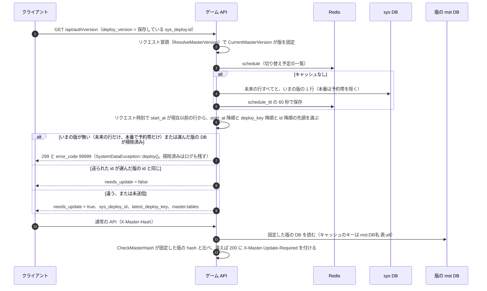
- **版はリクエストの始めに固定**する。途中で `start_at` を過ぎても、そのリクエストは同じ版で終える（`CheckMasterHash` も同じ版の hash と比べる。応答と比較対象がずれない。db.md 8.1・10.4）。
- **版が無いとき**（本番で予約帯しか有効な行が無い・`start_at` が未来のものしか無い）は **299 / 99999**（`SystemDataException::deploy()`）。**基底 DB にフォールバックしない**（本番で空の基底 DB を読まないため。db.md 8.1）。開発は `SysDeploySeeder` が基底 DB を 1 つの版として登録するので動く。
- 固定キーの再 build・巻き戻しは**新しい `sys_deploy.id`** なので、`id` の違いでクライアントが気づく。クライアントは `deploy_key` を読まない（`latest_deploy_key` の意味は「選んだ版の `deploy_key`」。Nexus の契約。R11）。
- 切り替わり前後の schedule キャッシュと `start_at` の関係は 2.3。

## 7. 録画用デプロイ（`make seed-recording` 系。db.md 11.2）
**キーは `7777777777`**（**決定**。Q2）。変わるのは、最新が `start_at` 基準になること。**録画用の `start_at` は現在**で登録すれば最新になる（`deploy_key` の大小は効かない）。**録画用の mst を版の DB としてどう作るかの細部（候補 a: シートを使える環境で `MASTER_DEPLOY_FIXED_KEY=7777777777` の build、b: シーダーが基底 DB の現在の行から版の DB を作る）は未決**（R19）。決めるまで次は**暫定（仮置き）**。

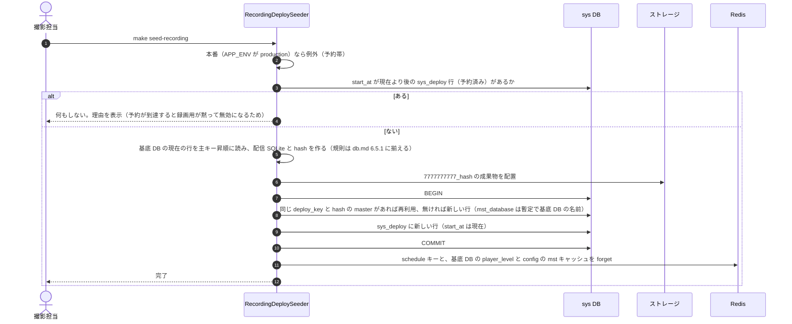
- **旧版の「`deploy_key` が 7777777777 より大きい有効な行があれば何もしない」は廃止**（予約キーの大小は最新に効かない）。LD・開発の固定キーの行があっても、録画用は `start_at = 現在` で最新になる。LD 仮 `8888888888`・開発 `9999999999` の `start_at` が**未来**のときだけ何もしない（予約の条件に含まれる）。
- 基底 DB を指す版は**書き換えられる**ので、mst のキャッシュは従来どおりシーダーが破棄する（db.md 8.4 の「基底 DB は例外」）。
- 元に戻すには `RecordingResetSeeder`（`[REC]` の行と成果物を消す）。**`sys_deploy` の行を消すと前の版が最新に戻る**（**仮置き**）。版の DB 方式が決まれば、作った版の DB の扱いを足す（R19）。
- シートを使える環境では、`MASTER_DEPLOY_FIXED_KEY=7777777777` にして 2.1 の build を行う（候補 a）。この場合 `RecordingDeploySeeder` は流さない。T が `7777777777` なので、**開発・LD の行は畳みに入らず、本物の行 + 録画用の行だけの版**になる（**仮置き**。db.md 11.2 の候補 a の記述どおり）。
- 暫定の範囲: `RecordingDeploySeeder` は、sys の列追加（`mst_database`・`artifact_dir`・`schema_fingerprint`・`source_kind`）で**壊れないところまで**だけ直す。保留中のブランチ `feature/recording-seeder-player-level` は決まるまで止めたまま（db.md 11.2）。

## 8. 9 桁変換の手順（db.md 9 節。運営の作業と dry run）
**手順は変わらない**（シートの変換は運営の作業。サーバーは書き換えない）。要点だけ。

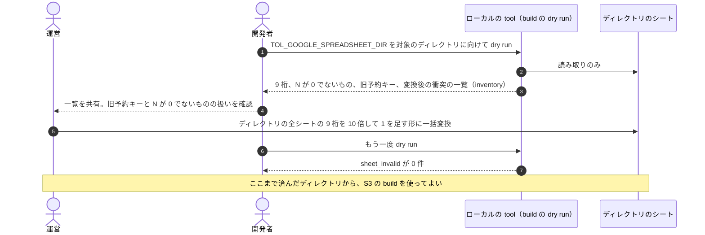
- LD と QA の共通ディレクトリは 1 回で両環境ぶんを変換する。一部のシートだけ変換した状態で build しない（9 桁は V04 が拒否する）。**本番のディレクトリは不要**（import 環境はシートを読まない）。
- 変換後の最初の build で、全テーブルの hash が一度変わる。版ごとの DB では、**変換前後の成果物は別の `(deploy_key, hash)` になる**（R1 の再利用にならない。db.md 9.3）。クライアントは全テーブルを 1 回取り直す。
- **dry run（3.1）は DB を作らない**ので、棚卸しは副作用なしで回せる。

## 9. この文書で置いた仮置きと、db.md に残る不備
**仮置き・規則の正本は db.md**（巻き戻しの `start_at` と二重登録・予約の取り消しの保護と `forget` 失敗・`kind` と phase・`register_unknown` と `resolve-unknown`・成否不明の扱い・掃除の順序・`final.json` と追従検出・import の `store` の順序・A の復元。db.md 14.1）。失敗コードの名前は api.md 13.1 で確定済みで、db.md が正本。ここでは再掲しない。

### 9.1 この文書で置いた仮置き（人の確認で変わりうる）
| # | 内容 | 場所 |
| --- | --- | --- |
| S1 | 録画の暫定（予約済みの未来の行があれば何もしない・基底 DB を指す版・`RecordingResetSeeder` は `sys_deploy` の行を消す）。R19 が決まるまで | 7 節 |
| S2 | `master:verify-sheet` と `master:finalize --dry-run` は読み取り専用で、ロックを取らない | 2.5 |
| S3 | `master:finalize` の実行で、追従検出を先に行い、そのあとに `final.json` の既存を確認する（順序） | 2.5 |

### 9.2 db.md に残る不備・足りない点（db.md は直していない。報告用）
1. `master:finalize` で、追従検出と `final.json` の既存の確認のどちらを先にするかが db.md 6.5.1 に無い（`already_finalized` の冪等のために、既存を先に見てもよい）。
2. `master:verify-sheet`・`finalize --dry-run` がロックを取るかが db.md に無い（import の dry run はロックを取る）。

### 9.3 新しい未決（台帳に足す候補）
- 古い build を review へ渡させないゲートの置き場と最終 hash の確定の仕組み（R28。既出）。
- 切り替えの瞬間のクライアント（R20）、版の DB 方式の録画（R19）、N（R21・R40）、スキーマ更新と hash（R34）。いずれも既出。
- 上の 9.2 の 1・2 は、db.md の直しか、実装 PR での決めか。
