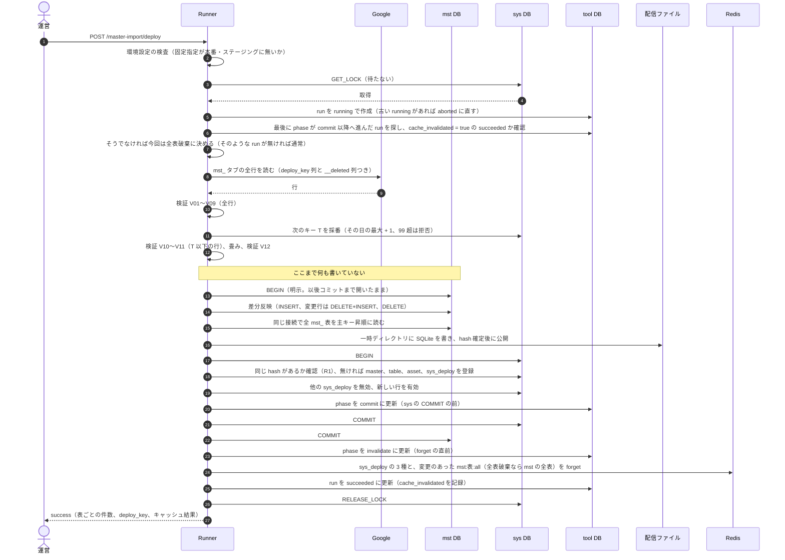
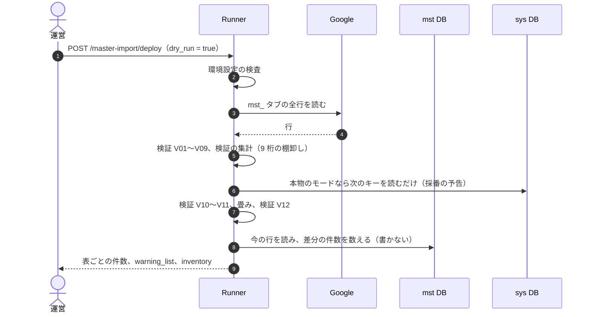
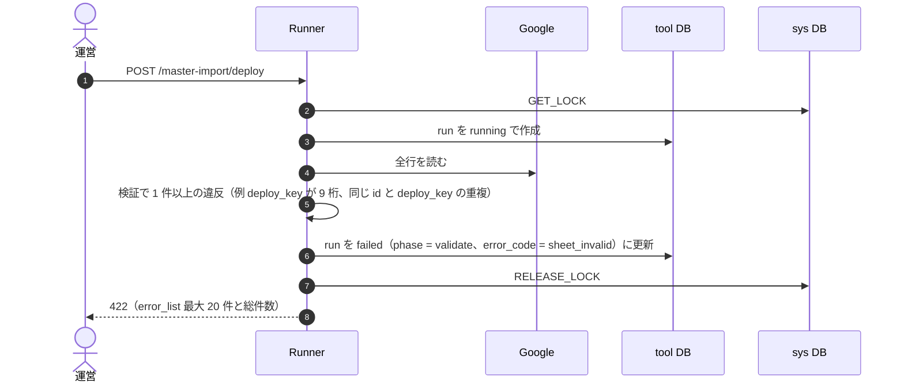
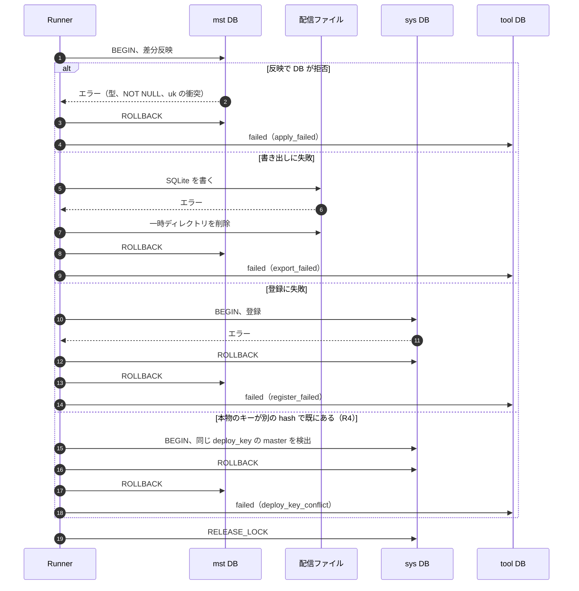
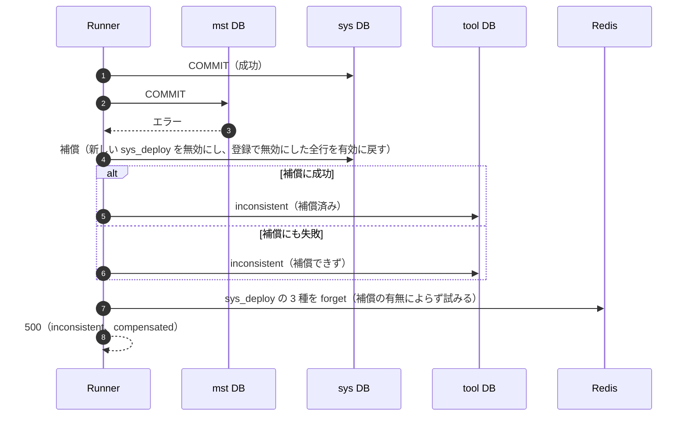
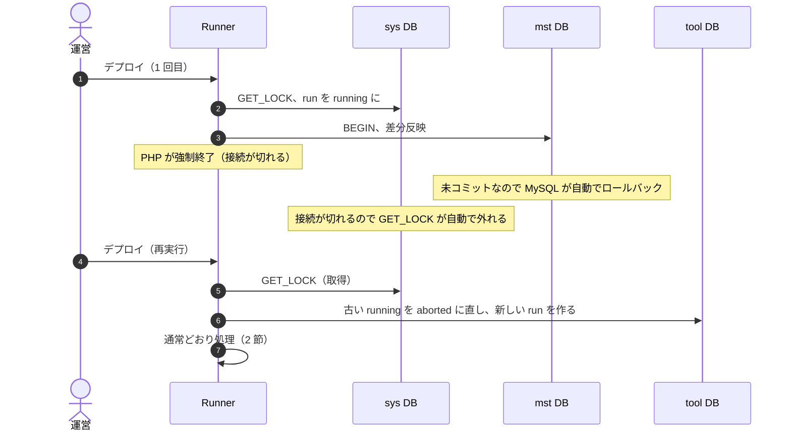
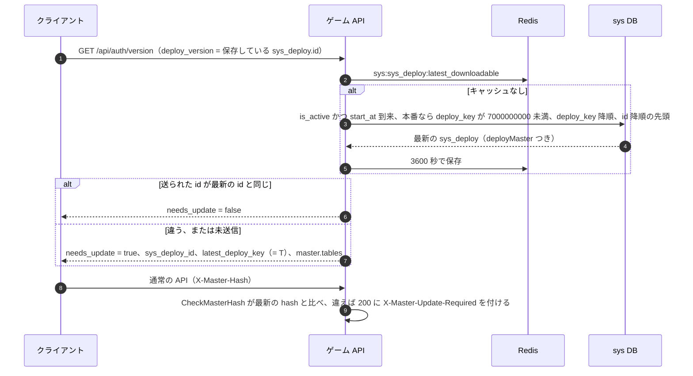
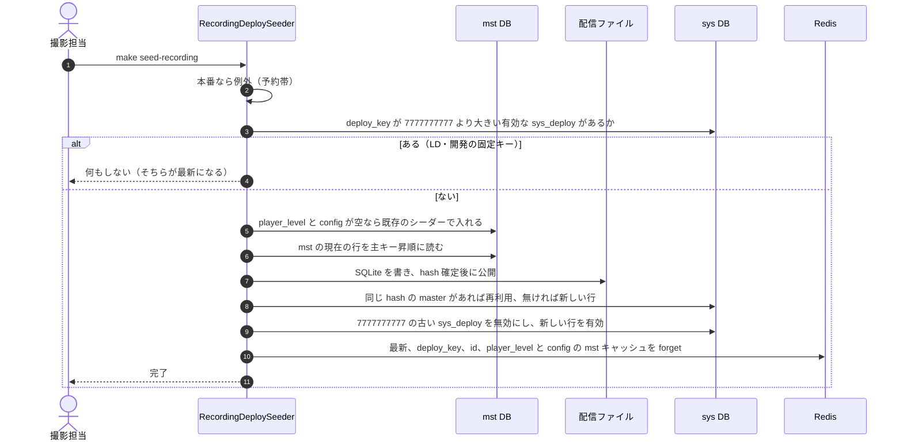
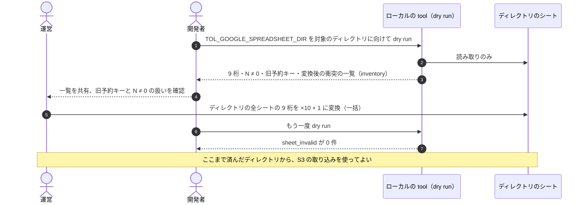

# マスター配信の deploy_key 上乗せ シーケンス設計（S2 のサーバー設計）

運営ツールのデプロイ操作の正常系・主要な異常系・トランザクション境界、ゲーム API の version 判定、録画用デプロイ、9 桁変換の手順。

- DB・規則: [db.md](db.md)、入力・出力・エラー: [api.md](api.md)
- 全体の流れの概要（正本）は Nexus の `docs/design/master-distribution/overview.md` 5 節。ここはその**サーバー内部の詳細**で、写さない
- 凡例: 「読んだ」= コードを読んだだけ。実行はしていない。図の `;` は使えないので読点で区切る

## 1. 登場者

| 名前 | 実体 |
| --- | --- |
| OP | 運営担当（画面）または CLI |
| R | `MasterDeployRunner`（tool。排他・順序・補償） |
| G | Google スプレッドシート |
| MST | mst DB（`mst` 接続） |
| SYS | sys DB（`sys` 接続。ロックもここ） |
| TOL | tool DB（`tool` 接続。`tol_master_deploy_run`） |
| FS | `tool/public/masterdata/` |
| RD | Redis（API と共有。db.md 8 節） |
| API | ゲーム API |
| C | クライアント |

## 2. 正常系: 本物のキー（本番・QA・ステージング）

- 手順 12 までは外部の読み取りと計算だけで、**mst も sys も変わらない**。失敗してもそのまま終われる。
- 手順 13（mst の BEGIN）から手順 22（COMMIT）まで mst のトランザクションが開いている。API は mst をロックせず一貫読み取りするので、**コミットまでは古い値を読む**。
- 手順 17〜19 の登録は `sys` の 1 トランザクションで、`sys_deploy_master`・`sys_deploy_master_table`・`sys_deploy_asset`・`sys_deploy` の挿入と、他の `sys_deploy` の無効化が一括で成否を決める。
- **`sys` を先にコミットし、mst を最後にコミットする**理由は 5.4 と 6 節。
- 手順 23〜24 のキャッシュ破棄は**コミットの後**。コミット前に消すと、API が古い DB を読み直して再びキャッシュしてしまう。
- 同じ hash の版が既にある（R1）ときは、手順 18 で新しい行を作らず、既存の版を有効に戻す。このとき mst は差分が 0 件のまま（シートの変更が無い再デプロイ）か、シートを前の状態に戻した結果（ロールバック運用）。

## 3. 正常系: 固定キー（LD・開発・録画）
手順は 2 節と同じ。違いだけ書く。

| 手順 | 本物 | 固定 |
| --- | --- | --- |
| T | 採番（手順 11） | `MASTER_DEPLOY_FIXED_KEY`（採番しない。`sys` を読まない） |
| 登録（R2 / R3） | 採番したキーで新しい行 | 固定キーで**新しい行**（同じキーの古い行は残るが、全 `sys_deploy` を無効にして新しい行だけ有効）。新しい `sys_deploy.id` になるので、クライアントは `needs_update` に気づく |
| 同じ内容の再実行（R1） | 既存の版を有効に戻す | 同じ。同じ hash の master を指す `sys_deploy` のうち `id` 最大の行を有効に戻し、他を無効にする |
| 再デプロイで内容が変わった | 次のキー（`NN+1`）の新しい行 | 同じキーのまま新しい `sys_deploy` 行 |

## 4. dry run

ロック・実行記録・書き込み・ファイル・キャッシュは一切使わない。検証でエラーがあっても、**全件を集計して**返す（`error_list` は 20 件で切るが `error_total` と `error_count_by_code` は全件。db.md 9.3）。

## 5. 異常系

### 5.1 検証の失敗（`sheet_invalid`）

mst・sys・ファイル・キャッシュは**何も変わらない**。今の行スキップと違い、一部の行だけが入ることはない（決定 9）。

### 5.2 排他（`deploy_locked`）
他のデプロイがロックを持っている間に来た要求は、`GET_LOCK` が 0 を返して**待たずに** 409。`tol_master_deploy_run` は作らない（実行中の行を `aborted` に直さないため。ロックを取れていないので古い `running` を判断できない）。画面は `target` の `running` を見せ、しばらくして押し直してもらう。

### 5.3 書き出し・登録の失敗（`export_failed`・`register_failed`・`apply_failed`）

- **mst は元のまま**（トランザクションのロールバック。今の `TRUNCATE` と違い、空のテーブルが残らない）。`sys` も元のまま。
- 公開済みの SQLite ディレクトリが残ることがあるが、内容アドレス（hash のディレクトリ）なので害はない（db.md 6.6）。
- 失敗の次の操作は、そのまま再実行してよい。

### 5.4 mst のコミット失敗（`inconsistent`）
`sys` のコミット後に mst の COMMIT が失敗する（接続断など）と、**クライアントには新しい版を案内しているのに、API の mst は古い**状態になる。

- **COMMIT のエラーは成否不明**（サーバー側で確定済みの可能性がある）。補償した後も、必ず再実行が要る（再実行で mst を新しい内容にそろえ、全表のキャッシュを破棄する）。
- 補償は、**登録で無効にした `sys_deploy` の `id` の集合（1 件とは限らない）をメモリに持っておき**、新しい行を無効にして集合を有効に戻すだけ（`sys_deploy` の `is_active` の更新だけで足りる。`sys_deploy_master` などの行は残してよい。同じ hash は次の実行の R1 で再利用される）。
- **`sys` を先にコミットする理由**: 逆（mst を先にコミットして `sys` が失敗）だと、mst を元に戻せない（前の行を持っていない）。`sys` なら無効・有効の切り替えだけで戻せる。
- **補償できなかった場合も、再実行で直る**: 差分反映は冪等（mst は新しい内容にそろう）、書き出す SQLite は同じ hash の見込み（バイト列の再現性は S3 で確認）、登録は R1（既存の版を有効に戻す）。**再実行は前回が `inconsistent` なので mst の全表と `sys_deploy` のキャッシュを破棄する**（db.md 8 節。差分 0 件でもキャッシュが残らない）。`tol_master_deploy_run` の `inconsistent` が画面の警告になる（api.md 3 節）。
- この窓（`sys` コミットから mst コミットまで）は、通常は数ミリ秒。その間にキャッシュが切れて API が新しい `sys_deploy` を読む可能性がある（Redis の TTL が切れた直後だけ）。許容する（**仮置き**。2 つの DB をまたぐトランザクションは使えないため）。

### 5.5 キャッシュ破棄の失敗
全段階が終わった後に Redis の `forget` が失敗しても、デプロイは**成功のまま**。結果の `cache.invalidated = false`・`failed_key_list` を返し、run の `summary.cache_invalidated` を false にする。最大 3600 秒で自然に直る。**次のデプロイ（差分 0 件でも）が全表を破棄する**（db.md 8 節）。すぐ直したいときは `POST /master-import/clear-cache`（api.md 5 節）。`tol_master_deploy_run` は `succeeded`（`summary` に失敗を記す）。

### 5.6 プロセスが途中で止まる（タイムアウト・強制終了）

- 強制終了の位置による残り方:
  - mst の COMMIT の前: mst は自動でロールバック。`sys` が登録済みの場合だけ食い違うので、**`sys` のコミット後・mst のコミット前**に落ちた場合が 5.4 と同じ状態になる（補償は動かない）。再実行で直る（その run の phase が `commit`。再実行が全表のキャッシュを破棄する。phase は `sys` の COMMIT の前に `commit` になるので、`sys` の COMMIT の前に落ちた場合も同じ判定になり、誤検知の全表破棄が走るが害は無い）。
  - **mst の COMMIT 後・キャッシュ破棄前**: mst も `sys` も新しい内容で整合しているが、Redis に古い mst・`sys_deploy` が残る（`running` が `aborted` になり、phase は `commit` か `invalidate`）。再実行は差分 0 件・R1 で何も変えないが、**「最後に phase が commit 以降へ進んだ run」が `aborted` なので、mst の全表と `sys_deploy` のキャッシュを破棄する**（db.md 8 節。間に `sheet_invalid` などの早期失敗の run が挟まっても、その run は phase が commit に届いていないので無視され、この判定は変わらない）。待てない場合は `POST /master-import/clear-cache`。
  - `sys` のコミット前: 両方ロールバック。何も変わらない。
- `aborted` の行は、次の操作が見つけて直す（画面にも警告。警告には clear-cache の案内を添える）。

## 6. トランザクション境界

| 段階 | 接続 | 範囲 | 失敗したとき |
| --- | --- | --- | --- |
| ロック | `sys`（`GET_LOCK`） | 取得から `RELEASE_LOCK`（またはプロセス終了）まで。トランザクションではない | 取れなければ 409。プロセスが落ちれば自動で外れる |
| 実行記録 | `tool` | 各更新が autocommit（トランザクションの外） | `sys` の COMMIT の**前**の書き込み失敗は中止（ロールバックして `failed`）。**COMMIT の後**の書き込み失敗は中止も補償もせず続行してアプリのログに残す。残った `running`（phase `commit`）は次の実行が `aborted` に直し、全表破棄が走る（db.md 8 節。**仮置き**） |
| シート読み込み・検証・畳み | なし（メモリ） | - | 何も変わらない |
| 採番 | `sys`（読み取り） | ロックの中なので他と競合しない | 何も変わらない |
| mst の差分反映・書き出し | `mst`（明示の `beginTransaction`） | 反映から 2 節の手順 22（COMMIT）まで開いたまま | `rollBack`。DDL は使わない（暗黙コミットを起こさない） |
| `sys` の登録 | `sys` | 1 トランザクション（`DB::connection('sys')->transaction`） | `rollBack` してから mst も `rollBack` |
| 補償 | `sys` | 1 トランザクション（`is_active` の更新だけ） | 補償できなかった旨を記録。再実行で直す |
| キャッシュ破棄 | Redis | トランザクションなし | 結果に失敗を返す。成功は取り消さない |

- **2 つの DB（mst と sys）をまたぐ原子性は無い**。代わりに、(1) `sys` を先にコミットして戻しやすい側を後に回す、(2) 失敗時の補償、(3) 実行記録と再実行で収束する、の 3 段で守る（Nexus overview 4.1 の「途中で失敗したときに、mst と配信版が食い違ったまま残らないようにする」への答え）。
- mst の DDL（`TRUNCATE`・`CREATE`・`ALTER`）をトランザクションの中で使わない。`SHOW TABLES`・`SHOW COLUMNS` は DDL ではなく問題ない（読んだ。メタデータの読み取り）。

## 7. ゲーム API の version 判定（Nexus の契約は変えない）

- 本番で予約帯しか有効な行が無いときは 299 / 99999（`SystemDataException::deploy()`）。
- 固定キーの再デプロイは**新しい `sys_deploy.id`** なので、`id` の違いでクライアントが気づく。デプロイ後の最初の要求でキャッシュが破棄されていれば、新しい最新が返る（8 節 db.md）。

## 8. 録画用デプロイ（`make seed-recording` 系。db.md 11.2）

### 8.1 シートを使えない環境（`RecordingDeploySeeder`）

本物のキー（`2026…`）があっても録画用が最新になる（`7777777777` のほうが大きいため。db.md 11.2）。元に戻すには `RecordingResetSeeder`（`[REC]` の行と SQLite を消す）。

### 8.2 シートを使える環境
`MASTER_DEPLOY_FIXED_KEY=7777777777` にして、画面か `php artisan master:deploy` で 3 節の固定キーのデプロイを行う。この場合 `RecordingDeploySeeder` は流さない。

## 9. 9 桁変換の手順（db.md 9 節。運営の作業と dry run）

- LD と QA の共通ディレクトリは 1 回で両環境ぶんを変換する。一部のシートだけ変換した状態でデプロイしない（9 桁は検証が拒否する）。
- 変換後の最初のデプロイで全テーブルの hash が一度変わる（db.md 9.3）。
