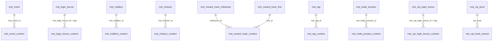

# mst 16 テーブルへの string id 導入 DB 設計（S0 のサーバー設計）

マスター配信の deploy_key 上乗せ（Nexus の全体設計）の前提作業「S0」の、サーバー側の DB 設計。上乗せは「同一 `id` は大きい `deploy_key` の行を採用」する（畳みの鍵は `id`）ので、`id` を持たない mst 16 テーブルに string の `id` を入れる。**この文書は設計だけで、実装（マイグレーション・Model・シーダー・テストの変更）はしない。**

- 全体設計（**仕様の正本**。複製しない）: `Nexus/docs/design/master-distribution/overview.md`（F16・F17、10.1 節、11.2 節）、`db.md` 5 節（16 テーブルの表と `id` の案）、`Nexus/docs/progress/master-distribution/progress.md`（Q8）
- 規約: `.claude/database.md` 5 節（id と主キー）。string の `id` 必須・AUTO_INCREMENT 禁止・自然キーは `unique`（`uk_xxx`）・外部キーなし・コメント必須
- 検査: `api/tests/Architecture/MstRequiresStringIdTest.php`、`api/tests/Architecture/MstNoAutoIncrementIdTest.php`（どちらも `PENDING_VIOLATIONS` を持つ）
- 他の文書: [sequence.md](sequence.md)（移行の流れ・取り込みから配信まで）、[api.md](api.md)（API の変化）
- 凡例: **決定** = 人の決定・既存の規約。**仮置き** = 推奨案で書いたもの（人の確認で変わりうる）。**未確認** = 読めていない・実行していない。**論点** = 人の確認が要るもの（推奨案つき。8 点は 2026-11-22 に決定済み。12 節）。実行（`make migrate`・seed・テスト）はしていない。サーバーは main `bdb83ccc` 時点

## 1. 結論

| 項目 | 内容 |
| --- | --- |
| 対象 | 16 テーブル（2 節）。全部に string の `id`（`$table->string('id')->primary()`）を足し、元の主キー（複合・`level`・AUTO_INCREMENT）は主キーから外して `unique`（`uk_xxx`）にする（`mst_player_level.level` も同じ） |
| id の作り方 | **決定**（Nexus progress の Q8）: 人が決めたのは「id は Nexus db.md 5 節の案」まで（`*_content` は親の ID・`content_type`・`content_mst_id` を `:` でつなぐ）。**個別のテーブルの規則は、この S0 設計での仮置き**（人の確認が要る。自然キーの全列を `:` でつなぐ形を他のテーブルにも広げる。3 節）。`mst_in_app_purchase` だけは人が決める安定した値（3.3、12 節 3） |
| 波及の本命 | AUTO_INCREMENT の 3 テーブルのうち **`mst_in_app_purchase`**。参照が mst 4 列（`mst_in_app_purchase__l10n` を含む）・trx 2 列（型が数値のまま）・API の入力と出力に及ぶ（4 節）。残り 2 つ（`mst_billing_platform_product`・`mst_vip_login_bonus_content`）の参照は mst の 2 列だけ・参照なし |
| マイグレーション | **決定**（現行規約）: 既存の `create_*_tables.php` を書き換える。後方互換は持たず、`make migrate-fresh` → `make seed` で作り直す。trx の購入履歴は捨てる。作り直せない環境は無い（人の明言。12 節 1）。追加マイグレーション方式は不採用（6.3） |
| 取り込み | 運営シートに `id` 列を足す（8 節）。足すまで、その表の取り込みは失敗する。失敗の前に TRUNCATE が走る現状の穴は、`id` 列の事前チェックだけ足して塞ぐ（8.2。**決定**。12 節 4） |
| クライアント | 読む表は `mst_player_level`・`mst_login_bonus_content`・**`mst_vip_login_bonus_content`**（Nexus の F17 は 3 つめを数えていない。9.2。Nexus 側の訂正は 11 節）。前 2 つは SELECT が列を明示しているので壊れない。VIP は `id` を整数で読んでいるので、文字列にすると 0 になる（結果は使われないので表示は壊れないが、型は直す） |
| 段階 | 4 本の PR（11 節）: ① `nexus-core`（unit/equipment level）+ `nexus-level` ② `*_content` 6 パッケージ ③ `nexus-login` + `nexus-vip` ④ `nexus-core-billing`（本命。trx・log・API を含む） |
| API | 新しい API は無い。**ただし `POST /api/in_app_purchase/buy` の入力 `mst_in_app_purchase_id` と、報酬トラックの応答の同名項目が整数 → 文字列に変わる**（[api.md](api.md)） |

## 2. 16 テーブルの現状と新しい id

現状は `packages/*/database/migrations/mst/` を読んだ結果。「参照元」は api・packages・tool の PHP を grep して洗った範囲（trx・log・mst・Model の relation）。「データ」は、開発用シーダー（`api/database/seeders/`）が行を入れるか。運営シートの中身は読めない（未確認）。

| # | テーブル（package） | 現状の主キー | 現状の自然キー | 参照元（列） | 開発のデータ | 新しい id（型・規則） | 移行後の主キー・unique |
| --- | --- | --- | --- | --- | --- | --- | --- |
| 1 | `mst_billing_platform_product`（core-billing） | `id`（unsignedBigInteger AUTO_INCREMENT） | `(billing_platform, platform_product_id)` が既に `uk_billing_platform_product` | `mst_in_app_purchase.app_store_product_id`・`google_play_product_id`（unsignedBigInteger）。Model の relation 2 本 | あり（`MstBillingPlatformProductSeeder`。10 行前後） | `string('id')`。`{billing_platform}:{platform_product_id}`（例 `app_store:com.example.game.diamond100`）**仮置き**（Nexus 5 節の案どおり） | PK `id`。`uk_billing_platform_product` は残す |
| 2 | `mst_in_app_purchase`（core-billing） | `id`（AUTO_INCREMENT） | なし（人が付ける商品） | mst: `mst_in_app_purchase_content`・`_effect`・`mst_reward_track_line.mst_in_app_purchase_id`。trx: `trx_in_app_purchase`・`trx_in_app_purchase_effect`・`trx_reward_track_line`。log: `log_action_in_app_purchase`・`log_change_trx_in_app_purchase`・`log_vip_point`（4 節） | あり（5 行。`MstInAppPurchaseSeeder`） | `string('id')`。**人が決める安定した値**（3.3。例 `iap_diamond_100`）**仮置き** | PK `id`。自然キーは無いので unique は足さない |
| 3 | `mst_in_app_purchase_content`（core-billing） | `(mst_in_app_purchase_id, content_type, content_mst_id)`（`pk_purchase_content`） | 同左 | なし（Model の relation のみ） | あり（2 行） | `string('id')`。`{mst_in_app_purchase_id}:{content_type}:{content_mst_id}`（例 `iap_starter_pack:item:free_diamond`）**仮置き**（Nexus 5 節の案どおり） | PK `id`。`uk_purchase_content`（元の 3 列）。`mst_in_app_purchase_id` は string に変える（4 節）。親 ID が unique の先頭列なので、検索用の索引は足さない |
| 4 | `mst_in_app_purchase_effect`（core-billing） | `(mst_in_app_purchase_id, effect_type)`（`pk_purchase_effect`） | 同左 | なし | あり（3 行） | `string('id')`。`{mst_in_app_purchase_id}:{effect_type}` **仮置き** | PK `id`。`uk_purchase_effect`（元の 2 列） |
| 5 | `mst_unit_level`（core） | `(rarity, level)`（`pk_unit_level`） | 同左 | なし（Repository が `queryOrMemory` を `where('rarity')->where('level')` で引く） | `MstUnitLevelSeeder` はあるが `DatabaseSeeder` から呼ばれていない（読んだ範囲） | `string('id')`。`{rarity}:{level}`（例 `UR:1`）。rarity は英字（DB の ENUM の値。3.2）**仮置き** | PK `id`。`uk_unit_level`（元の 2 列）。重複していた `index(['rarity','level'])` は外す（unique が担う） |
| 6 | `mst_equipment_level`（core） | `(rarity, level)`（`pk_equipment_level`） | 同左 | なし | シーダー無し | `{rarity}:{level}` **仮置き** | 同上（`uk_equipment_level`） |
| 7 | `mst_event_content`（event） | `(mst_event_id, content_type, content_mst_id)`（`pk_event_content`） | 同左 | なし（`EventMasterRepositoryAdapter` が Repository 経由で読む） | シーダー無し | `{mst_event_id}:{content_type}:{content_mst_id}` **仮置き**（Nexus 5 節の案どおり） | PK `id`。`uk_event_content`。`idx(content_type, content_mst_id)` は残す |
| 8 | `mst_player_level`（level） | `level`（unsignedInteger。`->primary()`） | `level` | なし。ただし `MstPlayerLevel::find($level)` と `MstPlayerLevelRepository::selectByLevel` が**主キー = level** を前提にする（7.2） | あり（1〜100。`MstPlayerLevelSeeder`）。テストの `TestCase::ensureInitialLevelMaster` も入れる | `string('id')`。`(string) $level`（例 `1`）。**仮置き**（Nexus 案「`level` の文字列」どおり） | PK `id`。`uk_player_level (level)`。`level` 列は残す（クライアントが `level` で引く） |
| 9 | `mst_login_bonus_content`（login） | `(mst_login_bonus_id, day, content_type, content_mst_id)`（`pk_login_bonus_content`） | 同左 | なし | あり（`MstLoginBonusSeeder`・`RecordingLoginBonusSeeder`） | `{mst_login_bonus_id}:{day}:{content_type}:{content_mst_id}`（例 `daily_login:1:item:item_potion`）**仮置き**（Nexus 5 節の案どおり） | PK `id`。`uk_login_bonus_content`。`foreign()` は規約違反なので外す（6.2） |
| 10 | `mst_mailbox_content`（mailbox） | `(mst_mailbox_id, content_type, content_mst_id)`（`pk_mailbox_content`）。**ただし Model は `$primaryKey` を宣言していない**（7.1） | 同左 | なし | シーダー無し | `{mst_mailbox_id}:{content_type}:{content_mst_id}` **仮置き**（Nexus 5 節の案どおり） | PK `id`。`uk_mailbox_content`。`idx(mst_mailbox_id)` は unique の先頭列と重複するので外す |
| 11 | `mst_mission_content`（mission） | `(mst_mission_id, content_type, content_mst_id)` | 同左 | なし | シーダー無し | `{mst_mission_id}:{content_type}:{content_mst_id}` **仮置き**（Nexus 5 節の案どおり） | PK `id`。`uk_mission_content` |
| 12 | `mst_reward_track_content`（reward-track） | `(mst_reward_track_milestone_id, mst_reward_track_line_id, content_type, content_mst_id)`（4 列） | 同左 | なし（Model 無し。`RewardTrackMasterRepositoryAdapter` が `DB::table` で読む） | シーダー無し | `{mst_reward_track_milestone_id}:{mst_reward_track_line_id}:{content_type}:{content_mst_id}` **仮置き**（Nexus の「別の列を含む。S0 で確認」への答え: 4 列。確認した） | PK `id`。`uk_reward_track_content`（元の 4 列）。`idx_milestone_line` などの既存索引は残す |
| 13 | `mst_tag_content`（tag） | `(mst_tag_id, content_type, content_mst_id)` | 同左 | なし | シーダー無し | `{mst_tag_id}:{content_type}:{content_mst_id}` **仮置き**（Nexus 5 節の案どおり） | PK `id`。`uk_tag_content`。`idx_tag_content_target` は残す |
| 14 | `mst_trade_product_content`（trade） | `(mst_trade_product_id, content_type, content_mst_id)` | 同左 | なし | シーダー無し | `{mst_trade_product_id}:{content_type}:{content_mst_id}` **仮置き**（Nexus 5 節の案どおり） | PK `id`。`uk_trade_product_content` |
| 15 | `mst_vip_level_reward`（vip） | `(vip_level, content_type, content_mst_id)`（`pk_vip_level_reward`） | 同左 | なし | シーダー無し | `{vip_level}:{content_type}:{content_mst_id}` **仮置き**（Nexus 5 節の案どおり） | PK `id`。`uk_vip_level_reward` |
| 16 | `mst_vip_login_bonus_content`（vip） | `id`（AUTO_INCREMENT）。`deploy_key` 列が無い。`timestamps()` | **無い**（unique が無いので同じ `(bonus, day, type, content)` を 2 行置ける） | なし（`MstVipLoginBonusRepository` が読む） | あり（`MstVipLoginBonusSeeder`。11 レベル × 数行） | `string('id')`。`{mst_vip_login_bonus_id}:{day}:{content_type}:{content_mst_id}`（例 `vip_login_lv5:4:item:item_exp_002`）**仮置き**（Nexus 案「親 ID + 中身」どおり） | PK `id`。`uk_vip_login_bonus_content`（元の 4 列。**新しく足す unique**）。`idx_vip_login_bonus_day` は unique の先頭 2 列と重複するので外す。`foreign()` は外す（6.2） |

- 「元の PK を unique にする」ので、行を一意にする条件は今と変わらない。キー長の条件も今の PK と同じ（今動いているなら動く）。新しい `id` 列（`varchar(191)`。実 DB は `Schema::defaultStringLength(191)`）の主キーが加わるだけ。
- `deploy_key` 列は触らない（型の BIGINT 化・既定値は deploy_key 上乗せの S3 の範囲）。`mst_vip_login_bonus_content` に `deploy_key` が無いのも、この S0 では直さない（Nexus db.md 3.3・7 節が「列が無いまま畳む」と決めている）。
- `created_at`・`updated_at` は触らない（#16 の `timestamps()` は規約から外れる（`dateTime` 明示）が、この S0 の範囲外。12 節 8。S3 で直す）。

## 3. id の規則

### 3.1 区切りと形

- 区切りは `:`（Nexus 案）。**親の ID と `content_type` に `:` を含めない**（含むと別の組が同じ `id` になりうる。例: `a:b` + `c` と `a` + `b:c`）。最後の `content_mst_id` は `:` を含んでよい（切り分けは常に先頭から。ただし `id` を分解して使うコードは作らない）。**仮置き**: 取り込みで、`:` を含む親 ID・`content_type` を拒否する。ただし `mst_billing_platform_product.platform_product_id`（外部の識別子）が `:` を含む場合は `billing_platform` が先頭固定で曖昧にならないので許す。
- 長さは `string('id')` = `VARCHAR(191)` を主キーにする前提（実 DB は `AppServiceProvider` の `Schema::defaultStringLength(191)` で `string` が varchar(191)。実測済み: 191 文字 × 4 バイトの列を 4 本並べた `mst_reward_track_content` の unique は 3056 バイトで、InnoDB の索引キー長の上限 3072 バイトにぎりぎり収まる。255 だと 4080 バイトで失敗する）。規則どおりに作ると、複数列をつなぐ表（特に `mst_billing_platform_product`〔`platform_product_id`〕と `mst_reward_track_content`〔4 列〕）は 191 を超えうる。**仮置き**: **全 16 表**の取り込み（と、シーダー・`makeId`）で、`id` が 191 文字を超える行を拒否する（切り詰めない）。照合順序は `utf8mb4_unicode_ci`（大文字小文字を区別しない）なので、`UR:1` と `ur:1` は同じ `id` と見なされる。ID は小文字・スネークケースを基本にし、`rarity` だけ慣習どおり大文字（`.claude/database.md` 5 節の例外）。
- `id` は**自然キーと必ず一致させる**（unique が一致を保証する。`id` が規則からずれても主キー・unique の両方が通ってしまう点は、取り込みの検証で守る。8.2）。

### 3.2 rarity の表記（Nexus が「S0 で決める」とした点）

`mst_unit_level`・`mst_equipment_level` の `id` の rarity は **DB の ENUM の値（`UR`・`SSR`・`SR`・`R`・`UC`・`C`）**にする（例 `UR:1`）。理由: ① シートの `rarity` セルの書き方と一致する（運営がそのまま式で作れる）② 規約が `rarity` を大文字の例外にしている ③ `id` 列は `RARITY_COLUMNS`（`rarity`・`bonus_rarity`）の変換の対象外なので、`UR` のまま入る。

**注意（未確認）**: `MasterImportService::RARITY_MAP` は取り込み時に `rarity` 列の `UR` を数値 `6` に直すが、`mst_unit_level.rarity` は ENUM（`UR` が 1 番目）。MySQL は ENUM への整数 `6` を「6 番目の値」（`C`）として入れるはずで、`UR` が `C` として入る疑いがある（`mst_gacha_*` の tinyint 向けの変換が ENUM の表にも当たっている）。実際の取り込みは未実行なので**未確認**。`id` は `UR:1` のまま入るので、行の `rarity` 列と `id` がずれる。S0 の範囲外だが、`id` と自然キー（unique）が食い違う形で表に出るため、実装の前に確かめる（12 節 7）。

**範囲（疑いが及ぶ表）**: 同じファイル（`nexus-core` の `create_resource_tables.php`）の `mst_unit`・`mst_equipment` も ENUM の `rarity`（`UR`〜`C`）を持つので、同じ変換が当たる疑いがある。`RARITY_MAP`（C=1〜UR=6）と ENUM の位置（UR=1〜C=6）は**逆順の 1 対 1 対応**なので、整数が ENUM の位置として入るなら `UR`↔`C`・`SSR`↔`UC`・`SR`↔`R` が入れ替わる（読んだ推測）。入れ替えは全単射なので、`mst_unit_level`・`mst_equipment_level` の `(rarity, level)` が**それだけで衝突するとは読めない**（`C:1` の行と `UR:1` の行は互いに入れ替わる）。ただし、`id` は `UR:1` のままで行の `rarity` は `C` になる食い違いが出る。整数を文字列として束ねて ENUM に入れる経路なら、厳格モードでは**値の不一致で INSERT が失敗**する。いずれも **MySQL 実機は未確認**。

### 3.3 `mst_in_app_purchase` の id（人が決める値）

自然キーが無い商品なので、規則で作れない。**決定**（12 節 3）: `iap_` + 種別 + 内容を表す snake_case（開発のシーダーの 5 行は次の対応）。運営が商品を足すときは同じ命名で付け、一度付けたら変えない（trx の購入履歴が指すため）。

| 旧 id（AUTO_INCREMENT の投入順） | 内容（`MstInAppPurchaseSeeder`） | 新しい id（決定。12 節 3） |
| --- | --- | --- |
| 1 | diamond・100 | `iap_diamond_100` |
| 2 | diamond・500 | `iap_diamond_500` |
| 3 | diamond・1000 | `iap_diamond_1000` |
| 4 | pack（スターター） | `iap_starter_pack` |
| 5 | pass（月額） | `iap_monthly_pass` |

## 4. 参照する側への影響（AUTO_INCREMENT の 3 テーブル）

grep（`api`・`packages`・`tool` の PHP、マイグレーション、シーダー、テスト）で洗った。**`mst_vip_login_bonus_content.id` と、`mst_billing_platform_product` の `id` を trx・log で指す列は無い**（mst の 2 列だけ）。影響が trx・log に及ぶのは `mst_in_app_purchase` だけ。

### 4.1 `mst_in_app_purchase.id` を指す列（現状の型と、新しい型）

| 接続 | テーブル.列 | 現状の型 | 新しい型 | 備考 |
| --- | --- | --- | --- | --- |
| mst | **`mst_in_app_purchase__l10n.mst_in_app_purchase_id`**（PK `pk_in_app_purchase_language` = `mst_in_app_purchase_id` + `language` の一部。16 テーブルの外の l10n。当初の洗い出しで漏れていた） | unsignedBigInteger | `string` | 親の `id` が string になると、列が bigint のままでは運営シートの l10n 展開（親の `id` を注入）が失敗するか 0 になる。Model・Repository・シーダーは無い（grep）ので、直すのはマイグレーションと取り込みだけ |
| mst | `mst_in_app_purchase_content.mst_in_app_purchase_id`（PK の一部） | unsignedBigInteger | `string` | Model の cast `integer` と `getMstInAppPurchaseId(): int` も直す |
| mst | `mst_in_app_purchase_effect.mst_in_app_purchase_id`（PK の一部） | unsignedBigInteger | `string` | 同上 |
| mst | `mst_reward_track_line.mst_in_app_purchase_id`（nullable。**nexus-reward-track のテーブルで、16 テーブルの外**） | unsignedBigInteger | `string`（nullable のまま） | `RewardTrackMasterRepositoryAdapter::toLine` が `(int)` に直している。`RewardTrackLineMaster::$mstInAppPurchaseId` は `?int` → `?string` |
| trx | `trx_in_app_purchase.mst_in_app_purchase_id`（PK の一部） | **string(255)**（数値を文字列で入れている） | 変えない | Model・Repository は `int` で比べている（`TrxInAppPurchaseRepository::selectByBillingPlatformAndMstInAppPurchaseId(string, int)` と `=== $mstInAppPurchaseId`）。列は既に文字列で、`id` が文字列になると素直になる。型を `string` に直す |
| trx | `trx_in_app_purchase_effect.mst_in_app_purchase_id` | unsignedBigInteger | `string` | `selectAllEffectsByMstInAppPurchaseId(int)`・`setMstInAppPurchaseId(int)`・cast `integer` を直す |
| trx | `trx_reward_track_line.mst_in_app_purchase_id`（nexus-reward-track） | unsignedBigInteger | `string` | `RewardTrackLine::$mstInAppPurchaseId`（int）、`RewardTrackLineRepositoryInterface::insertLine(…, int $mstInAppPurchaseId, …)`、`RewardTrackService::grantLine(…, int, …)`、`RewardTrackLineAdapter` の `(int)` を直す |
| log | `log_action_in_app_purchase.mst_in_app_purchase_id`（`api/database/migrations/log/…game_log_tables.php`） | string | 変えない | 既に string（`LogInAppPurchase` の cast も string）。**既存の行の値は旧 id（`"1"`・`"2"`…）のまま残る** |
| log | `log_change_trx_in_app_purchase.mst_in_app_purchase_id` | string | 変えない | 同上。`before_data`・`after_data`（JSON）にも旧値が入る |
| log | `log_vip_point.mst_in_app_purchase_id`（nullable。nexus-vip） | string | 変えない | 同上 |
| mst | `mst_in_app_purchase` が持つ `app_store_product_id`・`google_play_product_id` | unsignedBigInteger（nullable。`mst_billing_platform_product.id` を指す） | `string(255)` nullable | `MstBillingPlatformProduct` の relation はそのまま動く。`MstInAppPurchaseSeeder` の `->id`（数値）の渡し方が変わる |

- **洗い直し（再確認）**: `packages/*/database/migrations`・`api/database/migrations`・`tool/database` の全 `Schema::create` を grep し、旧 id（16 テーブルの `id`・`level` など）を指す列を探した。`mst`・`trx`・`log` の全部で、上の表のほかに漏れは無い。`__l10n` は 11 本（`mst_unit`・`mst_item`・`mst_equipment`・`mst_event`・`mst_gacha`・`mst_message`・`mst_mission`・`mst_tag`・`mst_trade`・`mst_trade_product`・`mst_in_app_purchase`）で、**`mst_in_app_purchase__l10n` 以外の親の ID 列は既に string**（16 テーブルの外の表が持つ id を指す）。16 テーブルの l10n は `mst_in_app_purchase__l10n`（親 = #2）だけで、それ以外の 15 テーブルに l10n は無い。
- **trx・log のコード側の数値前提**（整数のまま渡している箇所）: `BuyRequest`（`'integer', 'min:1'` と `getMstInAppPurchaseId(): int`）、`InAppPurchaseController`（`selectActiveById(int)`）、`MstInAppPurchaseRepository`（`selectByIdWithRelations(int)`・`selectActiveById(int)`）、`MstInAppPurchase::getId(): int`、`InAppPurchasePassService::deactivatePassEffects(int)`、`DetectRefundsCommand`（`$purchase->mst_in_app_purchase_id` を `LogInAppPurchaseRepository` の `string` 引数へ渡している箇所。現状は列が文字列なので動く）、`_BaseBuyUseCase::generateUniqueRequestId`（`{sysPlayerId}_{id}_{transaction}` の連結。**この文字列がどこまで使われ、長さの制限があるかは未確認**）、`GetSummaryResponse`（報酬トラックの応答。`mst_in_app_purchase_id`）。
- **既存データの扱い**: 6 節。trx の購入履歴（`trx_in_app_purchase`・`_effect`・`trx_reward_track_line`）は、`mst_in_app_purchase.id` が変わると**指す先を失う**（購入回数制限・パス効果・購入済みラインが外れる）。log は履歴なので書き換えない（旧 id のまま。新旧の対応は 3.3 の表）。
- TiDB モード（`DB_IS_TIDB=true`）: trx の `id` を UUID にする変換（`nexus-tidb`）は **trx 同士の参照**（`findSingleIdPrimaryKeyTables` と `findReferenceColumns`）だけを対象にする。`mst_in_app_purchase_id` は mst への参照で、対象外（読んだ）。影響しない。

### 4.2 他の 13 テーブル

参照する列は無い（trx・log・他の mst のどれにも、`mst_unit_level_id` のような列は無い）。参照ではなく、**Model の relation・Repository の鍵・テストのフィクスチャ**が影響を受ける（7 節）。

## 5. ER 図

`id` 導入後の mst の関係（実線は参照列、`PK`/`UK` は新しい主キー・unique）。外部キー制約は張らない（規約）。

```mermaid
erDiagram
    mst_billing_platform_product {
        string id PK "billing_platform:platform_product_id"
        string billing_platform UK
        string platform_product_id UK
    }
    mst_in_app_purchase {
        string id PK "人が決める（iap_*）"
        string app_store_product_id "mst_billing_platform_product.id"
        string google_play_product_id "mst_billing_platform_product.id"
    }
    mst_in_app_purchase_content {
        string id PK "iap:content_type:content_mst_id"
        string mst_in_app_purchase_id UK
        string content_type UK
        string content_mst_id UK
    }
    mst_in_app_purchase_effect {
        string id PK "iap:effect_type"
        string mst_in_app_purchase_id UK
        string effect_type UK
    }
    mst_in_app_purchase__l10n {
        string mst_in_app_purchase_id PK "bigint から string へ"
        string language PK
    }
    mst_reward_track_line {
        string id PK
        string mst_in_app_purchase_id "nullable。string に変える"
    }
    trx_in_app_purchase {
        bigint sys_player_id PK
        string billing_platform PK
        string mst_in_app_purchase_id PK "string のまま"
    }
    trx_in_app_purchase_effect {
        bigint id PK
        string mst_in_app_purchase_id "bigint から string へ"
    }
    trx_reward_track_line {
        bigint id PK
        string mst_in_app_purchase_id "bigint から string へ"
    }
    log_action_in_app_purchase {
        bigint id PK
        string mst_in_app_purchase_id "string のまま。旧値が残る"
    }
    mst_billing_platform_product ||--o{ mst_in_app_purchase : "app_store_product_id / google_play_product_id"
    mst_in_app_purchase ||--o{ mst_in_app_purchase__l10n : "mst_in_app_purchase_id + language"
    mst_in_app_purchase ||--o{ mst_in_app_purchase_content : "mst_in_app_purchase_id"
    mst_in_app_purchase ||--o{ mst_in_app_purchase_effect : "mst_in_app_purchase_id"
    mst_in_app_purchase ||--o{ mst_reward_track_line : "mst_in_app_purchase_id"
    mst_in_app_purchase ||--o{ trx_in_app_purchase : "mst_in_app_purchase_id"
    mst_in_app_purchase ||--o{ trx_in_app_purchase_effect : "mst_in_app_purchase_id"
    mst_in_app_purchase ||--o{ trx_reward_track_line : "mst_in_app_purchase_id"
    mst_in_app_purchase ||--o{ log_action_in_app_purchase : "mst_in_app_purchase_id（履歴）"
```

親と `*_content` の関係は、1 本の図にまとめる（残りの 11 テーブル。`id` は親の ID を含む）。

`mst_unit_level`・`mst_equipment_level`（`rarity` + `level`）と `mst_player_level`（`level`）は親を持たない単独の表。

## 6. マイグレーション方針

### 6.1 既存ファイルを書き換える（**決定**: 現行規約。ただし前提の確認が要る）

`.claude/database.md` 3 節「既存ファイルを書き換えてよい期間」のとおり、**今は既存の `create_{機能}_tables.php` を直接書き換えてよい期間**。凍結した日付は規約に書かれていない（読んだ）。人の明言（作り直せない環境は無い。12 節 1）により、凍結の対象は無い。したがって S0 は新しいマイグレーションファイルを足さず、次の 11 ファイルを書き換える。

| ファイル | 変えるテーブル |
| --- | --- |
| `packages/nexus-core-billing/database/migrations/mst/2026_01_01_000001_create_billing_tables.php` | 1〜4 と、`mst_in_app_purchase__l10n.mst_in_app_purchase_id` の型（bigint → string。PK `pk_in_app_purchase_language` の一部） |
| 同 `…/trx/…create_billing_tables.php` | `trx_in_app_purchase_effect.mst_in_app_purchase_id` の型 |
| `packages/nexus-core/database/migrations/mst/…create_resource_tables.php` | 5・6 |
| `packages/nexus-event/…/mst/…create_event_tables.php` | 7 |
| `packages/nexus-level/…/mst/…create_level_tables.php` | 8 |
| `packages/nexus-login/…/mst/…create_login_tables.php` | 9 |
| `packages/nexus-mailbox/…/mst/…create_mailbox_tables.php` | 10 |
| `packages/nexus-mission/…/mst/…create_mission_tables.php` | 11 |
| `packages/nexus-reward-track/…/mst/…create_reward_track_tables.php`、`…/trx/…create_reward_track_tables.php` | 12（PR ②）。`mst_reward_track_line.mst_in_app_purchase_id`・`trx_reward_track_line.mst_in_app_purchase_id` の型変更は **PR ④**（11 節。同じファイルを 2 回書き換える） |
| `packages/nexus-tag/…`、`packages/nexus-trade/…` | 13・14 |
| `packages/nexus-vip/…/mst/…create_vip_tables.php` | 15・16 |

手元・テストでは、書き換えた変更は通常の `make migrate` に反映されない。`make migrate-fresh` → `make seed` で作り直す。テスト DB は指紋の変化で自動的に作り直される（規約）。**mst はシート（または開発のシーダー）から作り直せる**ので、データを失っても再投入で戻る。戻せないのは trx（購入履歴）と log。

**前提（決定。2026-11-22）**: 作り直せないサーバー環境（共有の検証環境など）は無い、と人が明言した。凍結の対象は無く、`migrate-fresh` で作り直せる。trx・log の購入履歴は作り直しで消えてよい。

### 6.2 各テーブルの書き換え内容（up）

テーブルごとに同じ形にする（#2・#16 は元の `id` 定義を差し替える）。

- `id`: `$table->string('id')->primary()->comment('…')`。主キーに名前は付けない（規約の `pk_xxx` は複合・名前付き用。単独の `->primary()` は他の mst と同じ書き方）。コメントに規則を書く（例 `'ID（{親ID}:{content_type}:{content_mst_id}）'`）。
- 元の複合主キーを `unique([...], 'uk_xxx')` に変える（#5〜#7・#9〜#16。元の名前 `pk_xxx` を `uk_xxx` に置き換える）。`mst_player_level.level` は `unsignedInteger('level')`（`->primary()` を外す）＋ `unique('level', 'uk_player_level')`。
- 既存の `index()` で、新しい unique の先頭列と重複するものは外す（規約: unique に同じ index を重ねない。#5・#6・#10・#16）。**unique の先頭列にならない検索用の索引は残す**。`mst_in_app_purchase_content` は `(mst_in_app_purchase_id, …)` が先頭なので足さなくてよい（元の PK が担っていたのと同じ列が unique の先頭に来る）。
- `mst_billing_platform_product` と `mst_in_app_purchase` は `$table->id()` を `string('id')` に替える。`mst_vip_login_bonus_content` は `$table->id()` を `string('id')` に替える。
- 外部キー制約: `mst_login_bonus_content`（`fk_login_bonus_content`）と `mst_vip_login_bonus_content`（`fk_vip_login_bonus_content_bonus_id`）に `foreign()` があり、規約（外部キーを張らない）に反している。この 2 表は `id` の作り直しで書き換えるので、**`foreign()` を外す**（**決定**。12 節 8。外すと、シーダーと `MasterImportService` の `SET FOREIGN_KEY_CHECKS` の回避が不要になる。`MasterImportService` の回避は他のテーブル用に残す）。
- 型を変える参照列（4.1 の表。**`mst_in_app_purchase__l10n` を含む**）は `string('mst_in_app_purchase_id')`（nullable は元のまま）。`mst_in_app_purchase__l10n` の主キー `pk_in_app_purchase_language` は `(mst_in_app_purchase_id, language)` のまま（親 ID が string になるだけ。l10n に `id` 列は作らない。規約 6 節）。`app_store_product_id`・`google_play_product_id` は `string(..)->nullable()` と `index()` を残す。

### 6.3 down と、不採用の代替案（追加のマイグレーション）

- **down**: 既存のマイグレーションは `Schema::dropIfExists` だけ（テーブルごと消す）。S0 でも同じ。down で「`id` を外して元の複合 PK に戻す」ことはしない（書き換え方式では元に戻す対象が無い）。
- **不採用の代替案**: パッケージごとに `id` を足す追加のマイグレーション（`id` を nullable で足す → 規則で `UPDATE` して埋める → NOT NULL にして PK を付け替える → 元の列に unique）。`mst_in_app_purchase`・`mst_billing_platform_product` は対応表（旧 id → 新 id）で埋め、trx の 3 表の `mst_in_app_purchase_id` も同じ表で `UPDATE` する。**採用しない理由**: 作り直せない環境が無い（人の明言。12 節 1）ので、DDL の暗黙コミットで途中停止の復旧が要る・AUTO_INCREMENT 3 表の down が旧 id を再現できない・`MstRequiresStringIdTest` が追加ファイルの `id` を見つけられず検査の直しも要る、という負担に見合わない。

## 7. Model・Repository・シーダー・テスト

### 7.1 Model（`$primaryKey` と `CompositePrimaryKeyTrait`）

| Model | 現状 | 変更 |
| --- | --- | --- |
| `MstUnitLevel`・`MstEquipmentLevel`・`MstEventContent`・`MstMissionContent`・`MstTagContent`・`MstLoginBonusContent`・`MstTradeProductContent` | `use CompositePrimaryKeyTrait`・`$primaryKey` が配列・`$incrementing = false` | trait と `$primaryKey` の配列を外す。既定の主キー `id`・`$keyType = 'string'`・`$incrementing = false`（string の主キーは false にする）。`$fillable` に `id` を足す |
| `MstInAppPurchaseContent`・`MstInAppPurchaseEffect` | `$primaryKey` が配列・`setKeysForSaveQuery` を自前で上書き | 上書きと `$primaryKey` を外す。cast `mst_in_app_purchase_id` を `string` に。`getMstInAppPurchaseId(): int` → `string` |
| `NexusVip\Models\MstVipLevelReward`（`packages/nexus-vip/src/Models/`） | `$primaryKey` が配列 | 同上 |
| `MstPlayerLevel` | `$primaryKey = 'level'`・`$keyType = 'int'` | 主キーを `id`（string）に。`findByLevel(int $level)` は `self::find($level)`（主キー検索）なので **`self::where('level', $level)->first()` に直す**（`SysPlayer` が呼ぶ） |
| `MstBillingPlatformProduct`・`MstInAppPurchase`・`MstVipLoginBonusContent` | AUTO_INCREMENT の `id`（Laravel の既定） | `$keyType = 'string'`・`$incrementing = false`。`MstInAppPurchase::getId(): int` → `string`。`toResponseArray` の `id` → `mst_in_app_purchase_id` の置き換えは変えない。`MstVipLoginBonusContent` の `$fillable` に `id` を足す |
| `MstMailboxContent` | **`$primaryKey` を宣言していない**（既定の `id`、`$incrementing = false` だけ）。一方 `UpdateQueryBuilder` のコメントは「複合主キー（MstMailboxContent など）」と書いている | 実際に `queryOrMemory`・`UpdatedResources` が使う `getUniqueKeys()` は既定の `id`（列が無いので null）になっている。`MstMailboxContent` を読む経路は `MstMailbox::contents()`（`hasMany`）だけで（grep。Repository・`queryOrMemory` は通らない）、主キーを使わないため、**今は表に出ていない**。`id` 導入で既定の主キー `id` が本当に存在する形になり、辻褄が合う。変更は `$keyType`・`$fillable` の追加 |

- `RepositoryKeyDeclarationTest` は、ユニークキーを Model の `$primaryKey` が担うと決めている。変更後はどの Model も `$primaryKey = 'id'`（既定）で、Repository 側に鍵の宣言を足さない。

### 7.2 Repository（`queryOrMemory` の鍵）

`_BaseMstRepository::queryOrMemory()` は、Model の `getUniqueKeys()`（= `$primaryKey`）の値を `:` でつないだ文字列をキャッシュ配列の鍵にする（読んだ）。**S0 で鍵が `id` に変わる**。

| Repository | 影響 | 変更 |
| --- | --- | --- |
| `MstPlayerLevelRepository::selectByLevel` | `$allRecords->get($level)` が、鍵 = `level` を前提にしている。`id` が `(string) $level`（`"1"`）なら PHP の配列キーは整数 `1` に正規化されるので偶然動くが、偶然に頼る | `$allRecords->first(fn ($r) => $r->level === $level)` か、`id` を `(string) $level` として `selectById((string) $level)`。**推奨**: `where('level', $level)->first()`（鍵に依存しない。他の Repository と同じ流儀） |
| `MstUnitLevelRepository`・`MstEquipmentLevelRepository` | `where('rarity')->where('level')`（鍵に依存しない） | 変更なし |
| `MstInAppPurchaseRepository` | `selectActiveById(int)`・`selectByIdWithRelations(int)`・`selectById` が数値 id。`firstWhere('id', int)` | 引数を `string` に。`firstWhere('id', $id)` は文字列同士の比較になる |
| `MstEventContentRepository`・`MstMissionContentRepository`・`MstTagContentRepository`・`MstTradeProductContentRepository`・`MstVipLevelRewardRepository` | 全件を `queryOrMemory()` で取り、`filter`/`where` で親 ID に絞る（鍵に依存しない） | 変更なし。**キャッシュ（Redis `mst:{table}:all`）の中身の形は変わる**ので、デプロイ時に mst のキャッシュを破棄する（`_BaseMstRepository::clearAllCaches()`。TTL 待ちで古い形を読まない） |
| `MstVipLoginBonusRepository` | `selectContentsByBonusIdAndDay` が `orderByDesc('sort_desc')->orderBy('id')`。`selectActiveByVipLevel` も `orderBy('id')` | `id` が文字列になると、同値の並びが**文字列順**になる。`MstVipLoginBonusSeeder` は `sort_desc` を行ごとに変えて同値を作らないので、現状の並びは変わらない（読んだ）。同値が出るのは運営シートの誤りのとき。クライアントの並び（SQLite の `ORDER BY … id ASC`）と、サーバー（MySQL の `utf8mb4_unicode_ci`）の文字列順は**照合順序が違い**、記号・大文字小文字で食い違いうる（9.2。12 節 6） |
| `LoginBonusRepositoryAdapter` | `MstLoginBonusContent::where(...)->orderByDesc('sort_desc')…->orderBy('content_type')…` で、`id` に依存しない | 変更なし |
| `RewardTrackMasterRepositoryAdapter`（`DB::table('mst_reward_track_content')`） | 列を明示せず `(array) $row` で読む。`id` 列が増えても読み取りは壊れない（DTO に詰める列が決まっている） | 変更なし。`mstInAppPurchaseId` の `(int)` を `string` に（4.1） |

### 7.3 シーダー・テストのフィクスチャ

mst への書き込みは**シーダーとテストだけ**（`_BaseMst::allowWrites()`）。`id` は NOT NULL・既定値なしなので、`id` を渡さない `create`・`insert` はすべて失敗する。直す対象:

- シーダー（`api/database/seeders/`）: `MstBillingPlatformProductSeeder`・`MstInAppPurchaseSeeder`（`->id` の連携を、3.3 の固定 id に）・`MstPlayerLevelSeeder`・`MstUnitLevelSeeder`・`MstLoginBonusSeeder`・`MstVipLoginBonusSeeder`、`Recording/Scenarios/RecordingLoginBonusSeeder`・`RecordingLoginBonusProgressSeeder`（`updateOrInsert` の鍵を `id` にする。冪等性の根拠が「主キーで updateOrInsert」なので、`id` を鍵にする形に変わる）。**保留中のブランチ `feature/recording-seeder-player-level`（録画用のシーダー拡張）は、`mst_player_level` の `id` に合わせて作り直す**（Nexus の progress.md の取り決めどおり、この設計が決まるまで止まっている）。
- 生成規則は**1 か所に寄せる**（**仮置き**）: `Nexus\Core\…` のような共通のヘルパではなく、各パッケージの Model に `makeId(...)` の静的メソッドを置き、シーダー・テスト・取り込み後の検証の 3 か所が同じものを呼ぶ。理由: 規則が 3 か所に散ると食い違う（Nexus db.md の「`id` と自然キーを必ず一致させる」を機械で守る）。
- テスト（`api/tests/`、`packages/*/tests/`）: 16 テーブルをフィクスチャで入れているテストが約 45 ファイルある（2 節の grep の件数。主なもの: `MstPlayerLevelTest`・`TestCase::ensureInitialLevelMaster`・`LoginBonus*`・`InAppPurchase*`・`RewardTrack*`・`Mailbox*`・`Trade*`・`Mission*`・`Event*`・`CompositeUniqueKeyCacheTest`・`CastsMatchSchemaTest`）。`id` を足す。`TestCase::ensureInitialLevelMaster` は全テストが通る共通の起点なので、**①の PR の最初に直す**。
- `CastsMatchSchemaTest`: Model の `casts` とスキーマの型の一致を見る。`mst_in_app_purchase_id` の cast `integer` を `string` に直さないと落ちる（4.1）。

## 8. 運営シートと取り込み（`tool/`）

### 8.1 現状（読んだ）

- `GoogleSpreadsheetService::getSheetData`: シート（タブ）の **1 行目をテーブル名、2 行目を列名**として読み、1 列目の `is_active` が真の行だけを取り、テーブルごとに列をグルーピングする。つまり**1 つのタブに複数テーブルが横に並ぶ**。`mst_unit` のような親の `id` 列があれば、`__l10n` の行へ親 ID を注入する（`id` 列を持つテーブルだけ）。
- `MasterImportService::import`: シートにある列のうちテーブルに存在する列だけを INSERT する（`created_at`・`updated_at` は自動）。**対象テーブルを TRUNCATE してから INSERT**する。`id` 列がシートに無いと、NOT NULL・既定値なしの `id` で INSERT が失敗する。TRUNCATE は DDL でロールバックされないので、**失敗した時点でその表は空になる**（現状の穴。Nexus overview の F18 に当たる）。
- 画面側の説明（`.claude/tool.md`）の「シート名 = テーブル名」は、実コードの 1 行目読みと食い違う（`MasterImportService` の先頭コメントも古い）。S0 では直さない（deploy_key 上乗せの S2 が書き換える）。

### 8.2 作業

| 作業 | 誰が | 内容 |
| --- | --- | --- |
| シートに `id` 列を足す | 運営（シートの編集。コードの変更ではない） | 16 テーブルのそれぞれの列の並びに、`id` 列を足す。規則（3 節）で式を作る（例 `=C3&":"&D3&":"&E3`）。`mst_in_app_purchase` は人が決める値。**シートを持つ全ディレクトリ**（開発・LD・QA・本番）が対象 |
| 取り込みの検証 | サーバー | `id` が空・重複の行を拒否する。`*_content` と level 系は、`id` が自然キーの規則どおりかを検証する（食い違いを拒否する。**決定**（12 節 5。規則の細部は仮置き）。人が決める `mst_in_app_purchase` と、外部由来の `mst_billing_platform_product` は規則のチェックをしない。後者は規則どおりかを検証してよい） |
| 取り込みの事前チェック | サーバー | **TRUNCATE の前に**「テーブルに `id` 列があるのに、シートに `id` が無い」を検知して、その表だけ中断する（**決定**。12 節 4）。deploy_key 上乗せの S2/S3 が取り込みを作り直すまでのつなぎで、最小限（既存の挙動を他に変えない） |

- シートに `id` を足す前に、`id` 列を NOT NULL にした DB へ取り込むと失敗する。**順序**は、① シートに `id` 列を足す（運営） ② その表のパッケージの PR（11 節）をデプロイ、の順（sequence.md の 2 節）。
- l10n の親 ID の注入（`GoogleSpreadsheetService`）は、同じシートの親テーブルの `id` 列の値を `_parent_id` として `{親}_id` に入れる。**`mst_in_app_purchase__l10n` は親（`mst_in_app_purchase`）の `id` が string になる**ので、列 `mst_in_app_purchase_id` も string にしておかないと注入した文字列が入らない（bigint 列への文字列は 0 や失敗になる）。親の `id` はシートの値そのまま（`iap_*`）。ほかの 15 テーブルに l10n は無く、影響しない。

## 9. 配信の SQLite とクライアント

### 9.1 `MasterDataExporter`（配信の SQLite）

- `SELECT *` で全列を書き出す（読んだ）。`id` 列は**自動で SQLite に載る**。コードの変更は要らない。
- `buildCreateTableSql`: 主キーが**単一列**なら `PRIMARY KEY`、複数列なら表末尾の `PRIMARY KEY (...)`。AUTO_INCREMENT の 3 表は `INTEGER PRIMARY KEY AUTOINCREMENT` だったのが、`TEXT NOT NULL PRIMARY KEY` に変わる（MySQL の `Key = PRI` と `Extra` から決まる）。複合 PK だった 12 表は、単一の `id` PK になる。`unique` は SQLite に写らない（元から）。
- **配信ファイルの hash が変わる**: 列と PK が変わるので、16 テーブルを含むグループ（`mst_unit_level` など）の SQLite ファイルのバイト列、ひいてはマニフェストの hash が変わる（`MasterDataExporter` は全グループの hash から manifest hash を作る）。S0 の PR のデプロイ直後の最初の `export` で、新しい `sys_deploy_master` が登録される。クライアントは hash が違う版を取りに行く（通常の更新と同じ）。
- 親子が別ファイル: `mst_login_bonus` と `mst_login_bonus_content` は別グループ（別 SQLite）。`id` の追加はファイルの分け方を変えない。

### 9.2 クライアント（`NexusMobileGameClient-Godot` の `master_data/`）

読んだ範囲の事実:

| 表 | クライアントの読み方 | S0 の影響 |
| --- | --- | --- |
| `mst_player_level` | `local_mst_player_level_repository.gd`。`SELECT deploy_key, level, required_exp, max_stamina … WHERE level = ?`（列を明示） | 影響なし。`id` 列は読まない。`level` で引くので、`level` 列が残ること（`unique`）が前提 |
| `mst_login_bonus_content` | `local_mst_login_bonus_repository.gd`。`SELECT` が列を明示（`id` を含まない）。`ORDER BY day, sort_desc DESC, content_type, content_mst_id` | 影響なし |
| **`mst_vip_login_bonus_content`**（Nexus の F17 は「16 テーブルでクライアントが読むのは 2 つだけ」とするが、実際は 3 つ） | `local_mst_vip_login_bonus_repository.gd`。`CONTENT_COLUMNS` に **`id` を含む**。`content.id = MstRowReader.get_int(row, "id")`（エンティティ `MstVipLoginBonusContent.id` は `int`）。並びは SQL の `ORDER BY day, sort_desc DESC, id ASC` | `id` が文字列（`vip_login_lv5:4:item:…`）になると、`get_int` は `0` を返す（`is_valid_int` が偽）。読み取りは壊れない（エラーにならない）。`id` を使う箇所は `contexts/login/domain/services/login_bonus_stage_master_reader.gd` に見当たらず（読んだ範囲）、`id` の値は表示に使われない。ただし型が実態とずれるので、**クライアント側で `id: String`・`get_string` に直す**（小さな追従 PR。**サーバーの PR ③ と同時でなくてよい**: 先でも後でも壊れない）。同梱テスト（`local_mst_login_bonus_repositories_test.gd`）の `id INTEGER PRIMARY KEY` も直す |
| 同梱 DB（`data/master.db`） | テーブルは `mst_equipment`・`mst_gacha`・`mst_unit` と各 `__l10n` だけ（`sqlite3 .tables`） | 16 テーブルは含まない。影響なし |

- 他の 13 テーブルはクライアントが読まない（`master_data/` に Repository が無い）。
- **並びの食い違い（12 節 6）**: VIP 報酬の同値（`sort_desc` が同じ）の並びを、サーバーは MySQL の文字列順、クライアントは SQLite の `id ASC`（既定は BINARY 照合）で決める。サーバーの `orderBy('id')` と照合順序が違うと、配る順と表示順が入れ替わりうる。開発のシーダーは同値を作らないので現状は出ない。**決定**（12 節 6）: 同値を作らないことをシートの運用規則にし、取り込みで `(mst_vip_login_bonus_id, day, sort_desc)` の重複を拒否する（`id` を文字列にしたことで顕在化するため。PR ③）。

## 10. Architecture テストの PENDING_VIOLATIONS から消す手順

2 つのテストは、一覧に残っている表が**直っているのに残っていると失敗する**（消し忘れ検知）。したがって各 PR は、直した表を同じ PR で一覧から消す（消さないと自分の PR で落ちる）。

| PR | `MstRequiresStringIdTest` から消す | `MstNoAutoIncrementIdTest` から消す |
| --- | --- | --- |
| ① | `nexus-core`（#5・#6）、`nexus-level`（#8）の 3 表（ファイルのキーごと消える） | なし |
| ② | `nexus-event`・`nexus-mailbox`・`nexus-mission`・`nexus-reward-track`・`nexus-tag`・`nexus-trade`（#7・#10〜#14） | なし |
| ③ | `nexus-login`（#9）、`nexus-vip`（#15・#16） | `nexus-vip`（#16 `mst_vip_login_bonus_content`） |
| ④ | `nexus-core-billing`（#1〜#4） | `nexus-core-billing`（#1・#2）。**両方の一覧が空になる** |

- ファイルのキー（パッケージの行）は、そのファイルの全表が消えたら行ごと消す。ファイルに他の表が残っていれば、表だけ消す。
- ④ で `PENDING_VIOLATIONS` が空になったら、**定数そのものと、消し忘れ検知のテスト（`stale`）は残す**（将来の新しい違反を一覧に足せない運用を保つ。新規の mst テーブルは最初から `id` を持たせ、一覧へ足さない。規約）。
- `MstRequiresStringIdTest` は `$table->string('id'` の呼び出しで判定する（`STRING_ID_PATTERN`）。`string('id', 255)` や `->primary()` の付け方は問わない。（追加方式は不採用。6.3）
- `.claude/database.md` 5 節の「解消待ち」の一覧は、PR ごとに消す。④で 5 節の「解消待ち」の段落と「移行の進め方」を削除する。`database.md` 5 節の `*_content` の案の段落は、「案」から決定の書き方にする（3 節）。

## 11. 段階の分け（PR の順）

**パッケージ単位**で分ける（テーブル単位だと、1 パッケージの create ファイルを何度も書き換えて衝突する。基本は 1 パッケージ = 1 マイグレーションファイル = 1 回の書き換え）。**例外は `nexus-reward-track`**: 自分の `mst_reward_track_content`（#12）の `id` 導入は PR ②、ほかの表（`mst_reward_track_line`・`trx_reward_track_line`）の `mst_in_app_purchase_id` の型変更は PR ④ なので、create ファイル（mst・trx）を 2 回書き換える。型変更を PR ④ に回すのは、**親（`mst_in_app_purchase.id`）が整数のまま、子の列だけ string にする中間状態を作らないため**（PR ② で先に string にすると、整数の親を指す string 列ができて、購入の参照が一時的に壊れる）。順序はリスクの低い順。各 PR は単独でマージ・デプロイでき、`make check` が通る（途中の状態でも、他のパッケージの表は元のまま動く）。

| PR | 内容 | 規模・リスク | 前提（運営） |
| --- | --- | --- | --- |
| ① | `nexus-core`（#5・#6）+ `nexus-level`（#8）。`MstPlayerLevel::findByLevel`・`selectByLevel` の直し、`TestCase::ensureInitialLevelMaster`、`MstPlayerLevelSeeder`、`MstUnitLevelSeeder` | 小。参照元なし。`mst_player_level` は全テストの起点なので、ここで規則（`makeId`）の形を固める | シートに `id` 列（`mst_player_level`・`mst_unit_level`・`mst_equipment_level`） |
| ② | `*_content` の 6 パッケージ（#7・#10〜#14。`nexus-reward-track` は `mst_reward_track_content` の `id` だけ）。機械的な直し（trait を外す・unique・テストの `id`） | 中（表数が多いが、同じ形の繰り返し） | 該当の表に `id` 列 |
| ③ | `nexus-login`（#9）+ `nexus-vip`（#15・#16）。`foreign()` の削除、VIP の unique の追加、録画用シーダー、`feature/recording-seeder-player-level` の作り直し。クライアントの追従 PR（VIP の `id` を string）を別に立てる。**Nexus 側の直し**: F17（「クライアントが読む 16 テーブルの表は 2 つだけ」）を「3 つ（`mst_vip_login_bonus_content` を含む）」に訂正する（`design-change` か軽微訂正かは人が決める。S0 設計では Nexus の md を直さない） | 中。login-bonus-calendar（マージ済み）の実装に触れる。Nexus の login-bonus-calendar 設計の記述（overview 11.1）も直す | 該当の表に `id` 列 |
| ④ | `nexus-core-billing`（#1〜#4 と `mst_in_app_purchase__l10n` の親 ID 列）と、参照（4.1）の trx・mst・log のコード（`nexus-reward-track` の `mst_reward_track_line`・`trx_reward_track_line` の型変更を含む）。`POST /in_app_purchase/buy` の入力の変更。`.claude/database.md` の解消待ちの段落を削除 | **大**。API の入力と出力が変わる。trx の購入履歴は作り直しで捨てる（6.1。12 節 1） | 該当の表に `id` 列（`mst_in_app_purchase` は人が決めた値） |

- **deploy_key 上乗せの S3 より前に ①〜④ をすべて終える**（Nexus の決定: S0 は S3 より前）。上乗せの S2（サーバー設計）は、この設計がマージされていれば並行して書ける（S2 の入力は S0 の設計。S3 の入力は S0 の実装のマージ）。
- PR ごとに、デプロイ手順は sequence.md の 2 節（シート → DB → キャッシュ破棄 → export）。
- ④ を最後にするのは、API の破壊的変更（12 節 2）と、trx・log の参照の型変更があるから。**PR ① の前提作業**: `RARITY_MAP` の確認（12 節 7。開発 DB で `mst_unit`・`mst_equipment`・`mst_unit_level`・`mst_equipment_level`）。結果次第で別の修正を切り出す。

## 12. 決定（2026-11-22。旧「論点 1〜8」。人が「全て推奨で OK」と回答）

| # | 決定 | 残る前提・注意 | 影響 |
| --- | --- | --- | --- |
| 1 | **既存の create ファイルを書き換える方式**（6.1）で確定。作り直せないサーバー環境は無い（人の明言） | 追加マイグレーション方式は不採用（6.3） | PR ④ は trx の購入履歴を作り直しで捨てる前提で書ける |
| 2 | `POST /api/in_app_purchase/buy` の `mst_in_app_purchase_id` を **整数 → 文字列**に変える | **破壊的変更**として PR ④ の本文に載せる。クライアント側の追従（別リポジトリ。課金 API を呼ぶ側がある場合）を波及に書く（api.md 2.2）。Godot クライアントは呼んでいない（読んだ範囲）。他のクライアントの有無は未確認 | `BuyRequest`、報酬トラックの応答、`.claude/api.md` |
| 3 | id の命名は 3.3 の `iap_diamond_100`・`iap_diamond_500`・`iap_diamond_1000`・`iap_starter_pack`・`iap_monthly_pass` | 実データ（運営シート・既存環境の値）と合うかは **PR ④ の実装時に確かめる**（未確認） | シートの値、シーダー |
| 4 | 取り込みに **`id` 列の事前チェック（TRUNCATE の前に、その表だけ中断）を S0 で足す**（8.2） | deploy_key 上乗せの S2/S3 が取り込みを作り直すまでのつなぎ。最小限（他の挙動は変えない） | `tool/app/Services/MasterImportService.php` |
| 5 | シートの `id` は**運営が式で作り、取り込みは検証だけ**（8.2） | 検証は、空・重複と、`*_content`・level 系の規則どおりかの確認 | 運営の作業 |
| 6 | VIP 報酬の `sort_desc` 同値（`(mst_vip_login_bonus_id, day, sort_desc)` の重複）は**取り込みで拒否する** | サーバー（MySQL の照合）とクライアント（SQLite の BINARY）の並びの食い違いを避けるため（9.2）。実装の置き場は PR ③ | 取り込みの検証 |
| 7 | `RARITY_MAP` の疑い（3.2）を**実装の前に開発 DB で確かめる**。**S0 の PR ① の前提作業**として載せる | 確かめる範囲は `mst_unit`・`mst_equipment`・`mst_unit_level`・`mst_equipment_level`。結果（入れ替わり・INSERT 失敗・unique 衝突）次第で**別の修正**になる（S0 の範囲外。切り出す）。`id` は `UR:1` のまま | PR ① の着手条件 |
| 8 | `foreign()` は S0 で外す（#9・#16）。`mst_vip_login_bonus_content` の **`timestamps()` と `deploy_key` 列の無さは deploy_key 上乗せの S3 で直す** | S0 では触らない | PR ③ の範囲 |

### 12.1 仮置きとして残るもの（人の確認が要る）
人が答えたのは上の 8 点だけ。次は引き続き**仮置き**（変えるなら人が指示する）。
- 個別のテーブルの id 規則（2 節。Nexus db.md 5 節の案を広げたもの。`mst_unit_level` の rarity 表記を英字にする点を含む。3.2）。
- `:` を含む親 ID の拒否、`id` 191 文字超の拒否（3.1）。
- 各 Model の `makeId` に生成規則を寄せる（7.3）。
- PR の分け方と順序（11 節）。

## 13. 未確認の一覧

- 運営シートの中身（16 テーブルの列の並び・行数・`id` 列の有無。既に `id` を持つ表があるか）。
- 他のクライアント（Godot 以外）が課金 API・報酬トラックの API を呼んでいるか（12 節 2）。
- `_BaseBuyUseCase::generateUniqueRequestId` の文字列の使い道と長さの制限（4.1）。
- `RARITY_MAP` と ENUM（3.2。12 節 7）。`mst_unit`・`mst_equipment` を含む。入れ替わり・INSERT 失敗・unique 衝突のどれが起きるかは MySQL 実機で未確認。
- （解消済み）varchar(191) の `id` と、`mst_reward_track_content` の 4 列 unique の索引キー長は実測で収まる（3056/3072 バイト。3.1）。
- `mst_in_app_purchase__l10n` の運営シートの列の並び（親の `id` 列と同じシートにあるか）。
- 実行（マイグレーション・シーダー・テスト・`make check`）はしていない。
