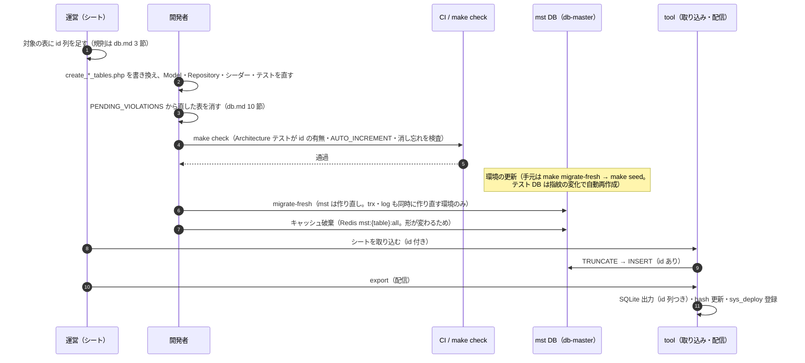
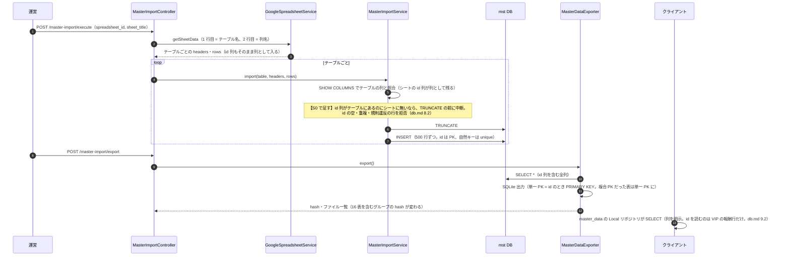
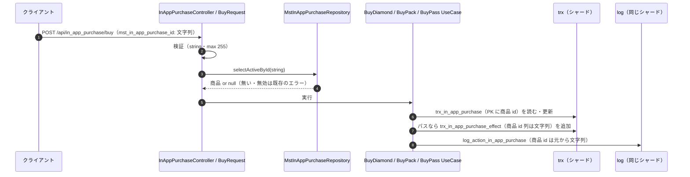

# mst 16 テーブルへの string id 導入 シーケンス設計（S0 のサーバー設計）

移行（マイグレーションの流れ）と、運営シートの取り込みから配信までの流れのうち、`id` が効く箇所だけを書く。短くてよい範囲。

- DB の設計・論点: [db.md](db.md)、API の変化: [api.md](api.md)
- 全体の流れ（畳み・採番・配信）は Nexus の `docs/design/master-distribution/overview.md` 5 節の図が正本。ここに写さない
- 凡例: 「読んだ」= コードを読んだだけ。実行はしていない

## 1. 移行の流れ（PR 1 本あたり。書き換え方式。db.md 6.1）

- **シートの `id` 列が先**。DB を新しい形にしてから `id` の無いシートを取り込むと、INSERT が失敗する。TRUNCATE が先に走っているので、その表は空のまま残る（db.md 8.1 の既存の穴。事前チェックで塞ぐ案がdb.md 12 節 4（決定））。
- 作り直せない環境は無い（db.md 12 節 1）ので、追加のマイグレーションは使わない（db.md 6.3 は不採用の代替案）。trx の購入履歴は `migrate-fresh` で消える。
- 手順 7 のキャッシュ破棄を忘れると、`queryOrMemory` が古い形（元の複合キーの鍵）の配列を TTL まで返す。

## 2. 運営シートの取り込みから配信まで（`id` が効く箇所）

- **`id` が効く箇所**: ①シートの 1 列目以降に `id` 列があること（`getSheetData` が列として拾う）②取り込みの検証（空・重複・規則違反）③DB の PK = `id`・自然キー = unique で、**行の一意が 2 重に守られる**（INSERT 時の重複は MySQL が拒否し、その表の取り込み全体が失敗する。TRUNCATE 後なので表は空になる。ここも既存の穴）④配信 SQLite の PK ⑤deploy_key 上乗せの畳み（`id` 単位で最大の `deploy_key` の行を採る）。⑤は deploy_key 上乗せの S2/S3 の範囲で、S0 は **畳みの鍵が存在する状態にする**ところまで。
- **S0 の後も `deploy_key` の扱いは変わらない**: 取り込みは今までどおり TRUNCATE + INSERT（畳みは S3）。S0 は列と PK だけを変える。
- 取り込みの拒否の粒度（テーブル単位で止める）と、`created_at`・`updated_at` の自動設定は現状のまま。

## 3. 買い切り・パスの購入で `id` が効く箇所（PR ④ の後）

`mst_in_app_purchase.id` が文字列になるので、購入の流れの識別子が変わる（API の入力は [api.md](api.md)）。

- 購入回数の制限（`trx_in_app_purchase`）は PK の `mst_in_app_purchase_id` で引く。**列は元から文字列**で、コードが `int` で比べていた（`===`）のを、文字列同士の比較に直す。直し忘れると、型の違いで「見つからない」→ 回数制限が効かなくなるので、PR ④ のテストで固定する（二重購入・上限・リセットの既存テストを文字列 id で通す）。
- 冪等キー（`_BaseBuyUseCase::generateUniqueRequestId` の `{sysPlayerId}_{id}_{transaction}`）は、`id` が文字列になって区切りの `_` を含みうる（`iap_diamond_100`）。連結の曖昧さが、同じプレイヤー・同じトランザクションで実害になるか（長さの上限も含めて）は**未確認**。PR ④ で確認する。
